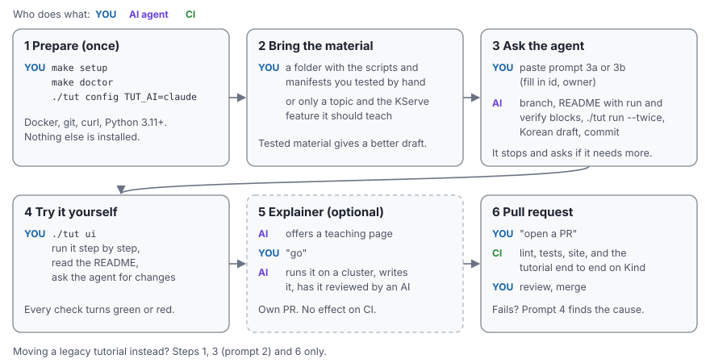

# Getting started: what you can do here, step by step

You write tutorials with an AI coding agent (Claude Code, Codex, Copilot)
started in a clone of this repository. You decide what the tutorial teaches
and check the result; the agent does the typing, runs the tutorial on a
cluster and follows the rules in [AGENTS.md](../AGENTS.md). The prompts to
copy are in [prompts.md](prompts.md); this page tells you which one to use and
what happens around it.

## What you can do

| You want to | You do | Prompt |
|---|---|---|
| move a tutorial from `Jooho/kserve-tutorials-legacy` | paste one prompt, wait, ask for the PR | [2. Migrate](prompts.md#2-migrate-a-tutorial) |
| write a new tutorial | see [below](#a-new-tutorial) | [3a](prompts.md#3a-new-tutorial-from-tested-work) or [3b](prompts.md#3b-new-tutorial-from-scratch) |
| add a teaching page with diagrams to a tutorial | say "make the explainer for <id>" | [5. Explainer](prompts.md#5-make-an-explainer) |
| translate a tutorial | say "bring the Korean translation of <id> up to date" | - |
| fix a failed CI run | paste the link of the failed run | [4. Fix a CI failure](prompts.md#4-fix-a-ci-failure) |

`<id>` is a tutorial's folder name under `tutorials/`; `./tut list` shows them
all. How to fill in the other `<...>` parts: [prompts.md](prompts.md#filling-in-the--parts).

## Before the first time

You install Docker (running, about 4 CPU / 16 GiB for it), git, curl and
Python 3.11+. Then, in the clone:

```bash skip
make setup                    # the toolkit, in .venv
make doctor                   # can this machine run tutorials?
./tut config TUT_AI=claude    # the AI CLI that ./tut uses for drafts (or codex, copilot)
```

## Moving a legacy tutorial

Straightforward: one prompt does it. Paste
[prompt 2](prompts.md#2-migrate-a-tutorial) with the legacy path, the new id,
the owner and the collection. The agent takes inventory, drafts, runs the
tutorial twice on a cluster, drafts the Korean translation and commits. It
stops and asks only when it needs something new (an environment, a shared
script, a GPU). Then you say "open a PR".

## A new tutorial



1. **Prepare** (once): the three commands above.
2. **Bring the material.** Best: a folder with the scripts, manifests and
   notes you tested by hand. The agent turns what you ran into the tutorial,
   so it starts from something that works. Without one, a topic is enough.
3. **Ask the agent.** Copy [3a](prompts.md#3a-new-tutorial-from-tested-work)
   (you have a folder) or [3b](prompts.md#3b-new-tutorial-from-scratch) (topic
   only) and fill in id, owner, collection, what the reader must learn and the
   level. For example:

   ```text
   ~/work/llmisvc-autoscaling contains scripts, manifests and notes I tested by
   hand. Turn them into a new tutorial.
   id: llmisvc-autoscaling, owner: <your GitHub login>, collection: llmisvc-deep-dive
   What the reader must learn: when and how an LLMInferenceService scales,
   and how to observe it
   Level: intermediate
   ... (rest of prompt 3a)
   ```

   With 3b the agent first shows you the outline and waits for your OK. Then
   it writes the README (every command a block that runs, every claim a check),
   runs it twice on a Kind cluster, drafts the Korean translation and commits.
4. **Try it yourself.** `./tut ui`, open the tutorial and run it step by step;
   every check turns green or red. Read it as a reader would. Ask the agent for
   changes in plain words ("step 3 needs a sentence on why", "split step 5").
5. **Explainer** (optional). The agent offers a teaching page with diagrams
   next to the tutorial. Say "go": it runs the tutorial on a cluster, writes the
   page and has another AI review it (15-30 min). It goes in its own PR and
   never affects CI. When you have read it: `./tut explain mark <id>`.
   More: [explainer.md](explainer.md).
6. **Pull request.** Say "open a PR". CI checks the rules and runs the tutorial
   end to end; you review and merge. If CI fails, give the agent the link
   ([prompt 4](prompts.md#4-fix-a-ci-failure)); it looks for the cause instead
   of re-running.

## Good to know

- The agent never opens a PR, merges or pushes to `stable` unless you ask.
- One tutorial per branch and per PR.
- A tutorial stays `draft` until CI has run it; `stable` comes later.
- Where things are explained: [authoring.md](authoring.md) (how a tutorial is
  written), [handbook.md](handbook.md) (how the repository works, for
  structural work).
