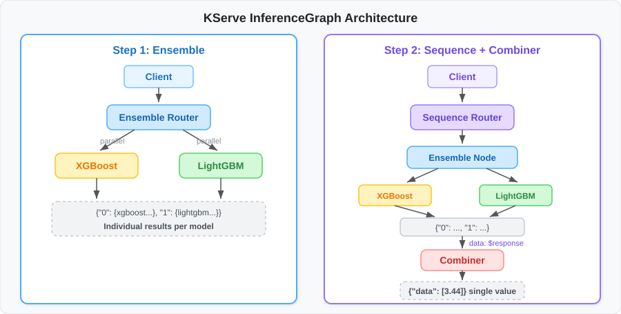
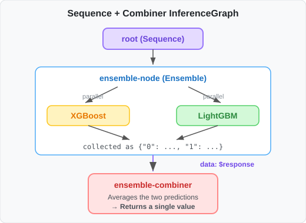

<!-- tut-translation source=README.md sha=480ccf440eb4 -->
# 두 모델의 예측을 하나로 묶는 InferenceGraph 앙상블과 결합기

<!-- tut:header -->

<!-- tutorial.yaml에서 `./tut sync`로 생성됨 — 직접 수정하지 마세요. -->
> **상태:** ✅ 안정 · **검증된 KServe:** v0.18.0 · **환경:** [`kind-kserve/v1`](../../envs/kind-kserve/v1/) · **GPU:** 불필요
>
> 🌐 [English](README.md)

<!-- /tut -->

California Housing 데이터셋으로 학습한 두 회귀 모델인 XGBoost와 LightGBM을
MLServer 런타임에서 실행되는 KServe InferenceService로 배포하고 **InferenceGraph**로
연결합니다. 먼저 `Ensemble` 라우터가 요청 하나를 두 모델에 보내고 두 응답을
모두 반환합니다. 이어서 `Sequence` 라우터가 두 응답을 작은 **결합기** 서비스에 전달하면 결합기 서비스가 평균을 내어 예측값 하나를 반환합니다.

> **핵심 질문** 클라이언트 쪽에서 요청을 여러 모델로 나눠 보내는 코드를 작성하지 않고도 어떻게
> 요청 하나를 여러 모델에 보내고 결과를 하나로 합쳐 받을 수 있습니까?

이 튜토리얼에서 다음 내용을 배웁니다.

- InferenceGraph는 여러 InferenceService 앞에 놓인 라우터입니다. 그래서 클라이언트는 요청을 한 번만 보냅니다.
- `Ensemble` 라우터는 요청 하나를 여러 모델에 보내고 모든 응답을 반환합니다.
- `Sequence` 라우터는 각 단계를 순서대로 실행하고 이전 단계의 출력(`$response`)을
  다음 단계에 전달합니다.
- `serviceUrl`로 호출하는 작은 맞춤형 결합기가 여러 예측값을 하나로 합치는
  방법을 살펴봅니다.
- 모델 파일을 PVC에 두고 MLServer 런타임에서 모델을 제공하는 방법을 살펴봅니다.

<a href="images/architecture.svg" target="_blank"></a>

그림을 클릭하면 원본 크기로 열립니다.

**로컬 환경 준비물** Docker가 실행 중이어야 하며, `curl`과 `venv` 모듈을
포함한 Python 3이 필요합니다. 0단계에서는 Kind 클러스터를 만들고 KServe를
표준 모드로 설치합니다(`kind-kserve/v1` 환경). 이 환경에는 `kind`와 `kubectl`이
포함됩니다.

## 0단계 환경 준비

`KSERVE_VERSION`과 네임스페이스(`$NS`, `kserve-graph-demo`)를 설정합니다.
KServe가 설치된 Kind 클러스터(InferenceService, 표준 모드)를 만들거나 기존
클러스터를 재사용한 뒤 튜토리얼 디렉터리로 이동합니다. 다시 실행해도 됩니다.

<!-- tut:setup -->

```bash run
# Generated from tutorial.yaml by `./tut sync` — do not edit by hand.
export KSERVE_VERSION="${KSERVE_VERSION:-v0.18.0}"
export NS="${NS:-kserve-graph-demo}"
export REPO_ROOT="$(git rev-parse --show-toplevel)"
source "$REPO_ROOT/tools/local-config.sh"   # your settings in .tut.env, if any
export TUT_LIB="$REPO_ROOT/lib"
# pinned CLI tools of the environment, for this shell only
export PATH="$REPO_ROOT/.tools/kind/v0.30.0:$REPO_ROOT/.tools/kubectl/v1.34.13:$REPO_ROOT/.tools/helm/v3.16.3:$REPO_ROOT/.tools/cloud-provider-kind/v0.12.0:$PATH"
# what this tutorial needs from the environment (env_options in tutorial.yaml)
TUT_ENV_TYPES=kserve TUT_ENV_MODE=standard TUT_ENV_KEDA=false "$REPO_ROOT/envs/kind-kserve/v1/setup.sh"
kubectl create namespace "$NS" --dry-run=client -o yaml | kubectl apply -f -
cd "$REPO_ROOT/tutorials/inferencegraph-ensemble"
```

<!-- /tut -->

## 1단계 ingress-nginx 설치 및 KServe 연동

`Host:` 헤더를 넣은 요청은 ingress-nginx 컨트롤러를 거쳐 InferenceGraph에
도달합니다. Kind용 컨트롤러는 `ingress-ready=true` 레이블이 붙은 노드에서
실행됩니다.

```bash run
INGRESS_NGINX_VERSION="${INGRESS_NGINX_VERSION:-v1.11.3}"
kubectl label node -l node-role.kubernetes.io/control-plane ingress-ready=true --overwrite
kubectl apply -f https://raw.githubusercontent.com/kubernetes/ingress-nginx/controller-${INGRESS_NGINX_VERSION}/deploy/static/provider/kind/deploy.yaml
kubectl -n ingress-nginx rollout status deployment/ingress-nginx-controller --timeout=300s
```

컨트롤러 Pod가 준비될 때까지 기다립니다. 새 클러스터에서는 약 1분이 걸립니다.

```bash verify
kubectl wait --namespace ingress-nginx \
  --for=condition=ready pod \
  --selector=app.kubernetes.io/component=controller \
  --timeout=300s
```

모델은 `standard` StorageClass를 사용하는 PersistentVolumeClaim에 저장합니다.
Kind는 local-path 프로비저너를 사용하는 StorageClass를 기본으로 제공합니다.
두 번째 줄은 사용 중인 Kind 버전에서 이 StorageClass의 이름이 `local-path`인
경우에만 이름을 바꿉니다.

```bash run
kubectl get storageclass standard >/dev/null 2>&1 || \
    kubectl patch storageclass local-path -p '{"metadata": {"name":"standard"}}'
kubectl get storageclass
```

KServe의 기본 설정에는 ingress-nginx가 지정되어 있지 않습니다.
`inferenceservice-config` ConfigMap의 `ingress` 섹션에서 `ingressClassName`을
`nginx`로, 도메인을 `127.0.0.1.sslip.io`로 설정합니다. 컨트롤러가 새 설정값을
읽도록 다시 시작합니다.

```bash run
kubectl get cm inferenceservice-config -n kserve -o json | \
    python3 -c "
import sys, json
cm = json.load(sys.stdin)
ingress = json.loads(cm['data']['ingress'])
ingress['ingressClassName'] = 'nginx'
ingress['ingressDomain'] = '127.0.0.1.sslip.io'
cm['data']['ingress'] = json.dumps(ingress)
json.dump(cm, sys.stdout)
" | kubectl apply -f -
kubectl rollout restart deployment/kserve-controller-manager -n kserve
kubectl rollout status deployment/kserve-controller-manager -n kserve --timeout=120s
```

InferenceService와 InferenceGraph CRD가 등록되고, MLServer 런타임이 XGBoost와
LightGBM 모델을 제공할 수 있으며, 인그레스 설정이 적용되면 KServe를 사용할
준비가 끝납니다.

```bash verify
kubectl wait --for=condition=Established crd/inferenceservices.serving.kserve.io crd/inferencegraphs.serving.kserve.io --timeout=120s
formats=$(kubectl get clusterservingruntime kserve-mlserver -o jsonpath='{.spec.supportedModelFormats[*].name}')
echo "kserve-mlserver formats: $formats"
echo "$formats" | grep -qw xgboost
echo "$formats" | grep -qw lightgbm
kubectl get cm inferenceservice-config -n kserve -o jsonpath='{.data.ingress}' \
  | python3 -c 'import json, sys; c = json.load(sys.stdin); assert c["ingressClassName"] == "nginx", c'
```

## 2단계 네임스페이스 생성

```bash run
kubectl create namespace "$NS" --dry-run=client -o yaml | kubectl apply -f -
```

## 3단계 두 모델 학습

`scripts/train.py`는 California Housing 데이터셋을 내려받습니다. 입력 특성은
수치형 8개이고, 예측 대상은 10만 달러 단위로 표시한 주택 가격 중앙값입니다.
스크립트는 XGBoost와 LightGBM 회귀 모델을 학습하고 각 모델을 MLServer용
`model-settings.json`과 함께 `models/<name>/`에 저장합니다. Python 패키지는
캐시 디렉터리의 가상 환경에만 설치합니다. 모델 디렉터리가 둘 다 있으면 학습을
건너뜁니다.

```bash run
VENV="${TUT_CACHE:-$HOME/.cache/kserve-tutorials}/venv-inferencegraph-ensemble"
if [ ! -d "models/xgboost-predictor" ] || [ ! -d "models/lightgbm-predictor" ]; then
  python3 -m venv "$VENV"
  (
    . "$VENV/bin/activate"
    pip install -r requirements.txt
    python3 scripts/train.py
  )
fi
ls -R models/
```

<details>
<summary>scripts/train.py</summary>

<!-- tut:include scripts/train.py -->

```python
#!/usr/bin/env python3
"""
California Housing Price Prediction Model Training Script

This script trains two models for a KServe InferenceGraph demo:
1. XGBoost regression model
2. LightGBM regression model
"""

import json
import numpy as np
from pathlib import Path
from sklearn.datasets import fetch_california_housing
from sklearn.model_selection import train_test_split
from sklearn.metrics import mean_squared_error, r2_score
import xgboost as xgb
import lightgbm as lgb


def create_model_settings(name, implementation, uri):
    """Create MLServer model-settings.json file"""
    settings = {
        "name": name,
        "implementation": implementation,
        "parameters": {
            "uri": uri
        }
    }
    return settings


def main():
    print("=" * 80)
    print("California Housing Price Prediction - Model Training")
    print("=" * 80)

    # Set random seed for reproducibility
    RANDOM_STATE = 42
    np.random.seed(RANDOM_STATE)

    # Load dataset
    print("\n[1/4] Loading California Housing dataset...")
    housing = fetch_california_housing(as_frame=True)
    X, y = housing.data, housing.target

    print(f"   - Dataset shape: {X.shape}")
    print(f"   - Features: {list(X.columns)}")
    print(f"   - Target: Median house value (in $100,000s)")

    # Split data
    print("\n[2/4] Splitting data (80% train, 20% test)...")
    X_train, X_test, y_train, y_test = train_test_split(
        X, y, test_size=0.2, random_state=RANDOM_STATE
    )
    print(f"   - Train set: {X_train.shape[0]} samples")
    print(f"   - Test set: {X_test.shape[0]} samples")

    # =========================================================================
    # Model 1: XGBoost Regressor
    # =========================================================================
    print("\n[3/4] Training XGBoost regression model...")
    xgb_model = xgb.XGBRegressor(
        n_estimators=100,
        max_depth=6,
        learning_rate=0.1,
        random_state=RANDOM_STATE,
        n_jobs=-1
    )
    xgb_model.fit(X_train, y_train)

    # Evaluate
    y_pred_xgb = xgb_model.predict(X_test)
    xgb_mse = mean_squared_error(y_test, y_pred_xgb)
    xgb_r2 = r2_score(y_test, y_pred_xgb)
    print(f"   - XGBoost MSE: {xgb_mse:.4f}")
    print(f"   - XGBoost R²: {xgb_r2:.4f}")

    # Save XGBoost model
    xgboost_dir = Path("models/xgboost-predictor")
    xgboost_dir.mkdir(parents=True, exist_ok=True)

    # Save in JSON format
    xgb_model.get_booster().save_model(str(xgboost_dir / "model.json"))

    settings = create_model_settings(
        name="xgboost-predictor",
        implementation="mlserver_xgboost.XGBoostModel",
        uri="./model.json"
    )
    with open(xgboost_dir / "model-settings.json", "w") as f:
        json.dump(settings, f, indent=2)

    print(f"   ✓ Saved to {xgboost_dir}")

    # =========================================================================
    # Model 2: LightGBM Regressor
    # =========================================================================
    print("\n[4/4] Training LightGBM regression model...")
    lgb_model = lgb.LGBMRegressor(
        n_estimators=100,
        max_depth=6,
        learning_rate=0.1,
        random_state=RANDOM_STATE,
        n_jobs=-1,
        verbose=-1
    )
    lgb_model.fit(X_train, y_train)

    # Evaluate
    y_pred_lgb = lgb_model.predict(X_test)
    lgb_mse = mean_squared_error(y_test, y_pred_lgb)
    lgb_r2 = r2_score(y_test, y_pred_lgb)
    print(f"   - LightGBM MSE: {lgb_mse:.4f}")
    print(f"   - LightGBM R²: {lgb_r2:.4f}")

    # Save LightGBM model
    lightgbm_dir = Path("models/lightgbm-predictor")
    lightgbm_dir.mkdir(parents=True, exist_ok=True)

    lgb_model.booster_.save_model(str(lightgbm_dir / "model.bst"))

    settings = create_model_settings(
        name="lightgbm-predictor",
        implementation="mlserver_lightgbm.LightGBMModel",
        uri="./model.bst"
    )
    with open(lightgbm_dir / "model-settings.json", "w") as f:
        json.dump(settings, f, indent=2)

    print(f"   ✓ Saved to {lightgbm_dir}")

    # =========================================================================
    # Summary
    # =========================================================================
    print("\n" + "=" * 80)
    print("Training Summary")
    print("=" * 80)
    print(f"XGBoost    - MSE: {xgb_mse:.4f}, R²: {xgb_r2:.4f}")
    print(f"LightGBM   - MSE: {lgb_mse:.4f}, R²: {lgb_r2:.4f}")
    print("\n✓ All models trained and saved successfully!")
    print("\nModel directories:")
    print("  - models/xgboost-predictor/")
    print("  - models/lightgbm-predictor/")
    print("=" * 80)

    # Save sample test data for demo
    sample_data = {
        "feature_names": list(X.columns),
        "sample_input": X_test.iloc[0].to_dict(),
        "expected_output": float(y_test.iloc[0])
    }

    with open("data/sample_data.json", "w") as f:
        json.dump(sample_data, f, indent=2)

    print("\n✓ Sample test data saved to data/sample_data.json")


if __name__ == "__main__":
    main()
```

<!-- /tut -->

</details>

각 모델 디렉터리에는 모델 파일과 모델 이름 및 구현을 지정하는 MLServer 설정
파일이 들어 있습니다.

```bash verify
test -s models/xgboost-predictor/model.json
test -s models/lightgbm-predictor/model.bst
grep -q '"mlserver_xgboost.XGBoostModel"' models/xgboost-predictor/model-settings.json
grep -q '"mlserver_lightgbm.LightGBMModel"' models/lightgbm-predictor/model-settings.json
```

## 4단계 결합기 빌드 및 Kind에 이미지 로드

결합기는 V2 추론 프로토콜을 사용하는 작은 FastAPI 앱입니다. `Ensemble`의
출력(`{"0": {...}, "1": {...}}`)을 받아 각 모델의 `outputs`에서 첫 번째 값을
꺼낸 뒤 평균을 반환합니다.

<details>
<summary>combiner/app.py와 combiner/Dockerfile</summary>

<!-- tut:include combiner/app.py -->

```python
"""
Ensemble Combiner Service for KServe InferenceGraph.

Receives the ensemble output (parallel model results) and averages the predictions.

Input format (from Ensemble router):
{
  "0": {"model_name": "xgboost-predictor", "outputs": [{"data": [2.73], ...}]},
  "1": {"model_name": "lightgbm-predictor", "outputs": [{"data": [4.15], ...}]}
}

Output format (V2 Inference Protocol):
{
  "model_name": "ensemble-combiner",
  "outputs": [{"name": "predict", "shape": [1, 1], "datatype": "FP64", "data": [3.44]}]
}
"""

import uuid
import logging
from fastapi import FastAPI, Request
from fastapi.responses import JSONResponse

logging.basicConfig(level=logging.INFO)
logger = logging.getLogger("combiner")

app = FastAPI()


@app.get("/v2/health/ready")
async def health():
    return JSONResponse({"ready": True})


def _average_predictions(body: dict) -> float:
    """Extract and average predictions from ensemble output."""
    logger.info("Received body: %s", body)
    predictions = []
    for key in sorted(body.keys()):
        step = body[key]
        if isinstance(step, dict) and "outputs" in step:
            value = step["outputs"][0]["data"][0]
            predictions.append(float(value))
    logger.info("Extracted predictions: %s", predictions)
    return sum(predictions) / len(predictions) if predictions else 0.0


@app.post("/v2/models/ensemble-combiner/infer")
async def infer_v2(request: Request):
    body = await request.json()
    avg = _average_predictions(body)
    return JSONResponse({
        "id": str(uuid.uuid4()),
        "model_name": "ensemble-combiner",
        "outputs": [
            {
                "name": "predict",
                "shape": [1, 1],
                "datatype": "FP64",
                "data": [avg],
            }
        ],
    })


if __name__ == "__main__":
    import uvicorn
    uvicorn.run(app, host="0.0.0.0", port=8080)
```

<!-- /tut -->

<!-- tut:include combiner/Dockerfile -->

```dockerfile
FROM python:3.11-slim

WORKDIR /app

RUN pip install --no-cache-dir fastapi uvicorn

COPY app.py .

CMD ["uvicorn", "app:app", "--host", "0.0.0.0", "--port", "8080"]
```

<!-- /tut -->

</details>

결합기 이미지를 빌드해 Kind 노드에 로드합니다. InferenceService에
`imagePullPolicy: Never`를 설정하므로 이미지가 노드에 미리 있어야 합니다.
MLServer 이미지는 크기 때문에 미리 로드해 두면 예측기가 시작할 때 이미지를
내려받느라 오래 기다리지 않아도 됩니다.

```bash run
CLUSTER_NAME="${KIND_CLUSTER_NAME:-kind}"   # 이 환경에서 사용하는 클러스터
COMBINER_IMAGE="${COMBINER_IMAGE:-ensemble-combiner:v1}"
MLSERVER_IMAGE="${MLSERVER_IMAGE:-docker.io/seldonio/mlserver:1.5.0}"
docker build -t ${COMBINER_IMAGE} combiner/
kind load docker-image ${COMBINER_IMAGE} --name ${CLUSTER_NAME}
docker pull ${MLSERVER_IMAGE}
kind load docker-image ${MLSERVER_IMAGE} --name ${CLUSTER_NAME}
```

```bash verify
CLUSTER_NAME="${KIND_CLUSTER_NAME:-kind}"   # 이 환경에서 사용하는 클러스터
# grep에 -q를 붙이지 않습니다. pipefail이 설정된 상태에서 -q를 쓰면 grep이 입력을 끝까지 읽지 않아 crictl이 SIGPIPE로 종료됩니다(종료 코드 141).
docker exec "${CLUSTER_NAME}-control-plane" crictl images | grep 'ensemble-combiner' >/dev/null
```

## 5단계 PVC에 모델 저장

InferenceService는 `pvc://model-pvc/<name>`에서 모델을 불러옵니다. PVC를
생성합니다. local-path 프로비저너가 처음 사용할 때 볼륨을 바인딩하므로 Pod가
PVC를 마운트하기 전까지 `Pending`으로 표시되는 것이 정상입니다.

```bash run
kubectl apply -f manifests/pvc.yaml
kubectl get pvc/model-pvc -n "$NS"
```

<details>
<summary>manifests/pvc.yaml</summary>

<!-- tut:include manifests/pvc.yaml -->

```yaml
apiVersion: v1
kind: PersistentVolumeClaim
metadata:
  name: model-pvc
  namespace: kserve-graph-demo
spec:
  accessModes:
    - ReadWriteOnce
  resources:
    requests:
      storage: 1Gi
  storageClassName: standard
```

<!-- /tut -->

</details>

PVC를 마운트하는 임시 Pod를 실행하고 각 모델 디렉터리를 이 Pod에 복사합니다.

```bash run
kubectl apply -f manifests/model-upload-helper.yaml
kubectl wait --for=condition=Ready pod/model-upload-helper -n "$NS" --timeout=180s
for model_dir in models/*/; do
    model_name=$(basename ${model_dir})
    kubectl cp ${model_dir} ${NS}/model-upload-helper:/mnt/models/${model_name}
done
kubectl exec -n "$NS" model-upload-helper -- ls -R /mnt/models/
```

<details>
<summary>manifests/model-upload-helper.yaml</summary>

<!-- tut:include manifests/model-upload-helper.yaml -->

```yaml
apiVersion: v1
kind: Pod
metadata:
  name: model-upload-helper
  namespace: kserve-graph-demo
spec:
  containers:
  - name: uploader
    image: busybox:1.36
    command: ["sleep", "3600"]
    volumeMounts:
    - name: model-storage
      mountPath: /mnt/models
  volumes:
  - name: model-storage
    persistentVolumeClaim:
      claimName: model-pvc
  restartPolicy: Never
```

<!-- /tut -->

</details>

두 모델이 모두 볼륨에 있는지 확인합니다.

```bash verify
kubectl exec -n "$NS" model-upload-helper -- test -s /mnt/models/xgboost-predictor/model.json
kubectl exec -n "$NS" model-upload-helper -- test -s /mnt/models/xgboost-predictor/model-settings.json
kubectl exec -n "$NS" model-upload-helper -- test -s /mnt/models/lightgbm-predictor/model.bst
kubectl exec -n "$NS" model-upload-helper -- test -s /mnt/models/lightgbm-predictor/model-settings.json
```

이제 임시 Pod가 필요 없으므로 삭제합니다.

```bash run
kubectl delete pod model-upload-helper -n "$NS" --force --grace-period=0 --ignore-not-found
```

## 6단계 InferenceService 3개 배포

두 예측기는 `kserve-mlserver` 런타임에서 PVC에 저장한 모델을 사용하고,
결합기는 맞춤형 컨테이너에서 실행합니다. 세 InferenceService 모두 Knative
없이 일반 Deployment와 Service로 실행하는 `RawDeployment` 모드를 사용합니다.

```bash run
kubectl apply -f manifests/inferenceservices/xgboost-predictor.yaml
kubectl apply -f manifests/inferenceservices/lightgbm-predictor.yaml
kubectl apply -f manifests/inferenceservices/ensemble-combiner.yaml
```

<details>
<summary>manifests/inferenceservices/*.yaml</summary>

<!-- tut:include manifests/inferenceservices/xgboost-predictor.yaml -->

```yaml
apiVersion: serving.kserve.io/v1beta1
kind: InferenceService
metadata:
  name: xgboost-predictor
  namespace: kserve-graph-demo
  annotations:
    serving.kserve.io/deploymentMode: RawDeployment
spec:
  predictor:
    model:
      modelFormat:
        name: xgboost
      runtime: kserve-mlserver
      storageUri: pvc://model-pvc/xgboost-predictor
```

<!-- /tut -->

<!-- tut:include manifests/inferenceservices/lightgbm-predictor.yaml -->

```yaml
apiVersion: serving.kserve.io/v1beta1
kind: InferenceService
metadata:
  name: lightgbm-predictor
  namespace: kserve-graph-demo
  annotations:
    serving.kserve.io/deploymentMode: RawDeployment
spec:
  predictor:
    model:
      modelFormat:
        name: lightgbm
      runtime: kserve-mlserver
      storageUri: pvc://model-pvc/lightgbm-predictor
```

<!-- /tut -->

<!-- tut:include manifests/inferenceservices/ensemble-combiner.yaml -->

```yaml
apiVersion: serving.kserve.io/v1beta1
kind: InferenceService
metadata:
  name: ensemble-combiner
  namespace: kserve-graph-demo
  annotations:
    serving.kserve.io/deploymentMode: RawDeployment
spec:
  predictor:
    containers:
      - name: combiner
        image: ensemble-combiner:v1
        imagePullPolicy: Never
        ports:
          - containerPort: 8080
            protocol: TCP
```

<!-- /tut -->

</details>

세 InferenceService가 모두 `Ready` 상태가 될 때까지 기다립니다. CPU로
실행하면 몇 분 정도 걸립니다.

```bash verify
kubectl wait --for=condition=Ready isvc/xgboost-predictor isvc/lightgbm-predictor isvc/ensemble-combiner -n "$NS" --timeout=600s
```

```bash run
kubectl get isvc -n "$NS"
```

## 7단계 `Ensemble`만 사용해 요청 하나로 응답 두 개 받기

`Ensemble` 라우터는 **모든 단계에 같은 입력을 병렬로 전달**하고, 단계
인덱스를 키로 사용해 모든 결과를 반환합니다.

```text
root (Ensemble)
  ├→ xgboost-predictor  (parallel)
  └→ lightgbm-predictor (parallel)
```

```bash run
kubectl apply -f manifests/inferencegraph/ensemble-only.yaml
kubectl apply -f manifests/ingress/housing-price-ingress.yaml
```

<details>
<summary>manifests/inferencegraph/ensemble-only.yaml과 manifests/ingress/housing-price-ingress.yaml</summary>

<!-- tut:include manifests/inferencegraph/ensemble-only.yaml -->

```yaml
apiVersion: serving.kserve.io/v1alpha1
kind: InferenceGraph
metadata:
  name: housing-price-graph
  namespace: kserve-graph-demo
  annotations:
    serving.kserve.io/deploymentMode: RawDeployment
spec:
  nodes:
    root:
      routerType: Ensemble
      steps:
        - serviceName: xgboost-predictor
        - serviceName: lightgbm-predictor
```

<!-- /tut -->

<!-- tut:include manifests/ingress/housing-price-ingress.yaml -->

```yaml
apiVersion: networking.k8s.io/v1
kind: Ingress
metadata:
  name: housing-price-graph-ingress
  namespace: kserve-graph-demo
spec:
  ingressClassName: nginx
  rules:
  - host: housing-price-graph.127.0.0.1.sslip.io
    http:
      paths:
      - path: /
        pathType: Prefix
        backend:
          service:
            name: housing-price-graph
            port:
              number: 80
```

<!-- /tut -->

</details>

InferenceGraph 컨트롤러는 그래프와 이름이 같은 Deployment에서 라우터를
실행합니다. 그래프에는 InferenceService와 같은 `RawDeployment` 어노테이션을
지정합니다. 이 어노테이션을 생략하면 클러스터의 기본 모드가 적용됩니다. 기본
모드가 Knative인 클러스터에서는 그래프가 거부됩니다. Ingress는
`housing-price-graph.127.0.0.1.sslip.io`로 들어온 요청을 그래프의 Service로
보냅니다.

```bash verify
kubectl wait --for=condition=Ready ig/housing-price-graph -n "$NS" --timeout=300s
kubectl rollout status deployment/housing-price-graph -n "$NS" --timeout=300s
```

`localhost:8080`에서 ingress-nginx에 접속할 수 있도록 백그라운드에서 포트
포워딩을 실행합니다. 이전 실행에서 시작한 포트 포워딩이 있으면 먼저 종료합니다.

```bash run
pkill -f "[p]ort-forward -n ingress-nginx svc/ingress-nginx-controller 8080:80" || true
kubectl port-forward -n ingress-nginx svc/ingress-nginx-controller 8080:80 > /dev/null 2>&1 &
```

캘리포니아의 한 구역에 해당하는 특성값 8개를 담은 요청을 한 번 보냅니다
(`data/inference_request.json`). 응답에는 모델별로 항목이 하나씩 들어 있습니다.
`"0"`은 XGBoost, `"1"`은 LightGBM의 결과입니다. 다음 단계에서 비교할 수
있도록 응답을 저장합니다.

```bash verify retry=12 delay=5
curl -sf -X POST \
  -H "Content-Type: application/json" \
  -H "Host: housing-price-graph.127.0.0.1.sslip.io" \
  -d @data/inference_request.json \
  http://localhost:8080/v2/models/housing-price-graph/infer \
  -o "${TMPDIR:-/tmp}/inferencegraph-ensemble.json"
python3 -c '
import json, sys
r = json.load(open(sys.argv[1]))
print(json.dumps(r, indent=2))
assert {r["0"]["model_name"], r["1"]["model_name"]} == {"xgboost-predictor", "lightgbm-predictor"}, r
' "${TMPDIR:-/tmp}/inferencegraph-ensemble.json"
```

두 모델의 예측값은 서로 다릅니다. 작성자가 실행했을 때는 XGBoost가 약 2.74,
LightGBM이 약 4.16이었습니다. 클라이언트는 두 값을 모두 받아 어떻게 사용할지
결정해야 합니다.

## 8단계 `Sequence`와 결합기로 요청 하나에 응답 하나 받기

서버에서 결과를 합치려면 앙상블을 `Sequence`로 감쌉니다.

1. 첫 번째 단계는 앞에서 사용한 것과 같은 `Ensemble`인 `ensemble-node`를
   실행합니다.
2. 두 번째 단계는 결합기를 호출합니다. `data: $response`는 결합기에
   **이전 단계의 출력**을 전달합니다. 이 설정을 생략하면 결합기는 원래 요청을
   받습니다. `serviceUrl`은 결합기의 V2 엔드포인트를 직접 가리킵니다.

<a href="images/inferencegraph.svg" target="_blank"></a>

```bash run
kubectl apply -f manifests/inferencegraph/housing-price-graph.yaml
```

<details>
<summary>manifests/inferencegraph/housing-price-graph.yaml</summary>

<!-- tut:include manifests/inferencegraph/housing-price-graph.yaml -->

```yaml
apiVersion: serving.kserve.io/v1alpha1
kind: InferenceGraph
metadata:
  name: housing-price-graph
  namespace: kserve-graph-demo
  annotations:
    serving.kserve.io/deploymentMode: RawDeployment
spec:
  nodes:
    # Root node - sequence: ensemble → combiner
    root:
      routerType: Sequence
      steps:
        - nodeName: ensemble-node
        - serviceUrl: http://ensemble-combiner-predictor.kserve-graph-demo.svc.cluster.local/v2/models/ensemble-combiner/infer
          data: $response
    # Ensemble node - parallel prediction from both models
    ensemble-node:
      routerType: Ensemble
      steps:
        - serviceName: xgboost-predictor
        - serviceName: lightgbm-predictor
```

<!-- /tut -->

</details>

라우터 Deployment가 새 그래프로 롤아웃됩니다. 롤아웃이 끝날 때까지 기다립니다.

```bash verify
kubectl rollout status deployment/housing-price-graph -n "$NS" --timeout=300s
```

같은 요청을 다시 보냅니다. 이번에는 `ensemble-combiner`가 7단계에서 본 것과 같은 두 예측값을 평균 내어 응답합니다. 이전 라우터 Pod가 여전히 응답하는 동안에는
검증을 재시도합니다.

```bash verify retry=12 delay=5
curl -sf -X POST \
  -H "Content-Type: application/json" \
  -H "Host: housing-price-graph.127.0.0.1.sslip.io" \
  -d @data/inference_request.json \
  http://localhost:8080/v2/models/housing-price-graph/infer \
  -o "${TMPDIR:-/tmp}/inferencegraph-combined.json"
python3 -c '
import json, sys
ens = json.load(open(sys.argv[1]))
out = json.load(open(sys.argv[2]))
print(json.dumps(out, indent=2))
assert out["model_name"] == "ensemble-combiner", out
preds = [float(ens[k]["outputs"][0]["data"][0]) for k in ("0", "1")]
avg = float(out["outputs"][0]["data"][0])
print("xgboost, lightgbm:", preds, "-> combined:", avg)
assert abs(avg - sum(preds) / 2) < 1e-4, (preds, avg)
' "${TMPDIR:-/tmp}/inferencegraph-ensemble.json" "${TMPDIR:-/tmp}/inferencegraph-combined.json"
```

| 그래프 구성 | 응답 | 클라이언트 후처리 |
|---|---|---|
| `Ensemble`만 사용 | `{"0": {...}, "1": {...}}` | 각 모델의 결과를 사용하거나 서로 비교합니다. |
| `Sequence`와 결합기 사용 | `{"outputs": [{"data": [<average>]}]}` | 결과값 하나를 바로 사용합니다. |

`combiner/app.py`의 `_average_predictions`에서 평균을 계산합니다. 이 함수를
가중 평균이나 최댓값을 반환하도록 바꾸면 그래프 수정 없이 결합 방식을 바꿀 수
있습니다.

## 정리

포트 포워딩을 종료하고 튜토리얼에서 클러스터에 생성한 그래프, Ingress,
InferenceService, PVC, 네임스페이스를 모두 삭제합니다.

```bash cleanup
pkill -f "[p]ort-forward -n ingress-nginx svc/ingress-nginx-controller 8080:80" || true
kubectl delete -f manifests/inferencegraph/housing-price-graph.yaml --ignore-not-found=true
kubectl delete -f manifests/ingress/housing-price-ingress.yaml --ignore-not-found=true
kubectl delete -f manifests/inferenceservices/ --ignore-not-found=true
kubectl delete -f manifests/pvc.yaml --ignore-not-found=true
kubectl delete namespace "$NS" --ignore-not-found
rm -f "${TMPDIR:-/tmp}/inferencegraph-ensemble.json" "${TMPDIR:-/tmp}/inferencegraph-combined.json"
```

ingress-nginx와 KServe가 설치된 Kind 클러스터는 남겨 두므로 이 튜토리얼이나 다른 튜토리얼을 빠르게 다시 실행할 수 있습니다. 작업이 끝나면 클러스터를 삭제합니다.

```bash skip
"$REPO_ROOT/envs/kind-kserve/v1/teardown.sh"
```

## 배운 내용

- **`Ensemble`** 라우터는 요청 하나를 여러 InferenceService에 병렬로 보내고
  모든 결과를 `"0"`, `"1"` 등의 키로 구분해 반환합니다.
- **`Sequence`** 라우터는 각 단계를 순서대로 실행합니다. `data: $response`를
  설정하면 이전 단계의 출력을 다음 단계에 전달합니다.
- `serviceUrl`을 사용하면 InferenceService 이름을 지정하는 대신 특정
  엔드포인트를 직접 호출합니다. 여기서는 결합기의 V2 경로를 호출합니다.
- 작은 맞춤형 결합기를 사용하면 서버에서 여러 모델의 출력을 응답 하나로 합칠
  수 있습니다.

## 참고 자료

- [KServe InferenceGraph 예제](https://github.com/kserve/kserve/tree/master/docs/samples/graph)
- [MLServer 문서](https://mlserver.readthedocs.io/)
