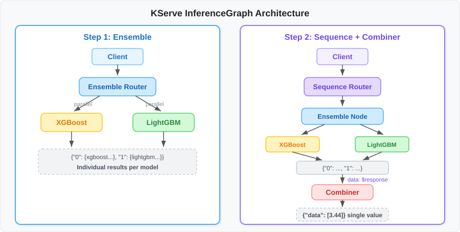
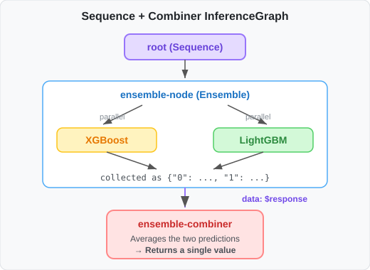

# Two Models, One Answer — InferenceGraph Ensemble and Combiner

<!-- tut:header -->

<!-- Generated from tutorial.yaml by `./tut sync` — do not edit by hand. -->
> **Status:** ✅ stable · **Tested with KServe:** v0.18.0, v0.20.0 · **Environment:** [`kind-kserve/v1`](../../envs/kind-kserve/v1/) · **GPU:** not required
>
> 🌐 [한국어](README.ko.md)

<!-- /tut -->

You deploy two regression models (XGBoost and LightGBM, trained on the
California Housing dataset) as KServe InferenceServices on the MLServer
runtime, and connect them with an **InferenceGraph**. First an `Ensemble`
router sends one request to both models and returns both answers. Then a
`Sequence` router feeds those answers into a small **combiner** service that
returns their average as a single prediction.

> **Key question:** how do you send one request to several models and get
> back one combined answer, without writing a client-side fan-out?

What you will learn:

- What an InferenceGraph is: a router in front of InferenceServices, so the
  client sends one request.
- What an `Ensemble` router does: one request to several models, every answer
  back.
- What a `Sequence` router does: steps in a row, each step getting the previous
  output (`$response`).
- How a small custom combiner, called by `serviceUrl`, turns several
  predictions into one.
- How the models are served: the MLServer runtime, with the model files on a
  PVC.

<a href="images/architecture.svg" target="_blank"></a>

Click a picture to open it at full size.

**What you need on your machine:** Docker (running), `curl` and Python 3 with
the `venv` module. Step 0 creates the Kind cluster and installs KServe in
standard mode (environment `kind-kserve/v1`); `kind` and `kubectl` come with it.

## Step 0: Environment

This sets `KSERVE_VERSION` and the namespace (`$NS`, `kserve-graph-demo`),
creates the Kind cluster with KServe (InferenceService, standard mode) or reuses
it, and moves into the tutorial directory. It is safe to run again.

<!-- tut:setup -->

```bash run
# Generated from tutorial.yaml by `./tut sync` — do not edit by hand.
export KSERVE_VERSION="${KSERVE_VERSION:-v0.18.0}"
export NS="${NS:-kserve-graph-demo}"
export REPO_ROOT="$(git rev-parse --show-toplevel)"
source "$REPO_ROOT/tools/local-config.sh"   # your settings in .tut.env, if any
export TUT_LIB="$REPO_ROOT/lib"
# pinned CLI tools of the environment, for this shell only
export PATH="$REPO_ROOT/.tools/kind/v0.30.0:$REPO_ROOT/.tools/kubectl/v1.34.13:$REPO_ROOT/.tools/helm/v3.16.3:$REPO_ROOT/.tools/cloud-provider-kind/v0.12.0:$PATH"
# what this tutorial needs from the environment (env_options in tutorial.yaml)
TUT_ENV_TYPES=kserve TUT_ENV_MODE=standard TUT_ENV_KEDA=false "$REPO_ROOT/envs/kind-kserve/v1/setup.sh"
kubectl create namespace "$NS" --dry-run=client -o yaml | kubectl apply -f -
cd "$REPO_ROOT/tutorials/inferencegraph-ensemble"
```

<!-- /tut -->

## Step 1: ingress-nginx, and KServe pointed at it

The InferenceGraph will be reached through the ingress-nginx controller with a
`Host:` header. Its Kind flavour runs on the node labelled `ingress-ready=true`.

```bash run
INGRESS_NGINX_VERSION="${INGRESS_NGINX_VERSION:-v1.11.3}"
kubectl label node -l node-role.kubernetes.io/control-plane ingress-ready=true --overwrite
kubectl apply -f https://raw.githubusercontent.com/kubernetes/ingress-nginx/controller-${INGRESS_NGINX_VERSION}/deploy/static/provider/kind/deploy.yaml
kubectl -n ingress-nginx rollout status deployment/ingress-nginx-controller --timeout=300s
```

The controller Pod must be ready (about a minute on a fresh cluster):

```bash verify
kubectl wait --namespace ingress-nginx \
  --for=condition=ready pod \
  --selector=app.kubernetes.io/component=controller \
  --timeout=300s
```

The models will live on a PersistentVolumeClaim with the `standard`
StorageClass. Kind ships one (local-path provisioner); the second line only
renames it if your Kind version calls it `local-path`.

```bash run
kubectl get storageclass standard >/dev/null 2>&1 || \
    kubectl patch storageclass local-path -p '{"metadata": {"name":"standard"}}'
kubectl get storageclass
```

By default KServe does not know about ingress-nginx. Set `ingressClassName`
to `nginx` and the domain to `127.0.0.1.sslip.io` in the `ingress` section of
the `inferenceservice-config` ConfigMap, then restart the controller so it
reads the new values.

```bash run
kubectl get cm inferenceservice-config -n kserve -o json | \
    python3 -c "
import sys, json
cm = json.load(sys.stdin)
ingress = json.loads(cm['data']['ingress'])
ingress['ingressClassName'] = 'nginx'
ingress['ingressDomain'] = '127.0.0.1.sslip.io'
cm['data']['ingress'] = json.dumps(ingress)
json.dump(cm, sys.stdout)
" | kubectl apply -f -
kubectl rollout restart deployment/kserve-controller-manager -n kserve
kubectl rollout status deployment/kserve-controller-manager -n kserve --timeout=120s
```

KServe is ready when the InferenceService and InferenceGraph CRDs are
established, the MLServer runtime can serve XGBoost and LightGBM, and the
ingress settings are in place:

```bash verify
kubectl wait --for=condition=Established crd/inferenceservices.serving.kserve.io crd/inferencegraphs.serving.kserve.io --timeout=120s
formats=$(kubectl get clusterservingruntime kserve-mlserver -o jsonpath='{.spec.supportedModelFormats[*].name}')
echo "kserve-mlserver formats: $formats"
echo "$formats" | grep -qw xgboost
echo "$formats" | grep -qw lightgbm
kubectl get cm inferenceservice-config -n kserve -o jsonpath='{.data.ingress}' \
  | python3 -c 'import json, sys; c = json.load(sys.stdin); assert c["ingressClassName"] == "nginx", c'
```

## Step 2: Create the namespace

```bash run
kubectl create namespace "$NS" --dry-run=client -o yaml | kubectl apply -f -
```

## Step 3: Train the two models

`scripts/train.py` downloads the California Housing dataset (8 numeric
features, target = median house value in units of $100,000), trains an
XGBoost and a LightGBM regressor, and writes each one with an MLServer
`model-settings.json` into `models/<name>/`. The Python packages go into a
virtual environment in your cache directory, not into your system Python.
Training is skipped when both model directories already exist.

```bash run
VENV="${TUT_CACHE:-$HOME/.cache/kserve-tutorials}/venv-inferencegraph-ensemble"
if [ ! -d "models/xgboost-predictor" ] || [ ! -d "models/lightgbm-predictor" ]; then
  python3 -m venv "$VENV"
  (
    . "$VENV/bin/activate"
    pip install -r requirements.txt
    python3 scripts/train.py
  )
fi
ls -R models/
```

<details>
<summary>scripts/train.py</summary>

<!-- tut:include scripts/train.py -->

```python
#!/usr/bin/env python3
"""
California Housing Price Prediction Model Training Script

This script trains two models for a KServe InferenceGraph demo:
1. XGBoost regression model
2. LightGBM regression model
"""

import json
import numpy as np
from pathlib import Path
from sklearn.datasets import fetch_california_housing
from sklearn.model_selection import train_test_split
from sklearn.metrics import mean_squared_error, r2_score
import xgboost as xgb
import lightgbm as lgb


def create_model_settings(name, implementation, uri):
    """Create MLServer model-settings.json file"""
    settings = {
        "name": name,
        "implementation": implementation,
        "parameters": {
            "uri": uri
        }
    }
    return settings


def main():
    print("=" * 80)
    print("California Housing Price Prediction - Model Training")
    print("=" * 80)

    # Set random seed for reproducibility
    RANDOM_STATE = 42
    np.random.seed(RANDOM_STATE)

    # Load dataset
    print("\n[1/4] Loading California Housing dataset...")
    housing = fetch_california_housing(as_frame=True)
    X, y = housing.data, housing.target

    print(f"   - Dataset shape: {X.shape}")
    print(f"   - Features: {list(X.columns)}")
    print(f"   - Target: Median house value (in $100,000s)")

    # Split data
    print("\n[2/4] Splitting data (80% train, 20% test)...")
    X_train, X_test, y_train, y_test = train_test_split(
        X, y, test_size=0.2, random_state=RANDOM_STATE
    )
    print(f"   - Train set: {X_train.shape[0]} samples")
    print(f"   - Test set: {X_test.shape[0]} samples")

    # =========================================================================
    # Model 1: XGBoost Regressor
    # =========================================================================
    print("\n[3/4] Training XGBoost regression model...")
    xgb_model = xgb.XGBRegressor(
        n_estimators=100,
        max_depth=6,
        learning_rate=0.1,
        random_state=RANDOM_STATE,
        n_jobs=-1
    )
    xgb_model.fit(X_train, y_train)

    # Evaluate
    y_pred_xgb = xgb_model.predict(X_test)
    xgb_mse = mean_squared_error(y_test, y_pred_xgb)
    xgb_r2 = r2_score(y_test, y_pred_xgb)
    print(f"   - XGBoost MSE: {xgb_mse:.4f}")
    print(f"   - XGBoost R²: {xgb_r2:.4f}")

    # Save XGBoost model
    xgboost_dir = Path("models/xgboost-predictor")
    xgboost_dir.mkdir(parents=True, exist_ok=True)

    # Save in JSON format
    xgb_model.get_booster().save_model(str(xgboost_dir / "model.json"))

    settings = create_model_settings(
        name="xgboost-predictor",
        implementation="mlserver_xgboost.XGBoostModel",
        uri="./model.json"
    )
    with open(xgboost_dir / "model-settings.json", "w") as f:
        json.dump(settings, f, indent=2)

    print(f"   ✓ Saved to {xgboost_dir}")

    # =========================================================================
    # Model 2: LightGBM Regressor
    # =========================================================================
    print("\n[4/4] Training LightGBM regression model...")
    lgb_model = lgb.LGBMRegressor(
        n_estimators=100,
        max_depth=6,
        learning_rate=0.1,
        random_state=RANDOM_STATE,
        n_jobs=-1,
        verbose=-1
    )
    lgb_model.fit(X_train, y_train)

    # Evaluate
    y_pred_lgb = lgb_model.predict(X_test)
    lgb_mse = mean_squared_error(y_test, y_pred_lgb)
    lgb_r2 = r2_score(y_test, y_pred_lgb)
    print(f"   - LightGBM MSE: {lgb_mse:.4f}")
    print(f"   - LightGBM R²: {lgb_r2:.4f}")

    # Save LightGBM model
    lightgbm_dir = Path("models/lightgbm-predictor")
    lightgbm_dir.mkdir(parents=True, exist_ok=True)

    lgb_model.booster_.save_model(str(lightgbm_dir / "model.bst"))

    settings = create_model_settings(
        name="lightgbm-predictor",
        implementation="mlserver_lightgbm.LightGBMModel",
        uri="./model.bst"
    )
    with open(lightgbm_dir / "model-settings.json", "w") as f:
        json.dump(settings, f, indent=2)

    print(f"   ✓ Saved to {lightgbm_dir}")

    # =========================================================================
    # Summary
    # =========================================================================
    print("\n" + "=" * 80)
    print("Training Summary")
    print("=" * 80)
    print(f"XGBoost    - MSE: {xgb_mse:.4f}, R²: {xgb_r2:.4f}")
    print(f"LightGBM   - MSE: {lgb_mse:.4f}, R²: {lgb_r2:.4f}")
    print("\n✓ All models trained and saved successfully!")
    print("\nModel directories:")
    print("  - models/xgboost-predictor/")
    print("  - models/lightgbm-predictor/")
    print("=" * 80)

    # Save sample test data for demo
    sample_data = {
        "feature_names": list(X.columns),
        "sample_input": X_test.iloc[0].to_dict(),
        "expected_output": float(y_test.iloc[0])
    }

    with open("data/sample_data.json", "w") as f:
        json.dump(sample_data, f, indent=2)

    print("\n✓ Sample test data saved to data/sample_data.json")


if __name__ == "__main__":
    main()
```

<!-- /tut -->

</details>

Each model directory holds the model file and the MLServer settings that name
the model and pick the implementation:

```bash verify
test -s models/xgboost-predictor/model.json
test -s models/lightgbm-predictor/model.bst
grep -q '"mlserver_xgboost.XGBoostModel"' models/xgboost-predictor/model-settings.json
grep -q '"mlserver_lightgbm.LightGBMModel"' models/lightgbm-predictor/model-settings.json
```

## Step 4: Build the combiner and load images into Kind

The combiner is a tiny FastAPI app that speaks the V2 inference protocol. It
receives the Ensemble output (`{"0": {...}, "1": {...}}`), takes the first
value of each model's `outputs`, and returns their average.

<details>
<summary>combiner/app.py and combiner/Dockerfile</summary>

<!-- tut:include combiner/app.py -->

```python
"""
Ensemble Combiner Service for KServe InferenceGraph.

Receives the ensemble output (parallel model results) and averages the predictions.

Input format (from Ensemble router):
{
  "0": {"model_name": "xgboost-predictor", "outputs": [{"data": [2.73], ...}]},
  "1": {"model_name": "lightgbm-predictor", "outputs": [{"data": [4.15], ...}]}
}

Output format (V2 Inference Protocol):
{
  "model_name": "ensemble-combiner",
  "outputs": [{"name": "predict", "shape": [1, 1], "datatype": "FP64", "data": [3.44]}]
}
"""

import uuid
import logging
from fastapi import FastAPI, Request
from fastapi.responses import JSONResponse

logging.basicConfig(level=logging.INFO)
logger = logging.getLogger("combiner")

app = FastAPI()


@app.get("/v2/health/ready")
async def health():
    return JSONResponse({"ready": True})


def _average_predictions(body: dict) -> float:
    """Extract and average predictions from ensemble output."""
    logger.info("Received body: %s", body)
    predictions = []
    for key in sorted(body.keys()):
        step = body[key]
        if isinstance(step, dict) and "outputs" in step:
            value = step["outputs"][0]["data"][0]
            predictions.append(float(value))
    logger.info("Extracted predictions: %s", predictions)
    return sum(predictions) / len(predictions) if predictions else 0.0


@app.post("/v2/models/ensemble-combiner/infer")
async def infer_v2(request: Request):
    body = await request.json()
    avg = _average_predictions(body)
    return JSONResponse({
        "id": str(uuid.uuid4()),
        "model_name": "ensemble-combiner",
        "outputs": [
            {
                "name": "predict",
                "shape": [1, 1],
                "datatype": "FP64",
                "data": [avg],
            }
        ],
    })


if __name__ == "__main__":
    import uvicorn
    uvicorn.run(app, host="0.0.0.0", port=8080)
```

<!-- /tut -->

<!-- tut:include combiner/Dockerfile -->

```dockerfile
FROM python:3.11-slim

WORKDIR /app

RUN pip install --no-cache-dir fastapi uvicorn

COPY app.py .

CMD ["uvicorn", "app:app", "--host", "0.0.0.0", "--port", "8080"]
```

<!-- /tut -->

</details>

Build the image and load it into the Kind node (the InferenceService uses
`imagePullPolicy: Never`, so it must already be on the node). The MLServer
image is large; loading it ahead of time saves a slow pull when the
predictors start.

```bash run
CLUSTER_NAME="${KIND_CLUSTER_NAME:-kind}"   # the environment's cluster
COMBINER_IMAGE="${COMBINER_IMAGE:-ensemble-combiner:v1}"
MLSERVER_IMAGE="${MLSERVER_IMAGE:-docker.io/seldonio/mlserver:1.5.0}"
docker build -t ${COMBINER_IMAGE} combiner/
kind load docker-image ${COMBINER_IMAGE} --name ${CLUSTER_NAME}
docker pull ${MLSERVER_IMAGE}
kind load docker-image ${MLSERVER_IMAGE} --name ${CLUSTER_NAME}
```

```bash verify
CLUSTER_NAME="${KIND_CLUSTER_NAME:-kind}"   # the environment's cluster
# grep without -q: with pipefail, -q stops reading early and crictl dies of SIGPIPE (exit 141)
docker exec "${CLUSTER_NAME}-control-plane" crictl images | grep 'ensemble-combiner' >/dev/null
```

## Step 5: Put the models on a PVC

The InferenceServices load their models from `pvc://model-pvc/<name>`.
Create the claim; it stays `Pending` until a Pod mounts it (the local-path
provisioner binds on first use), which is normal.

```bash run
kubectl apply -f manifests/pvc.yaml
kubectl get pvc/model-pvc -n "$NS"
```

<details>
<summary>manifests/pvc.yaml</summary>

<!-- tut:include manifests/pvc.yaml -->

```yaml
apiVersion: v1
kind: PersistentVolumeClaim
metadata:
  name: model-pvc
  namespace: kserve-graph-demo
spec:
  accessModes:
    - ReadWriteOnce
  resources:
    requests:
      storage: 1Gi
  storageClassName: standard
```

<!-- /tut -->

</details>

Start a short-lived helper Pod that mounts the claim, and copy each model
directory into it.

```bash run
kubectl apply -f manifests/model-upload-helper.yaml
kubectl wait --for=condition=Ready pod/model-upload-helper -n "$NS" --timeout=180s
for model_dir in models/*/; do
    model_name=$(basename ${model_dir})
    kubectl cp ${model_dir} ${NS}/model-upload-helper:/mnt/models/${model_name}
done
kubectl exec -n "$NS" model-upload-helper -- ls -R /mnt/models/
```

<details>
<summary>manifests/model-upload-helper.yaml</summary>

<!-- tut:include manifests/model-upload-helper.yaml -->

```yaml
apiVersion: v1
kind: Pod
metadata:
  name: model-upload-helper
  namespace: kserve-graph-demo
spec:
  containers:
  - name: uploader
    image: busybox:1.36
    command: ["sleep", "3600"]
    volumeMounts:
    - name: model-storage
      mountPath: /mnt/models
  volumes:
  - name: model-storage
    persistentVolumeClaim:
      claimName: model-pvc
  restartPolicy: Never
```

<!-- /tut -->

</details>

Both models are on the volume:

```bash verify
kubectl exec -n "$NS" model-upload-helper -- test -s /mnt/models/xgboost-predictor/model.json
kubectl exec -n "$NS" model-upload-helper -- test -s /mnt/models/xgboost-predictor/model-settings.json
kubectl exec -n "$NS" model-upload-helper -- test -s /mnt/models/lightgbm-predictor/model.bst
kubectl exec -n "$NS" model-upload-helper -- test -s /mnt/models/lightgbm-predictor/model-settings.json
```

The helper is no longer needed:

```bash run
kubectl delete pod model-upload-helper -n "$NS" --force --grace-period=0 --ignore-not-found
```

## Step 6: Deploy the three InferenceServices

Two predictors run on the `kserve-mlserver` runtime with the models from the
PVC; the combiner is a custom container. All three use `RawDeployment` mode
(a plain Deployment + Service, no Knative).

```bash run
kubectl apply -f manifests/inferenceservices/xgboost-predictor.yaml
kubectl apply -f manifests/inferenceservices/lightgbm-predictor.yaml
kubectl apply -f manifests/inferenceservices/ensemble-combiner.yaml
```

<details>
<summary>manifests/inferenceservices/*.yaml</summary>

<!-- tut:include manifests/inferenceservices/xgboost-predictor.yaml -->

```yaml
apiVersion: serving.kserve.io/v1beta1
kind: InferenceService
metadata:
  name: xgboost-predictor
  namespace: kserve-graph-demo
  annotations:
    serving.kserve.io/deploymentMode: RawDeployment
spec:
  predictor:
    model:
      modelFormat:
        name: xgboost
      runtime: kserve-mlserver
      storageUri: pvc://model-pvc/xgboost-predictor
```

<!-- /tut -->

<!-- tut:include manifests/inferenceservices/lightgbm-predictor.yaml -->

```yaml
apiVersion: serving.kserve.io/v1beta1
kind: InferenceService
metadata:
  name: lightgbm-predictor
  namespace: kserve-graph-demo
  annotations:
    serving.kserve.io/deploymentMode: RawDeployment
spec:
  predictor:
    model:
      modelFormat:
        name: lightgbm
      runtime: kserve-mlserver
      storageUri: pvc://model-pvc/lightgbm-predictor
```

<!-- /tut -->

<!-- tut:include manifests/inferenceservices/ensemble-combiner.yaml -->

```yaml
apiVersion: serving.kserve.io/v1beta1
kind: InferenceService
metadata:
  name: ensemble-combiner
  namespace: kserve-graph-demo
  annotations:
    serving.kserve.io/deploymentMode: RawDeployment
spec:
  predictor:
    containers:
      - name: combiner
        image: ensemble-combiner:v1
        imagePullPolicy: Never
        ports:
          - containerPort: 8080
            protocol: TCP
```

<!-- /tut -->

</details>

Wait until all three report `Ready` (a few minutes on CPU):

```bash verify
kubectl wait --for=condition=Ready isvc/xgboost-predictor isvc/lightgbm-predictor isvc/ensemble-combiner -n "$NS" --timeout=600s
```

```bash run
kubectl get isvc -n "$NS"
```

## Step 7: Ensemble only — one request, two answers

The `Ensemble` router sends **the same input to every step in parallel** and
returns all results, keyed by step index.

```text
root (Ensemble)
  ├→ xgboost-predictor  (parallel)
  └→ lightgbm-predictor (parallel)
```

```bash run
kubectl apply -f manifests/inferencegraph/ensemble-only.yaml
kubectl apply -f manifests/ingress/housing-price-ingress.yaml
```

<details>
<summary>manifests/inferencegraph/ensemble-only.yaml and manifests/ingress/housing-price-ingress.yaml</summary>

<!-- tut:include manifests/inferencegraph/ensemble-only.yaml -->

```yaml
apiVersion: serving.kserve.io/v1alpha1
kind: InferenceGraph
metadata:
  name: housing-price-graph
  namespace: kserve-graph-demo
  annotations:
    serving.kserve.io/deploymentMode: RawDeployment
spec:
  nodes:
    root:
      routerType: Ensemble
      steps:
        - serviceName: xgboost-predictor
        - serviceName: lightgbm-predictor
```

<!-- /tut -->

<!-- tut:include manifests/ingress/housing-price-ingress.yaml -->

```yaml
apiVersion: networking.k8s.io/v1
kind: Ingress
metadata:
  name: housing-price-graph-ingress
  namespace: kserve-graph-demo
spec:
  ingressClassName: nginx
  rules:
  - host: housing-price-graph.127.0.0.1.sslip.io
    http:
      paths:
      - path: /
        pathType: Prefix
        backend:
          service:
            name: housing-price-graph
            port:
              number: 80
```

<!-- /tut -->

</details>

The InferenceGraph controller runs the router as a Deployment named after the
graph. The graph carries the same `RawDeployment` annotation as the
InferenceServices; without it the graph would take the cluster's default mode,
which on some clusters is Knative, and be rejected. The Ingress sends requests for `housing-price-graph.127.0.0.1.sslip.io`
to its Service.

```bash verify
kubectl wait --for=condition=Ready ig/housing-price-graph -n "$NS" --timeout=300s
kubectl rollout status deployment/housing-price-graph -n "$NS" --timeout=300s
```

Reach ingress-nginx on `localhost:8080` with a port-forward in the
background (an old one from a previous run is stopped first):

```bash run
pkill -f "[p]ort-forward -n ingress-nginx svc/ingress-nginx-controller 8080:80" || true
kubectl port-forward -n ingress-nginx svc/ingress-nginx-controller 8080:80 > /dev/null 2>&1 &
```

Send one request with the 8 features of a California district
(`data/inference_request.json`). The response holds one entry per model,
`"0"` for XGBoost and `"1"` for LightGBM. It is saved so the next step can
compare against it.

```bash verify retry=12 delay=5
curl -sf -X POST \
  -H "Content-Type: application/json" \
  -H "Host: housing-price-graph.127.0.0.1.sslip.io" \
  -d @data/inference_request.json \
  http://localhost:8080/v2/models/housing-price-graph/infer \
  -o "${TMPDIR:-/tmp}/inferencegraph-ensemble.json"
python3 -c '
import json, sys
r = json.load(open(sys.argv[1]))
print(json.dumps(r, indent=2))
assert {r["0"]["model_name"], r["1"]["model_name"]} == {"xgboost-predictor", "lightgbm-predictor"}, r
' "${TMPDIR:-/tmp}/inferencegraph-ensemble.json"
```

The two models disagree (in the author's run: XGBoost ≈ 2.74, LightGBM ≈
4.16). The client gets both and has to decide what to do with them.

## Step 8: Sequence + Combiner — one request, one answer

To merge the results on the server, wrap the ensemble in a `Sequence`:

1. step 1 runs the `ensemble-node` (the same Ensemble as before);
2. step 2 calls the combiner. `data: $response` passes the **previous step's
   output** to it; without it the combiner would get the original request.
   `serviceUrl` points at the combiner's V2 endpoint directly.

<a href="images/inferencegraph.svg" target="_blank"></a>

```bash run
kubectl apply -f manifests/inferencegraph/housing-price-graph.yaml
```

<details>
<summary>manifests/inferencegraph/housing-price-graph.yaml</summary>

<!-- tut:include manifests/inferencegraph/housing-price-graph.yaml -->

```yaml
apiVersion: serving.kserve.io/v1alpha1
kind: InferenceGraph
metadata:
  name: housing-price-graph
  namespace: kserve-graph-demo
  annotations:
    serving.kserve.io/deploymentMode: RawDeployment
spec:
  nodes:
    # Root node - sequence: ensemble → combiner
    root:
      routerType: Sequence
      steps:
        - nodeName: ensemble-node
        - serviceUrl: http://ensemble-combiner-predictor.kserve-graph-demo.svc.cluster.local/v2/models/ensemble-combiner/infer
          data: $response
    # Ensemble node - parallel prediction from both models
    ensemble-node:
      routerType: Ensemble
      steps:
        - serviceName: xgboost-predictor
        - serviceName: lightgbm-predictor
```

<!-- /tut -->

</details>

The router Deployment rolls out with the new graph:

```bash verify
kubectl rollout status deployment/housing-price-graph -n "$NS" --timeout=300s
```

Send the same request again. Now the answer comes from `ensemble-combiner`
and is the average of the same two predictions you saw in Step 7. The check retries
while the old router Pod is still answering.

```bash verify retry=12 delay=5
curl -sf -X POST \
  -H "Content-Type: application/json" \
  -H "Host: housing-price-graph.127.0.0.1.sslip.io" \
  -d @data/inference_request.json \
  http://localhost:8080/v2/models/housing-price-graph/infer \
  -o "${TMPDIR:-/tmp}/inferencegraph-combined.json"
python3 -c '
import json, sys
ens = json.load(open(sys.argv[1]))
out = json.load(open(sys.argv[2]))
print(json.dumps(out, indent=2))
assert out["model_name"] == "ensemble-combiner", out
preds = [float(ens[k]["outputs"][0]["data"][0]) for k in ("0", "1")]
avg = float(out["outputs"][0]["data"][0])
print("xgboost, lightgbm:", preds, "-> combined:", avg)
assert abs(avg - sum(preds) / 2) < 1e-4, (preds, avg)
' "${TMPDIR:-/tmp}/inferencegraph-ensemble.json" "${TMPDIR:-/tmp}/inferencegraph-combined.json"
```

| Graph | Response | Client post-processing |
|---|---|---|
| Ensemble only | `{"0": {...}, "1": {...}}` | use or compare each model's result |
| Sequence + Combiner | `{"outputs": [{"data": [<average>]}]}` | use the single value directly |

The averaging lives in `_average_predictions` in `combiner/app.py`; replace it
with a weighted average or a max to change the strategy without touching the
graph.

## Cleanup

This stops the port-forward and deletes everything the tutorial created in
the cluster: the graph, the Ingress, the InferenceServices, the PVC and the
namespace.

```bash cleanup
pkill -f "[p]ort-forward -n ingress-nginx svc/ingress-nginx-controller 8080:80" || true
kubectl delete -f manifests/inferencegraph/housing-price-graph.yaml --ignore-not-found=true
kubectl delete -f manifests/ingress/housing-price-ingress.yaml --ignore-not-found=true
kubectl delete -f manifests/inferenceservices/ --ignore-not-found=true
kubectl delete -f manifests/pvc.yaml --ignore-not-found=true
kubectl delete namespace "$NS" --ignore-not-found
rm -f "${TMPDIR:-/tmp}/inferencegraph-ensemble.json" "${TMPDIR:-/tmp}/inferencegraph-combined.json"
```

The Kind cluster (with ingress-nginx and KServe) is kept so you can run this
and other tutorials again quickly. Remove it when you are done:

```bash skip
"$REPO_ROOT/envs/kind-kserve/v1/teardown.sh"
```

## What we learned

- An **Ensemble** router fans one request out to several InferenceServices in
  parallel and returns every result, keyed `"0"`, `"1"`, ...
- A **Sequence** router chains steps; `data: $response` hands the previous
  step's output to the next one.
- `serviceUrl` calls a specific endpoint (here the combiner's V2 path)
  instead of an InferenceService by name.
- A small custom combiner turns several model outputs into one answer on the
  server side.

## References

- [KServe InferenceGraph samples](https://github.com/kserve/kserve/tree/master/docs/samples/graph)
- [MLServer documentation](https://mlserver.readthedocs.io/)
