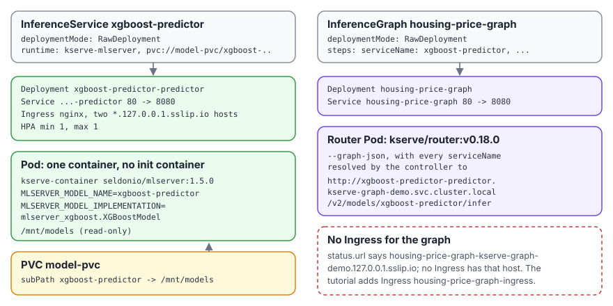
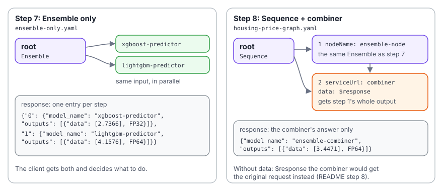

<!-- tut-explainer source=README.md sha=480ccf440eb4 by=codex reviewed=yes -->
# 두 모델의 답을 하나로 합치는 InferenceGraph 앙상블과 결합기의 작동 방식

## 한눈에 보기



같은 질문에 답하는 모델이 두 개 있고, 답은 하나만 받고 싶습니다. 클라이언트에서 두 모델을 각각 호출해 평균을 내는 대신, 그 호출들을 그래프로 기술합니다. KServe는 이 그래프를 실행하는 작은 **라우터**를 띄웁니다. 라우터는 두 모델에 요청을 동시에 보내고, 응답을 모아 두 값을 하나로 합치는 세 번째 서비스에 전달합니다. 클라이언트는 한 번만 호출하면 됩니다.

## 배울 내용

- RawDeployment 모드에서 KServe가 InferenceService로 어떤 리소스를 만들고, PVC에 있는 모델을 서빙 Pod에서 어떻게 읽는지 살펴봅니다(12~18단계).
- KServe가 InferenceGraph에서 각 단계의 정확한 URL을 전달받는 라우터 Deployment를 만드는 과정을 살펴봅니다(19~20단계, 23~24단계).
- `Ensemble` 노드가 무엇을 반환하고, `Sequence`가 `data: $response`로 그 응답을 다음 단계에 어떻게 전달하는지 살펴봅니다(22단계, 25단계).
- 요청을 `Host:` 헤더와 함께 `localhost:8080`으로 보내는 이유를 살펴봅니다(2단계, 19단계, 21단계).

## 구성 요소

### InferenceService 세 개와 각 리소스 구성



InferenceService 세 개에 모두 `serving.kserve.io/deploymentMode: RawDeployment`가 설정되어 있습니다. 이 모드는 Kubernetes 기본 리소스만 사용하고 Knative는 사용하지 않습니다. 18단계가 끝난 뒤 확인해 보니 컨트롤러는 각 InferenceService에 다음 리소스를 만들었습니다.

- Pod 한 개를 실행하는 Deployment `<name>-predictor`
- 포트 80을 Pod의 포트 8080으로 연결하는 Service `<name>-predictor`
- 클래스가 `nginx`인 Ingress. `127.0.0.1.sslip.io` 아래에 호스트가 두 개 있습니다. 하나는 InferenceService 전체용이고 하나는 예측기 구성 요소용이며, 둘 다 예측기 Service로 연결됩니다(KServe v0.18.0 소스의 `kube_ingress_reconciler.go`에서 진입점과 구성 요소마다 규칙을 하나씩 만듭니다).
- 최소 및 최대 복제본 수가 모두 1인 HPA. KServe의 기본 자동 확장 클래스는 `hpa`입니다(소스의 `constants.DefaultAutoscalerClass`). 어노테이션으로 다른 클래스를 지정하지 않으면 InferenceService에 HPA가 생성됩니다. 매니페스트에 복제본 수를 따로 지정하지 않아 Pod 한 개가 유지됩니다.

**런타임.** 클러스터에는 XGBoost를 서빙할 수 있는 런타임이 여러 개 있습니다. `kserve-mlserver`와 `kserve-xgbserver`가 모두 XGBoost를 지원합니다. LightGBM에는 `kserve-lgbserver`도 있습니다. 매니페스트에 `runtime: kserve-mlserver`를 명시했으므로 두 모델은 각자의 Pod에서 같은 서버 소프트웨어인 `seldonio/mlserver:1.5.0`으로 실행됩니다. 이 런타임은 V2 추론 프로토콜만 지원합니다. XGBoost Pod에서 컨트롤러는 `MLSERVER_MODEL_NAME`에 InferenceService 이름을, `MLSERVER_MODEL_IMPLEMENTATION`에 `mlserver_xgboost.XGBoostModel`을 설정합니다. LightGBM Pod의 환경 변수는 확인하지 않았습니다.

**PVC에 저장한 모델.** `storageUri: pvc://model-pvc/xgboost-predictor`로 지정한 모델은 다운로드하지 않습니다. Pod에는 초기화 컨테이너가 없습니다. XGBoost Pod는 `subPath: xgboost-predictor`를 지정해 PVC를 `/mnt/models`에 읽기 전용으로 마운트합니다. 따라서 자체 모델 디렉터리만 보이며, 그 안에는 13단계에서 복사한 `model.json`과 `model-settings.json`이 있습니다. LightGBM Pod도 같은 PVC를 `/mnt/models`에 마운트합니다. PVC는 12단계에서 보조 Pod가 사용하기 전까지 `Pending` 상태였고, 사용한 뒤 `Bound` 상태가 됐습니다. 보조 Pod를 삭제한 뒤에도 데이터는 남았습니다. 두 예측기는 같은 ReadWriteOnce PVC를 마운트합니다. 이 클러스터에서 이것이 가능한 이유는 모든 Pod가 하나뿐인 워커 노드에서 실행되기 때문입니다.

### 그래프와 라우터

InferenceGraph의 요청은 모델 서버 대신 **라우터**(`kserve/router:v0.18.0`)가 처리합니다. 컨트롤러는 `housing-price-graph`와 같은 이름의 Deployment와 Service를 만들었습니다. Service는 포트 80을 8080으로 연결합니다. 컨트롤러는 그래프 전체를 `--graph-json`으로 라우터에 전달했습니다. 이 JSON에서 `serviceName: xgboost-predictor`는 모두 다음과 같은 전체 URL로 바뀌었습니다.

```text
http://xgboost-predictor-predictor.kserve-graph-demo.svc.cluster.local/v2/models/xgboost-predictor/infer
```

라우터는 이 URL의 V2 `infer` 경로로 예측기 Service를 직접 호출합니다. 그래프에도 `RawDeployment` 어노테이션이 있습니다. 이 어노테이션을 생략하면 클러스터의 기본 모드를 사용합니다. 이번 실행의 기본 모드는 `Standard`였습니다. 이번 단계별 실행의 첫 시도는 기본 모드가 아직 Knative인 클러스터에서 진행되어 라우터가 생성되지 않았습니다. 그 실행은 이 페이지의 근거에 포함하지 않았으며, 별도의 근거와 함께 docs/authoring.md의 교훈 CI-014에 기록했습니다.

### Ensemble은 입력 하나로 두 응답을 모두 받습니다



`Ensemble` 노드는 두 단계에 같은 요청을 보내고, 각 단계의 순서를 키로 사용해 두 응답을 반환했습니다. 여기서는 각 단계에 `name`을 지정하지 않았으므로 XGBoost의 키는 `"0"`, LightGBM의 키는 `"1"`입니다(22단계). 라우터 로그에서 두 호출이 겹쳐 실행된 것을 확인할 수 있습니다. 각 호출에는 6.4ms와 8.4ms가 걸렸습니다. 노드 전체에는 8.8ms가 걸렸으므로 두 시간을 합한 14.8ms보다 느린 쪽 호출 시간인 8.4ms에 가깝습니다.

두 응답은 값과 자료형이 모두 달랐습니다. XGBoost는 `2.7366`을 `FP32`로, LightGBM은 `4.1576`을 `FP64`로 반환했습니다.

### Sequence는 결과를 다음 단계에 넘깁니다

두 번째 그래프에는 노드가 두 개 있습니다. `root`는 `Sequence`입니다. 1단계에서 앞과 같은 Ensemble인 `ensemble-node`를 실행하고, 2단계에서 `serviceUrl`로 결합기를 호출합니다. `data: $response`를 지정했으므로 결합기로 보내는 데이터는 원본 요청이 아닌 1단계의 출력입니다. 라우터 로그에도 두 예측기를 호출한 뒤 결합기를 호출한 순서가 그대로 나타납니다.

결합기(`combiner/app.py`)는 받은 요청 본문을 로그에 남겼습니다. 본문은 Ensemble이 반환한 `{"0": ..., "1": ...}` 객체였습니다. 결합기는 각 응답의 `outputs`에서 첫 번째 값을 꺼내 `[2.7366, 4.1576]`을 얻고, 두 값의 평균인 `3.4471`을 반환했습니다(25단계). 결합기가 받은 요청의 출발지 IP는 라우터 Pod의 IP였습니다.

그래프를 교체하면 라우터 Deployment가 새 Pod를 배포합니다(24단계). 이때 두 Pod가 잠시 함께 실행됐습니다. 기존 라우터 Pod가 여전히 응답할 수 있으므로 README의 25단계에서는 요청을 재시도합니다.

### Ingress와 포트 포워딩으로 요청을 보냅니다

5단계에서는 `inferenceservice-config`에 `ingressClassName: nginx`와 도메인 `127.0.0.1.sslip.io`를 설정하고 컨트롤러를 재시작합니다. 이후 각 InferenceService의 Ingress에는 `nginx` 클래스와 해당 도메인 아래의 호스트가 설정됩니다.

InferenceGraph의 상태에는 `http://housing-price-graph-kserve-graph-demo.127.0.0.1.sslip.io`가 URL로 표시됩니다. KServe는 그래프용 Ingress를 만들지 않았으며, 네임스페이스에도 해당 호스트를 사용하는 Ingress가 없습니다. 튜토리얼에서는 `housing-price-graph.127.0.0.1.sslip.io`를 라우터 Service에 연결하는 Ingress를 별도로 추가합니다. 21단계에서는 `localhost:8080`을 ingress-nginx로 포트 포워딩합니다. 그런 다음 curl이 해당 호스트를 `Host:` 헤더에 담아 `localhost:8080`으로 요청을 보내면 ingress-nginx가 호스트에 맞는 Ingress를 선택합니다.

## 단계별로 살펴보기

| README 단계 | 클러스터에서 일어나는 일 | 확인할 항목 |
|---|---|---|
| 1 환경 설정 | 실습 환경의 클러스터에서 KServe가 표준 모드로 실행됩니다 | `defaultDeploymentMode: Standard` |
| 2~3 ingress-nginx | Kind용 컨트롤러를 설치합니다 | Pod가 `Ready` 상태입니다 |
| 4~6 스토리지 및 KServe 설정 | StorageClass `standard`(local-path)를 사용합니다. KServe가 nginx를 사용하도록 설정하고 컨트롤러를 재시작합니다 | `kserve-mlserver formats: ... xgboost ... lightgbm` |
| 7 네임스페이스 | `kserve-graph-demo` | |
| 8~9 모델 학습 | `models/`가 있으면 학습을 건너뜁니다. 이번 실행에는 해당 디렉터리가 있었습니다 | `model.json`, `model.bst`, 설정 파일 |
| 10~11 이미지 | 결합기 이미지를 빌드해 Kind에 로드하고, MLServer 이미지도 로드합니다 | 노드에 있는 `ensemble-combiner` |
| 12~15 PVC | PVC가 `Pending` 상태로 시작하고 보조 Pod가 사용하면 바인딩됩니다. 모델 파일을 복사한 뒤 보조 Pod를 삭제합니다 | `/mnt/models/<name>/` |
| 16~18 InferenceService | 각각 Deployment, Service, Ingress, HPA를 만듭니다. 두 예측기 Pod는 PVC를 마운트합니다 | 세 InferenceService 모두 `Ready` 상태입니다 |
| 19~20 Ensemble 그래프 | 라우터 Deployment `housing-price-graph`와 튜토리얼용 Ingress를 만듭니다 | `ig ... condition met` |
| 21~22 첫 요청 | 포트 포워딩을 설정하고 두 응답을 받습니다 | `"0"`과 `"1"` |
| 23~24 Sequence 그래프 | 새 그래프를 적용한 라우터 Pod를 배포합니다 | `rollout status` 결과(`successfully rolled out`) |
| 25 결합 결과 요청 | `ensemble-combiner`에서 응답 하나를 받습니다 | `-> combined: 3.4471` |
| 정리 | 그래프, Ingress, InferenceService, PVC, 네임스페이스를 삭제합니다 | |

## README에 없는 관찰 결과

- KServe는 InferenceGraph용 Ingress를 만들지 않았습니다. 그래프의 상태에 표시된 URL에 연결되는 Ingress도 없습니다. 요청은 별도의 호스트를 사용하는 튜토리얼용 Ingress로 보냅니다.
- 두 모델은 서로 다른 자료형(`FP32`와 `FP64`)으로 응답합니다.
- 각 InferenceService에는 복제본 수가 1로 고정된 HPA와 호스트 두 개(`<name>-<ns>`와 `<name>-predictor-<ns>`)를 가진 Ingress도 생성됩니다. 위의 「InferenceService 세 개와 각 리소스 구성」에서 KServe 소스 코드를 근거로 그 이유를 설명합니다.

## 이해도 확인

<details>
<summary>1. 그래프에서 <code>data: $response</code> 줄을 삭제하면 결합기는 무엇을 받습니까?</summary>

결합기는 Ensemble의 응답 대신 입력 특성 8개가 담긴 원본 요청을 받습니다. 요청에 `outputs`가 없으므로 0.0을 반환합니다(`_average_predictions` 참조).
</details>

<details>
<summary>2. 왜 그래프의 URL 대신 <code>Host:</code> 헤더를 붙여 <code>localhost:8080</code>으로 요청을 보냅니까?</summary>

포트 포워딩을 설정하면 localhost에서 ingress-nginx에 접근할 수 있고, ingress-nginx는 호스트에 맞는 Ingress를 선택합니다. 그래프의 상태에 표시된 URL에는 연결된 Ingress가 없습니다. 튜토리얼의 Ingress는 `housing-price-graph.127.0.0.1.sslip.io`를 사용합니다.
</details>

<details>
<summary>3. MLServer Pod는 모델 파일을 어떻게 읽습니까?</summary>

파일을 다운로드하는 과정은 없습니다. 모델 디렉터리를 `subPath`로 지정해 PVC를 `/mnt/models`에 읽기 전용으로 마운트합니다.
</details>

<details>
<summary>4. XGBoost에 70%의 가중치를 주어 가중 평균을 구하려면 무엇을 바꿉니까?</summary>

`combiner/app.py`의 `_average_predictions`만 수정한 뒤 이미지를 다시 빌드하고 로드합니다. 그래프는 그대로 사용합니다.
</details>

<details>
<summary>5. 라우터는 <code>serviceName: xgboost-predictor</code>로 지정된 단계에 관해 무엇을 알아야 합니까?</summary>

라우터가 이 이름을 해석할 필요는 없습니다. 컨트롤러가 이름을 예측기 Service의 V2 `infer` URL로 바꿔 라우터의 `--graph-json`에 넣습니다.
</details>

Based on a run of inferencegraph-ensemble with KServe v0.18.0 on 2026-11-22.
