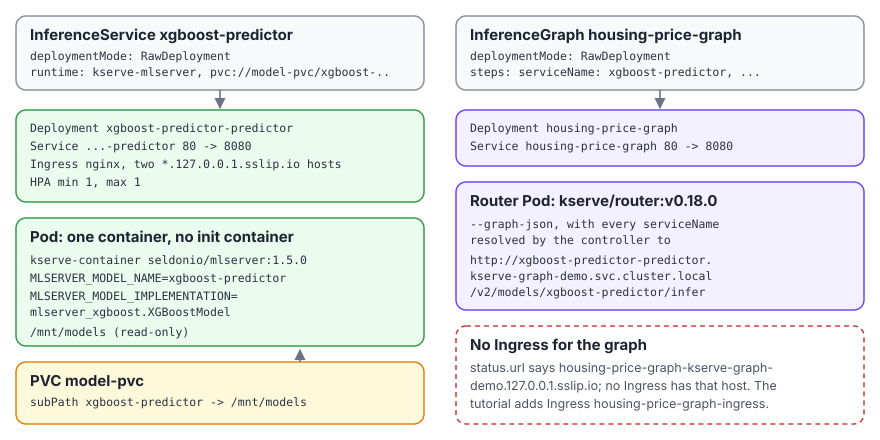
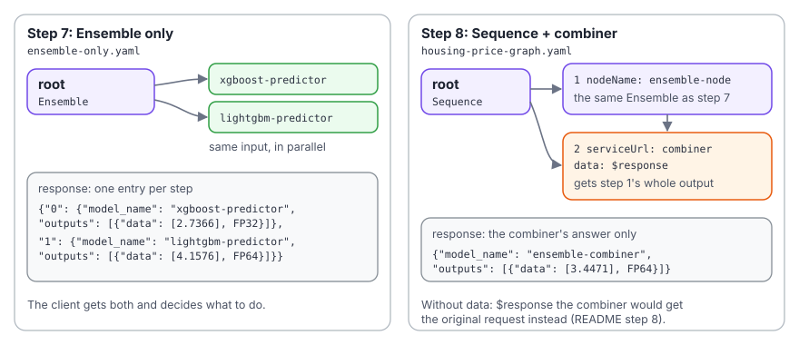

<!-- tut-explainer source=README.md sha=480ccf440eb4 by=claude reviewed=yes -->
# Two Models, One Answer - InferenceGraph Ensemble and Combiner: how it works

## In one picture



You have two models that answer the same question, and you want one answer. Instead of calling both from your client and averaging there, you describe the calls as a graph. KServe runs a small **router** for that graph: it sends your request to both models at once, collects what they say, and hands that to a third service that turns two numbers into one. Your client makes a single call.

## What you will learn

- What KServe builds from an InferenceService in RawDeployment mode, and how a model on a PVC gets into the serving Pod (steps 12-18).
- What KServe builds from an InferenceGraph: a router Deployment that is told the exact URL of every step (steps 19-20, 23-24).
- What an `Ensemble` node returns, and how a `Sequence` with `data: $response` passes it to the next step (steps 22, 25).
- Why the request goes to `localhost:8080` with a `Host:` header (steps 2, 19, 21).

## The pieces

### Three InferenceServices, each a small stack



All three InferenceServices carry `serving.kserve.io/deploymentMode: RawDeployment`: plain Kubernetes objects, no Knative. For each one the controller created (probe after step 18):

- a Deployment `<name>-predictor` with one Pod,
- a Service `<name>-predictor`, port 80 to the Pod's 8080,
- an Ingress of class `nginx` with two hosts under `127.0.0.1.sslip.io`, both to the predictor Service: one for the InferenceService as a whole and one for its predictor component (KServe v0.18.0 source, `kube_ingress_reconciler.go`: one rule per entry point and per component),
- an HPA with min and max 1 replica. KServe's default autoscaler class is `hpa` (source, `constants.DefaultAutoscalerClass`), so an InferenceService gets one unless an annotation says otherwise; with no replica settings in the manifest it stays at one Pod.

**The runtime.** The cluster has several runtimes that can serve XGBoost: `kserve-mlserver` and `kserve-xgbserver` both list it, and LightGBM has `kserve-lgbserver` too. The manifests pick `runtime: kserve-mlserver` explicitly, so both models run in the same server software, `seldonio/mlserver:1.5.0`, each in its own Pod; this runtime speaks only the V2 inference protocol. In the XGBoost Pod the controller sets `MLSERVER_MODEL_NAME` to the InferenceService name and `MLSERVER_MODEL_IMPLEMENTATION` to `mlserver_xgboost.XGBoostModel` (the LightGBM Pod's environment was not probed).

**The model on a PVC.** `storageUri: pvc://model-pvc/xgboost-predictor` is not downloaded. The Pod has no init container; in the XGBoost Pod the PVC is mounted read-only at `/mnt/models` with `subPath: xgboost-predictor`, so it sees only its own directory (`model.json` and `model-settings.json`, copied there in step 13); the LightGBM Pod mounts the same claim at `/mnt/models`. The claim stayed `Pending` until the helper Pod used it (step 12), then `Bound`; it kept its data after the helper was deleted. Both predictors mount the same ReadWriteOnce claim, which works here because all Pods run on the one worker node.

### The graph and its router

An InferenceGraph is not served by a model server but by a **router** (`kserve/router:v0.18.0`). For `housing-price-graph` the controller created a Deployment and a Service (80 to 8080) with the graph's name, and passed the whole graph to the router as `--graph-json`. In that JSON every `serviceName: xgboost-predictor` has become a full URL:

```text
http://xgboost-predictor-predictor.kserve-graph-demo.svc.cluster.local/v2/models/xgboost-predictor/infer
```

So the router calls the predictor's Service directly, on the V2 `infer` path. The graph also carries the `RawDeployment` annotation; without it the graph takes the cluster's default mode (`Standard` in this run). A first attempt at this walk, on a cluster whose default was still Knative, never got a router; that run is not part of the evidence here, but it is written down with its own evidence as lesson CI-014 in docs/authoring.md.

### Ensemble: one input, all answers



The `Ensemble` node sent the same request to both steps and returned both answers, keyed by the step's position (the steps have no `name` here): `"0"` for XGBoost, `"1"` for LightGBM (step 22). The router log shows the calls overlapping: the node took 8.8 ms, about as long as the slower call (6.4 ms and 8.4 ms), not their sum of 14.8 ms.

The two answers differ, and not only in value: XGBoost returned `2.7366` as `FP32`, LightGBM `4.1576` as `FP64`.

### Sequence: pass the result on

The second graph has two nodes. `root` is a `Sequence`: step 1 runs `ensemble-node` (the same Ensemble as before), step 2 calls the combiner by `serviceUrl` with `data: $response`, which means "send step 1's output", not the original request. The router log shows exactly that order: the two predictors, then the combiner.

The combiner (`combiner/app.py`) logged the body it received: the `{"0": ..., "1": ...}` object of the Ensemble. It took the first value of each `outputs`, `[2.7366, 4.1576]`, and returned their average, `3.4471` (step 25). The request reached it from the router Pod's IP.

When the graph is replaced, the router Deployment rolls out a new Pod (step 24; for a moment both Pods existed). The README's step 25 retries because the old router Pod may still answer.

### Getting in: Ingress and a port-forward

Step 5 sets `ingressClassName: nginx` and the domain `127.0.0.1.sslip.io` in `inferenceservice-config` and restarts the controller; the InferenceServices' Ingresses then have class `nginx` and hosts under that domain.

The InferenceGraph's status shows a URL, `http://housing-price-graph-kserve-graph-demo.127.0.0.1.sslip.io`, but KServe made no Ingress for the graph: no Ingress in the namespace has that host. The tutorial adds its own Ingress for `housing-price-graph.127.0.0.1.sslip.io` to the router Service, and step 21 port-forwards `localhost:8080` to ingress-nginx. curl then sends the request to `localhost:8080` with that `Host:` header, and ingress-nginx picks the Ingress by host.

## Step by step

| README step | What happens in the cluster | What to look at |
|---|---|---|
| 1 setup | the environment's cluster, KServe in standard mode | `defaultDeploymentMode: Standard` |
| 2-3 ingress-nginx | the Kind flavour of the controller | Pod `Ready` |
| 4-6 storage, KServe config | StorageClass `standard` (local-path); KServe told to use nginx; controller restarted | `kserve-mlserver formats: ... xgboost ... lightgbm` |
| 7 namespace | `kserve-graph-demo` | |
| 8-9 train | skipped when `models/` exists (it did in this run) | `model.json`, `model.bst`, settings |
| 10-11 images | combiner built and loaded into kind, MLServer image loaded | `ensemble-combiner` on the node |
| 12-15 PVC | claim `Pending`, helper Pod binds it, models copied, helper deleted | `/mnt/models/<name>/` |
| 16-18 InferenceServices | Deployment, Service, Ingress, HPA each; the two predictor Pods mount the PVC | all three `Ready` |
| 19-20 Ensemble graph | router Deployment `housing-price-graph`; tutorial's Ingress | `ig ... condition met` |
| 21-22 first request | port-forward, both answers | `"0"` and `"1"` |
| 23-24 Sequence graph | router rolls out with the new graph | rollout status |
| 25 combined request | one answer from `ensemble-combiner` | `-> combined: 3.4471` |
| cleanup | graph, Ingress, InferenceServices, PVC, namespace | |

## What we saw that the README does not say

- KServe created no Ingress for the InferenceGraph; the URL in its status has no Ingress behind it. The tutorial's own Ingress, with a different host, is the way in.
- The two models answer with different data types (`FP32` and `FP64`).
- Each InferenceService also gets an HPA fixed at one replica and an Ingress with two hosts (`<name>-<ns>` and `<name>-predictor-<ns>`); the reasons, from the KServe source, are in "Three InferenceServices" above.

## Check yourself

<details>
<summary>1. You delete the <code>data: $response</code> line from the graph. What does the combiner receive?</summary>

The original request (the 8 input features), not the Ensemble's answers. It finds no `outputs` in it and returns 0.0 (see `_average_predictions`).
</details>

<details>
<summary>2. Why does the request go to <code>localhost:8080</code> with a <code>Host:</code> header instead of to the graph's URL?</summary>

The port-forward makes ingress-nginx reachable on localhost, and ingress-nginx picks the Ingress by host. The URL in the graph's status has no Ingress behind it; the tutorial's Ingress uses `housing-price-graph.127.0.0.1.sslip.io`.
</details>

<details>
<summary>3. How do the model files get into the MLServer Pod?</summary>

Not by a download: the PVC is mounted read-only at `/mnt/models`, with the model's directory as `subPath`.
</details>

<details>
<summary>4. You want a weighted average, 70% XGBoost. What do you change?</summary>

Only `_average_predictions` in `combiner/app.py` (and rebuild and load the image). The graph stays the same.
</details>

<details>
<summary>5. What does the router need to know about a step called <code>serviceName: xgboost-predictor</code>?</summary>

Nothing: the controller resolves it to the predictor Service's V2 `infer` URL and writes that into the router's `--graph-json`.
</details>

Based on a run of inferencegraph-ensemble with KServe v0.18.0 on 2026-11-22.
