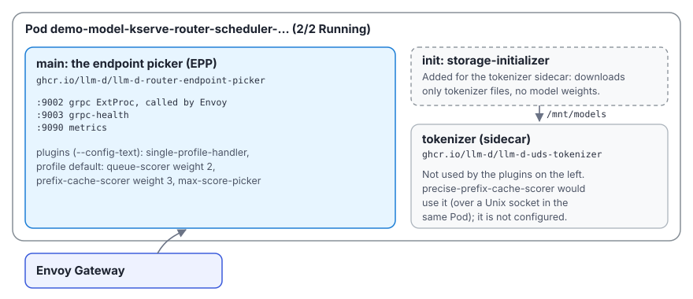

<!-- tut-explainer source=README.md sha=0 by=claude reviewed=no -->
# 하나의 Apply, 열 개의 리소스: 동작 원리

## 한 장으로 보기

여러분이 쓰는 것은 작은 YAML 파일 하나, **LLMInferenceService**입니다. KServe는
이것을 모델 서빙에 필요한 모든 것으로 바꿉니다. 모델을 실행하는 vLLM Pod, 요청마다
어느 Pod가 답할지 정하는 스케줄러, 그리고 이 둘을 공용 Gateway에 연결하는 라우팅입니다.
이 튜토리얼은 "객체 하나"에서 "동작하는 서빙 스택"으로 가는 그 한 걸음과, 새로 생긴
객체 각각이 무슨 일을 하는지를 다룹니다.

## 배울 내용

- LLMInferenceService를 `kubectl apply` 한 번 하면 무엇이 생기고, 왜 열 개인지
  (README step 2-5, 13-14)
- 요청이 길을 찾는 방법: Gateway -> HTTPRoute -> InferencePool -> EPP 스케줄러 ->
  vLLM Pod (step 10-11, 15-16)
- 스케줄러 Pod 안에서 무엇이 돌고, 기본 설정이 그중 무엇을 실제로 쓰는지 (step 6-9)
- LLMInferenceService 하나만 지우면 정리가 끝나는 이유 (cleanup)

## 구성 요소

### 객체 하나에서 열 개로

apply 전에는 네임스페이스가 비어 있습니다(step 2). `kubectl apply`(step 3) 후 약
6초 안에 객체 열 개가 모두 생깁니다. 그다음 Pod가 Ready가 되기까지
몇 분이 걸립니다(step 4). LLMInferenceService를 주문서라고
생각하면 됩니다. 여러분은 모델, 이미지, 자원만 적고, 나머지 서류 작업은 컨트롤러가
합니다.

| 그룹 | 객체 | 역할 |
|---|---|---|
| Workload | Deployment `demo-model-kserve`, Service `...-workload-svc` (포트 8000) | vLLM 실행. 모델은 `/mnt/models`에서 서빙 |
| TLS | Secret `...-self-signed-certs` | 컨트롤러가 생성한 인증서. TLS를 켰을 때만 쓰임(아래 참고) |
| Scheduler | Deployment `...-router-scheduler`, Service `demo-model-epp-service`, ServiceAccount `demo-model-epp-sa`, Role, RoleBinding | endpoint picker(EPP)와 그 전용 신원, 권한 (로그를 보면 Pod와 InferencePool을 watch함) |
| Traffic wiring | InferencePool `...-inference-pool`, HTTPRoute `...-kserve-route` | 공용 Gateway를 스케줄러와 vLLM Pod에 연결 |

YAML에 실행 명령, probe, 스케줄러가 없는데 어디서 왔을까요? KServe는 `kserve`
네임스페이스에 **well-known LLMInferenceServiceConfig**를 설치해 둡니다(이번 실행에서는
8개. 예: `kserve-config-llm-template`, `kserve-config-llm-scheduler`). 컨트롤러가 이것을
여러분의 객체에 합칩니다. 여러분의 YAML은 이 모델에 맞게 달라지는 것만 적습니다. 이미지, 환경 변수, 자원, non-root
securityContext, 그리고 probe 타이밍입니다.

**LeaderWorkerSet**은 생기지 않습니다(step 5). `replicas`만 있고 병렬 설정이 없으면
일반 Deployment 하나로 충분합니다. LeaderWorkerSet은 모델 하나가 여러 Pod에 걸칠 때
씁니다.

### 요청의 경로

첫 번째 그림을 한 단계씩 다시 보겠습니다.

1. 클라이언트가 `POST /<namespace>/demo-model/v1/completions`를 **Gateway**
   `kserve/kserve-ingress-gateway`로 보냅니다. 모델에 속하지 않은 Envoy 프록시입니다(이번
   실행에서는 Gateway가 이것 하나). LoadBalancer 주소(예: 172.18.0.5, cloud-provider-kind가
   붙여 줌)가 있지만, 튜토리얼의 헬퍼 `gateway-url.sh`는 worker 노드 IP와 Envoy Service의
   NodePort(예: `172.18.0.3:31084`, step 15)로 요청을 보냅니다. 둘 다 같은 Envoy에 닿습니다.
2. **HTTPRoute**가 경로를 매칭하고 vLLM이 알아듣는 `/v1/completions`로 바꿉니다.
3. 이 라우트의 백엔드는 Service가 아니라 **InferencePool**입니다. pool은 Pod를
   (라벨 `kserve.io/component: workload`, 포트 8000으로) 알고, 그중 누가 고를지도 압니다
   (`endpointPickerRef`: EPP Service, 포트 9002).
4. Envoy가 ExtProc gRPC로 **EPP**에게 "어느 Pod?"라고 묻습니다. EPP는 Pod에 점수를
   매기고 주소 하나를 돌려줍니다.
5. Envoy가 그 **vLLM Pod**로 요청을 보내고, 응답은 같은 길로 돌아옵니다(step 16에서
   20토큰짜리 completion을 받았습니다).

HTTPRoute의 규칙은 하나가 아니라 네 개입니다. `/v1/completions`, `/v1/chat/completions`,
`/v1/responses`는 InferencePool로, 즉 EPP를 거쳐 갑니다. `/<namespace>/demo-model`
아래의 나머지 경로는 EPP를 거치지 않고 workload Service로 바로 갑니다(그림의 점선).

EPP를 쓸 수 없을 때를 대비해 pool의 `failureMode`는 `FailOpen`입니다. 이때 Envoy는
요청을 실패시키지 않고 Pod로 그대로 보냅니다.

### 스케줄러 Pod 내부

이 Pod에는 컨테이너 두 개와 init 컨테이너 하나가 있습니다(step 8이 정확히 이것을
확인합니다).

- **main**: endpoint picker. 포트는 9002(gRPC, Envoy의 ExtProc 호출), 9003(gRPC
  health), 9090(metrics). 설정(step 9)에는 플러그인 네 개가 있습니다.
  `single-profile-handler`는 스케줄링 프로파일이 `default` 하나라는 뜻이고, 그 프로파일이
  나머지 셋을 씁니다. `queue-scorer`(가중치 2), `prefix-cache-scorer`(가중치 3), 그리고
  가중 합이 가장 높은 Pod를 고르는 `max-score-picker`.
- **tokenizer**: 사이드카. 설정된 플러그인 중 이것을 쓰는 것은 없습니다. KServe v0.18.0
  소스(`scheduler.go`, `WithUdsTokenizerConfig`)를 보면 컨트롤러는
  `precise-prefix-cache-scorer` 플러그인만 tokenizer의 Unix 소켓에 연결하는데, 이 설정에는
  그 플러그인이 없습니다.
- **storage-initializer** (init). 모델을 서빙하지 않는 스케줄러에 있으니 이상해 보입니다.
  이것은 tokenizer 사이드카 때문에 있습니다. 스케줄러 템플릿에 `tokenizer` 컨테이너가
  있으면 KServe 컨트롤러가 vLLM Pod와 같은 init 컨테이너를 붙이되,
  `STORAGE_ALLOW_PATTERNS`로 tokenizer 파일(`tokenizer.json`, `vocab.json`,
  `config.json` 등)만 받게 합니다. 가중치는 받지 않습니다. 사이드카는 이 파일을
  `/mnt/models`에서 읽습니다. 즉 기본 플러그인 설정에서는 아무도 부르지 않는 컨테이너를
  위해 다운로드를 하는 셈입니다. (이 이유는 클러스터 출력이 아니라 KServe v0.18.0 소스
  `pkg/controller/v1alpha2/llmisvc/scheduler.go`, `workload_storage.go`에서 확인했습니다.)

replica가 하나면 고를 것이 없지만, Pod가 많아져도 같은 장치가 결정합니다. 큐가 짧은
Pod, 그리고 프롬프트의 앞부분을 이미 캐시에 가진 Pod를 선호합니다.

### 정리

객체 열 개 모두 `LLMInferenceService/demo-model`을 가리키는 ownerReference를 가지고
있습니다. 그 객체 하나만 지우면(cleanup 블록) 나머지는 Kubernetes가 지웁니다.
ReplicaSet과 Pod는 각자의 Deployment를 따라 지워집니다.

## 단계별로 보기

| README step | 클러스터에서 일어나는 일 | 볼 것 |
|---|---|---|
| 1 setup | KServe, Envoy Gateway, Gateway API Inference Extension이 설치된 Kind 클러스터, 네임스페이스 생성 | `kubectl get gateway -A`: Gateway 하나, `Programmed` |
| 2 스냅숏 | 네임스페이스는 아직 비어 있음 | "No resources found" |
| 3 apply | 컨트롤러가 몇 초 안에 객체 열 개 생성 | Pod가 `Init:0/1` |
| 4 대기 | storage-initializer 다운로드, vLLM 시작, `/health` readiness | 몇 분 후 `Ready` |
| 5 LWS | 없음: 단일 노드 모델은 Deployment 사용 | "No resources found" |
| 6-9 스케줄러 | EPP 실행 중. 로그에 InferencePool, Pod controller와 9002 포트 `gRPC server listening` | 이미지와 플러그인 목록 |
| 10-12 pool, route, service | 위 그림의 연결 구조 | `endpointPickerRef`, 라우트 규칙 네 개, 서비스 포트 |
| 13-14 개수 | Deployment 2, Service 2, InferencePool 1, HTTPRoute 1 | verify가 이 숫자를 확인 |
| 15-16 요청 | Gateway를 통한 completion | 20토큰 후 `"finish_reason": "length"` |

## README에 없는 관찰

- README 표는 포트 8000을 HTTPS로 적고, workload Service의 포트 이름도 `https`입니다.
  이번 실행에서 vLLM은 일반 HTTP로 동작했습니다. readiness probe가 HTTP를 쓰고 vLLM 실행
  명령에도 TLS 옵션이 없습니다. 이것은 README 오류가 아니라 설정 차이입니다. KServe v0.18.0
  well-known config에서 vLLM의 `--ssl-*` 옵션, probe scheme, EPP의 `--secure-serving`은 모두
  TLS를 켰을 때(ingress config의 `enableLLMInferenceServiceTLS`)만 적용됩니다.
  같은 config는 TLS 여부와 상관없이 `...-self-signed-certs` Secret을 두 Pod에
  마운트합니다(`/var/run/kserve/tls`). 이번 실행에서 마운트 자체는 확인하지 않았습니다.
- 이번 실행에서 컨트롤러가 만든 ServiceAccount는 EPP용 하나뿐이고, vLLM Pod는 네임스페이스의
  `default` ServiceAccount로 실행됩니다. README의 리소스 지도에는 workload 아래에도
  ServiceAccount가 있습니다. (KServe 소스에서 컨트롤러는 멀티 노드 LeaderWorkerSet 배포일 때
  workload ServiceAccount를 만듭니다. 이 튜토리얼은 단일 노드입니다.)
- 이 환경의 스케줄러 이미지는 `llm-d-router-endpoint-picker`입니다. 환경이 KServe 설정에
  적힌 이미지를 바꿔 넣으며, 환경 README(`envs/kind-kserve/v1/README.md`)에 따르면 예전
  이미지는 이제 403을 돌려줍니다. 튜토리얼 README 표에는 예전 이름이 있습니다.
- HTTPRoute에 EPP를 거치지 않는 catch-all 규칙이 있습니다.

## 스스로 확인하기

1. <code>replicas: 1</code>을 3으로 바꾸면 어떤 객체가 바뀌고 어떤 객체는 그대로일까요?

workload Deployment의 Pod가 세 개가 됩니다. InferencePool, HTTPRoute, EPP는 그대로입니다.
pool은 라벨로 Pod를 고르므로 새 Pod가 자동으로 들어가고, EPP는 이제 후보 세 개에 점수를
매깁니다.

2. <code>/&lt;namespace&gt;/demo-model/health</code>로 보낸 요청을 EPP가 볼까요?

아니요. OpenAI 스타일 API 경로 세 개만 InferencePool로 가고, catch-all 규칙은 다른 경로를
workload Service로 바로 보냅니다.

3. 왜 LeaderWorkerSet이 생기지 않을까요?

모델이 Pod 하나에 들어가므로(`replicas`만 있고 병렬 설정 없음) Deployment로 충분합니다.
LeaderWorkerSet은 여러 Pod가 모델 하나를 함께 서빙할 때 묶어 줍니다.

4. 튜토리얼이 네임스페이스에 만든 것을 모두 없애려면 최소한 무엇을 지우면 될까요?

LLMInferenceService입니다. 객체 열 개가 모두 그 소유라서 함께 지워집니다.

KServe v0.18.0으로 2026-11-21에 llmisvc-anatomy를 실행한 결과를 바탕으로 작성했습니다.
