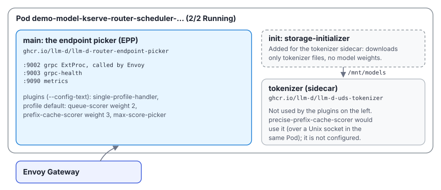

<!-- tut-explainer source=README.md sha=b757bba6b7ec by=claude reviewed=yes -->
# One Apply, Ten Resources: how it works

## In one picture

You write one small YAML file: an **LLMInferenceService**. KServe turns it into
everything a model server needs: the vLLM Pod that runs the model, a scheduler
that decides which Pod answers each request, and the routing that connects them
to a shared Gateway. The tutorial is about that one step from "one object" to
"a working serving stack", and about what each of the new objects is for.

## What you will learn

- What one `kubectl apply` of an LLMInferenceService creates, and why there are
  ten objects (README steps 2-5, 13-14).
- How a request finds its way: Gateway -> HTTPRoute -> InferencePool -> EPP
  scheduler -> vLLM Pod (steps 10-11, 15-16).
- What runs inside the scheduler Pod and how it scores the Pods (steps 6-9).
- Why deleting the LLMInferenceService is enough to clean up (cleanup).

## The pieces

### From one object to ten

The namespace is empty before the apply (step 2). After `kubectl apply`
(step 3) the controller creates the ten objects; the Pods then need a few
minutes until they are Ready (step 4). Think of the LLMInferenceService as an order form: you fill in the
model, the image and the resources; the controller does the paperwork. That
controller is `llmisvc-controller-manager` in the `kserve` namespace. (KServe's
predictive InferenceService has a controller of its own,
`kserve-controller-manager`; this environment does not install it.)

| Group | Objects | What for |
|---|---|---|
| Workload | Deployment `demo-model-kserve`, Service `...-workload-svc` (port 8000) | runs vLLM, which serves the model from `/mnt/models` |
| TLS | Secret `...-self-signed-certs` (type `kubernetes.io/tls`) | certificates; both Pods mount a volume at `/var/run/kserve/tls` |
| Scheduler | Deployment `...-router-scheduler`, Service `demo-model-epp-service`, ServiceAccount `demo-model-epp-sa`, Role, RoleBinding | the endpoint picker (EPP), with its own identity and permissions (its log shows it watching Pods and the InferencePool) |
| Traffic wiring | InferencePool `...-inference-pool`, HTTPRoute `...-kserve-route` | connect the shared Gateway to the scheduler and the vLLM Pods |

Where do the command, the probes and the scheduler come from if the YAML does
not mention them? KServe installs **well-known LLMInferenceServiceConfigs** in
the `kserve` namespace (ten of them in this run, e.g.
`kserve-config-llm-template`, `kserve-config-llm-scheduler` and
`kserve-config-llm-router-route`), and the
controller merges them into your object. Your YAML sets only what differs for
this model: the image, the environment, the resources, a non-root
securityContext and its own probe timings.

No **LeaderWorkerSet** is created (step 5): with only `replicas` and no
parallelism settings, one ordinary Deployment is enough. LeaderWorkerSets are
for models that span several Pods.

### The path of a request

Look at the first picture again, step by step:

1. The client sends `POST /<namespace>/demo-model/v1/completions` to the
   **Gateway** `kserve/kserve-ingress-gateway`, an Envoy proxy that is not part
   of the model (in this run it is the only Gateway). It has a LoadBalancer
   address (from cloud-provider-kind), but the tutorial's
   helper `gateway-url.sh` sends the request to the worker node IP and the
   NodePort of the Envoy Service (e.g. `172.18.0.2:30857`, step 15). Both reach
   the same Envoy.
2. The **HTTPRoute** matches the path and rewrites it to `/v1/completions`,
   which is the path vLLM understands.
3. Its backend is not a Service but an **InferencePool**. The pool knows the
   Pods (by label: `kserve.io/component: workload`, port 8000) and who picks
   among them (`endpointPickerRef`: the EPP Service, port 9002).
4. Envoy asks the **EPP** over ExtProc gRPC: "which Pod?". The EPP scores the
   Pods and returns one address. The request itself does not pass through the
   EPP: Envoy keeps it while it waits for the answer. (This comes from the
   configuration; the walk did not log the EPP's choice, and with one Pod there
   is only one answer.) Envoy in fact asks 16 times: its configuration has one
   ExtProc filter for every match of the HTTPRoute rules that point at the
   InferencePool, and those rules have 16 matches together (below). This was
   seen in Envoy's configuration and in the EPP log of llmisvc-request-flow,
   not in this walk.
5. Envoy sends the request to that **vLLM Pod**, to its IP, with no Service in
   between: the EPP's answer carries the Pod's address (header
   `x-gateway-destination-endpoint`), and Envoy's cluster for these rules
   connects to exactly that address. (Seen in Envoy's configuration and in the
   Envoy log of llmisvc-request-flow, whose `upstream_host` is the Pod IP; not
   in this walk.) The answer comes back the same way (step 16 got a 20-token
   completion).

The HTTPRoute has twelve rules, not one (step 11 prints it as YAML; the
llmisvc-request-flow tutorial prints the rules as a short list). Nine go to the
InferencePool, so through the EPP: `/v1/completions`, `/v1/chat/completions`,
`/v1/responses` and `/v1/messages` under `/<namespace>/demo-model`, the same
four under `/publishers/<namespace>/models/<model>`, and `v1-model-routing`,
which matches the bare `/v1/...` paths when the request carries the header
`X-Gateway-Model-Name` (eight matches). Three catch-all rules send everything
else straight to the workload Service and skip the EPP (dashed in the
picture).

So the workload Service does not carry inference requests. It is the name and
the list of vLLM Pods for everything else: the catch-all rules, Prometheus in
llmisvc-monitoring, and clients inside the cluster that call
`...-workload-svc:8000`.

If the EPP is unavailable, the pool's `failureMode` is `FailOpen`: Envoy still
sends requests to a Pod instead of failing them.

### Inside the scheduler Pod

The Pod has one running container and one init container (step 8 checks
exactly this):

- **main**, the endpoint picker. Ports: 9002 (gRPC, the ExtProc calls from
  Envoy), 9003 (gRPC health), 9090 (metrics). Its configuration (step 9) lists
  six plugins. `single-profile-handler` means there is one scheduling profile,
  `default`, and that profile uses the other five: four scorers,
  `queue-scorer` (weight 2), `kv-cache-utilization-scorer` (weight 2),
  `prefix-cache-scorer` (weight 3) and `no-hit-lru-scorer` (weight 2), and
  `max-score-picker`, which takes the Pod with the highest weighted score.
- **storage-initializer** (init). It looks odd on a scheduler, which serves no
  model. It downloads only the tokenizer files (`STORAGE_ALLOW_PATTERNS`:
  `tokenizer.json`, `vocab.json`, `config.json`, ...), no weights. They are
  for a tokenizer container that the llmisvc controller starts only when a
  configured plugin needs it. Only `precise-prefix-cache-scorer` does, and it
  is not in the configuration above, so this Pod has no tokenizer container.
  (The reason is in the KServe v0.20.0 source,
  `pkg/controller/v1alpha2/llmisvc/scheduler.go`, not in the cluster output.)

With one replica the choice is easy, but the same machinery decides between
many Pods: prefer short queues and a KV cache with room, prefer Pods that
already have the start of your prompt, and spread prompts nobody has seen.

### Cleaning up

Every one of the ten objects has an ownerReference to
`LLMInferenceService/demo-model`. Deleting that one object (the cleanup block)
makes Kubernetes delete the rest; the ReplicaSets and Pods follow their
Deployments.

## Step by step

| README step | What happens in the cluster | What to look at |
|---|---|---|
| 1 setup | Kind cluster with KServe, Envoy Gateway, Gateway API Inference Extension; namespace created | `kubectl get gateway -A`: one Gateway, `Programmed` |
| 2 snapshot | nothing in the namespace yet | nothing is listed after `=== Before Apply ===` |
| 3 apply | the LLMInferenceService is created; the controller then creates the ten objects | `demo-model created`; a moment later the namespace still lists no Pods (probe after step 3) |
| 4 wait | storage-initializer downloads, vLLM starts, readiness on `/health` | `Ready` after a few minutes |
| 5 LWS | none: a single-node model uses a Deployment | "No resources found" |
| 6-9 scheduler | the EPP is running; its log shows controllers for InferencePool and Pods and `gRPC server listening` on 9002 | images and the plugin list: four scorers and a picker |
| 10-12 pool, route, services | the wiring of the picture above | `endpointPickerRef`, the twelve route rules, service ports |
| 13-14 counts | 2 Deployments, 2 Services, 1 InferencePool, 1 HTTPRoute | the verify checks these numbers |
| 15-16 request | a completion through the Gateway | `"finish_reason": "length"` after 20 tokens |

## What we saw that the README does not say

- In this run the only ServiceAccount the controller created is the EPP's; the
  vLLM Pod runs as the namespace's `default` ServiceAccount. The README's
  resource map lists a ServiceAccount under the workload. (In the KServe
  source the controller creates a workload ServiceAccount for multi-node
  LeaderWorkerSet deployments; this tutorial is single-node.)
- The scheduler Pod has three volumes for the tokenizer (`tokenizer-uds`,
  `tokenizer-tmp`, `tokenizer-cache`) although no tokenizer container is
  started, and the well-known config `kserve-config-llm-scheduler` lists a
  `tokenizer` container next to `main`.

## Check yourself

1. You change <code>replicas: 1</code> to 3. Which objects change, and which stay the same?

The workload Deployment gets three Pods. The InferencePool, HTTPRoute and EPP
stay as they are: the pool selects Pods by label, so new Pods join it
automatically, and the EPP now has three candidates to score.

2. A request to <code>/&lt;namespace&gt;/demo-model/health</code>: does the EPP see it?

No. Only the API paths (`/v1/completions`, `/v1/chat/completions`,
`/v1/responses`, `/v1/messages`) go to the InferencePool; a catch-all rule
sends other paths straight to the workload Service.

3. Why is no LeaderWorkerSet created?

The model fits in one Pod (`replicas` only, no parallelism), so a Deployment is
enough. LeaderWorkerSets group several Pods that serve one model together.

4. What is the minimum you must delete to remove everything the tutorial created in the namespace?

The LLMInferenceService. Its ten objects are owned by it and are deleted with
it.

Based on a run of llmisvc-anatomy with KServe v0.20.0 on 2026-11-27.
