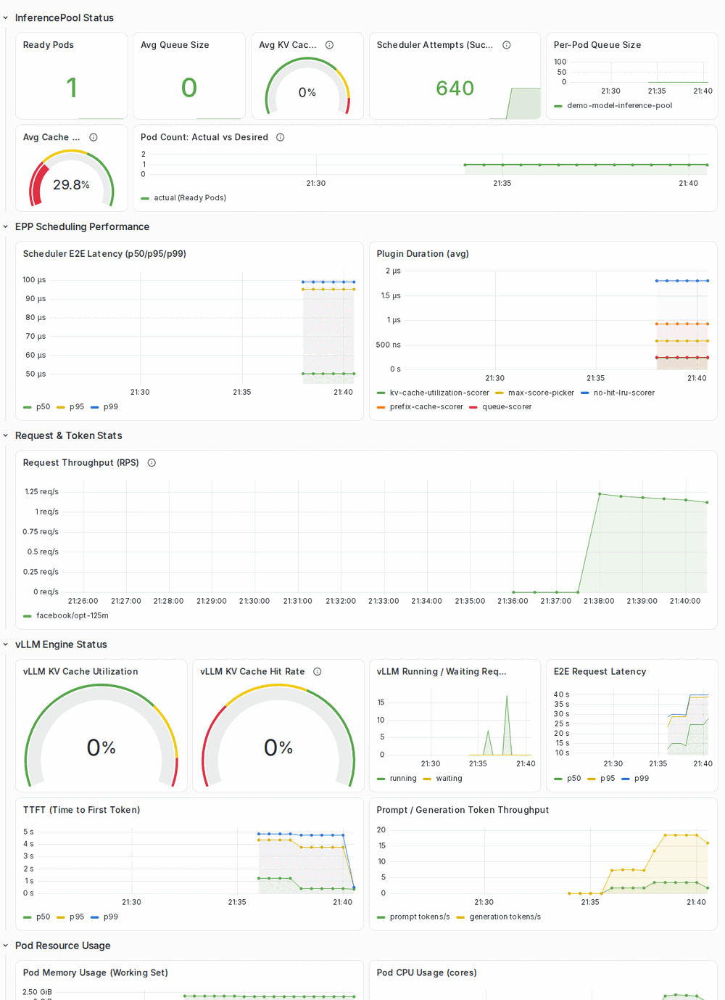

<!-- tut-translation source=README.md sha=739fde139bdf -->
# 스케줄러의 관점에서 메트릭 살펴보기

<!-- tut:header -->

<!-- tutorial.yaml에서 `./tut sync`로 생성됨 — 직접 수정하지 마세요. -->
> **상태:** 🚧 작성 중 · **검증된 KServe:** v0.20.0 · **환경:** [`kind-kserve/v1`](../../envs/kind-kserve/v1/) · **GPU:** 불필요
>
> 🌐 [English](README.md)
>
> **이전 KServe 버전:** v0.18.0: [v0.18](revisions/v0.18/README.ko.md)

<!-- /tut -->

이 튜토리얼에서 살펴볼 LLMInferenceService의 Pod는 두 종류입니다. **vLLM**은
응답을 계산하는 모델 서버입니다. **EPP**(엔드포인트 선택기)는 Gateway의 프록시인
Envoy가 요청마다 어느 vLLM Pod로 보낼지 물어보는 스케줄러입니다. InferencePool은
vLLM Pod 목록과 EPP 이름을 지정해 둘을 연결합니다. 두 종류의 Pod 모두 Prometheus
메트릭을 노출합니다. 이 튜토리얼에서는 Prometheus로 메트릭을 수집하고 Grafana에
표시합니다. 그런 다음 두 가지 부하를 주고 어떤 값이 왜 바뀌는지 확인합니다.

> **핵심 질문**  
> 스케줄러는 어떤 메트릭을 보고, 부하가 걸리면 그 값은 어떻게 바뀝니까?

배울 내용은 다음과 같습니다.

- 메트릭이 어디에서 오는지 살펴봅니다. vLLM은 처리 중이거나 대기 중인 요청, KV 캐시,
  접두사 캐시 등 모델 서버 내부 상태를 보고합니다. EPP는 자신이 파악한 풀의 상태와
  스케줄링 결과를 보고합니다.
- Prometheus가 메트릭을 어떻게 수집하는지 살펴봅니다. ServiceMonitor를 사용하고,
  인증이 필요한 EPP의 `/metrics` 엔드포인트에는 토큰을 보냅니다.
- 접두사 캐시가 무엇이며 메트릭으로 어떻게 확인하는지 살펴봅니다. 프롬프트 앞부분이
  같을 때 어떤 카운터가 오르고, 다를 때 어떤 카운터가 그대로인지 확인합니다.
- vLLM의 접두사 캐시와 EPP의 접두사 인덱스가 어떻게 다른지, 이 구성에서 EPP가
  요청 하나를 왜 16번 집계하는지 살펴봅니다.
- 대시보드를 읽는 법을 익힙니다. 이름이나 위치만 보면 헷갈리기 쉬운 패널도 살펴봅니다.

## 0단계. 환경 준비

Kind 클러스터에 KServe LLMInferenceService와 게이트웨이 스택를 준비하고, 아래에서
사용할 네임스페이스를 만듭니다. 환경 구성은 위 링크에서 확인할 수 있습니다. 이 단계는
다시 실행해도 안전합니다.

<!-- tut:setup -->

```bash run
# Generated from tutorial.yaml by `./tut sync` — do not edit by hand.
export KSERVE_VERSION="${KSERVE_VERSION:-v0.20.0}"
export NS="${NS:-llmisvc-monitoring}"
export REPO_ROOT="$(git rev-parse --show-toplevel)"
source "$REPO_ROOT/tools/local-config.sh"   # your settings in .tut.env, if any
export TUT_LIB="$REPO_ROOT/lib"
# pinned CLI tools of the environment, for this shell only
export PATH="$REPO_ROOT/.tools/kind/v0.30.0:$REPO_ROOT/.tools/kubectl/v1.34.13:$REPO_ROOT/.tools/helm/v3.16.3:$REPO_ROOT/.tools/cloud-provider-kind/v0.12.0:$PATH"
# what this tutorial needs from the environment (env_options in tutorial.yaml)
TUT_ENV_TYPES=llmisvc TUT_ENV_MODE=standard TUT_ENV_KEDA=false "$REPO_ROOT/envs/kind-kserve/v1/setup.sh"
kubectl create namespace "$NS" --dry-run=client -o yaml | kubectl apply -f -
cd "$REPO_ROOT/tutorials/llmisvc-monitoring"
```

<!-- /tut -->

## 1단계. LLMInferenceService 배포

메트릭을 수집할 모델을 배포합니다. 구조와 요청 흐름을 다룬 튜토리얼에서 사용한 것과
같이, CPU에서 vLLM으로 `facebook/opt-125m`을 서빙하는 LLMInferenceService 하나를
적용합니다. LLMInferenceService 학습 경로를 따라왔다면 이미 실행 중이므로 이 단계는
건너뜁니다.

<!-- tut:use llmisvc-demo-model -->

<!-- Copied from llmisvc-anatomy (tut:define llmisvc-demo-model) by `./tut sync` — do not edit by hand. -->

```bash run
kubectl apply -f manifests/llmisvc-cpu.yaml -n "$NS"
```

<!-- /tut -->

<details>
<summary>manifests/llmisvc-cpu.yaml</summary>

<!-- tut:include manifests/llmisvc-cpu.yaml -->

```yaml
apiVersion: serving.kserve.io/v1alpha2
kind: LLMInferenceService
metadata:
  name: demo-model
spec:
  model:
    uri: "hf://facebook/opt-125m"
    name: facebook/opt-125m
  replicas: 1
  router:
    scheduler: {}
    route: {}
    gateway: {}
  template:
    containers:
      - name: main
        image: public.ecr.aws/q9t5s3a7/vllm-cpu-release-repo:v0.19.0
        securityContext:
          runAsNonRoot: true
          runAsUser: 1000
        env:
          - name: USER
            value: nonroot
          - name: VLLM_LOGGING_LEVEL
            value: DEBUG
          - name: VLLM_CPU_KVCACHE_SPACE
            value: "1"
          - name: VLLM_ADDITIONAL_ARGS
            value: "--block-size 16"
        resources:
          limits:
            cpu: "2"
            memory: 7Gi
          requests:
            cpu: 200m
            memory: 2Gi
        livenessProbe:
          initialDelaySeconds: 180
          periodSeconds: 30
          timeoutSeconds: 30
          failureThreshold: 8
        readinessProbe:
          initialDelaySeconds: 30
          periodSeconds: 10
          timeoutSeconds: 5
          failureThreshold: 3
```

<!-- /tut -->

</details>

LLMInferenceService의 상태가 `Ready`가 될 때까지 기다립니다. 모델을 내려받고 CPU에서
vLLM을 시작하는 데 몇 분 걸립니다.

```bash verify
kubectl wait --for=condition=Ready llminferenceservice/demo-model -n "$NS" --timeout=900s
```

## 2단계. Prometheus와 Grafana 설치

이 환경에는 모니터링 스택이 없으므로 Helm으로 같은 클러스터의 `monitoring`
네임스페이스에
[kube-prometheus-stack](https://github.com/prometheus-community/helm-charts/tree/main/charts/kube-prometheus-stack)을
설치합니다. Grafana는 NodePort 30090으로, Prometheus는 NodePort 30091로 노출하므로
둘 다 로컬 머신에서 접속할 수 있습니다. 처음 설치할 때는 이미지 여러 개를 내려받느라
몇 분 걸립니다. 이후 같은 스택이 필요한 튜토리얼에서도 이 단계를 재사용합니다.

<!-- tut:define monitoring-stack -->

```bash run
PROM_STACK_VERSION="${PROM_STACK_VERSION:-93.6.1}"
helm repo add prometheus-community https://prometheus-community.github.io/helm-charts --force-update
helm repo update prometheus-community

helm upgrade --install prometheus prometheus-community/kube-prometheus-stack \
  --version "$PROM_STACK_VERSION" \
  -n monitoring --create-namespace \
  --set grafana.service.type=NodePort \
  --set grafana.service.nodePort=30090 \
  --wait --timeout 10m

# Prometheus itself on NodePort 30091
kubectl patch svc prometheus-kube-prometheus-prometheus -n monitoring \
  -p '{"spec":{"type":"NodePort","ports":[{"name":"http-web","port":9090,"targetPort":9090,"nodePort":30091}]}}'
```

이 차트가 설치하는 것 중 여기서 중요한 것은 세 가지입니다. **Prometheus operator**는
ServiceMonitor 객체를 지켜보다가 Prometheus의 수집 설정으로 바꿉니다. **Prometheus**
서버는 15초마다 대상에서 메트릭을 수집해 저장합니다. **Grafana**는 그 값을 그래프로
그립니다. 설치 중에 Helm이 `unrecognized format "int32"` 같은 경고를 출력하는데, 차트의
스키마에서 나오는 것이고 설치에는 영향이 없습니다.

Helm은 operator와 Grafana가 준비될 때까지만 기다립니다. Prometheus 서버는 operator가
잠시 뒤에 만드는 StatefulSet이므로 이것도 기다립니다.

```bash verify retry=10 delay=15
kubectl rollout status statefulset prometheus-prometheus-kube-prometheus-prometheus -n monitoring --timeout=300s
kubectl rollout status deployment prometheus-grafana -n monitoring --timeout=300s
```

<!-- /tut -->

## 3단계. Prometheus에서 vLLM과 EPP 스케줄러의 메트릭 수집

### 3-1. EPP 메트릭을 읽을 계정 준비

vLLM의 `/metrics`는 Pod에 접속할 수 있으면 누구나 읽을 수 있습니다. EPP는 기본값인
`metrics-endpoint-auth: true`로 배포되므로 베어러 토큰을 요구합니다. EPP는 토큰
소유자에게 비리소스 URL인 `/metrics`의 `get` 권한이 있는지 API 서버에 확인합니다.
이 권한만 가진 `metrics-reader` ServiceAccount와 장기 토큰을 담을 Secret을 만듭니다.
Prometheus는 계속 메트릭을 수집하므로 만료되지 않는 이 토큰을 사용합니다. 5단계에서
메트릭을 한 번씩 조회할 때는 `kubectl create token`으로 발급한 단기 토큰을 사용합니다.
두 토큰 모두 같은 ServiceAccount에 속합니다. `/metrics`는 네임스페이스에 속한
Kubernetes 객체가 아닌 비리소스 URL이므로 ClusterRole로만 권한을 부여할 수 있습니다.
따라서 역할과 바인딩의 범위는 클러스터 전체이며, 정리할 때 이름을 지정해 삭제합니다.

```bash run
kubectl apply -f manifests/metrics-reader.yaml -n "$NS"
kubectl create clusterrolebinding llmisvc-monitoring-metrics-reader \
  --clusterrole=llmisvc-monitoring-metrics-reader \
  --serviceaccount="$NS:metrics-reader" \
  --dry-run=client -o yaml | kubectl apply -f -
```

<details>
<summary>manifests/metrics-reader.yaml</summary>

<!-- tut:include manifests/metrics-reader.yaml -->

```yaml
# Identity used to read the EPP scheduler's /metrics endpoint.
# The endpoint checks the bearer token (TokenReview) and asks the API server
# whether its owner may "get" the non-resource URL /metrics.
apiVersion: v1
kind: ServiceAccount
metadata:
  name: metrics-reader
---
apiVersion: rbac.authorization.k8s.io/v1
kind: ClusterRole
metadata:
  name: llmisvc-monitoring-metrics-reader
rules:
  - nonResourceURLs: ["/metrics"]
    verbs: ["get"]
---
# Long-lived token of the ServiceAccount: Prometheus sends it on every scrape.
apiVersion: v1
kind: Secret
metadata:
  name: metrics-reader-token
  annotations:
    kubernetes.io/service-account.name: metrics-reader
type: kubernetes.io/service-account-token
```

<!-- /tut -->

</details>

Kubernetes가 Secret에 ServiceAccount의 토큰을 채웠는지 확인합니다.

```bash verify retry=5 delay=3
test -n "$(kubectl get secret metrics-reader-token -n "$NS" -o jsonpath='{.data.token}')"
```

### 3-2. 두 Service에 사용할 ServiceMonitor

ServiceMonitor 하나로 vLLM(포트 8000)과 EPP 스케줄러(포트 9090)에서 메트릭을
수집합니다. EPP 엔드포인트는 `bearerTokenSecret`에 토큰이 담긴 Secret을 지정합니다.
오퍼레이터가 직접 그 Secret을 읽고, Prometheus용으로 생성하는 설정에 토큰을 넣습니다.
설정은 자동으로 다시 로드되므로 재시작할 필요가 없고, Prometheus 자체의 ServiceAccount에도
Secret을 읽을 권한이 필요 없습니다. 실제로 Prometheus가 Secret을 읽을 수 없는 상태에서도
EPP 수집 대상이 `up`을 유지하는 것을 확인했습니다. 이 차트의 Prometheus는 모든
네임스페이스에서 `release: prometheus` 레이블이 붙은 ServiceMonitor를 사용합니다.
ServiceMonitor는 레이블로 LLMInferenceService의 두 Service를 선택합니다. 각 엔드포인트
설정은 해당 포트 이름을 가진 Service에 적용됩니다. EPP Service의 포트 이름은 `metrics`,
vLLM Service의 포트 이름은 `http`입니다.

```bash run
kubectl apply -f manifests/servicemonitor.yaml -n "$NS"
```

<details>
<summary>manifests/servicemonitor.yaml</summary>

<!-- tut:include manifests/servicemonitor.yaml -->

```yaml
# Scrapes both Services of the LLMInferenceService in this namespace:
# the EPP scheduler (port "metrics", 9090, bearer token required) and
# vLLM (port "http", 8000: plain HTTP. With TLS enabled for
# LLMInferenceServices the port is named "https" instead, and this endpoint
# would need that name and scheme).
apiVersion: monitoring.coreos.com/v1
kind: ServiceMonitor
metadata:
  name: kserve-llmisvc-metrics
  labels:
    release: prometheus   # kube-prometheus-stack selects ServiceMonitors by its release name
spec:
  selector:
    matchLabels:
      app.kubernetes.io/part-of: llminferenceservice
  endpoints:
  - port: metrics
    path: /metrics
    interval: 15s
    bearerTokenSecret:
      name: metrics-reader-token
      key: token
  - port: http
    path: /metrics
    interval: 15s
    scheme: http
```

<!-- /tut -->

</details>

### 3-3. 수집 대상 확인

NodePort로 Prometheus에 접속해 수집 대상을 조회합니다. EPP Service와 vLLM Service
모두 `up`이어야 합니다. 오퍼레이터가 설정을 생성하고 Prometheus가 이를 다시 로드해
처음 수집할 때까지 1~2분 걸리므로 확인을 재시도합니다. 첫 수집 전까지 대상이
`unknown`으로 표시되는 것은 정상입니다.

```bash run
NODE_IP=$(kubectl get nodes -o jsonpath='{.items[0].status.addresses[?(@.type=="InternalIP")].address}')
echo "Prometheus: http://${NODE_IP}:30091"
```

```bash verify retry=20 delay=15
curl -s "http://${NODE_IP}:30091/api/v1/targets" | python3 -c 'import json, sys
up = set()
for t in json.load(sys.stdin)["data"]["activeTargets"]:
    svc = t["discoveredLabels"].get("__meta_kubernetes_service_name", "")
    if "epp" in svc or "workload" in svc:
        print(svc + ":", t["health"], t.get("lastError", ""))
        if t["health"] == "up":
            up.add(svc)
assert {"demo-model-epp-service", "demo-model-kserve-workload-svc"} <= up, "both targets must be up"'
```

예상 출력은 다음과 같습니다.

```text
demo-model-epp-service: up
demo-model-kserve-workload-svc: up
```

## 4단계. vLLM 메트릭 직접 확인

대시보드를 보기 전에 원본 값을 살펴봅니다. vLLM은 `/metrics`에서 Prometheus 텍스트
형식으로 메트릭을 노출합니다. 클러스터 안에 잠깐 띄운 Pod에서 읽습니다. 이후 확인
단계에서 다시 호출할 수 있도록 함수로 만들고, 이 튜토리얼에서 다루는 줄만 출력합니다.
전체 출력에는 메트릭이 약 100개 있습니다. `kubectl run`은 세션이 컨테이너 로그에
기록된다고 경고합니다. 일반 안내이므로 이 단계에는 영향이 없습니다.

```bash run
vllm_metrics() {
  kubectl delete pod curl-vllm -n "$NS" --ignore-not-found
  kubectl run curl-vllm --rm -i --restart=Never -n "$NS" --image=curlimages/curl:8.11.1 -- \
    sh -c "sleep 2 && curl -s http://demo-model-kserve-workload-svc:8000/metrics"
}
vllm_metrics | grep -E '^vllm:(num_requests_(running|waiting)|kv_cache_usage_perc|prefix_cache_(hits|queries)_total|cache_config_info)'
```

아래는 요청을 하나도 보내기 전에 확인할 항목과 실행에서 관측한 값입니다.

| 메트릭 | 현재 값 | 의미 |
|--------|-----------|---------------|
| `vllm:num_requests_running` | 0 | vLLM이 현재 처리 중인 요청 수 |
| `vllm:num_requests_waiting` | 0 | 처리 중인 배치가 가득 차 대기열에 들어간 요청 수 |
| `vllm:kv_cache_usage_perc` | 0 | 사용 중인 KV 캐시의 비율(0~1) |
| `vllm:prefix_cache_queries_total` | 0 | vLLM이 접두사 캐시에서 조회한 프롬프트 토큰 수 |
| `vllm:prefix_cache_hits_total` | 0 | 조회한 토큰 중 캐시에서 찾아 다시 계산하지 않은 토큰 수 |
| `vllm:cache_config_info` | 레이블 `block_size="16"`, `enable_prefix_caching="True"` | 캐시 설정 |

vLLM은 처리한 모든 토큰의 중간 계산 결과(키와 값)를 토큰 16개 단위의 블록으로
**KV 캐시**에 저장합니다. **접두사 캐시**는 이 블록을 재사용합니다. 새 프롬프트의
시작 부분이 이전 프롬프트와 토큰 단위로 정확히 일치하면, vLLM은 계산을 마친 블록을
찾아 해당 부분의 계산을 건너뜁니다. `vllm:kv_cache_usage_perc`는 처리 중인 요청이
점유한 블록만 비율로 집계합니다. Grafana에서는 백분율로 표시합니다. 요청이 끝나면
블록의 점유는 해제되지만 내용은 남습니다. vLLM에 공간이 필요해질 때까지 이 블록을
접두사 캐시에서 재사용할 수 있으므로, 부하가 끝나 사용률이 0으로 돌아가도 캐시 적중은
계속 발생할 수 있습니다. 이름이 `_total`로 끝나는 메트릭은 카운터이며 Pod가 시작한
이후 계속 누적됩니다. 학습 경로를 따라왔다면 이전 튜토리얼에서 이미 몇 건의 요청을
보냈으므로 카운터가 0보다 큽니다.

접두사 캐시가 켜져 있고 블록 크기가 이 튜토리얼에서 지정한 값인지 확인합니다.
블록 크기는 7단계의 참고에서 설명합니다.

```bash verify retry=3 delay=10
vllm_metrics | grep '^vllm:cache_config_info' | grep 'block_size="16"' | grep 'enable_prefix_caching="True"' >/dev/null
```

## 5단계. EPP 스케줄러 메트릭 확인

EPP 엔드포인트에 접속하려면 토큰이 필요합니다. 3단계에서 만든 `metrics-reader`
ServiceAccount의 단기 토큰을 발급받아 사용합니다.

```bash run
epp_metrics() {
  TOKEN=$(kubectl create token metrics-reader -n "$NS" --duration=1h)
  kubectl delete pod curl-epp -n "$NS" --ignore-not-found
  kubectl run curl-epp --rm -i --restart=Never -n "$NS" --image=curlimages/curl:8.11.1 -- \
    sh -c "sleep 2 && curl -s -H 'Authorization: Bearer ${TOKEN}' \
    http://demo-model-epp-service.${NS}.svc:9090/metrics | grep -E '$1' || true"
}
epp_metrics '^(inference_pool_|inference_extension_scheduler_attempts_total|inference_objective_request_total|inference_extension_prefix_indexer_size)'
```

아래는 확인할 항목과 요청을 하나도 보내기 전에 관측한 값입니다.

| 메트릭 | 현재 값 | 의미 |
|--------|-----------|---------------|
| `inference_pool_ready_pods` | 1 | 풀에서 준비된 vLLM Pod 수 |
| `inference_pool_average_queue_size` | 0 | EPP가 각 Pod에서 읽은 `vllm:num_requests_waiting`의 평균 |
| `inference_pool_per_pod_queue_size` | 0 | EPP가 각 Pod에서 읽은 대기 요청 수 |
| `inference_pool_average_kv_cache_utilization` | 0 | EPP가 읽은 `vllm:kv_cache_usage_perc`의 평균 |
| `inference_extension_scheduler_attempts_total` | 아직 표시되지 않음 | 스케줄링 결정 횟수. 첫 요청이 들어오면 표시됩니다. |
| `inference_objective_request_total` | 아직 표시되지 않음 | EPP가 받은 요청 수를 모델별로 집계한 값 |
| `inference_extension_prefix_indexer_size` | 0 | EPP 자체 접두사 인덱스의 항목 수(7단계) |

EPP는 `inference_pool_*` 값을 vLLM Pod에서 읽습니다. Prometheus의 15초 수집 주기와
별개로 EPP 자체 일정에 맞춰 읽고, 그 값을 저장해 점수를 계산합니다. 그래서 EPP가
저장한 값과 vLLM의 현재 값이 잠시 다를 수 있습니다. `inference_extension_*` 값은
EPP 자체 동작을 나타냅니다. `inference_objective_*`라는 이름은 Gateway API Inference
Extension의 객체인 InferenceObjective에서 따왔습니다. 이 튜토리얼에서는 해당 객체를
만들지 않아도 모든 요청을 모델 이름별로 집계합니다.

풀이 준비된 Pod 1개를 보고하는지 확인합니다.

```bash verify retry=5 delay=10
epp_metrics '^inference_pool' | awk '$1 ~ /^inference_pool_ready_pods/ && $NF >= 1 {ok = 1} END {exit !ok}'
```

### EPP가 Pod를 선택하는 방식

KServe는 EPP 설정인 `EndpointPickerConfig`를 스케줄러에 실행 인수로 전달합니다.
이 설정을 출력합니다.

```bash run
kubectl get deployment demo-model-kserve-router-scheduler -n "$NS" \
  -o jsonpath='{.spec.template.spec.containers[?(@.name=="main")].args}' \
  | python3 -c 'import json, sys; a = json.load(sys.stdin); print(a[a.index("--config-text") + 1])'
```

설정에는 점수를 매기는 플러그인 4개와 각각의 가중치, 그리고 선택기 1개가 있습니다.

```bash verify
kubectl get deployment demo-model-kserve-router-scheduler -n "$NS" \
  -o jsonpath='{.spec.template.spec.containers[?(@.name=="main")].args}' \
  | python3 -c 'import json, re, sys
a = json.load(sys.stdin); c = a[a.index("--config-text") + 1]
want = {"queue-scorer": 2, "kv-cache-utilization-scorer": 2, "prefix-cache-scorer": 3, "no-hit-lru-scorer": 2}
assert all(re.search(rf"pluginRef: {p}\s+weight: {w}\b", c) for p, w in want.items()), c'
```

| 플러그인 | 점수 산정 또는 선택 기준 | 가중치 |
|--------|---------------------|--------|
| `queue-scorer` | EPP가 각 Pod에서 마지막으로 읽은 `vllm:num_requests_waiting`을 사용합니다. 대기 요청이 적을수록 점수가 높습니다. | 2 |
| `kv-cache-utilization-scorer` | EPP가 각 Pod에서 마지막으로 읽은 `vllm:kv_cache_usage_perc`를 사용합니다. KV 캐시 사용률이 낮을수록 점수가 높습니다. | 2 |
| `prefix-cache-scorer` | **EPP 자체** 접두사 인덱스를 사용합니다. EPP가 프롬프트 앞부분을 각 Pod에 얼마나 보냈는지 확인합니다. | 3 |
| `no-hit-lru-scorer` | 인덱스에서 프롬프트를 찾지 못하면, 이런 새 프롬프트를 마지막으로 받은 지 가장 오래된 Pod에 높은 점수를 줍니다. | 2 |
| `max-score-picker` | 가중치를 적용한 점수 합계가 가장 높은 Pod를 선택합니다. | |

`prefix-cache-scorer`는 vLLM의 접두사 캐시 메트릭을 읽지 않습니다. EPP가 자체적으로
추가하는 보조 플러그인 `approx-prefix-cache-producer`는 프롬프트를 블록 단위로
해시합니다. 스케줄링 전에 어느 Pod에 어떤 프롬프트를 보냈는지 기록한 인덱스를 조회하고,
선택이 끝나면 해당 Pod를 기록합니다. 이 플러그인은 위 설정에 없지만 EPP의 플러그인
메트릭에는 이름이 나옵니다. 7단계에서 이 플러그인의 수치가 vLLM과 어떻게 다른지
확인합니다.

## 6단계. Grafana 대시보드 가져오기

Grafana API로 대시보드를 만듭니다. [dashboard.json](dashboard.json)의 Pod 리소스
패널에는 네임스페이스가 `kserve-demo`로 지정되어 있습니다. 가져오는 과정에서 `sed`로
이 값을 튜토리얼의 네임스페이스로 바꿉니다. 다시 가져오면 기존 대시보드를 덮어씁니다.

```bash run
NODE_IP=$(kubectl get nodes -o jsonpath='{.items[0].status.addresses[?(@.type=="InternalIP")].address}')
GRAFANA_PASS=$(kubectl get secret -n monitoring prometheus-grafana -o jsonpath='{.data.admin-password}' | base64 -d)

sed "s/kserve-demo/${NS}/g" dashboard.json | curl -s -u "admin:${GRAFANA_PASS}" \
  -H "Content-Type: application/json" \
  -X POST "http://${NODE_IP}:30090/api/dashboards/db" \
  -d @-
```

```bash run
echo "Dashboard: http://${NODE_IP}:30090/d/llmisvc-overview"
echo "Login: admin / ${GRAFANA_PASS}"
```

Grafana에 대시보드가 있는지 확인합니다.

```bash verify retry=5 delay=5
curl -sf -u "admin:${GRAFANA_PASS}" "http://${NODE_IP}:30090/api/dashboards/uid/llmisvc-overview" \
  | python3 -c 'import json, sys; d = json.load(sys.stdin)["dashboard"]; print(d["title"]); assert d["uid"] == "llmisvc-overview"'
```

브라우저에서 URL을 열고 로그인합니다. 7단계에서 다시 볼 수 있도록 페이지를 열어 둡니다.
페이지는 10초마다 새로 고쳐집니다.

### 대시보드 구성

<a href="images/dashboard-layout.png" target="_blank"></a>

그림을 클릭하면 7단계가 끝났을 때 찍은 화면을 원래 크기로 볼 수 있습니다. 제목 옆에
(i)가 있는 패널에는 짧은 설명이 있습니다. 아이콘에 마우스를 올리면 설명이 표시됩니다.

섹션 이름은 패널이 다루는 구성 요소를 기준으로 붙였습니다. 실제 메트릭 출처와 항상
일치하는 것은 아닙니다. 특히 다음 세 항목은 이름이나 위치만 보면 헷갈리기 쉽습니다.

- **Avg Cache Hit Rate**는 *InferencePool Status*에 있지만 풀이나 EPP의 메트릭이 아닌
  vLLM 카운터로 계산합니다.
- **vLLM KV Cache Hit Rate**는 옆에 있는 KV 캐시 사용률과 다른 지표입니다.
  *접두사* 캐시의 `prefix_cache_*` 카운터로 계산합니다.
- **Scheduler Attempts**와 **Request Throughput**은 EPP 스케줄링 호출을 집계합니다.
  이 구성에서는 요청 하나당 EPP를 16번 호출합니다(7단계). Scheduler Attempts는
  성공한 시도를 표시하며, 실패한 시도가 있으면 두 번째 값으로 표시합니다.
  Request Throughput은 5분 동안의 초당 호출 수입니다. 300초에 걸쳐 호출이 320번 발생하면
  순간적으로 치솟는 대신 몇 분 동안 초당 약 1.1회로 표시됩니다.

학습 경로를 따라왔다면 이전 튜토리얼에서 보낸 요청도 카운터에 포함되므로 패널의
수치가 아래 그림과 다를 수 있습니다. 7단계의 확인 명령은 각 부하에서 생긴 변화만
출력합니다.

**1. InferencePool Status**  
EPP가 파악한 풀의 상태를 보여 줍니다.

| 패널 | 쿼리 | 출처 |
|-------|-------|--------|
| Ready Pods | `inference_pool_ready_pods` | EPP |
| Avg Queue Size | `inference_pool_average_queue_size` | EPP가 vLLM에서 읽어 둔 대기 요청 수 |
| Avg KV Cache Utilization | `inference_pool_average_kv_cache_utilization` | EPP가 vLLM에서 읽어 둔 KV 캐시 사용률 |
| Scheduler Attempts (Success/Fail) | `inference_extension_scheduler_attempts_total` | EPP |
| Per-Pod Queue Size | `inference_pool_per_pod_queue_size` | EPP |
| Avg Cache Hit Rate | 각 Pod가 시작한 이후의 `vllm:prefix_cache_hits_total / vllm:prefix_cache_queries_total` | **vLLM** |
| Pod Count: Actual vs Desired | `inference_pool_ready_pods`, `wva_desired_replicas` | EPP. 목표 Pod 수는 WVA 자동 확장기가 제공하는데, 이 튜토리얼에서는 설치하지 않으므로 빈 상태로 표시됩니다. |

**2. EPP Scheduling Performance**  
EPP가 응답하는 데 걸리는 시간을 보여 줍니다.

| 패널 | 쿼리 |
|-------|-------|
| Scheduler E2E Latency | `inference_extension_scheduler_e2e_duration_seconds`의 p50/p95/p99 |
| Plugin Duration (avg) | 점수를 매기는 플러그인과 선택기의 `inference_extension_plugin_duration_seconds` |

스케줄러 종단 간 지연 시간은 Envoy가 EPP에 문의하고 답을 받기까지 걸린 시간입니다.
이 실행에서는 50~100마이크로초였고, 각 플러그인은 0.5~1.5마이크로초 걸렸습니다.
vLLM의 응답에는 몇 초가 걸리므로 여기서 EPP가 차지하는 시간은 짧습니다.

**3. Request & Token Stats**

| 패널 | 쿼리 |
|-------|-------|
| Request Throughput (RPS) | 모델별 초당 `inference_objective_request_total` 증가량(EPP, 이 구성에서는 요청당 16회 집계) |

**4. vLLM Engine Status**  
vLLM Pod에서 직접 수집한 값을 보여 줍니다.

| 패널 | 쿼리 |
|-------|-------|
| vLLM KV Cache Utilization | `vllm:kv_cache_usage_perc` |
| vLLM KV Cache Hit Rate | `rate(vllm:prefix_cache_hits_total[5m]) / rate(vllm:prefix_cache_queries_total[5m])` (**최근 5분**만 계산) |
| vLLM Running / Waiting Requests | `vllm:num_requests_running`, `vllm:num_requests_waiting` |
| E2E Request Latency, TTFT | `vllm:e2e_request_latency_seconds`, `vllm:time_to_first_token_seconds`의 p50/p95/p99 |
| Prompt / Generation Token Throughput | `vllm:prompt_tokens_total`, `vllm:generation_tokens_total`의 초당 증가량 |

**5. Pod Resource Usage**  
vLLM과 스케줄러 컨테이너의 메모리 및 CPU 사용량을 보여 줍니다.

부하를 주기 전에는 준비된 Pod가 1개이고 대기 요청은 0건입니다. **Avg Cache Hit Rate**는
0%로 표시됩니다. 쿼리가 분모에 0.001을 더하므로 분자와 분모가 모두 0인 경우 결과가
0이 됩니다. **vLLM KV Cache Hit Rate**는 최근 5분 동안 요청이 없어 비율을 계산할 수
없으므로 비어 있습니다.

<a href="images/panels-idle.png" target="_blank"></a>

## 7단계. 부하를 주고 메트릭 변화 관찰

클러스터 내부의 Pod에서 Gateway를 거쳐 두 차례 부하를 줍니다. 각 부하는 요청
20건으로 구성합니다. 첫 번째는 프롬프트를 모두 똑같이 보내고, 두 번째는 프롬프트의
앞부분을 서로 다르게 보냅니다. 아래 확인 명령은 부하를 주기 전과 후에 카운터를 읽어
해당 부하에서 생긴 변화만 보여 줍니다.

### 첫 번째 부하. 같은 프롬프트를 20번 전송(접두사 캐시 재사용)

```bash run
# vLLM 접두사 캐시의 적중 및 조회 토큰 수를 레이블별 카운터에서 합산합니다.
prefix_cache() {
  vllm_metrics | awk '$1 ~ /^vllm:prefix_cache_hits_total/ {h += $2} $1 ~ /^vllm:prefix_cache_queries_total/ {q += $2} END {print h + 0, q + 0}'
}
# EPP의 스케줄링 시도 횟수, 접두사 인덱스 조회 횟수, 조회별 적중률의 합계를 구합니다.
epp_counts() {
  epp_metrics '^inference_extension_(scheduler_attempts_total|prefix_indexer_hit_ratio_(sum|count))' \
    | awk '$1 ~ /^inference_extension_scheduler_attempts_total/ {a += $NF} $1 ~ /hit_ratio_count/ {c += $NF} $1 ~ /hit_ratio_sum/ {s += $NF} END {print a + 0, c + 0, s + 0}'
}
# InferencePool로 보내는 HTTPRoute 규칙의 일치 조건을 셉니다(Envoy는 조건마다 EPP에 한 번 문의합니다).
MATCHES=$(kubectl get httproute -n "$NS" -o json | python3 -c '
import json, sys
print(sum(len(rule.get("matches", [])) for r in json.load(sys.stdin)["items"] for rule in r["spec"]["rules"]
          if any(b.get("kind") == "InferencePool" for b in rule.get("backendRefs", []))))')
read -r HITS0 QUERIES0 < <(prefix_cache)
read -r ATT0 LOOK0 RATIO0 < <(epp_counts)
GATEWAY_SVC=$(kubectl get svc -n envoy-gateway-system -l gateway.envoyproxy.io/owning-gateway-name=kserve-ingress-gateway -o jsonpath='{.items[0].metadata.name}').envoy-gateway-system.svc:80
BASE_PATH="/${NS}/demo-model"

# 같은 프롬프트로 요청 20건을 0.3초 간격으로 보냅니다.
kubectl delete pod load-test -n "$NS" --ignore-not-found
kubectl run -n "$NS" load-test --rm -i --restart=Never --image=curlimages/curl:8.11.1 -- sh -c "
# KV 캐시를 재사용할 수 있도록 공통 접두사를 지정합니다.
COMMON_PREFIX='You are a helpful AI assistant specializing in computer science. Please provide a detailed explanation about'

for i in \$(seq 1 20); do
  curl -s --max-time 60 \
    \"http://${GATEWAY_SVC}${BASE_PATH}/v1/completions\" \
    -H 'Content-Type: application/json' \
    -d \"{\\\"model\\\":\\\"facebook/opt-125m\\\",\\\"prompt\\\":\\\"\${COMMON_PREFIX} machine learning algorithms and their applications.\\\",\\\"max_tokens\\\":200}\" &
  sleep 0.3
done
wait
echo 'KV Cache Hit Test Complete'
"
```

**vLLM 접두사 캐시의 동작.** 각 프롬프트는 토큰 25개로 구성됩니다. 응답마다
`prompt_tokens`에서 확인할 수 있습니다. vLLM은 토큰 16개가 모두 찬 블록만 캐시합니다.
따라서 토큰 25개짜리 프롬프트에는 꽉 찬 블록 하나(1~16번째 토큰)와 재사용할 수 없는
부분 블록 하나(17~25번째 토큰)가 있습니다. 첫 요청은 캐시에서 아무것도 찾지 못하므로
토큰 25개를 모두 계산하고 첫 번째 블록을 캐시에 남깁니다. vLLM은 블록 계산이 끝나자마자
캐시에 저장하고, 응답을 생성하기 전에 프롬프트부터 계산합니다. 그래서 0.3초 간격으로
시작하는 나머지 요청 19건은 각각 토큰 25개 중 16개를 캐시에서 찾습니다.
`prefix_cache_queries_total`은 20 x 25 = 500개, `prefix_cache_hits_total`은
19 x 16 = 304개 늘어 적중률은 61%입니다. 실행할 때마다 프롬프트 토큰 500개 중
정확히 304개를 캐시에서 찾았습니다. 이 프롬프트에서는 그 이상 적중할 수 없습니다.

**EPP의 동작.** 요청 20건에 스케줄링을 320번 시도했습니다. 요청마다 16번씩
시도한 셈입니다. Envoy는 *ExtProc*(외부 처리)로 EPP와 통신합니다. Envoy 필터가
외부 서비스에 요청을 넘기고 응답을 기다리는 방식입니다. Envoy 설정에서는 HTTPRoute
규칙의 **일치 조건** 하나가 개별 경로 하나에 해당합니다. Gateway 리스너에는
InferencePool로 요청을 보내는 경로마다 이런 필터가 하나씩 있습니다. 이 HTTPRoute에서
InferencePool로 보내는 규칙은 9개이며, 일치 조건은 모두 16개입니다.
`/<namespace>/demo-model` 아래 경로에 규칙 4개, `/publishers/...` 아래의 같은 경로에
규칙 4개가 있습니다. 나머지 `v1-model-routing` 규칙에는 헤더로 선택하는 접두사 없는
`/v1/...` 경로의 일치 조건이 8개 있습니다. 풀로 가는 모든 요청은 리스너의 필터 체인을
거칩니다. 따라서 `/v1/completions`로 보낸 요청도 필터 16개를 모두 거치면서 EPP에
16번 문의합니다. llmisvc-request-flow 튜토리얼에는 규칙 목록이 있으며, EPP 로그에서
이 호출 16건을 확인할 수 있습니다.

EPP는 접두사 인덱스를 320번 조회했고, 그중 319번 프롬프트를 찾았습니다. 첫 조회에서
Pod를 기록했기 때문에 이후에는 같은 요청이든 다음 요청이든 모두 해당 기록을 찾았습니다.
EPP는 vLLM의 토크나이저를 사용하지 않고 토큰을 추정하며 자체 블록 크기를 사용합니다
(llm-d-router 소스 참고). 따라서 EPP의 수치를 vLLM의 토큰 수와 직접 비교할 수
없습니다. 여기서는 조회별 적중률이 0 또는 1이므로, 적중률의 합계는 프롬프트를 찾은
조회 횟수와 같습니다.

```bash verify retry=3 delay=5
read -r HITS1 QUERIES1 < <(prefix_cache)
read -r ATT1 LOOK1 RATIO1 < <(epp_counts)
awk -v h=$((HITS1 - HITS0)) -v q=$((QUERIES1 - QUERIES0)) -v a=$((ATT1 - ATT0)) -v l=$((LOOK1 - LOOK0)) \
    -v r0="$RATIO0" -v r1="$RATIO1" -v matches="$MATCHES" 'BEGIN {
  printf "vLLM prefix cache: %d of %d prompt tokens were hits\n", h, q
  printf "EPP: %d scheduling attempts for 20 requests (%d route matches), %d prefix index lookups, hit ratios add up to %.0f\n", a, matches, l, r1 - r0
  exit !(q > 0 && h / q >= 0.5 && a == 20 * matches)
}'
```

이 실행에서 나온 예상 출력은 다음과 같습니다.

```text
vLLM prefix cache: 304 of 500 prompt tokens were hits
EPP: 320 scheduling attempts for 20 requests (16 route matches), 320 prefix index lookups, hit ratios add up to 319
```

이 부하를 준 뒤 대시보드에서는 **Scheduler Attempts**가 320회, 두 적중률 패널의 값은
60.8%로 표시됐습니다. **vLLM Running**에 표시되는 처리 중인 요청의 최댓값은 20건까지
나올 수 있으며, 이 그림에서는 7건입니다. Prometheus는 15초마다
수집하므로 배치가 처리되는 도중의 값을 포착합니다. 요청 20건이 모두 배치 하나에
들어가므로 **대기 중인 요청**과 대기열 패널은 0을 유지합니다. 요청 처리가 끝나면
KV 캐시 사용률은 다시 0%가 됩니다.

<a href="images/panels-after-prefix.png" target="_blank"></a>

> **참고**  
> CPU에서 실행하는 vLLM의 기본값은 `block_size=128`입니다. 이때는 프롬프트의 시작 토큰
> 128개가 일치해야 재사용이 일어납니다. 이 튜토리얼의 LLMInferenceService는 짧은
> 프롬프트에서도 효과를 볼 수 있도록 `VLLM_ADDITIONAL_ARGS`에 GPU 기본값인
> `--block-size 16`을 지정합니다.

### 두 번째 부하. 서로 다른 프롬프트 20개 전송(접두사 캐시 재사용 없음)

같은 부하를 주되, 각 프롬프트의 첫 몇 개 토큰에 실행 번호와 프롬프트 고유 번호 `$i`를
넣습니다. 블록은 토큰 16개가 모두 일치해야 재사용하므로 어느 두 프롬프트도 같은 블록을
공유하지 않습니다. 실행 번호를 넣으면 다시 실행해도 첫 실행의 프롬프트를 캐시에서
찾지 않습니다.

```bash run
read -r HITS0 QUERIES0 < <(prefix_cache)
read -r ATT0 LOOK0 RATIO0 < <(epp_counts)
RUN_ID=$(date +%s)
kubectl delete pod load-test-varied -n "$NS" --ignore-not-found
kubectl run -n "$NS" load-test-varied --rm -i --restart=Never --image=curlimages/curl:8.11.1 -- sh -c "
for i in \$(seq 1 20); do
  curl -s --max-time 60 \
    \"http://${GATEWAY_SVC}${BASE_PATH}/v1/completions\" \
    -H 'Content-Type: application/json' \
    -d \"{\\\"model\\\":\\\"facebook/opt-125m\\\",\\\"prompt\\\":\\\"Run ${RUN_ID} topic \$i: write a detailed essay about this topic in computer science. Cover the history and future.\\\",\\\"max_tokens\\\":200}\" &
  sleep 0.3
done
wait
echo 'Varied Prompts Test Complete'
"
```

**vLLM**에서 `prefix_cache_queries_total`은 520개 늘었습니다. 프롬프트 20개에 토큰이
26개씩 들어 있었습니다. `prefix_cache_hits_total`은 그대로였습니다. 조회한 프롬프트
토큰 520개 중 캐시에서 찾은 토큰은 0개였습니다.

**EPP**에서는 스케줄링 시도와 접두사 인덱스 조회가 각각 320회 더 늘었습니다. vLLM이
재사용한 토큰은 없었지만 EPP에서 조회별 적중률을 합하면 300입니다. 각 요청의 첫 조회는
프롬프트를 찾지 못해 Pod를 기록합니다. 뒤따르는 ExtProc 필터가 잠시 후 같은 요청으로
나머지 15번의 조회를 하면 해당 기록을 찾습니다. 모두 20번 찾지 못했고 300번
찾았습니다. 요청당 16번 호출하는 효과가 이번에는 EPP의 적중 수치에 나타납니다.

```bash verify retry=3 delay=5
read -r HITS1 QUERIES1 < <(prefix_cache)
read -r ATT1 LOOK1 RATIO1 < <(epp_counts)
awk -v h=$((HITS1 - HITS0)) -v q=$((QUERIES1 - QUERIES0)) -v a=$((ATT1 - ATT0)) -v l=$((LOOK1 - LOOK0)) \
    -v r0="$RATIO0" -v r1="$RATIO1" 'BEGIN {
  printf "vLLM prefix cache: %d of %d prompt tokens were hits\n", h, q
  printf "EPP: %d scheduling attempts, %d prefix index lookups, hit ratios add up to %.0f\n", a, l, r1 - r0
  exit !(q > 0 && h == 0)
}'
```

이 실행에서 나온 예상 출력은 다음과 같습니다.

```text
vLLM prefix cache: 0 of 520 prompt tokens were hits
EPP: 320 scheduling attempts, 320 prefix index lookups, hit ratios add up to 300
```

두 적중률 패널에는 0% 대신 **29.8%**가 표시됩니다. 각 패널은 집계 구간에 포함된
전체 적중 토큰 수를 전체 조회 토큰 수로 나눕니다. 두 부하를 합하면 조회한 토큰
1,020개 중 304개를 캐시에서 찾았습니다. **Scheduler Attempts**는 640회입니다.

<a href="images/panels-after-varied.png" target="_blank"></a>

### 두 적중률 패널의 값이 달라지는 시점

마지막 부하가 끝나고 5분 뒤에 다시 확인합니다. **Avg Cache Hit Rate**는 Pod가 시작한
이후의 누적 카운터를 나눠 계산합니다. 카운터가 더 이상 바뀌지 않으므로 29.8%를
유지합니다. **vLLM KV Cache Hit Rate**는 최근 5분만 집계하고, 그동안 요청이 없었으므로
0%로 떨어집니다. 전체 기간의 캐시 성능은 첫 번째 패널에서, 현재 캐시 성능은 두 번째
패널에서 확인합니다.

<a href="images/panels-later.png" target="_blank"></a>

vLLM Pod가 하나뿐이면 점수가 어떻든 EPP는 모든 요청을 같은 Pod로 보냅니다. 점수를
매기는 플러그인이 선택 결과를 바꾸는 모습을 보려면 복제본이 최소 2개 필요합니다
(매니페스트에서 `replicas: 2`). 한 Pod의 대기열을 채우거나 같은 프롬프트 접두사를
계속 보내는 부하를 준 뒤 **Per-Pod Queue Size**를 살펴봅니다. 이 튜토리얼에서는
복제본을 1개로 유지합니다.

### Prometheus에서 부하 결과 확인

대시보드는 Prometheus에서 데이터를 읽습니다. Prometheus를 직접 조회해 토큰으로
수집한 EPP 메트릭에 준비된 Pod가 표시되는지, 위 요청을 처리하면서 vLLM이 토큰을
생성했는지 확인합니다. 수집 주기가 15초이므로 조회를 재시도합니다.

```bash verify retry=8 delay=15
prom_positive() {
  curl -s "http://${NODE_IP}:30091/api/v1/query" --data-urlencode "query=$1" \
    | python3 -c 'import json, sys
r = json.load(sys.stdin)["data"]["result"]
v = float(r[0]["value"][1]) if r else 0.0
print(sys.argv[1], "=", v)
assert v > 0' "$1"
}
prom_positive 'sum(inference_pool_ready_pods)'
prom_positive 'sum(vllm:generation_tokens_total)'
```

## 정리

LLMInferenceService를 삭제하면 컨트롤러가 해당 리소스를 위해 만든 항목이 모두
삭제됩니다. ServiceMonitor, 토큰 Secret, 네임스페이스 범위의 RBAC 리소스는
네임스페이스와 함께 삭제됩니다. ClusterRole과 바인딩은 클러스터 범위이므로 이름을
지정해 삭제합니다. 그런 다음 모니터링 스택을 제거합니다. Helm은 차트가 설치한
CRD(`servicemonitors.monitoring.coreos.com` 등)를 삭제하지 않습니다. 클러스터에
그대로 있어도 문제없습니다.

```bash cleanup
kubectl delete pod curl-vllm curl-epp load-test load-test-varied -n "$NS" --ignore-not-found
kubectl delete llminferenceservice demo-model -n "$NS" --ignore-not-found --wait=true
kubectl delete clusterrolebinding llmisvc-monitoring-metrics-reader --ignore-not-found
kubectl delete clusterrole llmisvc-monitoring-metrics-reader --ignore-not-found
kubectl delete namespace "$NS" --ignore-not-found
helm uninstall prometheus -n monitoring --ignore-not-found --wait
kubectl delete namespace monitoring --ignore-not-found
```

이 환경의 튜토리얼들은 Kind 클러스터를 공유합니다. 모두 마쳤으면 환경의 `teardown.sh`로
클러스터를 삭제합니다.

## 배운 내용

- vLLM과 EPP는 서로 다른 메트릭을 노출합니다. vLLM은 처리 중이거나 대기 중인 요청,
  KV 캐시, 접두사 캐시 등 모델 서버 내부 상태를 보고합니다. EPP는 자신이 파악한 풀의
  상태와 스케줄링 결과를 보고합니다.
- Prometheus는 ServiceMonitor 하나로 양쪽 메트릭을 수집합니다. EPP 엔드포인트에는
  `get /metrics` 권한을 가진 ServiceAccount의 토큰이 필요합니다. Prometheus
  오퍼레이터가 토큰 Secret을 읽어 설정에 넣습니다.
- 접두사 캐시는 꽉 찬 블록 단위로 재사용합니다. 토큰이 25개씩 들어 있는 동일한
  프롬프트를 20번 보내면 토큰 500개 중 304개를 재사용합니다. 첫 프롬프트를 제외하고
  토큰 16개짜리 블록을 하나씩 재사용한 결과입니다. 첫 블록이 서로 다른 프롬프트에서는
  재사용이 일어나지 않습니다.
- vLLM의 접두사 캐시와 EPP의 접두사 인덱스는 서로 다릅니다. EPP는 이전에 어느 Pod로
  요청을 보냈는지 기록한 정보를 바탕으로 자체 블록 단위로 일치하는 접두사를 추정합니다.
  vLLM의 캐시 메트릭은 읽지 않습니다.
- 기본 HTTPRoute에서는 Envoy가 InferencePool로 보내는 규칙의 일치 조건마다 EPP에
  한 번씩, 요청당 총 16번 문의합니다. 따라서 EPP의 스케줄링 시도, 요청, 인덱스 조회
  카운터는 각각 실제 요청 수의 16배입니다.
- 두 적중률 패널은 같은 vLLM 카운터를 사용하지만 집계 구간이 다릅니다. 한 패널은
  Pod가 시작한 이후부터, 다른 패널은 최근 5분만 집계합니다.
