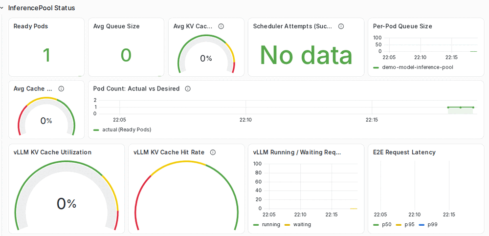
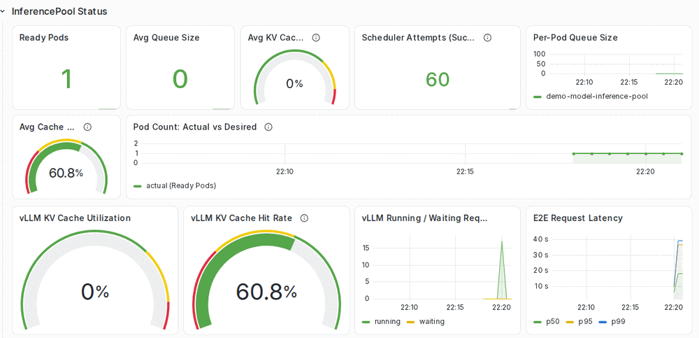
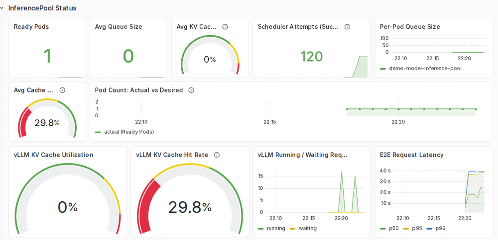
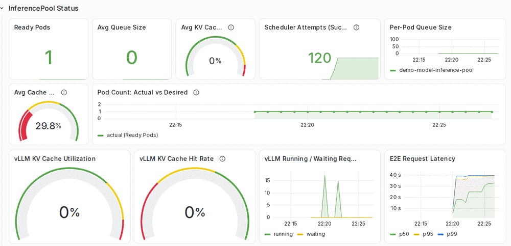

<!-- tut-translation source=README.md sha=5f7897e55dc0 -->
# 스케줄러의 눈으로 보기 - 메트릭 관찰

<!-- tut:header -->

<!-- tutorial.yaml에서 `./tut sync`로 생성됨 — 직접 수정하지 마세요. -->
> **상태:** 🚧 작성 중 · **검증된 KServe:** v0.18.0 · **환경:** [`kind-kserve/v1`](../../envs/kind-kserve/v1/) · **GPU:** 불필요
>
> 🌐 [English](README.md)

<!-- /tut -->

LLMInferenceService에는 여기서 중요한 두 종류의 Pod가 있습니다. 하나는 답을 계산하는
모델 서버인 **vLLM**이고, 다른 하나는 **EPP**(endpoint picker)입니다. EPP는 스케줄러로,
Gateway의 프록시인 Envoy가 각 요청을 어느 vLLM Pod로 보낼지 물어보는 대상입니다.
InferencePool은 이 둘을 묶어 주는 오브젝트로, vLLM Pod 목록을 갖고 EPP를 지정합니다.
두 종류의 Pod 모두 Prometheus 메트릭을 노출합니다. 이 튜토리얼에서는 Prometheus로 메트릭을
수집하고 Grafana로 보여 준 다음, 두 가지 부하를 보내서 어떤 숫자가 왜 움직이는지 살펴봅니다.

> **핵심 질문:** 스케줄러는 어떤 메트릭을 보고 있으며, 부하가 걸리면 이 값들은
> 어떻게 변할까?

배울 내용:

- 숫자가 어디서 오는지: vLLM은 모델 서버 내부에서 일어나는 일(실행 중/대기 중 요청,
  KV cache, prefix cache)을 보고하고, EPP는 풀에 대한 자신의 관점과 자신의 결정을
  보고합니다.
- Prometheus가 메트릭을 가져가는 방법: ServiceMonitor, 그리고 `/metrics` 엔드포인트가
  보호되어 있는 EPP를 위한 토큰.
- prefix cache가 무엇이고 숫자로 어떻게 읽는지: 앞부분이 같은 프롬프트에서는 어떤
  카운터가 오르고, 그렇지 않은 프롬프트에서는 어떤 카운터가 그대로인지.
- vLLM의 prefix cache와 EPP의 prefix index는 서로 다른 것이라는 점, 그리고 이 구성에서
  EPP가 모든 요청을 세 번씩 세는 이유.
- 이름이나 위치가 오해를 부르는 패널까지 포함해서 대시보드를 읽는 방법.

## Step 0: 환경

KServe LLMInferenceService와 그 게이트웨이 스택이 설치된 Kind 클러스터를 준비하고(위의
환경 링크 참고), 아래에서 사용할 namespace를 만듭니다. 여러 번 실행해도 안전합니다.

<!-- tut:setup -->

```bash run
# Generated from tutorial.yaml by `./tut sync` — do not edit by hand.
export KSERVE_VERSION="${KSERVE_VERSION:-v0.18.0}"
export NS="${NS:-llmisvc-monitoring}"
export REPO_ROOT="$(git rev-parse --show-toplevel)"
source "$REPO_ROOT/tools/local-config.sh"   # your settings in .tut.env, if any
export TUT_LIB="$REPO_ROOT/lib"
# pinned CLI tools of the environment, for this shell only
export PATH="$REPO_ROOT/.tools/kind/v0.30.0:$REPO_ROOT/.tools/kubectl/v1.34.13:$REPO_ROOT/.tools/helm/v3.16.3:$REPO_ROOT/.tools/cloud-provider-kind/v0.12.0:$PATH"
# what this tutorial needs from the environment (env_options in tutorial.yaml)
TUT_ENV_TYPES=llmisvc TUT_ENV_MODE=standard TUT_ENV_KEDA=false "$REPO_ROOT/envs/kind-kserve/v1/setup.sh"
kubectl create namespace "$NS" --dry-run=client -o yaml | kubectl apply -f -
cd "$REPO_ROOT/tutorials/llmisvc-monitoring"
```

<!-- /tut -->

## Step 1: LLMInferenceService 배포

메트릭이 나오려면 모델이 있어야 합니다. CPU에서 vLLM으로 `facebook/opt-125m`을 서빙하는
LLMInferenceService 하나를 적용합니다. anatomy, request-flow 튜토리얼에서 쓴 것과 같은
것입니다. LLMInferenceService 학습 경로를 따라왔다면 이미 실행 중이므로 이 단계는
건너뜁니다.

<!-- tut:use llmisvc-demo-model -->

<!-- Copied from llmisvc-anatomy (tut:define llmisvc-demo-model) by `./tut sync` — do not edit by hand. -->

```bash run
kubectl apply -f manifests/llmisvc-cpu.yaml -n "$NS"
```

<!-- /tut -->

<details>
<summary>manifests/llmisvc-cpu.yaml</summary>

<!-- tut:include manifests/llmisvc-cpu.yaml -->

```yaml
apiVersion: serving.kserve.io/v1alpha2
kind: LLMInferenceService
metadata:
  name: demo-model
spec:
  model:
    uri: "hf://facebook/opt-125m"
    name: facebook/opt-125m
  replicas: 1
  router:
    scheduler: {}
    route: {}
    gateway: {}
  template:
    containers:
      - name: main
        image: public.ecr.aws/q9t5s3a7/vllm-cpu-release-repo:v0.19.0
        securityContext:
          runAsNonRoot: true
          runAsUser: 1000
        env:
          - name: USER
            value: nonroot
          - name: VLLM_LOGGING_LEVEL
            value: DEBUG
          - name: VLLM_CPU_KVCACHE_SPACE
            value: "1"
          - name: VLLM_ADDITIONAL_ARGS
            value: "--block-size 16"
        resources:
          limits:
            cpu: "2"
            memory: 7Gi
          requests:
            cpu: 200m
            memory: 2Gi
        livenessProbe:
          initialDelaySeconds: 180
          periodSeconds: 30
          timeoutSeconds: 30
          failureThreshold: 8
        readinessProbe:
          initialDelaySeconds: 30
          periodSeconds: 10
          timeoutSeconds: 5
          failureThreshold: 3
```

<!-- /tut -->

</details>

서비스가 `Ready`가 될 때까지 기다립니다. 모델을 내려받고 CPU에서 vLLM을 시작하는 데
몇 분 걸립니다.

```bash verify
kubectl wait --for=condition=Ready llminferenceservice/demo-model -n "$NS" --timeout=900s
```

## Step 2: Prometheus와 Grafana 설치

이 환경에는 모니터링 스택이 없으므로, 같은 클러스터의 `monitoring` namespace에 Helm으로
[kube-prometheus-stack](https://github.com/prometheus-community/helm-charts/tree/main/charts/kube-prometheus-stack)을
설치합니다. Grafana는 NodePort 30090, Prometheus는 NodePort 30091로 노출되어 내 머신에서
둘 다 접근할 수 있습니다. 처음 설치할 때는 이미지 여러 개를 받느라 몇 분 걸립니다. 같은
스택이 필요한 이후 튜토리얼들도 이 단계를 재사용합니다.

<!-- tut:define monitoring-stack -->

```bash run
PROM_STACK_VERSION="${PROM_STACK_VERSION:-93.6.1}"
helm repo add prometheus-community https://prometheus-community.github.io/helm-charts --force-update
helm repo update prometheus-community

helm upgrade --install prometheus prometheus-community/kube-prometheus-stack \
  --version "$PROM_STACK_VERSION" \
  -n monitoring --create-namespace \
  --set grafana.service.type=NodePort \
  --set grafana.service.nodePort=30090 \
  --wait --timeout 10m

# Prometheus itself on NodePort 30091
kubectl patch svc prometheus-kube-prometheus-prometheus -n monitoring \
  -p '{"spec":{"type":"NodePort","ports":[{"name":"http-web","port":9090,"targetPort":9090,"nodePort":30091}]}}'
```

이 chart가 설치하는 것 중 여기서 중요한 것은 세 가지입니다. ServiceMonitor
객체를 지켜보다가 Prometheus scrape 설정으로 바꾸는 **Prometheus operator**,
15초마다 대상을 scrape해서 숫자를 저장하는 **Prometheus** 서버, 그 숫자를
그리는 **Grafana**입니다. 설치 중 Helm이 `unrecognized format "int32"` 같은
경고를 출력하는데, chart의 스키마에서 나오는 것이고 설치에는 영향이 없습니다.

Helm은 operator와 Grafana까지만 기다립니다. Prometheus 서버는 operator가 조금
뒤에 만드는 StatefulSet이므로, 이것도 기다립니다.

```bash verify retry=10 delay=15
kubectl rollout status statefulset prometheus-prometheus-kube-prometheus-prometheus -n monitoring --timeout=300s
kubectl rollout status deployment prometheus-grafana -n monitoring --timeout=300s
```

<!-- /tut -->

## Step 3: Prometheus가 vLLM과 EPP 스케줄러를 스크레이프하도록 설정

### 3-1. EPP 메트릭을 읽을 수 있는 아이덴티티

vLLM의 `/metrics`는 Pod에 접근할 수 있는 누구에게나 열려 있습니다. EPP는 그렇지 않습니다.
EPP는 `metrics-endpoint-auth: true`(기본값)로 배포되기 때문에 bearer token을 요구하고,
토큰 소유자가 non-resource URL `/metrics`에 `get` 권한이 있는지 API 서버에 확인합니다.
정확히 그 권한만 가진 ServiceAccount `metrics-reader`와, 이 계정용 장기 토큰 Secret을
만듭니다. Prometheus는 계속해서 스크레이프하므로 만료되지 않는 이 토큰을 쓰고, Step 5의
일회성 조회에서는 단기 토큰(`kubectl create token`)을 씁니다. 둘 다 같은 ServiceAccount에
속합니다. `/metrics`는 namespace 안의 Kubernetes 오브젝트가 아니라 URL("non-resource
URL")이라서 ClusterRole로만 권한을 줄 수 있습니다. 그래서 role과 그 binding은 클러스터
범위이고, 정리 단계에서 이름으로 삭제합니다.

```bash run
kubectl apply -f manifests/metrics-reader.yaml -n "$NS"
kubectl create clusterrolebinding llmisvc-monitoring-metrics-reader \
  --clusterrole=llmisvc-monitoring-metrics-reader \
  --serviceaccount="$NS:metrics-reader" \
  --dry-run=client -o yaml | kubectl apply -f -
```

<details>
<summary>manifests/metrics-reader.yaml</summary>

<!-- tut:include manifests/metrics-reader.yaml -->

```yaml
# Identity used to read the EPP scheduler's /metrics endpoint.
# The endpoint checks the bearer token (TokenReview) and asks the API server
# whether its owner may "get" the non-resource URL /metrics.
apiVersion: v1
kind: ServiceAccount
metadata:
  name: metrics-reader
---
apiVersion: rbac.authorization.k8s.io/v1
kind: ClusterRole
metadata:
  name: llmisvc-monitoring-metrics-reader
rules:
  - nonResourceURLs: ["/metrics"]
    verbs: ["get"]
---
# Long-lived token of the ServiceAccount: Prometheus sends it on every scrape.
apiVersion: v1
kind: Secret
metadata:
  name: metrics-reader-token
  annotations:
    kubernetes.io/service-account.name: metrics-reader
type: kubernetes.io/service-account-token
```

<!-- /tut -->

</details>

Kubernetes가 Secret에 ServiceAccount의 토큰을 채워 넣습니다.

```bash verify retry=5 delay=3
test -n "$(kubectl get secret metrics-reader-token -n "$NS" -o jsonpath='{.data.token}')"
```

### 3-2. 두 Service를 위한 ServiceMonitor

ServiceMonitor 하나로 vLLM(포트 8000)과 EPP 스케줄러(포트 9090)를 모두 스크레이프합니다.
EPP 엔드포인트는 `bearerTokenSecret`에 토큰 Secret을 지정합니다. operator가 그 Secret을
직접 읽어서 Prometheus용으로 생성하는 설정에 토큰을 써 넣고, 설정은 알아서 다시
로드됩니다. 재시작도 필요 없고, Prometheus 자신의 ServiceAccount에 Secret 접근 권한을 줄
필요도 없습니다. (확인해 봤습니다. Prometheus가 Secret을 읽을 수 없는 상태에서도 EPP
타깃은 `up`이었습니다.) 이 차트의 Prometheus는 모든 namespace에서 `release: prometheus`
레이블이 붙은 ServiceMonitor를 사용합니다. ServiceMonitor는 LLMInferenceService의 두
Service를 레이블로 선택하고, 각 엔드포인트는 해당 이름의 포트를 가진 Service에 적용됩니다
(EPP Service의 `metrics`, vLLM Service의 `https`).

```bash run
kubectl apply -f manifests/servicemonitor.yaml -n "$NS"
```

<details>
<summary>manifests/servicemonitor.yaml</summary>

<!-- tut:include manifests/servicemonitor.yaml -->

```yaml
# Scrapes both Services of the LLMInferenceService in this namespace:
# the EPP scheduler (port "metrics", 9090, bearer token required) and
# vLLM (port "https", 8000; the port is named https but serves plain HTTP
# unless TLS is enabled for LLMInferenceServices).
apiVersion: monitoring.coreos.com/v1
kind: ServiceMonitor
metadata:
  name: kserve-llmisvc-metrics
  labels:
    release: prometheus   # kube-prometheus-stack selects ServiceMonitors by its release name
spec:
  selector:
    matchLabels:
      app.kubernetes.io/part-of: llminferenceservice
  endpoints:
  - port: metrics
    path: /metrics
    interval: 15s
    bearerTokenSecret:
      name: metrics-reader-token
      key: token
  - port: https
    path: /metrics
    interval: 15s
    scheme: http
```

<!-- /tut -->

</details>

### 3-3. 스크레이프 타깃 확인

NodePort를 통해 Prometheus에 타깃 목록을 요청합니다. EPP Service와 vLLM Service 모두
`up`이어야 합니다. operator 처리, 설정 리로드, 첫 스크레이프까지 1~2분 걸리므로 검사는
재시도합니다. 첫 스크레이프 전까지 타깃은 `unknown`으로 표시되는데, 오류가 아닙니다.

```bash run
NODE_IP=$(kubectl get nodes -o jsonpath='{.items[0].status.addresses[?(@.type=="InternalIP")].address}')
echo "Prometheus: http://${NODE_IP}:30091"
```

```bash verify retry=20 delay=15
curl -s "http://${NODE_IP}:30091/api/v1/targets" | python3 -c 'import json, sys
up = set()
for t in json.load(sys.stdin)["data"]["activeTargets"]:
    svc = t["discoveredLabels"].get("__meta_kubernetes_service_name", "")
    if "epp" in svc or "workload" in svc:
        print(svc + ":", t["health"], t.get("lastError", ""))
        if t["health"] == "up":
            up.add(svc)
assert {"demo-model-epp-service", "demo-model-kserve-workload-svc"} <= up, "both targets must be up"'
```

예상 출력:

```text
demo-model-epp-service: up
demo-model-kserve-workload-svc: up
```

## Step 4: vLLM 메트릭 직접 살펴보기

대시보드보다 먼저 원시 숫자를 봅니다. vLLM은 `/metrics`에 Prometheus 텍스트 형식으로
메트릭을 노출합니다. 클러스터 안의 단기 Pod에서 읽어 옵니다. 이후 검사에서 다시 호출하기
때문에 명령을 함수로 만들었고, 이 튜토리얼에서 다루는 줄만 출력합니다(전체 출력에는
메트릭이 백 개쯤 있습니다). `kubectl run`이 세션이 컨테이너 로그에 기록된다고 경고하는데,
일반적인 안내일 뿐 여기서는 상관없습니다.

```bash run
vllm_metrics() {
  kubectl delete pod curl-vllm -n "$NS" --ignore-not-found
  kubectl run curl-vllm --rm -i --restart=Never -n "$NS" --image=curlimages/curl:8.11.1 -- \
    sh -c "sleep 2 && curl -s http://demo-model-kserve-workload-svc:8000/metrics"
}
vllm_metrics | grep -E '^vllm:(num_requests_(running|waiting)|kv_cache_usage_perc|prefix_cache_(hits|queries)_total|cache_config_info)'
```

요청을 보내기 전에 볼 것들(우리가 실행한 결과):

| 메트릭 | 현재 값 | 의미 |
|--------|-----------|---------------|
| `vllm:num_requests_running` | 0 | vLLM이 지금 계산 중인 요청 |
| `vllm:num_requests_waiting` | 0 | 실행 중인 배치가 가득 차서 대기열에 있는 요청 |
| `vllm:kv_cache_usage_perc` | 0 | 사용 중인 KV cache 비율(0~1) |
| `vllm:prefix_cache_queries_total` | 0 | vLLM이 prefix cache에서 조회한 프롬프트 토큰 수 |
| `vllm:prefix_cache_hits_total` | 0 | 그중 캐시에서 찾아서 다시 계산하지 않은 토큰 수 |
| `vllm:cache_config_info` | 레이블 `block_size="16"`, `enable_prefix_caching="True"` | 캐시 설정 |

**KV cache**는 vLLM이 처리한 모든 토큰의 중간 결과(key와 value)를 16토큰 단위 블록으로
보관하는 곳입니다. **prefix cache**는 그 블록을 재사용합니다. 새 프롬프트가 이전
프롬프트와 정확히 같은 토큰으로 시작하면, vLLM은 이미 계산된 블록을 찾아서 그 부분의
작업을 건너뜁니다. `vllm:kv_cache_usage_perc`는 실행 중인 요청이 점유한 블록만 셉니다
(비율 값이며, Grafana에서는 퍼센트로 표시). 요청이 끝나면 블록은 해제되지만 내용은
남아 있어서, vLLM이 공간을 필요로 할 때까지 prefix cache로 계속 쓰입니다. 그래서 부하가
끝난 뒤에는 사용률이 0으로 돌아가도 캐시는 여전히 hit합니다. `_total` 메트릭은 카운터라서
Pod가 시작된 시점부터 증가만 합니다. 학습 경로를 따라왔다면 앞선 튜토리얼에서 이미 요청을
몇 개 보냈으므로 카운터가 0이 아닙니다.

prefix cache가 켜져 있고, 이 튜토리얼에서 설정한 블록 크기를 쓰고 있습니다(Step 7의
노트 참고).

```bash verify retry=3 delay=10
vllm_metrics | grep '^vllm:cache_config_info' | grep 'block_size="16"' | grep -q 'enable_prefix_caching="True"'
```

## Step 5: EPP 스케줄러 메트릭 살펴보기

이번에는 EPP입니다. 엔드포인트에 토큰이 필요하므로, Step 3의 `metrics-reader`
ServiceAccount로 단기 토큰을 발급받습니다.

```bash run
epp_metrics() {
  TOKEN=$(kubectl create token metrics-reader -n "$NS" --duration=1h)
  kubectl delete pod curl-epp -n "$NS" --ignore-not-found
  kubectl run curl-epp --rm -i --restart=Never -n "$NS" --image=curlimages/curl:8.11.1 -- \
    sh -c "sleep 2 && curl -s -H 'Authorization: Bearer ${TOKEN}' \
    http://demo-model-epp-service.${NS}.svc:9090/metrics | grep -E '$1' || true"
}
epp_metrics '^(inference_pool_|inference_extension_scheduler_attempts_total|inference_objective_request_total|inference_extension_prefix_indexer_size)'
```

볼 것들(우리가 실행한 결과, 요청 전):

| 메트릭 | 현재 값 | 의미 |
|--------|-----------|---------------|
| `inference_pool_ready_pods` | 1 | 풀에서 Ready 상태인 vLLM Pod |
| `inference_pool_average_queue_size` | 0 | Pod들의 `vllm:num_requests_waiting`에 대한 EPP의 평균 |
| `inference_pool_per_pod_queue_size` | 0 | 같은 값, Pod별 |
| `inference_pool_average_kv_cache_utilization` | 0 | `vllm:kv_cache_usage_perc`에 대한 EPP의 평균 |
| `inference_extension_scheduler_attempts_total` | 아직 없음 | 스케줄링 결정 수. 첫 요청과 함께 줄이 나타남 |
| `inference_objective_request_total` | 아직 없음 | EPP가 본 요청 수, 모델별 |
| `inference_extension_prefix_indexer_size` | 0 | EPP 자체 prefix index의 항목 수(Step 7) |

`inference_pool_*` 값은 EPP가 직접 측정한 것이 아닙니다. EPP는 Prometheus의 15초
스크레이프와는 별개로 자기 주기에 따라 vLLM Pod에서 값을 읽어 오고, 점수 계산에 쓸 사본을
보관합니다. 그래서 잠깐 동안은 EPP의 사본과 vLLM의 실제 값이 다를 수 있습니다.
`inference_extension_*` 값은 EPP 자신의 작업에 관한 것입니다. `inference_objective_*`는
Gateway API Inference Extension의 오브젝트인 InferenceObjective에서 이름을 따왔는데, 이
튜토리얼에서는 InferenceObjective를 만들지 않습니다. 그래도 모든 요청을 모델 이름별로
셉니다.

풀이 ready Pod 하나를 보고합니다.

```bash verify retry=5 delay=10
epp_metrics '^inference_pool' | awk '$1 ~ /^inference_pool_ready_pods/ && $NF >= 1 {ok = 1} END {exit !ok}'
```

### EPP가 Pod를 고르는 방법

EPP의 설정은 KServe가 스케줄러에 인자로 넘기는 `EndpointPickerConfig`입니다. 출력해
봅니다.

```bash run
kubectl get deployment demo-model-kserve-router-scheduler -n "$NS" \
  -o jsonpath='{.spec.template.spec.containers[?(@.name=="main")].args}' \
  | python3 -c 'import json, sys; a = json.load(sys.stdin); print(a[a.index("--config-text") + 1])'
```

가중치가 붙은 scorer 두 개와 picker 하나가 있습니다.

```bash verify
kubectl get deployment demo-model-kserve-router-scheduler -n "$NS" \
  -o jsonpath='{.spec.template.spec.containers[?(@.name=="main")].args}' \
  | python3 -c 'import json, re, sys
a = json.load(sys.stdin); c = a[a.index("--config-text") + 1]
assert re.search(r"pluginRef: queue-scorer\s+weight: 2", c) and re.search(r"pluginRef: prefix-cache-scorer\s+weight: 3", c), c'
```

| 플러그인 | 점수 계산 기준 | 가중치 |
|--------|---------------------|--------|
| `queue-scorer` | EPP가 마지막으로 읽은 각 Pod의 `vllm:num_requests_waiting`: 대기가 적을수록 좋음 | 2 |
| `prefix-cache-scorer` | EPP **자체의** prefix index: 프롬프트 중 얼마만큼을 EPP가 이미 각 Pod에 보냈는지 | 3 |
| `max-score-picker` | 가중 합이 가장 높은 Pod를 선택 | |

prefix-cache-scorer는 vLLM의 prefix cache 메트릭을 읽지 **않습니다**. EPP가 스스로
추가하는 보조 플러그인 `approx-prefix-cache-producer`(위 설정에는 없지만 EPP의 플러그인
메트릭에 이름이 나타납니다)가 각 프롬프트를 블록 단위로 해싱하고, 스케줄링 전에 "어느
Pod가 어떤 프롬프트를 받았는지" 인덱스에서 조회하고, 스케줄링 후에 선택된 Pod를
기록합니다. 이 숫자가 vLLM의 숫자와 어떻게 다른지는 Step 7에서 봅니다. KV cache 사용률은
읽기는 하지만 이 설정에서는 점수 계산에 쓰이지 않습니다.

## Step 6: Grafana 대시보드 가져오기

Grafana API로 대시보드를 만듭니다. [dashboard.json](dashboard.json)은 Pod 리소스
패널에서 namespace를 `kserve-demo`로 지정하고 있는데, 가져올 때 `sed`로 이 튜토리얼의
namespace로 바꿉니다. 다시 가져오면 대시보드를 덮어씁니다.

```bash run
NODE_IP=$(kubectl get nodes -o jsonpath='{.items[0].status.addresses[?(@.type=="InternalIP")].address}')
GRAFANA_PASS=$(kubectl get secret -n monitoring prometheus-grafana -o jsonpath='{.data.admin-password}' | base64 -d)

sed "s/kserve-demo/${NS}/g" dashboard.json | curl -s -u "admin:${GRAFANA_PASS}" \
  -H "Content-Type: application/json" \
  -X POST "http://${NODE_IP}:30090/api/dashboards/db" \
  -d @-
```

```bash run
echo "Dashboard: http://${NODE_IP}:30090/d/llmisvc-overview"
echo "Login: admin / ${GRAFANA_PASS}"
```

이제 Grafana에 대시보드가 있습니다.

```bash verify retry=5 delay=5
curl -sf -u "admin:${GRAFANA_PASS}" "http://${NODE_IP}:30090/api/dashboards/uid/llmisvc-overview" \
  | python3 -c 'import json, sys; d = json.load(sys.stdin)["dashboard"]; print(d["title"]); assert d["uid"] == "llmisvc-overview"'
```

브라우저에서 URL을 열고 로그인합니다. Step 7에서 쓸 수 있도록 페이지를 열어 두세요.
10초마다 새로 고침됩니다.

### 대시보드 구성

<a href="images/dashboard-layout.png" target="_blank"></a>

그림을 클릭하면 원본 크기로 열립니다(Step 7이 끝난 시점에 찍은 것). 제목 옆에 (i)가 있는
패널에는 짧은 설명이 있으니 마우스를 올려 보세요.

섹션 이름은 패널이 다루는 컴포넌트를 따른 것이지, 항상 숫자의 출처를 따른 것은 아닙니다.
오해하기 쉬운 곳이 세 군데 있습니다.

- **Avg Cache Hit Rate**는 *InferencePool Status* 아래에 있지만, 풀이나 EPP가 아니라
  vLLM의 카운터로 계산됩니다.
- **vLLM KV Cache Hit Rate**는 바로 옆의 KV cache 사용률이 아니라 *prefix* cache
  (`prefix_cache_*` 카운터)를 측정합니다.
- **Scheduler Attempts**와 **Request Throughput**은 EPP 스케줄링 호출을 세는데, 이
  구성에서는 요청 하나당 호출이 세 번 일어납니다(Step 7). Scheduler Attempts는 성공한
  호출을 보여 주고, 실패한 호출은 두 번째 숫자로 나타납니다. Request Throughput은 5분
  구간의 rate라서, 300초에 걸쳐 퍼진 60번의 호출은 급증이 아니라 몇 분 동안 초당 0.2로
  표시됩니다.

학습 경로를 따라왔다면 앞선 튜토리얼의 요청도 카운터에 들어 있으므로 패널 숫자가 아래
그림과 다릅니다. Step 7의 검사는 각 부하만의 결과를 출력합니다.

**1. InferencePool Status**: EPP가 보는 풀

| 패널 | 쿼리 | 출처 |
|-------|-------|--------|
| Ready Pods | `inference_pool_ready_pods` | EPP |
| Avg Queue Size | `inference_pool_average_queue_size` | EPP (vLLM 대기 요청 수의 사본) |
| Avg KV Cache Utilization | `inference_pool_average_kv_cache_utilization` | EPP (vLLM KV cache 사용률의 사본) |
| Scheduler Attempts (Success/Fail) | `inference_extension_scheduler_attempts_total` | EPP |
| Per-Pod Queue Size | `inference_pool_per_pod_queue_size` | EPP |
| Avg Cache Hit Rate | `vllm:prefix_cache_hits_total / vllm:prefix_cache_queries_total`, 각 Pod 시작 이후 | **vLLM** |
| Pod Count: Actual vs Desired | `inference_pool_ready_pods`, `wva_desired_replicas` | EPP. "Desired"는 이 튜토리얼에서 설치하지 않는 WVA autoscaler에서 오므로 비어 있음 |

**2. EPP Scheduling Performance**: EPP가 걸리는 시간

| 패널 | 쿼리 |
|-------|-------|
| Scheduler E2E Latency | `inference_extension_scheduler_e2e_duration_seconds` p50/p95/p99 |
| Plugin Duration (avg) | scorer와 picker의 `inference_extension_plugin_duration_seconds` |

Scheduler E2E Latency는 Envoy가 질문한 뒤 EPP가 답할 때까지의 시간입니다. 우리가 실행한
결과는 50~100마이크로초였고 각 플러그인은 0.5~1.5마이크로초 걸렸습니다. vLLM이 답하는 데
걸리는 수 초에 비하면 아주 작습니다. 여기서 느린 쪽은 EPP가 아닙니다.

**3. Request & Token Stats**

| 패널 | 쿼리 |
|-------|-------|
| Request Throughput (RPS) | 모델별 초당 `inference_objective_request_total` (EPP. 여기서는 요청당 3) |

**4. vLLM Engine Status**: vLLM Pod에서 직접

| 패널 | 쿼리 |
|-------|-------|
| vLLM KV Cache Utilization | `vllm:kv_cache_usage_perc` |
| vLLM KV Cache Hit Rate | `rate(vllm:prefix_cache_hits_total[5m]) / rate(vllm:prefix_cache_queries_total[5m])`: **최근 5분**만 |
| vLLM Running / Waiting Requests | `vllm:num_requests_running`, `vllm:num_requests_waiting` |
| E2E Request Latency, TTFT | `vllm:e2e_request_latency_seconds`, `vllm:time_to_first_token_seconds` p50/p95/p99 |
| Prompt / Generation Token Throughput | 초당 `vllm:prompt_tokens_total`, `vllm:generation_tokens_total` |

**5. Pod Resource Usage**: vLLM 컨테이너와 스케줄러 컨테이너의 메모리와 CPU

부하를 걸기 전 패널은 다음과 같습니다. ready Pod 하나, 대기 없음, **Avg Cache Hit Rate**는
0%(0/0이 0이 되도록 쿼리가 분모에 0.001을 더함), **vLLM KV Cache Hit Rate**는 비어
있음(최근 5분 동안 요청이 없어서 나눌 것이 없음).

<a href="images/panels-idle.png" target="_blank"></a>

## Step 7: 부하를 걸고 메트릭 변화 관찰하기

클러스터 안의 Pod에서 Gateway를 거쳐 각각 20개 요청으로 된 두 번의 부하를 보냅니다.
먼저 모두 같은 프롬프트, 그다음 앞부분부터 다른 프롬프트입니다. 아래 각 검사는 부하
전후의 카운터를 읽기 때문에 해당 부하만의 결과를 보여 줍니다.

### 부하 1: 같은 프롬프트 20번 (prefix cache 재사용)

```bash run
# vLLM: prefix cache의 hit와 query, 카운터 레이블 전체에 대해 합산
prefix_cache() {
  vllm_metrics | awk '$1 ~ /^vllm:prefix_cache_hits_total/ {h += $2} $1 ~ /^vllm:prefix_cache_queries_total/ {q += $2} END {print h + 0, q + 0}'
}
# EPP: 스케줄링 시도 수, prefix index 조회 수, 그리고 hit ratio의 합
epp_counts() {
  epp_metrics '^inference_extension_(scheduler_attempts_total|prefix_indexer_hit_ratio_(sum|count))' \
    | awk '$1 ~ /^inference_extension_scheduler_attempts_total/ {a += $NF} $1 ~ /hit_ratio_count/ {c += $NF} $1 ~ /hit_ratio_sum/ {s += $NF} END {print a + 0, c + 0, s + 0}'
}
# InferencePool로 보내는 HTTPRoute 규칙 수 (Envoy는 규칙마다 EPP에 한 번씩 물어봄)
RULES=$(kubectl get httproute -n "$NS" -o json | python3 -c '
import json, sys
print(sum(1 for r in json.load(sys.stdin)["items"] for rule in r["spec"]["rules"]
          if any(b.get("kind") == "InferencePool" for b in rule.get("backendRefs", []))))')
read -r HITS0 QUERIES0 < <(prefix_cache)
read -r ATT0 LOOK0 RATIO0 < <(epp_counts)
GATEWAY_SVC=$(kubectl get svc -n envoy-gateway-system -l gateway.envoyproxy.io/owning-gateway-name=kserve-ingress-gateway -o jsonpath='{.items[0].metadata.name}').envoy-gateway-system.svc:80
BASE_PATH="/${NS}/demo-model"

# 같은 프롬프트로 요청 20개, 0.3초 간격
kubectl delete pod load-test -n "$NS" --ignore-not-found
kubectl run -n "$NS" load-test --rm -i --restart=Never --image=curlimages/curl:8.11.1 -- sh -c "
# KV cache 재사용을 위한 공통 prefix
COMMON_PREFIX='You are a helpful AI assistant specializing in computer science. Please provide a detailed explanation about'

for i in \$(seq 1 20); do
  curl -s --max-time 60 \
    \"http://${GATEWAY_SVC}${BASE_PATH}/v1/completions\" \
    -H 'Content-Type: application/json' \
    -d \"{\\\"model\\\":\\\"facebook/opt-125m\\\",\\\"prompt\\\":\\\"\${COMMON_PREFIX} machine learning algorithms and their applications.\\\",\\\"max_tokens\\\":200}\" &
  sleep 0.3
done
wait
echo 'KV Cache Hit Test Complete'
"
```

**vLLM의 prefix cache가 한 일.** 각 프롬프트는 25토큰입니다(모든 응답의
`prompt_tokens`). vLLM은 16토큰짜리 온전한 블록만 캐시하므로, 25토큰 프롬프트에는 온전한
블록 하나(토큰 1-16)와 재사용되지 않는 부분 블록 하나(17-25)가 있습니다. 첫 요청은 아무것도
찾지 못하고 25토큰을 전부 계산한 뒤 블록 1을 캐시에 남깁니다. vLLM은 블록을 계산하는
즉시 캐시하고, 프롬프트는 응답보다 먼저 계산되므로, 0.3초 간격으로 시작하는 나머지
19개 요청은 그 블록을 찾습니다. 각각 25토큰 중 16토큰을 찾습니다. 따라서
`prefix_cache_queries_total`은 20 x 25 = 500 오르고 `prefix_cache_hits_total`은
19 x 16 = 304 오릅니다. 61%입니다. 매번 실행할 때마다 정확히 500 중 304가 나왔고, 이
프롬프트로는 그 이상이 불가능합니다.

**EPP가 한 일.** 요청 20개에 대해 스케줄링 시도를 60번 했습니다. Envoy는 *ExtProc*
(external processing)을 통해 EPP와 통신합니다. Envoy 필터가 요청을 외부 서비스에 넘기고
답을 기다리는 방식입니다. Envoy Gateway는 InferencePool로 보내는 HTTPRoute 규칙마다
Gateway 리스너에 이런 필터를 하나씩 추가하는데, 이 route에는 규칙이 세 개
(`/v1/completions`, `/v1/chat/completions`, `/v1/responses`) 있습니다. 리스너의 필터들은
모든 요청이 통과하는 체인을 이루고, catch-all 규칙만 이 필터들을 끄기 때문에,
`/v1/completions`로 가는 요청은 세 필터를 모두 지나갑니다. 즉 EPP는 세 번 질문을
받습니다. (llmisvc-request-flow 튜토리얼에서 EPP 로그로 세 번의 호출을 보여 줍니다.)

prefix index는 60번 조회되었고 그중 59번 프롬프트를 찾았습니다. 맨 처음 조회만 빼고
전부입니다. 첫 조회가 Pod를 기록했고, 이후 조회는 같은 요청이든 다음 요청이든 그 기록을
찾았기 때문입니다. EPP는 vLLM의 tokenizer 없이 토큰 수를 추정하고 자체 블록 크기를
사용하므로(llm-d-router 소스), 그 숫자를 vLLM의 토큰 수와 비교할 수는 없습니다. 여기서는
각 조회의 점수가 0 아니면 1이었으므로, hit ratio의 합은 프롬프트를 찾은 조회 수와
같습니다.

```bash verify retry=3 delay=5
read -r HITS1 QUERIES1 < <(prefix_cache)
read -r ATT1 LOOK1 RATIO1 < <(epp_counts)
awk -v h=$((HITS1 - HITS0)) -v q=$((QUERIES1 - QUERIES0)) -v a=$((ATT1 - ATT0)) -v l=$((LOOK1 - LOOK0)) \
    -v r0="$RATIO0" -v r1="$RATIO1" -v rules="$RULES" 'BEGIN {
  printf "vLLM prefix cache: %d of %d prompt tokens were hits\n", h, q
  printf "EPP: %d scheduling attempts for 20 requests (%d route rules), %d prefix index lookups, hit ratios add up to %.0f\n", a, rules, l, r1 - r0
  exit !(q > 0 && h / q >= 0.5 && a == 20 * rules)
}'
```

예상 출력(우리가 실행한 결과):

```text
vLLM prefix cache: 304 of 500 prompt tokens were hits
EPP: 60 scheduling attempts for 20 requests (3 route rules), 60 prefix index lookups, hit ratios add up to 59
```

이 부하 후 대시보드(우리가 실행한 결과): **Scheduler Attempts** 60, 두 hit rate 패널 모두
60.8%, **vLLM Running**은 15~20(Prometheus는 15초마다 샘플링하므로 배치의 어느 한
순간을 잡습니다. 요청 20개가 모두 한 배치에 들어가므로 **waiting**과 대기열 패널은 0에
머뭅니다), 그리고 요청이 끝나면 KV cache 게이지는 다시 0%가 됩니다.

<a href="images/panels-after-prefix.png" target="_blank"></a>

> **참고:** CPU에서 vLLM의 기본값은 `block_size=128`이라서, 무언가 재사용되려면 동일한
> 토큰이 128개 있어야 합니다. 이 튜토리얼의 LLMInferenceService는 `VLLM_ADDITIONAL_ARGS`로
> GPU 기본값인 `--block-size 16`을 설정해서 짧은 프롬프트로도 효과가 보이게 합니다.

### 부하 2: 서로 다른 프롬프트 20개 (prefix cache 재사용 없음)

같은 부하지만, 각 프롬프트의 처음 몇 토큰 안에 실행 번호와 자신의 번호 `$i`가 들어
있습니다. 블록은 16토큰이 모두 일치해야만 재사용되므로, 어떤 두 프롬프트도 블록을
공유하지 않습니다. 실행 번호는 두 번째 실행이 첫 번째 실행의 프롬프트를 찾지 못하게
합니다.

```bash run
read -r HITS0 QUERIES0 < <(prefix_cache)
read -r ATT0 LOOK0 RATIO0 < <(epp_counts)
RUN_ID=$(date +%s)
kubectl delete pod load-test-varied -n "$NS" --ignore-not-found
kubectl run -n "$NS" load-test-varied --rm -i --restart=Never --image=curlimages/curl:8.11.1 -- sh -c "
for i in \$(seq 1 20); do
  curl -s --max-time 60 \
    \"http://${GATEWAY_SVC}${BASE_PATH}/v1/completions\" \
    -H 'Content-Type: application/json' \
    -d \"{\\\"model\\\":\\\"facebook/opt-125m\\\",\\\"prompt\\\":\\\"Run ${RUN_ID} topic \$i: write a detailed essay about this topic in computer science. Cover the history and future.\\\",\\\"max_tokens\\\":200}\" &
  sleep 0.3
done
wait
echo 'Varied Prompts Test Complete'
"
```

**vLLM**: `prefix_cache_queries_total`은 520(26토큰 프롬프트 20개) 오르고
`prefix_cache_hits_total`은 움직이지 않습니다. 520 중 0입니다.

**EPP**: 시도 60번, 조회 60번이 늘었고, vLLM은 아무것도 재사용하지 않았는데도 hit ratio의
합은 40입니다. 각 요청의 첫 조회는 miss가 나면서 Pod를 기록하고, 잠시 뒤 다음 ExtProc
필터가 하는 같은 요청의 두 번째, 세 번째 조회는 그 기록을 찾습니다. 요청당 세 번 호출되는
효과가 이번에는 EPP의 hit 숫자에 다시 나타난 것입니다.

```bash verify retry=3 delay=5
read -r HITS1 QUERIES1 < <(prefix_cache)
read -r ATT1 LOOK1 RATIO1 < <(epp_counts)
awk -v h=$((HITS1 - HITS0)) -v q=$((QUERIES1 - QUERIES0)) -v a=$((ATT1 - ATT0)) -v l=$((LOOK1 - LOOK0)) \
    -v r0="$RATIO0" -v r1="$RATIO1" 'BEGIN {
  printf "vLLM prefix cache: %d of %d prompt tokens were hits\n", h, q
  printf "EPP: %d scheduling attempts, %d prefix index lookups, hit ratios add up to %.0f\n", a, l, r1 - r0
  exit !(q > 0 && h == 0)
}'
```

예상 출력(우리가 실행한 결과):

```text
vLLM prefix cache: 0 of 520 prompt tokens were hits
EPP: 60 scheduling attempts, 60 prefix index lookups, hit ratios add up to 40
```

이제 대시보드의 두 hit rate 패널은 0%가 아니라 **29.8%**를 보여 줍니다. 구간 안의 전체
hit를 전체 query로 나누기 때문에, 두 부하를 합쳐 1020 중 304입니다. **Scheduler Attempts**는
120입니다.

<a href="images/panels-after-varied.png" target="_blank"></a>

### 두 hit rate 패널이 갈라지는 지점

마지막 부하 후 5분을 기다렸다가 다시 봅니다. **Avg Cache Hit Rate**는 여전히 29.8%입니다.
Pod 시작 이후의 카운터로 나누는데, 카운터가 더 이상 변하지 않기 때문입니다. **vLLM KV
Cache Hit Rate**는 0%로 떨어집니다. 최근 5분만 보는데 그동안 아무 일도 없었기 때문입니다.
"캐시가 전체적으로 얼마나 잘 동작했나"는 앞의 패널로, "지금 어떻게 동작하고 있나"는 뒤의
패널로 보세요.

<a href="images/panels-later.png" target="_blank"></a>

vLLM Pod가 하나뿐이면 EPP에게는 선택지가 없습니다. 점수와 상관없이 모든 요청이 같은
Pod로 갑니다. scorer가 결정을 바꾸는 것을 보려면 최소 두 개의 replica(매니페스트에
`replicas: 2`)와 한 Pod의 대기열을 채우거나 하나의 프롬프트 prefix를 계속 보내는 부하가
필요합니다. 그런 다음 Per-Pod Queue Size를 지켜보세요. 이 튜토리얼은 replica 하나를
유지합니다.

### 부하가 Prometheus에 들어 있음

대시보드는 Prometheus에서 데이터를 읽습니다. Prometheus에 직접 물어보면, EPP는 ready
Pod를 보고하고(토큰으로 스크레이프됨) vLLM은 위의 요청에 대해 토큰을 생성했습니다.
스크레이프가 15초마다 일어나므로 재시도합니다.

```bash verify retry=8 delay=15
prom_positive() {
  curl -s "http://${NODE_IP}:30091/api/v1/query" --data-urlencode "query=$1" \
    | python3 -c 'import json, sys
r = json.load(sys.stdin)["data"]["result"]
v = float(r[0]["value"][1]) if r else 0.0
print(sys.argv[1], "=", v)
assert v > 0' "$1"
}
prom_positive 'sum(inference_pool_ready_pods)'
prom_positive 'sum(vllm:generation_tokens_total)'
```

## 정리

LLMInferenceService를 삭제하면 컨트롤러가 그것을 위해 만든 모든 것이 제거됩니다.
ServiceMonitor, 토큰 Secret, RBAC은 namespace와 함께 삭제되고, ClusterRole과 그 binding은
클러스터 범위라서 이름으로 삭제합니다. 그다음 모니터링 스택을 제거합니다. Helm은 차트가
설치한 CRD(`servicemonitors.monitoring.coreos.com`, ...)를 삭제하지 않습니다. CRD는
클러스터에 남지만 해가 되지는 않습니다.

```bash cleanup
kubectl delete pod curl-vllm curl-epp load-test load-test-varied -n "$NS" --ignore-not-found
kubectl delete llminferenceservice demo-model -n "$NS" --ignore-not-found --wait=true
kubectl delete clusterrolebinding llmisvc-monitoring-metrics-reader --ignore-not-found
kubectl delete clusterrole llmisvc-monitoring-metrics-reader --ignore-not-found
kubectl delete namespace "$NS" --ignore-not-found
helm uninstall prometheus -n monitoring --ignore-not-found --wait
kubectl delete namespace monitoring --ignore-not-found
```

Kind 클러스터 자체는 이 환경의 튜토리얼들이 함께 쓰므로, 다 끝나면 환경의 `teardown.sh`로
제거하세요.

## 배운 내용

- vLLM과 EPP는 모두 메트릭을 노출하지만 다루는 대상이 다릅니다. vLLM은 모델 서버 내부의
  작업(실행 중/대기 중 요청, KV cache, prefix cache)을, EPP는 자신이 보는 풀과 자신의
  결정을 다룹니다.
- Prometheus는 ServiceMonitor 하나로 둘 다 스크레이프합니다. EPP 엔드포인트에는
  `get /metrics` 권한이 있는 ServiceAccount의 토큰이 필요하고, Prometheus operator가 토큰
  Secret을 읽어 설정에 넣어 줍니다.
- prefix cache는 온전한 블록 단위로 동작합니다. 동일한 25토큰 프롬프트 20개는 500토큰 중
  304토큰을 재사용하고(첫 번째를 제외하고 각각 16토큰 블록 하나), 첫 블록에서 달라지는
  프롬프트는 아무것도 재사용하지 않습니다.
- vLLM의 prefix cache와 EPP의 prefix index는 서로 다른 것입니다. EPP는 자신이 라우팅한
  내용을 바탕으로 자체 블록 단위로 추정할 뿐, vLLM의 캐시 메트릭을 읽지 않습니다.
- 기본 HTTPRoute에서는 Envoy가 요청당 EPP에 세 번 물어보므로, EPP의 모든 카운터(시도,
  요청, 인덱스 조회)는 요청 수의 세 배가 됩니다.
- 두 hit rate 패널은 같은 vLLM 카운터를 서로 다른 구간(Pod 시작 이후, 또는 최근 5분)으로
  계산합니다.
