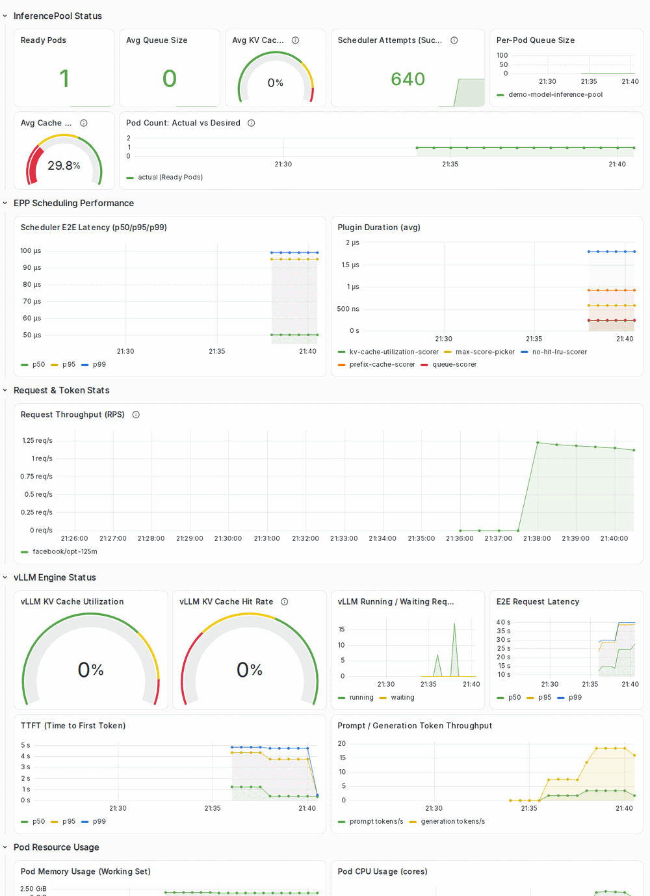
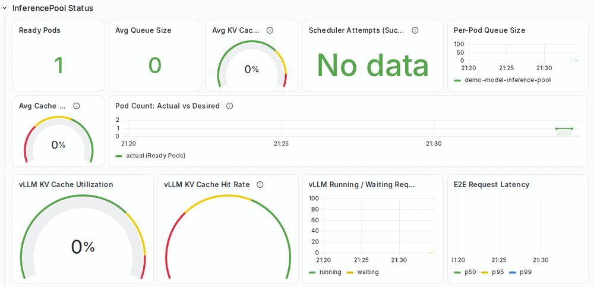
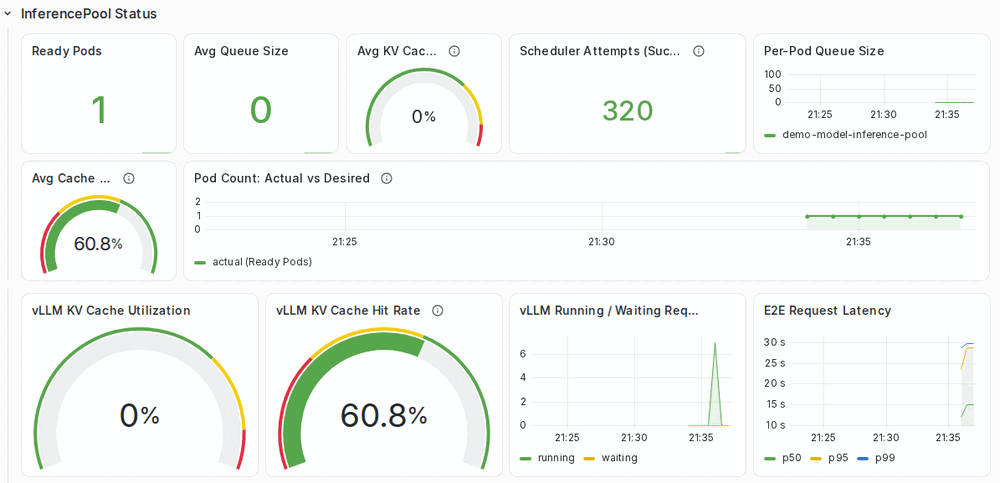
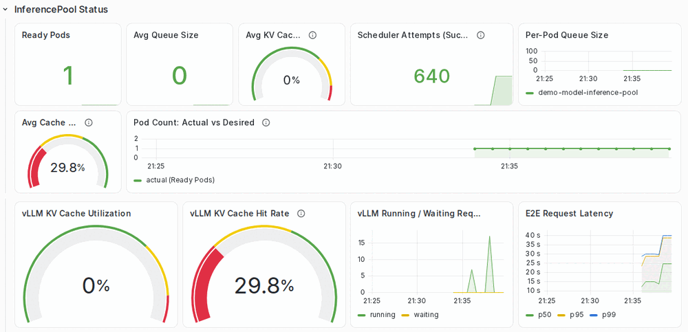
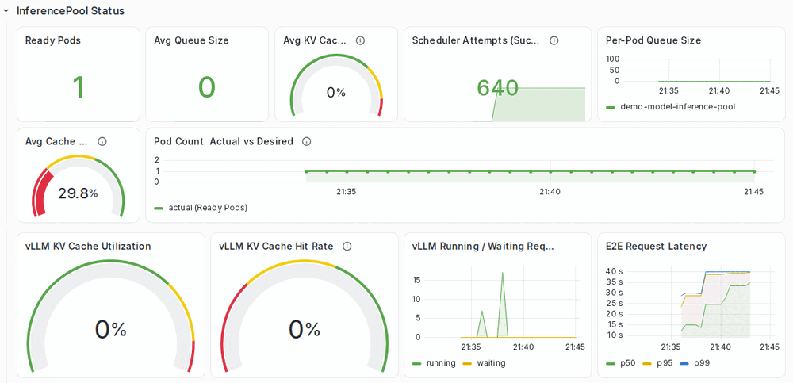

# Through the Scheduler's Eyes - Metric Observation

<!-- tut:header -->

<!-- Generated from tutorial.yaml by `./tut sync` — do not edit by hand. -->
> **Status:** 🚧 draft · **Tested with KServe:** v0.20.0 · **Environment:** [`kind-kserve/v1`](../../envs/kind-kserve/v1/) · **GPU:** not required
>
> 🌐 [한국어](README.ko.md)
>
> **Older KServe versions:** v0.18.0: [v0.18](revisions/v0.18/README.md)

<!-- /tut -->

An LLMInferenceService runs two kinds of Pods that matter here: **vLLM**, the
model server that computes the answers, and the **EPP** (endpoint picker), the
scheduler that Envoy, the Gateway's proxy, asks which vLLM Pod should get each
request. The InferencePool is the object that ties them together: it lists the
vLLM Pods and names the EPP. Both kinds of Pods publish Prometheus metrics. This
tutorial collects them with Prometheus, shows them in Grafana, and then sends
two kinds of load so you can see which numbers move and why.

> **Key question:** what metrics is the scheduler watching, and how do these
> values change under load?

What you will learn:

- Where the numbers come from: vLLM reports what happens inside the model
  server (requests running and waiting, KV cache, prefix cache), the EPP reports
  its own view of the pool and of its decisions.
- How Prometheus gets them: a ServiceMonitor, and a token for the EPP, whose
  `/metrics` endpoint is protected.
- What the prefix cache is and how to read it in the numbers: which counters
  rise for prompts that share a beginning, and which stay flat for prompts that
  do not.
- That vLLM's prefix cache and the EPP's prefix index are two different things,
  and why the EPP counts every request 16 times in this setup.
- How to read the dashboard, including panels whose name or place misleads.

## Step 0: Environment

This prepares a Kind cluster with KServe LLMInferenceService and its gateway
stack (see the environment link above) and creates the namespace used below. It
is safe to run again.

<!-- tut:setup -->

```bash run
# Generated from tutorial.yaml by `./tut sync` — do not edit by hand.
export KSERVE_VERSION="${KSERVE_VERSION:-v0.20.0}"
export NS="${NS:-llmisvc-monitoring}"
export REPO_ROOT="$(git rev-parse --show-toplevel)"
source "$REPO_ROOT/tools/local-config.sh"   # your settings in .tut.env, if any
export TUT_LIB="$REPO_ROOT/lib"
# pinned CLI tools of the environment, for this shell only
export PATH="$REPO_ROOT/.tools/kind/v0.30.0:$REPO_ROOT/.tools/kubectl/v1.34.13:$REPO_ROOT/.tools/helm/v3.16.3:$REPO_ROOT/.tools/cloud-provider-kind/v0.12.0:$PATH"
# what this tutorial needs from the environment (env_options in tutorial.yaml)
TUT_ENV_TYPES=llmisvc TUT_ENV_MODE=standard TUT_ENV_KEDA=false "$REPO_ROOT/envs/kind-kserve/v1/setup.sh"
kubectl create namespace "$NS" --dry-run=client -o yaml | kubectl apply -f -
cd "$REPO_ROOT/tutorials/llmisvc-monitoring"
```

<!-- /tut -->

## Step 1: Deploy the LLMInferenceService

The metrics need a model to come from. Apply one LLMInferenceService that
serves `facebook/opt-125m` with vLLM on CPU: the same one as in the anatomy and
request-flow tutorials. If you follow the LLMInferenceService learning path, it
is already running and this step is skipped.

<!-- tut:use llmisvc-demo-model -->

<!-- Copied from llmisvc-anatomy (tut:define llmisvc-demo-model) by `./tut sync` — do not edit by hand. -->

```bash run
kubectl apply -f manifests/llmisvc-cpu.yaml -n "$NS"
```

<!-- /tut -->

<details>
<summary>manifests/llmisvc-cpu.yaml</summary>

<!-- tut:include manifests/llmisvc-cpu.yaml -->

```yaml
apiVersion: serving.kserve.io/v1alpha2
kind: LLMInferenceService
metadata:
  name: demo-model
spec:
  model:
    uri: "hf://facebook/opt-125m"
    name: facebook/opt-125m
  replicas: 1
  router:
    scheduler: {}
    route: {}
    gateway: {}
  template:
    containers:
      - name: main
        image: public.ecr.aws/q9t5s3a7/vllm-cpu-release-repo:v0.19.0
        securityContext:
          runAsNonRoot: true
          runAsUser: 1000
        env:
          - name: USER
            value: nonroot
          - name: VLLM_LOGGING_LEVEL
            value: DEBUG
          - name: VLLM_CPU_KVCACHE_SPACE
            value: "1"
          - name: VLLM_ADDITIONAL_ARGS
            value: "--block-size 16"
        resources:
          limits:
            cpu: "2"
            memory: 7Gi
          requests:
            cpu: 200m
            memory: 2Gi
        livenessProbe:
          initialDelaySeconds: 180
          periodSeconds: 30
          timeoutSeconds: 30
          failureThreshold: 8
        readinessProbe:
          initialDelaySeconds: 30
          periodSeconds: 10
          timeoutSeconds: 5
          failureThreshold: 3
```

<!-- /tut -->

</details>

Wait until the service reports `Ready`. Downloading the model and starting vLLM
on CPU takes a few minutes.

```bash verify
kubectl wait --for=condition=Ready llminferenceservice/demo-model -n "$NS" --timeout=900s
```

## Step 2: Install Prometheus and Grafana

The environment has no monitoring stack, so install
[kube-prometheus-stack](https://github.com/prometheus-community/helm-charts/tree/main/charts/kube-prometheus-stack)
with Helm into the namespace `monitoring`, in the same cluster. Grafana is
exposed on NodePort 30090 and Prometheus on NodePort 30091, so both can be
reached from your machine. The first install pulls several images and takes a
few minutes. Later tutorials that need the same stack reuse this step.

<!-- tut:define monitoring-stack -->

```bash run
PROM_STACK_VERSION="${PROM_STACK_VERSION:-93.6.1}"
helm repo add prometheus-community https://prometheus-community.github.io/helm-charts --force-update
helm repo update prometheus-community

helm upgrade --install prometheus prometheus-community/kube-prometheus-stack \
  --version "$PROM_STACK_VERSION" \
  -n monitoring --create-namespace \
  --set grafana.service.type=NodePort \
  --set grafana.service.nodePort=30090 \
  --wait --timeout 10m

# Prometheus itself on NodePort 30091
kubectl patch svc prometheus-kube-prometheus-prometheus -n monitoring \
  -p '{"spec":{"type":"NodePort","ports":[{"name":"http-web","port":9090,"targetPort":9090,"nodePort":30091}]}}'
```

The chart installs three things that matter here: the **Prometheus
operator**, which watches ServiceMonitor objects and turns them into Prometheus
scrape configuration; the **Prometheus** server, which scrapes the targets
every 15 seconds and stores the numbers; and **Grafana**, which draws them.
Helm prints warnings such as `unrecognized format "int32"` while it installs;
they come from the chart's schema and do not affect the install.

Helm waits for the operator and Grafana. The Prometheus server itself is a
StatefulSet that the operator creates a moment later; wait for it too:

```bash verify retry=10 delay=15
kubectl rollout status statefulset prometheus-prometheus-kube-prometheus-prometheus -n monitoring --timeout=300s
kubectl rollout status deployment prometheus-grafana -n monitoring --timeout=300s
```

<!-- /tut -->

## Step 3: Let Prometheus scrape vLLM and the EPP scheduler

### 3-1. An identity that may read the EPP metrics

vLLM's `/metrics` is open to anyone who can reach the Pod. The EPP's is not:
the EPP is deployed with `metrics-endpoint-auth: true` (the default), so it
asks for a bearer token and checks with the API server that the token's owner
may `get` the non-resource URL `/metrics`. Create a ServiceAccount
`metrics-reader` with exactly that permission, and a long-lived token Secret
for it. Prometheus scrapes forever, so it gets this token that does not expire;
the one-off reads in Step 5 use a short-lived token instead
(`kubectl create token`). Both belong to the same ServiceAccount. `/metrics`
is a URL, not a Kubernetes object in a namespace (a "non-resource URL"), so
only a ClusterRole can grant it; that is why the role and its binding are
cluster-wide and deleted by name in the cleanup.

```bash run
kubectl apply -f manifests/metrics-reader.yaml -n "$NS"
kubectl create clusterrolebinding llmisvc-monitoring-metrics-reader \
  --clusterrole=llmisvc-monitoring-metrics-reader \
  --serviceaccount="$NS:metrics-reader" \
  --dry-run=client -o yaml | kubectl apply -f -
```

<details>
<summary>manifests/metrics-reader.yaml</summary>

<!-- tut:include manifests/metrics-reader.yaml -->

```yaml
# Identity used to read the EPP scheduler's /metrics endpoint.
# The endpoint checks the bearer token (TokenReview) and asks the API server
# whether its owner may "get" the non-resource URL /metrics.
apiVersion: v1
kind: ServiceAccount
metadata:
  name: metrics-reader
---
apiVersion: rbac.authorization.k8s.io/v1
kind: ClusterRole
metadata:
  name: llmisvc-monitoring-metrics-reader
rules:
  - nonResourceURLs: ["/metrics"]
    verbs: ["get"]
---
# Long-lived token of the ServiceAccount: Prometheus sends it on every scrape.
apiVersion: v1
kind: Secret
metadata:
  name: metrics-reader-token
  annotations:
    kubernetes.io/service-account.name: metrics-reader
type: kubernetes.io/service-account-token
```

<!-- /tut -->

</details>

Kubernetes fills the Secret with a token for the ServiceAccount:

```bash verify retry=5 delay=3
test -n "$(kubectl get secret metrics-reader-token -n "$NS" -o jsonpath='{.data.token}')"
```

### 3-2. A ServiceMonitor for both Services

One ServiceMonitor scrapes vLLM (port 8000) and the EPP scheduler (port 9090).
The EPP endpoint names the token Secret in `bearerTokenSecret`. The operator
reads that Secret itself and writes the token into the configuration it
generates for Prometheus, and the configuration reloads on its own: no
restart, and no access to the Secret for Prometheus' own ServiceAccount. (We
checked: with Prometheus unable to read the Secret, the EPP target stayed
`up`.) This chart's Prometheus uses the ServiceMonitors of every namespace
that carry the label `release: prometheus`. The ServiceMonitor selects the two
Services of the LLMInferenceService by their label; each endpoint applies to
the Service that has a port of that name (`metrics` on the EPP Service, `http`
on the vLLM Service).

```bash run
kubectl apply -f manifests/servicemonitor.yaml -n "$NS"
```

<details>
<summary>manifests/servicemonitor.yaml</summary>

<!-- tut:include manifests/servicemonitor.yaml -->

```yaml
# Scrapes both Services of the LLMInferenceService in this namespace:
# the EPP scheduler (port "metrics", 9090, bearer token required) and
# vLLM (port "http", 8000: plain HTTP. With TLS enabled for
# LLMInferenceServices the port is named "https" instead, and this endpoint
# would need that name and scheme).
apiVersion: monitoring.coreos.com/v1
kind: ServiceMonitor
metadata:
  name: kserve-llmisvc-metrics
  labels:
    release: prometheus   # kube-prometheus-stack selects ServiceMonitors by its release name
spec:
  selector:
    matchLabels:
      app.kubernetes.io/part-of: llminferenceservice
  endpoints:
  - port: metrics
    path: /metrics
    interval: 15s
    bearerTokenSecret:
      name: metrics-reader-token
      key: token
  - port: http
    path: /metrics
    interval: 15s
    scheme: http
```

<!-- /tut -->

</details>

### 3-3. Check the scrape targets

Ask Prometheus for its targets through the NodePort. Both the EPP Service and
the vLLM Service must be `up`. The operator, the configuration reload and the
first scrape take a minute or two, so the check retries; until the first
scrape a target shows `unknown`, which is not an error.

```bash run
NODE_IP=$(kubectl get nodes -o jsonpath='{.items[0].status.addresses[?(@.type=="InternalIP")].address}')
echo "Prometheus: http://${NODE_IP}:30091"
```

```bash verify retry=20 delay=15
curl -s "http://${NODE_IP}:30091/api/v1/targets" | python3 -c 'import json, sys
up = set()
for t in json.load(sys.stdin)["data"]["activeTargets"]:
    svc = t["discoveredLabels"].get("__meta_kubernetes_service_name", "")
    if "epp" in svc or "workload" in svc:
        print(svc + ":", t["health"], t.get("lastError", ""))
        if t["health"] == "up":
            up.add(svc)
assert {"demo-model-epp-service", "demo-model-kserve-workload-svc"} <= up, "both targets must be up"'
```

Expected output:

```text
demo-model-epp-service: up
demo-model-kserve-workload-svc: up
```

## Step 4: Inspect the vLLM metrics directly

Before any dashboard, look at the raw numbers. vLLM publishes them on
`/metrics` in Prometheus' text format; read them from a short-lived Pod inside
the cluster. The command is a function because later checks call it again, and
it prints only the lines this tutorial talks about (the full output has about a
hundred metrics). `kubectl run` warns that the session is recorded in the
container logs; that is general advice and does not matter here.

```bash run
vllm_metrics() {
  kubectl delete pod curl-vllm -n "$NS" --ignore-not-found
  kubectl run curl-vllm --rm -i --restart=Never -n "$NS" --image=curlimages/curl:8.11.1 -- \
    sh -c "sleep 2 && curl -s http://demo-model-kserve-workload-svc:8000/metrics"
}
vllm_metrics | grep -E '^vllm:(num_requests_(running|waiting)|kv_cache_usage_perc|prefix_cache_(hits|queries)_total|cache_config_info)'
```

What to look at, before any request has been sent (our run):

| Metric | Value now | What it means |
|--------|-----------|---------------|
| `vllm:num_requests_running` | 0 | requests vLLM is computing right now |
| `vllm:num_requests_waiting` | 0 | requests queued because the running batch is full |
| `vllm:kv_cache_usage_perc` | 0 | share of the KV cache in use (0 to 1) |
| `vllm:prefix_cache_queries_total` | 0 | prompt tokens vLLM looked up in its prefix cache |
| `vllm:prefix_cache_hits_total` | 0 | of those, tokens it found there and did not compute again |
| `vllm:cache_config_info` | labels `block_size="16"`, `enable_prefix_caching="True"` | how the cache is set up |

The **KV cache** is where vLLM keeps the intermediate results (keys and values)
of every token it has processed, in blocks of 16 tokens. The **prefix cache**
reuses those blocks: when a new prompt starts with exactly the same tokens as
an earlier one, vLLM finds the finished blocks and skips that part of the
work. `vllm:kv_cache_usage_perc` counts only the blocks that running requests
hold (as a fraction; Grafana shows it in percent). When a request ends, its
blocks are released but keep their content, so they still serve the prefix
cache until vLLM needs the space: after a load, usage is back at 0 while the
cache still hits. `_total` metrics are counters: they only go up, from when the
Pod started. If you came here through the learning path, the earlier tutorials
already sent a few requests, so the counters are not 0.

The prefix cache is on, with the block size this tutorial set (see the note in
Step 7):

```bash verify retry=3 delay=10
vllm_metrics | grep '^vllm:cache_config_info' | grep 'block_size="16"' | grep 'enable_prefix_caching="True"' >/dev/null
```

## Step 5: Inspect the EPP scheduler metrics

Now the EPP. Its endpoint needs a token: take a short-lived one of the
`metrics-reader` ServiceAccount from Step 3.

```bash run
epp_metrics() {
  TOKEN=$(kubectl create token metrics-reader -n "$NS" --duration=1h)
  kubectl delete pod curl-epp -n "$NS" --ignore-not-found
  kubectl run curl-epp --rm -i --restart=Never -n "$NS" --image=curlimages/curl:8.11.1 -- \
    sh -c "sleep 2 && curl -s -H 'Authorization: Bearer ${TOKEN}' \
    http://demo-model-epp-service.${NS}.svc:9090/metrics | grep -E '$1' || true"
}
epp_metrics '^(inference_pool_|inference_extension_scheduler_attempts_total|inference_objective_request_total|inference_extension_prefix_indexer_size)'
```

What to look at (our run, before any request):

| Metric | Value now | What it means |
|--------|-----------|---------------|
| `inference_pool_ready_pods` | 1 | vLLM Pods of the pool that are Ready |
| `inference_pool_average_queue_size` | 0 | the EPP's average of `vllm:num_requests_waiting` over the Pods |
| `inference_pool_per_pod_queue_size` | 0 | the same, per Pod |
| `inference_pool_average_kv_cache_utilization` | 0 | the EPP's average of `vllm:kv_cache_usage_perc` |
| `inference_extension_scheduler_attempts_total` | not there yet | scheduling decisions; the line appears with the first request |
| `inference_objective_request_total` | not there yet | requests the EPP has seen, by model |
| `inference_extension_prefix_indexer_size` | 0 | entries in the EPP's own prefix index (Step 7) |

The `inference_pool_*` values are not measured by the EPP itself: it reads
them from the vLLM Pods on its own schedule, separate from Prometheus' 15-second
scrape, and keeps a copy that it scores with; for a moment its copy and vLLM's
own value can differ. The `inference_extension_*` values are about the EPP's
own work. The `inference_objective_*` ones are named after InferenceObjective,
an object of the Gateway API Inference Extension that this tutorial does not
create; they still count every request, by model name.

The pool reports one ready Pod:

```bash verify retry=5 delay=10
epp_metrics '^inference_pool' | awk '$1 ~ /^inference_pool_ready_pods/ && $NF >= 1 {ok = 1} END {exit !ok}'
```

### How the EPP picks a Pod

The EPP's configuration is an `EndpointPickerConfig` that KServe passes to the
scheduler as an argument. Print it:

```bash run
kubectl get deployment demo-model-kserve-router-scheduler -n "$NS" \
  -o jsonpath='{.spec.template.spec.containers[?(@.name=="main")].args}' \
  | python3 -c 'import json, sys; a = json.load(sys.stdin); print(a[a.index("--config-text") + 1])'
```

It has four scorers with their weights, and a picker:

```bash verify
kubectl get deployment demo-model-kserve-router-scheduler -n "$NS" \
  -o jsonpath='{.spec.template.spec.containers[?(@.name=="main")].args}' \
  | python3 -c 'import json, re, sys
a = json.load(sys.stdin); c = a[a.index("--config-text") + 1]
want = {"queue-scorer": 2, "kv-cache-utilization-scorer": 2, "prefix-cache-scorer": 3, "no-hit-lru-scorer": 2}
assert all(re.search(rf"pluginRef: {p}\s+weight: {w}\b", c) for p, w in want.items()), c'
```

| Plugin | What it scores with | Weight |
|--------|---------------------|--------|
| `queue-scorer` | `vllm:num_requests_waiting` of each Pod, as the EPP last read it: fewer waiting is better | 2 |
| `kv-cache-utilization-scorer` | `vllm:kv_cache_usage_perc` of each Pod, as the EPP last read it: a less full KV cache is better | 2 |
| `prefix-cache-scorer` | the EPP's **own** prefix index: how much of the prompt the EPP has already sent to each Pod | 3 |
| `no-hit-lru-scorer` | for a prompt the index does not know: which Pod got such a new prompt least recently | 2 |
| `max-score-picker` | takes the Pod with the highest weighted sum | |

The prefix-cache-scorer does **not** read vLLM's prefix cache metrics. A
helper the EPP adds on its own (it is not in the configuration above, but its
name shows up in the EPP's plugin metrics), `approx-prefix-cache-producer`, hashes each
prompt into blocks, looks them up in an index of "which Pod got which prompt"
before scheduling, and records the chosen Pod afterwards. Step 7 shows how its
numbers differ from vLLM's.

## Step 6: Import the Grafana dashboard

Create the dashboard through the Grafana API. [dashboard.json](dashboard.json)
names the namespace `kserve-demo` in its Pod resource panels; `sed` replaces it
with this tutorial's namespace on the way in. Importing again overwrites the
dashboard.

```bash run
NODE_IP=$(kubectl get nodes -o jsonpath='{.items[0].status.addresses[?(@.type=="InternalIP")].address}')
GRAFANA_PASS=$(kubectl get secret -n monitoring prometheus-grafana -o jsonpath='{.data.admin-password}' | base64 -d)

sed "s/kserve-demo/${NS}/g" dashboard.json | curl -s -u "admin:${GRAFANA_PASS}" \
  -H "Content-Type: application/json" \
  -X POST "http://${NODE_IP}:30090/api/dashboards/db" \
  -d @-
```

```bash run
echo "Dashboard: http://${NODE_IP}:30090/d/llmisvc-overview"
echo "Login: admin / ${GRAFANA_PASS}"
```

Grafana now has the dashboard:

```bash verify retry=5 delay=5
curl -sf -u "admin:${GRAFANA_PASS}" "http://${NODE_IP}:30090/api/dashboards/uid/llmisvc-overview" \
  | python3 -c 'import json, sys; d = json.load(sys.stdin)["dashboard"]; print(d["title"]); assert d["uid"] == "llmisvc-overview"'
```

Open the URL in a browser and log in. Keep the page open for Step 7; it
refreshes every 10 seconds.

### Dashboard layout

<a href="images/dashboard-layout.png" target="_blank"></a>

Click the picture to open it at full size (taken at the end of Step 7). Panels
with an (i) next to the title have a short note; hover over it.

The sections are named after the component a panel is about, not always after
where its number comes from. Three places mislead:

- **Avg Cache Hit Rate** sits under *InferencePool Status* but is computed from
  vLLM's counters, not from the pool or the EPP.
- **vLLM KV Cache Hit Rate** measures the *prefix* cache (`prefix_cache_*`
  counters), not the KV cache usage next to it.
- **Scheduler Attempts** and **Request Throughput** count EPP scheduling calls,
  and in this setup every request makes 16 of them (Step 7). Scheduler
  Attempts shows the successful ones; failed attempts would appear as a second
  number. Request Throughput is a rate over 5 minutes: 320 calls spread over
  300 seconds show as about 1.1 per second for several minutes, not as a spike.

If you came through the learning path, the earlier tutorials' requests are in
the counters too, so your panels show other numbers than the pictures below;
the checks in Step 7 print what each load alone did.

**1. InferencePool Status**: the pool as the EPP sees it

| Panel | Query | Source |
|-------|-------|--------|
| Ready Pods | `inference_pool_ready_pods` | EPP |
| Avg Queue Size | `inference_pool_average_queue_size` | EPP (its copy of vLLM's waiting requests) |
| Avg KV Cache Utilization | `inference_pool_average_kv_cache_utilization` | EPP (its copy of vLLM's KV cache usage) |
| Scheduler Attempts (Success/Fail) | `inference_extension_scheduler_attempts_total` | EPP |
| Per-Pod Queue Size | `inference_pool_per_pod_queue_size` | EPP |
| Avg Cache Hit Rate | `vllm:prefix_cache_hits_total / vllm:prefix_cache_queries_total`, since each Pod started | **vLLM** |
| Pod Count: Actual vs Desired | `inference_pool_ready_pods`, `wva_desired_replicas` | EPP; "Desired" comes from the WVA autoscaler, which this tutorial does not install, so it stays empty |

**2. EPP Scheduling Performance**: how long the EPP takes

| Panel | Query |
|-------|-------|
| Scheduler E2E Latency | `inference_extension_scheduler_e2e_duration_seconds` p50/p95/p99 |
| Plugin Duration (avg) | `inference_extension_plugin_duration_seconds` of the scorers and the picker |

Scheduler E2E Latency is the time from Envoy's question to the EPP's answer.
In our run it was 50 to 100 microseconds and each plugin took 0.5 to 1.5
microseconds, small next to the seconds vLLM needs to answer: the EPP is not
the slow part here.

**3. Request & Token Stats**

| Panel | Query |
|-------|-------|
| Request Throughput (RPS) | `inference_objective_request_total` per second, by model (EPP; 16 per request here) |

**4. vLLM Engine Status**: straight from the vLLM Pods

| Panel | Query |
|-------|-------|
| vLLM KV Cache Utilization | `vllm:kv_cache_usage_perc` |
| vLLM KV Cache Hit Rate | `rate(vllm:prefix_cache_hits_total[5m]) / rate(vllm:prefix_cache_queries_total[5m])`: the **last 5 minutes** only |
| vLLM Running / Waiting Requests | `vllm:num_requests_running`, `vllm:num_requests_waiting` |
| E2E Request Latency, TTFT | `vllm:e2e_request_latency_seconds`, `vllm:time_to_first_token_seconds` p50/p95/p99 |
| Prompt / Generation Token Throughput | `vllm:prompt_tokens_total`, `vllm:generation_tokens_total` per second |

**5. Pod Resource Usage**: memory and CPU of the vLLM and scheduler containers

Before any load, the panels look like this: one ready Pod, nothing queued,
**Avg Cache Hit Rate** at 0% (its query adds 0.001 to the divisor so that 0/0
becomes 0) and **vLLM KV Cache Hit Rate** empty (no request in the last 5
minutes, nothing to divide).

<a href="images/panels-idle.png" target="_blank"></a>

## Step 7: Apply load and watch the metrics change

Two loads of 20 requests each, sent from a Pod inside the cluster through the
Gateway: first prompts that are all the same, then prompts that differ early.
Each check below reads the counters before and after a load, so it shows what
that load alone did.

### Load 1: the same prompt 20 times (prefix cache reuse)

```bash run
# vLLM: hits and queries of the prefix cache, summed over the counters' labels
prefix_cache() {
  vllm_metrics | awk '$1 ~ /^vllm:prefix_cache_hits_total/ {h += $2} $1 ~ /^vllm:prefix_cache_queries_total/ {q += $2} END {print h + 0, q + 0}'
}
# EPP: scheduling attempts, prefix index lookups, and the sum of their hit ratios
epp_counts() {
  epp_metrics '^inference_extension_(scheduler_attempts_total|prefix_indexer_hit_ratio_(sum|count))' \
    | awk '$1 ~ /^inference_extension_scheduler_attempts_total/ {a += $NF} $1 ~ /hit_ratio_count/ {c += $NF} $1 ~ /hit_ratio_sum/ {s += $NF} END {print a + 0, c + 0, s + 0}'
}
# Matches of the HTTPRoute rules that send to the InferencePool (Envoy asks the EPP once per match)
MATCHES=$(kubectl get httproute -n "$NS" -o json | python3 -c '
import json, sys
print(sum(len(rule.get("matches", [])) for r in json.load(sys.stdin)["items"] for rule in r["spec"]["rules"]
          if any(b.get("kind") == "InferencePool" for b in rule.get("backendRefs", []))))')
read -r HITS0 QUERIES0 < <(prefix_cache)
read -r ATT0 LOOK0 RATIO0 < <(epp_counts)
GATEWAY_SVC=$(kubectl get svc -n envoy-gateway-system -l gateway.envoyproxy.io/owning-gateway-name=kserve-ingress-gateway -o jsonpath='{.items[0].metadata.name}').envoy-gateway-system.svc:80
BASE_PATH="/${NS}/demo-model"

# 20 requests with the same prompt, 0.3 s apart
kubectl delete pod load-test -n "$NS" --ignore-not-found
kubectl run -n "$NS" load-test --rm -i --restart=Never --image=curlimages/curl:8.11.1 -- sh -c "
# Common prefix for KV cache reuse
COMMON_PREFIX='You are a helpful AI assistant specializing in computer science. Please provide a detailed explanation about'

for i in \$(seq 1 20); do
  curl -s --max-time 60 \
    \"http://${GATEWAY_SVC}${BASE_PATH}/v1/completions\" \
    -H 'Content-Type: application/json' \
    -d \"{\\\"model\\\":\\\"facebook/opt-125m\\\",\\\"prompt\\\":\\\"\${COMMON_PREFIX} machine learning algorithms and their applications.\\\",\\\"max_tokens\\\":200}\" &
  sleep 0.3
done
wait
echo 'KV Cache Hit Test Complete'
"
```

**What vLLM's prefix cache did.** Each prompt is 25 tokens (`prompt_tokens` in
every answer). vLLM caches whole blocks of 16 tokens only, so a 25-token prompt
has one full block (tokens 1-16) and a partial one (17-25) that is never
reused. The first request finds nothing; it computes all 25 tokens and leaves
block 1 in the cache. vLLM caches a block as soon as it has computed it, and
the prompt is computed before any of the answer, so the next 19, which start
0.3 s apart, find it: each finds 16 of its 25 tokens. So `prefix_cache_queries_total` rises
by 20 x 25 = 500 and `prefix_cache_hits_total` by 19 x 16 = 304: 61%. We got
exactly 304 of 500 in every run, and with this prompt more is not possible.

**What the EPP did.** It made 320 scheduling attempts for 20 requests: 16
for each. Envoy talks to the EPP through *ExtProc* (external processing): an
Envoy filter hands the request to an outside service and waits for its answer.
In Envoy's configuration every **match** of an HTTPRoute rule is a route of
its own, and the Gateway's listener has one such filter for each of those
routes that sends to an InferencePool. The route has nine rules that do, with
16 matches together: four for the paths under `/<namespace>/demo-model`, four
for the same paths under `/publishers/...`, and one rule, `v1-model-routing`,
with eight matches (the bare `/v1/...` paths, chosen by a header). The filters
of a listener form a chain that every request to the pool passes through, so a
request to `/v1/completions` goes through all 16: the EPP is asked 16 times.
(The llmisvc-request-flow tutorial lists the rules and shows the 16 calls in
the EPP log.)

Its prefix index was looked up 320 times, and 319 lookups found the prompt:
all but the very first, because that one recorded the Pod and every later
lookup, of the same request or the next, found the record. The EPP estimates
tokens without vLLM's tokenizer and uses its own block size (llm-d-router
source), so its numbers cannot be compared with vLLM's token counts. Here each
lookup scored either 0 or 1, so the hit ratios add up to the number of lookups
that found the prompt.

```bash verify retry=3 delay=5
read -r HITS1 QUERIES1 < <(prefix_cache)
read -r ATT1 LOOK1 RATIO1 < <(epp_counts)
awk -v h=$((HITS1 - HITS0)) -v q=$((QUERIES1 - QUERIES0)) -v a=$((ATT1 - ATT0)) -v l=$((LOOK1 - LOOK0)) \
    -v r0="$RATIO0" -v r1="$RATIO1" -v matches="$MATCHES" 'BEGIN {
  printf "vLLM prefix cache: %d of %d prompt tokens were hits\n", h, q
  printf "EPP: %d scheduling attempts for 20 requests (%d route matches), %d prefix index lookups, hit ratios add up to %.0f\n", a, matches, l, r1 - r0
  exit !(q > 0 && h / q >= 0.5 && a == 20 * matches)
}'
```

Expected output (our run):

```text
vLLM prefix cache: 304 of 500 prompt tokens were hits
EPP: 320 scheduling attempts for 20 requests (16 route matches), 320 prefix index lookups, hit ratios add up to 319
```

On the dashboard after this load (our run): **Scheduler Attempts** 320, both
hit rate panels at 60.8%, **vLLM Running** with a peak somewhere up to 20,
7 in this picture (Prometheus samples every 15 seconds and catches the batch
at some moment of it; all 20 requests fit into one batch, so **waiting** and the queue panels stay at 0), and the KV
cache gauges at 0% again once the requests are done.

<a href="images/panels-after-prefix.png" target="_blank"></a>

> **Note:** vLLM on CPU defaults to `block_size=128`: a prompt would need 128
> identical tokens before anything is reused. The LLMInferenceService of this
> tutorial sets `--block-size 16` through `VLLM_ADDITIONAL_ARGS`, the GPU
> default, so short prompts show the effect.

### Load 2: 20 different prompts (no prefix cache reuse)

The same load, but each prompt carries a run number and its own number `$i`
within its first few tokens. A block is reused only if all 16 of its tokens
match, so no two prompts share a block. The run number keeps a second run from
finding the first run's prompts.

```bash run
read -r HITS0 QUERIES0 < <(prefix_cache)
read -r ATT0 LOOK0 RATIO0 < <(epp_counts)
RUN_ID=$(date +%s)
kubectl delete pod load-test-varied -n "$NS" --ignore-not-found
kubectl run -n "$NS" load-test-varied --rm -i --restart=Never --image=curlimages/curl:8.11.1 -- sh -c "
for i in \$(seq 1 20); do
  curl -s --max-time 60 \
    \"http://${GATEWAY_SVC}${BASE_PATH}/v1/completions\" \
    -H 'Content-Type: application/json' \
    -d \"{\\\"model\\\":\\\"facebook/opt-125m\\\",\\\"prompt\\\":\\\"Run ${RUN_ID} topic \$i: write a detailed essay about this topic in computer science. Cover the history and future.\\\",\\\"max_tokens\\\":200}\" &
  sleep 0.3
done
wait
echo 'Varied Prompts Test Complete'
"
```

**vLLM**: `prefix_cache_queries_total` rises by 520 (20 prompts of 26 tokens)
and `prefix_cache_hits_total` does not move: 0 of 520.

**EPP**: 320 more attempts, 320 more lookups, and its hit ratios add up to
300, although vLLM reused nothing. Each request's first lookup misses and
records the Pod; the other 15 lookups of the same request, made a moment later
by the next ExtProc filters, find that record: 20 misses, 300 hits. That is
the 16-calls-per-request effect again, now in the EPP's hit numbers.

```bash verify retry=3 delay=5
read -r HITS1 QUERIES1 < <(prefix_cache)
read -r ATT1 LOOK1 RATIO1 < <(epp_counts)
awk -v h=$((HITS1 - HITS0)) -v q=$((QUERIES1 - QUERIES0)) -v a=$((ATT1 - ATT0)) -v l=$((LOOK1 - LOOK0)) \
    -v r0="$RATIO0" -v r1="$RATIO1" 'BEGIN {
  printf "vLLM prefix cache: %d of %d prompt tokens were hits\n", h, q
  printf "EPP: %d scheduling attempts, %d prefix index lookups, hit ratios add up to %.0f\n", a, l, r1 - r0
  exit !(q > 0 && h == 0)
}'
```

Expected output (our run):

```text
vLLM prefix cache: 0 of 520 prompt tokens were hits
EPP: 320 scheduling attempts, 320 prefix index lookups, hit ratios add up to 300
```

On the dashboard both hit rate panels now show **29.8%**, not 0%: they divide
all hits by all queries in their window, 304 of 1020 for both loads together.
**Scheduler Attempts** is at 640.

<a href="images/panels-after-varied.png" target="_blank"></a>

### The two hit rate panels part ways

Wait five minutes after the last load and look again. **Avg Cache Hit Rate**
still shows 29.8%: it divides the counters since the Pod started, and they no
longer change. **vLLM KV Cache Hit Rate** drops to 0%: it only looks at the
last 5 minutes, and nothing happened in them. Use the first for "how well has
the cache done overall", the second for "how is it doing right now".

<a href="images/panels-later.png" target="_blank"></a>

With one vLLM Pod the EPP has nothing to choose: every request goes to the same
Pod whatever the scores. To see the scorers change a decision you need at
least two replicas (`replicas: 2` in the manifest) and a load that fills one
Pod's queue or keeps sending one prompt prefix; then watch Per-Pod Queue Size.
This tutorial keeps one replica.

### The load is in Prometheus

The dashboard reads from Prometheus. Ask Prometheus directly: the EPP reports
its ready Pod (scraped with the token), and vLLM generated tokens for the
requests above. A scrape happens every 15 seconds, hence the retries.

```bash verify retry=8 delay=15
prom_positive() {
  curl -s "http://${NODE_IP}:30091/api/v1/query" --data-urlencode "query=$1" \
    | python3 -c 'import json, sys
r = json.load(sys.stdin)["data"]["result"]
v = float(r[0]["value"][1]) if r else 0.0
print(sys.argv[1], "=", v)
assert v > 0' "$1"
}
prom_positive 'sum(inference_pool_ready_pods)'
prom_positive 'sum(vllm:generation_tokens_total)'
```

## Cleanup

Deleting the LLMInferenceService removes everything the controller created for
it. The ServiceMonitor, the token Secret and the RBAC go with the namespace;
the ClusterRole and its binding are cluster-wide, so they are deleted by name.
Then the monitoring stack is uninstalled. Helm does not delete the CRDs the
chart installed (`servicemonitors.monitoring.coreos.com`, ...); they stay in
the cluster and do no harm.

```bash cleanup
kubectl delete pod curl-vllm curl-epp load-test load-test-varied -n "$NS" --ignore-not-found
kubectl delete llminferenceservice demo-model -n "$NS" --ignore-not-found --wait=true
kubectl delete clusterrolebinding llmisvc-monitoring-metrics-reader --ignore-not-found
kubectl delete clusterrole llmisvc-monitoring-metrics-reader --ignore-not-found
kubectl delete namespace "$NS" --ignore-not-found
helm uninstall prometheus -n monitoring --ignore-not-found --wait
kubectl delete namespace monitoring --ignore-not-found
```

The Kind cluster itself is shared by the tutorials in this environment; remove
it with the environment's `teardown.sh` when you are done.

## What we learned

- vLLM and the EPP both publish metrics, about different things: vLLM about
  the work inside the model server (running and waiting requests, KV cache,
  prefix cache), the EPP about the pool as it sees it and about its own
  decisions.
- Prometheus scrapes both through one ServiceMonitor. The EPP endpoint needs a
  token of a ServiceAccount allowed to `get /metrics`; the Prometheus operator
  reads the token Secret and puts it into the configuration.
- The prefix cache works on whole blocks: 20 identical 25-token prompts reuse
  304 of 500 tokens (one 16-token block each, except the first); prompts that
  differ in their first block reuse nothing.
- vLLM's prefix cache and the EPP's prefix index are different things: the EPP
  guesses from what it has routed, in its own blocks, and it does not
  read vLLM's cache metrics.
- With the default HTTPRoute, Envoy asks the EPP 16 times per request (once
  per match of the rules that send to the InferencePool), so every EPP counter
  (attempts, requests, index lookups) is 16 times the number of requests.
- The two hit rate panels use the same vLLM counters over different windows:
  since the Pod started, or the last 5 minutes.
