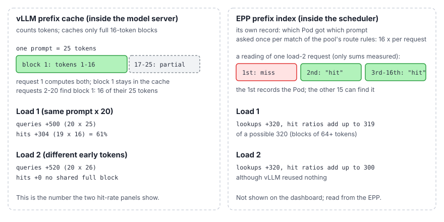
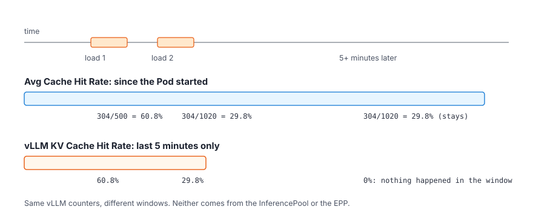

<!-- tut-explainer source=README.md sha=0 by=claude reviewed=no -->
# 스케줄러의 눈으로 보기 - 메트릭 관찰: 동작 원리

## 한 장으로 보기


LLMInferenceService 하나에서 숫자를 내는 Pod는 두 종류입니다. 모델 서버인
**vLLM**은 자기가 하는 일을, Envoy가 각 요청을 어디로 보낼지 묻는 스케줄러인
**EPP**(endpoint picker)는 풀과 자기 결정을 보고합니다. Prometheus가 둘 다 모으고
Grafana가 그립니다. 튜토리얼은 두 가지 부하를 보내고, 어떤 숫자가 왜 움직이는지
읽습니다.

## 배울 내용

- 어떤 숫자가 vLLM에서 오고 어떤 숫자가 EPP에서 오는지, 그리고 EPP가 vLLM 숫자의
  일부를 왜 따로 갖고 있는지(step 11-14).
- Prometheus가 EPP를 읽을 수 있는 이유: 토큰, ServiceMonitor, 그리고 토큰을 scrape
  설정에 써 넣는 operator(step 6-10).
- prefix cache가 하는 일을 숫자로: 같은 프롬프트를 반복하면 500토큰 중 304토큰을
  재사용하고, 앞부분이 다른 프롬프트는 520토큰 중 0토큰(step 20-23).
- vLLM의 prefix cache와 EPP의 prefix index가 왜 다른 숫자를 내는지, 그리고 여기서 EPP의
  시도와 조회가 왜 요청 수의 세 배인지(step 15-16, 21, 23).
- 두 hit rate 패널이 부하 직후에는 같다가 나중에 갈라지는 이유.

## 구성 요소

### 숫자의 출처 두 곳

namespace에는 Pod가 두 개 있습니다. `demo-model-kserve-...`(vLLM, 1/1 Ready)와
`demo-model-kserve-router-scheduler-...`(EPP, 2/2 Ready)이고, Service도 하나씩
있습니다. `demo-model-kserve-workload-svc`와 `demo-model-epp-service`입니다(step 16 뒤
probe). 메트릭은 vLLM이 8000 포트, EPP가 9090 포트에 있습니다.

요청을 보내기 전 vLLM은 `num_requests_running 0`, `num_requests_waiting 0`,
`kv_cache_usage_perc 0`, prefix cache 카운터 두 개 모두 0을 보고하고,
`cache_config_info`에는 `block_size="16"`과 `enable_prefix_caching="True"`가
있습니다(step 11-12). EPP는 `inference_pool_ready_pods 1`과 빈 prefix index
(`inference_extension_prefix_indexer_size 0`)를 보고합니다(step 13-14).

`inference_pool_*` 숫자는 vLLM이 보고한 값을 EPP가 점수 계산에 쓰려고 갖고 있는
사본입니다. 따로 잰 값이 아닙니다.

### Prometheus가 EPP를 읽는 방법

vLLM의 엔드포인트는 열려 있습니다. EPP의 엔드포인트는 bearer token을 확인하고, 토큰
주인이 URL `/metrics`에 `get` 권한이 있는지 API 서버에 묻습니다. 그래서 튜토리얼은
정확히 그 권한만 가진 ServiceAccount `metrics-reader`(`/metrics`는 namespace 안의
오브젝트가 아니라서 ClusterRole)와 장기 토큰 Secret을 만듭니다(step 6-7).

ServiceMonitor `kserve-llmisvc-metrics`는 `bearerTokenSecret`에 그 Secret을
지정합니다(step 8). Prometheus operator가 Secret을 읽어서 자기가 만드는 scrape 설정에
토큰을 써 넣습니다(이전 실행에서 생성된 설정을 열어 확인했고, 이번 실행에서는 열지
않았습니다). Prometheus 자신은 Secret이 필요 없습니다. 이번 실행에서
Prometheus의 ServiceAccount는 읽을 권한이 없었는데(`kubectl auth can-i get
secret/metrics-reader-token ... --as=...prometheus`가 `no`, step 16 뒤 probe), 두
target 모두 `up`이었습니다(step 10). 그래서 Role을 따로 만들 필요도, Prometheus를
재시작할 필요도 없습니다.

### EPP가 Pod를 고르는 방법, 그리고 스스로 추가하는 것

step 15에서 출력한 EPP 설정에는 플러그인 네 개와 가중치 두 개가 있습니다.

```bash
kubectl get deployment demo-model-kserve-router-scheduler -n "$NS" \
  -o jsonpath='{.spec.template.spec.containers[?(@.name=="main")].args}'
```

`queue-scorer`(가중치 2)는 대기 요청이 적은 Pod를, `prefix-cache-scorer`(가중치 3)는
같은 프롬프트를 이미 받은 Pod를 선호하고, `max-score-picker`가 합이 가장 큰 Pod를
고릅니다. 스케줄러 이미지는 `ghcr.io/llm-d/llm-d-router-endpoint-picker:v0.9.0`입니다.
환경 설정이 KServe v0.18.0의 기본값(`llm-d-inference-scheduler:v0.7.1`)을 이 이미지로
바꾸기 때문에(step 1), 아래 내용은 이 버전의 동작입니다. EPP Pod의 두 번째 컨테이너는
llmisvc-anatomy explainer에서 설명합니다.

prefix scorer는 vLLM의 캐시를 읽지 않습니다. 데이터가 어디서 오는지는 EPP 로그에
나옵니다(step 24 뒤 probe).

```text
"msg":"auto-created default producer","producer":"approx-prefix-cache-producer/...","consumer":"prefix-cache-scorer"
"msg":"auto-created default producer","producer":"token-producer/...","consumer":"approx-prefix-cache-producer"
```

`approx-prefix-cache-producer`는 EPP가 스스로 만듭니다. 다음은 llm-d-router v0.9.0
소스에서 읽은 내용입니다(클러스터에서는 보이지 않음). 이 플러그인은 `token-producer`에서
프롬프트의 토큰을 받는데, `token-producer`는 vLLM의 tokenizer 없이 토큰을 추정합니다.
그 토큰을 블록으로 해싱하고, 어느 Pod가 어떤 프롬프트를 받았는지 인덱스로 보관합니다.

### 프롬프트 하나, 캐시 둘



부하 1은 같은 25토큰 프롬프트를 20번 보냅니다. vLLM은 16토큰짜리 온전한 블록만
남기므로, 프롬프트마다 재사용할 수 있는 블록 하나와 부분 블록 하나가 있습니다. 첫
요청은 전부 계산하고, 나머지 19개는 블록 1을 찾습니다. 카운터는 query 500, hit 304만큼
오릅니다(step 21). 부하 2는 각 프롬프트의 처음 몇 토큰 안에 번호를 넣어서 온전한 블록을
공유하지 않습니다. query 520, hit 0입니다(step 23).

EPP는 다른 질문에 답합니다. EPP의 인덱스는 최소 64토큰 블록으로 동작합니다. EPP
로그에 설정값 16을 그 최솟값으로 올렸다고 나옵니다(step 24 뒤 probe). 두 부하 모두
요청 20개에 대해 인덱스를 60번 조회했습니다. 부하 1에서는 조회들의 hit ratio 합이 최대
60 중 59이고, 부하 2에서는 40인데, 그동안 vLLM은 아무것도 재사용하지 않았습니다. 이번
실행은 이 합만 쟀고, 조회 하나하나는 재지 않았습니다.

### EPP의 숫자가 요청 수의 세 배인 이유

step 21의 검사는 요청 20개에 스케줄링 시도 60번을 세고, InferencePool을 가리키는
route 규칙 세 개를 찾습니다(`/v1/completions`, `/v1/chat/completions`,
`/v1/responses`. 네 번째 catch-all 규칙은 workload Service로 갑니다). 이유는 Envoy
설정에 있습니다. 앞서 llmisvc-request-flow 작업 중에 읽었습니다(이번 실행에서는 읽지
않음). Envoy Gateway가 이런 규칙마다 ExtProc 필터 하나를 Gateway 리스너에 넣고, 요청이
그 필터를 모두 지나가서 Envoy가 규칙마다 EPP에 한 번씩 묻습니다. llmisvc-request-flow
README가 EPP 로그로 세 번의 호출을 보여 줍니다.

이번 실행에서는 스케줄링 시도와 prefix index 조회가 모두 요청 수의 세 배입니다. 부하 2도
이렇게 읽을 수 있습니다. 요청의 첫 조회가 Pod를 기록하므로 같은 요청의 두 번째·세 번째
조회는 그 기록을 찾을 수 있고, 요청 20개에 합 40과 맞아떨어집니다.

### 두 hit rate 패널



두 패널 모두 vLLM의 `prefix_cache_hits_total`을 `prefix_cache_queries_total`로
나눕니다(dashboard.json). **Avg Cache Hit Rate**는 *InferencePool Status* 아래에
있지만 Pod 시작 이후의 vLLM 카운터를 씁니다. **vLLM KV Cache Hit Rate**는
`rate(...[5m])`, 즉 최근 5분을 쓰고, 이름과 달리 prefix cache를 잽니다. step 21과 23의
숫자로 계산하면 부하 1 뒤에는 304/500 = 60.8%, 부하 2 뒤에는 304/1020 = 29.8%로 두
패널이 같습니다. 마지막 부하 5분 뒤에는 앞의 패널은 29.8%에 머물고, 뒤의 패널은 0%로 떨어집니다. 그
구간에 아무 일도 없었기 때문입니다. (첫 요청 전에는 뒤의 패널이 0%가 아니라 비어
있습니다. README의 그림은 이전 실행에서 찍은 것으로 이 값들을 보여 줍니다. 이번
실행에서는 Grafana를 보지 않았습니다.)

## 단계별로

| walk 단계 | 클러스터에서 일어나는 일 | 볼 곳 |
|---|---|---|
| 1 | KServe(llmisvc)와 게이트웨이 스택이 있는 Kind 클러스터. `kserve`에 `llmisvc-controller-manager` | namespace `llmisvc-monitoring` |
| 2-3 | LLMInferenceService `demo-model` 적용, Ready | vLLM Pod 1/1, EPP Pod 2/2 |
| 4-5 | kube-prometheus-stack 설치, Prometheus StatefulSet과 Grafana 배포 완료 | Grafana NodePort 30090, Prometheus 30091 |
| 6-7 | ServiceAccount `metrics-reader`, `/metrics`용 ClusterRole, 토큰 Secret 채워짐 | Secret `metrics-reader-token` |
| 8-10 | ServiceMonitor 적용, 두 target 모두 `up` | `demo-model-epp-service: up`, `demo-model-kserve-workload-svc: up` |
| 11-12 | 요청 전 vLLM 메트릭 | 모두 0, `block_size="16"`, prefix caching 켜짐 |
| 13-14 | 요청 전 EPP 메트릭 | `inference_pool_ready_pods 1`, 인덱스 크기 0 |
| 15-16 | EPP 설정 | queue-scorer 가중치 2, prefix-cache-scorer 가중치 3 |
| 17-19 | Grafana API로 대시보드 가져오기 | `KServe LLMIsvc Overview` |
| 20-21 | 부하 1, 같은 프롬프트 x 20 | vLLM 500 중 304, EPP 시도 60, 규칙 3, ratio 합 59 |
| 22-23 | 부하 2, 다른 프롬프트 x 20 | vLLM 520 중 0, EPP 시도 60, ratio 합 40 |
| 24 | Prometheus에 데이터가 있음 | `sum(inference_pool_ready_pods) = 1`, 생성 토큰 > 0 |

## README에 없는 관찰

- EPP 로그에 EPP가 스스로 만드는 보조 플러그인 두 개와 그 소비자가 나옵니다
  (`prefix-cache-scorer`를 위한 `approx-prefix-cache-producer`,
  `approx-prefix-cache-producer`를 위한 `token-producer`). README는 보조 플러그인이
  있다고만 말하고, 로그는 직접 확인할 수 있는 근거입니다.
- 이번 실행은 README가 이전 실행에서 가져온 숫자(304/500, 0/520, 60/59, 60/40)와
  정확히 같았습니다.

## 스스로 확인하기

1. 부하 1에서 hit가 320이 아니라 304인 이유는?
<details><summary>답</summary>20개 중 첫 요청은 캐시에서 아무것도 찾지 못하고 25토큰을 모두 계산합니다. 나머지 19개만 블록 1을 16토큰씩 재사용합니다. 19 x 16 = 304입니다.</details>

2. Prometheus의 ServiceAccount는 토큰 Secret을 읽을 수 없습니다. 어떻게 EPP를 scrape할까요?
<details><summary>답</summary>Prometheus operator가 ServiceMonitor의 <code>bearerTokenSecret</code>에 지정된 Secret을 읽고, 자기가 만드는 scrape 설정에 토큰을 써 넣습니다. Prometheus는 그 설정만 씁니다.</details>

3. 부하 2에서 vLLM은 아무것도 재사용하지 않았는데, EPP의 hit ratio 합은 40입니다. 어디서 온 걸까요?
<details><summary>답</summary>Envoy는 요청마다 EPP에 세 번 묻습니다(InferencePool route 규칙마다 한 번). 요청의 첫 조회가 Pod를 기록하므로 같은 요청의 두 번째·세 번째 조회는 그 기록을 찾을 수 있습니다. 요청 20개 x 2 = 40과 맞아떨어집니다.</details>

4. 부하 한 시간 뒤에도 숫자를 보여 주는 hit rate 패널은 어느 쪽이고, 왜일까요?
<details><summary>답</summary>Avg Cache Hit Rate입니다. 더 이상 변하지 않는 Pod 시작 이후의 카운터로 나누기 때문에 29.8%를 보여 줍니다. vLLM KV Cache Hit Rate는 최근 5분만 보는데, 그동안 아무 일도 없었습니다.</details>

Based on a run of llmisvc-monitoring with KServe v0.18.0 on 2026-11-25.
