<!-- tut-explainer source=README.md sha=ee43b991536d by=codex reviewed=yes -->
# 스케줄러가 보는 지표와 관측 원리

## 그림으로 한눈에 보기



하나의 LLMInferenceService에서 두 종류의 Pod가 지표를 노출합니다. 모델 서버인 **vLLM**은 자신이 처리한 작업에 관한 지표를 내보냅니다. **EPP**는 Envoy가 요청을 어디로 보낼지 물어보는 스케줄러로, 엔드포인트를 선택하며 풀의 상태와 스케줄링 결정에 관한 지표를 내보냅니다. Prometheus가 양쪽에서 지표를 수집하고 Grafana가 그래프로 표시합니다. 이 튜토리얼에서는 두 가지 부하를 가한 뒤 어떤 지표가 왜 달라지는지 살펴봅니다.

## 무엇을 배웁니까?

- 어떤 지표를 vLLM과 EPP가 각각 내보내는지, EPP가 왜 일부 vLLM 지표의 사본을 자체적으로 유지하는지 살펴봅니다(11~14단계).
- Prometheus가 EPP 지표를 읽는 데 필요한 토큰과 ServiceMonitor, 그리고 수집 설정에 토큰을 기록하는 오퍼레이터의 역할을 살펴봅니다(6~10단계).
- 접두사 캐시가 토큰을 얼마나 재사용하는지 측정합니다. 같은 프롬프트를 반복하면 프롬프트 토큰 500개 중 304개를 재사용하고, 앞부분이 다른 프롬프트를 보내면 토큰 520개 중 하나도 재사용하지 못합니다(20~23단계).
- vLLM의 접두사 캐시와 EPP의 접두사 인덱스에서 집계 결과가 다른 이유, 그리고 이번 실행에서 EPP의 스케줄링 시도 횟수와 인덱스 조회 횟수가 각각 요청 수의 세 배인 이유를 살펴봅니다(15~16단계, 21단계, 23단계).
- 부하를 가한 직후 두 캐시 적중률 패널에 같은 값이 표시되다가 나중에 달라지는 이유를 살펴봅니다.

## 구성 요소

### 지표를 내보내는 두 곳

네임스페이스에는 `demo-model-kserve-...`(vLLM, 1/1 준비 완료)와 `demo-model-kserve-router-scheduler-...`(EPP, 2/2 준비 완료)라는 Pod 두 개가 있습니다. 각 Pod에는 Service가 하나씩 연결됩니다. vLLM에는 `demo-model-kserve-workload-svc`, EPP에는 `demo-model-epp-service`가 연결됩니다(16단계 이후 확인). 지표는 vLLM의 8000번 포트와 EPP의 9090번 포트에서 노출됩니다.

요청을 받기 전에 vLLM은 `num_requests_running 0`, `num_requests_waiting 0`, `kv_cache_usage_perc 0`을 보고하며, 접두사 캐시의 두 카운터도 모두 0입니다. `cache_config_info`에는 `block_size="16"`과 `enable_prefix_caching="True"`가 표시됩니다(11~12단계). EPP는 준비된 Pod가 1개임을 `inference_pool_ready_pods 1`로 보고하고, 접두사 인덱스는 비어 있습니다(`inference_extension_prefix_indexer_size 0`, 13~14단계).

`inference_pool_*` 지표는 vLLM이 보고한 값을 EPP가 자체적으로 복사해 둔 것입니다. EPP는 이 사본으로 점수를 매기며, 같은 지표를 별도로 측정하지는 않습니다.

### Prometheus가 EPP 지표를 읽는 방식

vLLM의 지표 엔드포인트에는 인증 없이 접근할 수 있습니다. EPP는 베어러 토큰을 확인하고, 토큰 소유자에게 `/metrics` URL에 대한 `get` 권한이 있는지 API 서버에 묻습니다. 따라서 튜토리얼에서는 이 권한만 가진 ServiceAccount `metrics-reader`를 만들고, 이 계정에 유효 기간이 긴 토큰을 발급해 Secret에 저장합니다. `/metrics`는 네임스페이스에 속한 객체가 아니므로 권한은 ClusterRole로 부여합니다(6~7단계).

ServiceMonitor `kserve-llmisvc-metrics`는 `bearerTokenSecret`에 해당 Secret을 지정합니다(8단계). Prometheus 오퍼레이터는 Secret을 읽고 자신이 생성하는 수집 설정에 토큰을 기록합니다. 이전 실행에서는 생성된 설정에서 이를 확인했고, 이번 실행에서는 그 설정을 열어 보지 않았습니다. Prometheus 자체에는 Secret을 읽을 권한이 필요하지 않습니다. 이번 실행에서 Prometheus의 ServiceAccount로 Secret을 읽을 수 있는지 확인했을 때 `kubectl auth can-i get secret/metrics-reader-token ... --as=...prometheus`의 응답은 `no`였지만(16단계 이후 확인), 두 수집 대상은 모두 `up`이었습니다(10단계). 그래서 별도의 Role을 추가하거나 Prometheus를 재시작할 필요가 없습니다.

### EPP가 Pod를 선택하고 보조 구성 요소를 추가하는 방식

15단계에서 출력한 EPP 설정에는 플러그인 네 개와 가중치 두 개가 나옵니다.

```bash
kubectl get deployment demo-model-kserve-router-scheduler -n "$NS" \
  -o jsonpath='{.spec.template.spec.containers[?(@.name=="main")].args}'
```

`queue-scorer`(가중치 2)는 대기 중인 요청이 적은 Pod에 높은 점수를 줍니다. `prefix-cache-scorer`(가중치 3)는 같은 프롬프트를 이미 받은 Pod에 높은 점수를 줍니다. `max-score-picker`는 점수 합계가 가장 높은 Pod를 선택합니다. 스케줄러 이미지는 `ghcr.io/llm-d/llm-d-router-endpoint-picker:v0.9.0`입니다. 환경을 구성할 때 KServe v0.18.0의 기본 이미지(`llm-d-inference-scheduler:v0.7.1`)를 이 이미지로 교체합니다(1단계). 아래 동작은 교체한 버전을 기준으로 설명합니다. EPP Pod의 두 번째 컨테이너는 llmisvc-anatomy 해설에서 설명합니다.

접두사 점수를 매기는 플러그인은 vLLM의 캐시를 읽지 않습니다. 어떤 구성 요소에서 데이터를 받는지는 EPP 로그에 나옵니다(24단계 이후 확인).

```text
"msg":"auto-created default producer","producer":"approx-prefix-cache-producer/...","consumer":"prefix-cache-scorer"
"msg":"auto-created default producer","producer":"token-producer/...","consumer":"approx-prefix-cache-producer"
```

EPP는 `approx-prefix-cache-producer`를 자동으로 생성합니다. 클러스터에서는 확인할 수 없는 llm-d-router v0.9.0 소스 코드를 보면, 이 구성 요소는 `token-producer`에서 프롬프트 토큰을 받습니다. `token-producer`는 vLLM의 토크나이저를 사용하지 않고 토큰을 추정합니다. `approx-prefix-cache-producer`는 받은 토큰을 해시해 블록으로 만들고, 어느 Pod가 어떤 프롬프트를 받았는지 인덱스에 기록합니다.

### 프롬프트 하나를 처리하는 두 캐시


첫 번째 부하에서는 토큰 25개로 구성된 동일한 프롬프트를 20번 보냅니다. vLLM은 토큰 16개가 꽉 찬 블록만 보관합니다. 따라서 각 프롬프트에는 재사용할 수 있는 블록 하나와 토큰이 덜 찬 블록 하나가 있습니다. 첫 요청은 토큰을 모두 계산하고, 나머지 19개 요청은 캐시에서 첫 번째 블록을 찾습니다. 카운터에는 조회한 프롬프트 토큰 500개와 그중 캐시에서 찾은 토큰 304개가 추가됩니다(21단계). 두 번째 부하에서는 각 프롬프트의 첫 몇 토큰 사이에 숫자를 넣습니다. 온전한 블록을 공유하지 않으므로 조회한 토큰 520개 중 캐시에서 찾은 토큰은 0개입니다(23단계).

EPP가 답하는 질문은 다릅니다. EPP는 자체 인덱스에서 프롬프트를 조회합니다. 인덱스는 토큰 64개 이상의 블록을 사용합니다. EPP가 설정값 16을 최솟값인 64로 올렸다는 내용이 로그에 나옵니다(24단계 이후 확인). 두 부하 모두 요청 20건에 인덱스 조회 60회가 발생했습니다. 조회마다 적중 비율을 더하면 최댓값은 60입니다. 첫 번째 부하에서는 합이 59였고, vLLM이 토큰을 하나도 재사용하지 못한 두 번째 부하에서도 합이 40이었습니다. 이번 실행에서는 조회별 비율을 따로 측정하지 않고 그 합만 측정했습니다.

### EPP의 집계 횟수가 요청 수의 세 배인 이유

21단계에서는 요청 20건에 스케줄링 시도 60회가 집계됐고, InferencePool로 연결되는 라우팅 규칙이 세 개임을 확인했습니다(`/v1/completions`, `/v1/chat/completions`, `/v1/responses`). 나머지 요청을 처리하는 네 번째 규칙은 워크로드의 Service로 연결됩니다. 그 이유는 llmisvc-request-flow를 작업하던 이전 실행에서 읽은 Envoy 설정에 나옵니다. 이번 실행에서는 이 설정을 읽지 않았습니다. Envoy Gateway는 InferencePool로 연결되는 규칙마다 Gateway의 리스너에 ExtProc 필터를 하나씩 추가합니다. 요청 하나가 이 필터를 모두 거치므로 Envoy는 규칙마다 한 번씩 EPP에 요청을 보냅니다. llmisvc-request-flow의 README에는 EPP 로그에 찍힌 호출 세 건이 나옵니다.

이번 실행에서는 스케줄링 시도 횟수와 접두사 인덱스 조회 횟수가 각각 요청 수의 세 배였습니다. 이를 바탕으로 두 번째 부하의 결과를 이렇게 해석해 볼 수 있습니다. 각 요청의 첫 번째 조회에서 Pod를 인덱스에 기록하므로, 같은 요청의 두 번째와 세 번째 조회에서는 해당 Pod를 찾을 수 있습니다. 이는 요청 20건에서 조회별 적중 비율의 합이 40이었다는 결과와 맞습니다.

### 캐시 적중률 패널 두 개


두 패널 모두 vLLM의 `prefix_cache_hits_total`을 `prefix_cache_queries_total`로 나눠 적중률을 계산합니다(dashboard.json). **Avg Cache Hit Rate**는 *InferencePool Status* 아래에 있지만, 계산에는 vLLM Pod가 시작된 이후의 누적 카운터를 사용합니다. **vLLM KV Cache Hit Rate**는 `rate(...[5m])`으로 최근 5분을 집계하며, 패널 이름과 달리 접두사 캐시의 적중률을 보여 줍니다. 21단계와 23단계의 수치로 계산하면 첫 번째 부하 직후 두 패널 모두 토큰 500개 중 304개가 적중해 60.8%를 표시합니다. 두 번째 부하 직후에는 누적 토큰 1020개 중 304개가 적중해 두 패널 모두 29.8%를 표시합니다. 마지막 부하가 끝나고 5분이 지나면 첫 번째 패널은 여전히 29.8%를 표시하고, 두 번째 패널은 집계 구간에 활동이 없어 0%로 떨어집니다. 첫 요청 전에는 두 번째 패널에 값이 표시되지 않습니다. 이전 실행에서 찍은 README의 이미지에서 이 값들을 볼 수 있으며, 이번 실행에서는 Grafana를 열어 보지 않았습니다.

## 단계별로 살펴보기

| 실행 단계 | 클러스터에서 일어나는 일 | 확인할 항목 |
|---|---|---|
| 1 | Kind 클러스터에 KServe(llmisvc)와 게이트웨이 스택이 설치되고, `kserve`에 `llmisvc-controller-manager`가 실행됩니다 | 네임스페이스 `llmisvc-monitoring` |
| 2-3 | LLMInferenceService `demo-model`을 적용하면 준비 상태가 됩니다 | vLLM Pod 1/1, EPP Pod 2/2 준비 완료 |
| 4-5 | kube-prometheus-stack을 설치하고 Prometheus StatefulSet과 Grafana를 배포합니다 | Grafana는 NodePort 30090, Prometheus는 30091 |
| 6-7 | ServiceAccount `metrics-reader`와 `/metrics`에 접근할 ClusterRole을 만들고 토큰을 Secret에 채웁니다 | Secret `metrics-reader-token` |
| 8-10 | ServiceMonitor를 적용하면 두 수집 대상이 모두 `up`이 됩니다 | `demo-model-epp-service: up`, `demo-model-kserve-workload-svc: up` |
| 11-12 | 요청을 보내기 전의 vLLM 지표를 확인합니다 | 측정값은 모두 0이며, `block_size="16"`이고 접두사 캐싱은 켜져 있습니다 |
| 13-14 | 요청을 보내기 전의 EPP 지표를 확인합니다 | `inference_pool_ready_pods 1`, 인덱스 항목 0개 |
| 15-16 | EPP 설정을 확인합니다 | queue-scorer의 가중치는 2, prefix-cache-scorer의 가중치는 3입니다 |
| 17-19 | Grafana API로 대시보드를 가져옵니다 | `KServe LLMIsvc Overview` |
| 20-21 | 첫 번째 부하로 동일한 프롬프트를 20번 보냅니다 | vLLM에서 토큰 500개 중 304개 적중, EPP에서 스케줄링 시도 60회, 라우팅 규칙 3개, 조회별 적중 비율의 합 59 |
| 22-23 | 두 번째 부하로 서로 다른 프롬프트를 20번 보냅니다 | vLLM에서 토큰 520개 중 0개 적중, EPP에서 스케줄링 시도 60회, 조회별 적중 비율의 합 40 |
| 24 | Prometheus에 지표가 수집됐는지 확인합니다 | `sum(inference_pool_ready_pods) = 1`, 생성 토큰 수는 0개보다 많습니다 |

## README에 없는 관측 결과

- EPP 로그에는 자동으로 생성한 보조 구성 요소 두 개와 각각의 데이터를 받는 구성 요소가 나옵니다. `prefix-cache-scorer`는 `approx-prefix-cache-producer`에서, `approx-prefix-cache-producer`는 `token-producer`에서 데이터를 받습니다. README에는 보조 구성 요소가 있다고 설명하며, 로그에서 실제 생성과 연결을 확인할 수 있습니다.
- 이번 실행에서는 README가 이전 실행에서 인용한 수치가 그대로 나왔습니다. vLLM은 첫 번째 부하에서 토큰 500개 중 304개, 두 번째 부하에서 토큰 520개 중 0개가 적중했습니다. EPP는 두 부하에서 각각 60회 조회했고, 조회별 적중 비율의 합은 각각 59와 40이었습니다.

## 이해했는지 확인합니다

1. 첫 번째 부하에서 캐시에 적중한 토큰이 320개가 아니라 304개인 이유는 무엇입니까?
<details><summary>정답</summary>요청 20건 중 첫 요청은 캐시에서 아무것도 찾지 못해 토큰 25개를 모두 계산합니다. 나머지 19건만 첫 번째 블록에 담긴 토큰 16개씩을 재사용합니다. 19 × 16 = 304개입니다.</details>

2. Prometheus의 ServiceAccount에는 토큰 Secret을 읽을 권한이 없습니다. 그런데도 Prometheus는 어떻게 EPP 지표를 수집합니까?
<details><summary>정답</summary>Prometheus 오퍼레이터가 ServiceMonitor의 <code>bearerTokenSecret</code>에 지정된 Secret을 읽고, 자신이 생성하는 수집 설정에 토큰을 기록합니다. Prometheus는 그 설정만 사용합니다.</details>

3. 두 번째 부하에서 vLLM은 토큰을 하나도 재사용하지 못했는데 EPP의 조회별 적중 비율을 더하면 40이 됩니다. 이 수치는 어떻게 나옵니까?
<details><summary>정답</summary>Envoy는 InferencePool로 연결되는 라우팅 규칙마다 한 번씩, 요청당 총 세 번 EPP에 문의합니다. 각 요청의 첫 번째 조회에서 Pod를 기록하므로 같은 요청의 두 번째와 세 번째 조회에서 그 Pod를 찾을 수 있습니다. 요청 20건에 두 번씩 적중하면 합이 40이라는 결과와 맞습니다.</details>

4. 부하가 끝나고 한 시간이 지나도 어느 적중률 패널에 수치가 남아 있으며, 그 이유는 무엇입니까?
<details><summary>정답</summary>Avg Cache Hit Rate입니다. Pod가 시작된 이후의 누적 카운터를 나눠 계산하므로 카운터 값이 더 이상 변하지 않으면 적중률도 29.8%로 유지됩니다. vLLM KV Cache Hit Rate는 최근 5분만 집계하며, 그 구간에는 활동이 없었습니다.</details>

Based on a run of llmisvc-monitoring with KServe v0.18.0 on 2026-11-25.
