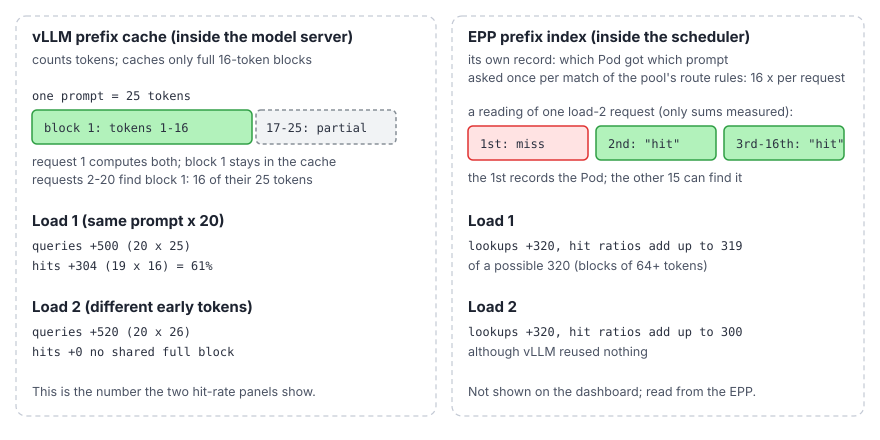
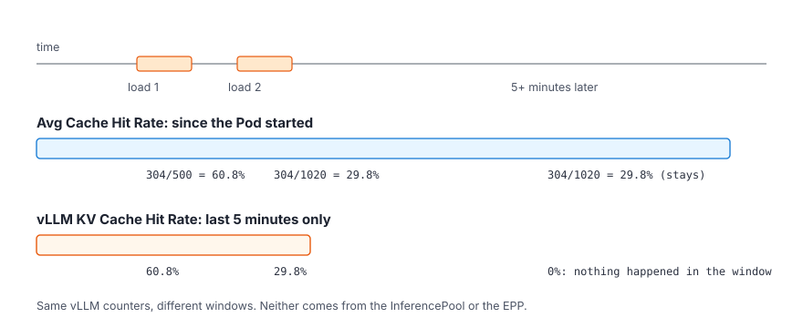

<!-- tut-explainer source=README.md sha=0 by=claude reviewed=no -->
# Through the Scheduler's Eyes - Metric Observation: how it works

## In one picture



Two kinds of Pods of one LLMInferenceService publish numbers: **vLLM**, the
model server, about the work it does, and the **EPP** (endpoint picker), the
scheduler Envoy asks where each request should go, about the pool and its own
decisions. Prometheus collects both; Grafana draws them. The tutorial then
sends two loads and reads which numbers move, and why.

## What you will learn

- Which numbers come from vLLM and which from the EPP, and why the EPP keeps
  its own copy of some vLLM numbers (steps 11-14).
- How Prometheus is allowed to read the EPP: a token, a ServiceMonitor, and the
  operator that writes the token into the scrape configuration (steps 6-10).
- What the prefix cache does, measured: 304 of 500 prompt tokens reused for one
  repeated prompt, 0 of 520 for prompts that differ early (steps 20-23).
- Why vLLM's prefix cache and the EPP's prefix index give different numbers,
  and why the EPP's attempts and lookups are three times the requests here
  (steps 15-16, 21, 23).
- Why the two hit-rate panels agree after a load and part ways later.

## The pieces

### Two sources of numbers

The namespace has two Pods: `demo-model-kserve-...` (vLLM, 1/1 Ready) and
`demo-model-kserve-router-scheduler-...` (the EPP, 2/2 Ready), with one
Service each, `demo-model-kserve-workload-svc` and `demo-model-epp-service`
(probes after step 16). The metrics are on port 8000 for vLLM and on port 9090
for the EPP.

Before any request, vLLM reports `num_requests_running 0`,
`num_requests_waiting 0`, `kv_cache_usage_perc 0` and both prefix-cache
counters at 0, and its `cache_config_info` carries `block_size="16"` and
`enable_prefix_caching="True"` (steps 11-12). The EPP reports
`inference_pool_ready_pods 1` and an empty prefix index
(`inference_extension_prefix_indexer_size 0`, steps 13-14).

The `inference_pool_*` numbers are the EPP's own copy of what vLLM reports, the
copy it scores with. They are not a second measurement.

### How Prometheus reads the EPP

vLLM's endpoint is open. The EPP's checks a bearer token and asks the API server
whether its owner may `get` the URL `/metrics`. So the tutorial creates a
ServiceAccount `metrics-reader` with exactly that permission (a ClusterRole,
because `/metrics` is not an object in a namespace) and a long-lived token
Secret for it (steps 6-7).

The ServiceMonitor `kserve-llmisvc-metrics` names that Secret in
`bearerTokenSecret` (step 8). The Prometheus operator reads the Secret and
writes the token into the scrape configuration it generates (seen in that
generated configuration in an earlier run; this run did not open it).
Prometheus itself does not need the Secret: in this run, Prometheus'
ServiceAccount was not allowed to read it (`kubectl auth can-i get secret/metrics-reader-token ... --as=...prometheus`
answered `no`, probe after step 16), and both targets were `up` anyway (step
10). That is why there is no extra Role and no Prometheus restart.

### How the EPP picks a Pod, and what it adds on its own

The EPP's configuration, printed in step 15, lists four plugins and two
weights:

```bash
kubectl get deployment demo-model-kserve-router-scheduler -n "$NS" \
  -o jsonpath='{.spec.template.spec.containers[?(@.name=="main")].args}'
```

`queue-scorer` (weight 2) prefers Pods with fewer waiting requests;
`prefix-cache-scorer` (weight 3) prefers Pods that already got the same
prompt; `max-score-picker` takes the highest sum. The scheduler image is
`ghcr.io/llm-d/llm-d-router-endpoint-picker:v0.9.0`: the environment's setup
replaces KServe v0.18.0's default (`llm-d-inference-scheduler:v0.7.1`) with it
(step 1), so what follows is that version's behaviour. The EPP Pod's second
container is explained in the llmisvc-anatomy explainer.

The prefix scorer does not read vLLM's cache. The EPP log shows where its data
comes from (probe after step 24):

```text
"msg":"auto-created default producer","producer":"approx-prefix-cache-producer/...","consumer":"prefix-cache-scorer"
"msg":"auto-created default producer","producer":"token-producer/...","consumer":"approx-prefix-cache-producer"
```

The EPP creates `approx-prefix-cache-producer` itself. From the llm-d-router
v0.9.0 source (not visible in the cluster): it gets the prompt's tokens from
`token-producer`, which estimates them without vLLM's tokenizer, hashes them into
blocks, and keeps an index of which Pod got which prompt.

### One prompt, two caches



Load 1 sends the same 25-token prompt 20 times. vLLM keeps only full 16-token
blocks, so each prompt has one reusable block and a partial one. The first
request computes everything; the other 19 find block 1. The counters rise by
500 queries and 304 hits (step 21). Load 2 puts a number among the first
tokens of each prompt, so no full block is shared: 520 queries, 0 hits (step
23).

The EPP answers a different question. Its index works in blocks of at least 64
tokens: the EPP log says it raised the configured 16 to that minimum (probe after
step 24). It was looked up 60 times for 20 requests in each load. In load 1 the
lookups' hit ratios add up to 59 of a possible 60; in load 2 to 40, while vLLM
reused nothing. The run measures only these sums, not each lookup.

### Why the EPP's counts are three times the requests

The step 21 check counts 60 scheduling attempts for 20 requests and finds three
route rules that point at the InferencePool (`/v1/completions`,
`/v1/chat/completions`, `/v1/responses`; the fourth rule, the catch-all, goes
to the workload Service). The reason is in Envoy's configuration, read in an
earlier run while working on llmisvc-request-flow (this run did not read it):
Envoy Gateway puts one ExtProc filter per such rule on the Gateway's listener,
and a request passes all of them, so Envoy asks the EPP once per rule. The
llmisvc-request-flow README shows the three calls in the EPP log.

In this run the scheduling attempts and the prefix-index lookups are both three
times the number of requests. It also gives a reading of load 2: the first
lookup of a request records the Pod, so the second and third lookups of the
same request can find it, which fits a sum of 40 for 20 requests.

### Two hit-rate panels



Both panels divide vLLM's `prefix_cache_hits_total` by
`prefix_cache_queries_total` (dashboard.json). **Avg Cache Hit Rate** sits under
*InferencePool Status* but uses vLLM's counters since the Pod started.
**vLLM KV Cache Hit Rate** uses `rate(...[5m])`, the last five minutes, and
despite its name measures the prefix cache. From the step 21 and 23 numbers:
304/500 = 60.8% after load 1, 304/1020 = 29.8% after load 2, in both panels.
Five minutes after the last load the first still shows 29.8%, and the second
drops to 0%: nothing happened in its window. (Before the first request the
second panel is empty instead. The README's pictures, from an earlier run, show
these values; this run did not look at Grafana.)

## Step by step

| Walk step | What happens in the cluster | What to look at |
|---|---|---|
| 1 | Kind cluster with KServe (llmisvc) and the gateway stack; `llmisvc-controller-manager` in `kserve` | namespace `llmisvc-monitoring` |
| 2-3 | LLMInferenceService `demo-model` applied and Ready | vLLM Pod 1/1, EPP Pod 2/2 |
| 4-5 | kube-prometheus-stack installed, Prometheus StatefulSet and Grafana rolled out | Grafana on NodePort 30090, Prometheus on 30091 |
| 6-7 | ServiceAccount `metrics-reader`, ClusterRole for `/metrics`, token Secret filled | Secret `metrics-reader-token` |
| 8-10 | ServiceMonitor applied; both targets `up` | `demo-model-epp-service: up`, `demo-model-kserve-workload-svc: up` |
| 11-12 | vLLM metrics before any request | all 0; `block_size="16"`, prefix caching on |
| 13-14 | EPP metrics before any request | `inference_pool_ready_pods 1`, index size 0 |
| 15-16 | EPP configuration | queue-scorer weight 2, prefix-cache-scorer weight 3 |
| 17-19 | Dashboard imported through the Grafana API | `KServe LLMIsvc Overview` |
| 20-21 | Load 1, same prompt x 20 | vLLM 304 of 500; EPP 60 attempts, 3 rules, ratios add up to 59 |
| 22-23 | Load 2, different prompts x 20 | vLLM 0 of 520; EPP 60 attempts, ratios add up to 40 |
| 24 | Prometheus has the data | `sum(inference_pool_ready_pods) = 1`, generation tokens > 0 |

## What we saw that the README does not say

- The EPP log names the two helpers it creates on its own and who consumes
  them (`approx-prefix-cache-producer` for `prefix-cache-scorer`,
  `token-producer` for `approx-prefix-cache-producer`). The README says the
  helper exists; the log is the proof you can look at.
- This run gave exactly the numbers the README quotes from earlier runs
  (304/500, 0/520, 60/59, 60/40).

## Check yourself

1. Why is it 304 and not 320 hits in load 1?
<details><summary>Answer</summary>The first of the 20 requests finds nothing in the cache: it computes all 25 tokens. Only the other 19 reuse block 1, 16 tokens each: 19 x 16 = 304.</details>

2. Prometheus' ServiceAccount cannot read the token Secret. How does it scrape the EPP?
<details><summary>Answer</summary>The Prometheus operator reads the Secret named in the ServiceMonitor's <code>bearerTokenSecret</code> and writes the token into the scrape configuration it generates. Prometheus only uses that configuration.</details>

3. In load 2 vLLM reused nothing, yet the EPP's hit ratios add up to 40. Where do they come from?
<details><summary>Answer</summary>Envoy asks the EPP three times per request (once per InferencePool route rule). The first lookup of a request records the Pod, so the second and third lookups of the same request can find it; that fits 20 requests x 2 = 40.</details>

4. An hour after the loads, which hit-rate panel still shows a number, and why?
<details><summary>Answer</summary>Avg Cache Hit Rate: it divides the counters since the Pod started, which no longer change (29.8%). vLLM KV Cache Hit Rate looks only at the last five minutes, in which nothing happened.</details>

Based on a run of llmisvc-monitoring with KServe v0.18.0 on 2026-11-25.
