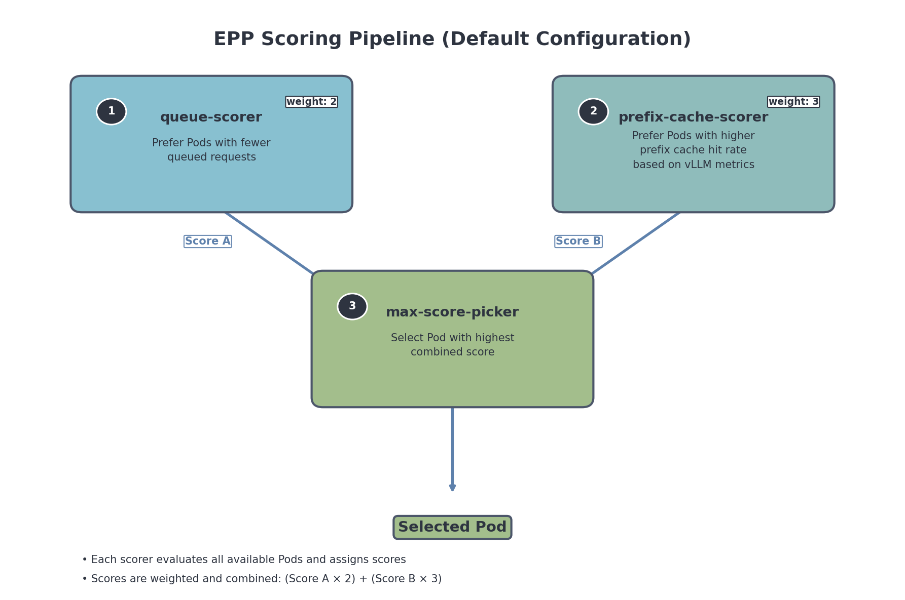

<!-- tut-translation source=README.md sha=8a90e0d669da -->
# 요청의 여정 — Gateway에서 vLLM까지

<!-- tut:header -->

<!-- tutorial.yaml에서 `./tut sync`로 생성됨 — 직접 수정하지 마세요. -->
> **상태:** 🚧 작성 중 · **검증된 KServe:** v0.18.0 · **환경:** [`kind-kserve/v1`](../../envs/kind-kserve/v1/) · **GPU:** 불필요
>
> 🌐 [English](README.md)

<!-- /tut -->

LLMInferenceService에 `curl` 요청 하나를 보내면 클러스터 안에서는 어떤 일이
일어날까요? 이 튜토리얼에서는 작은 모델을 배포한 뒤, 요청 하나가 Envoy Gateway와
EPP 스케줄러를 거쳐 vLLM Pod에 도달하기까지의 과정을 세 구성 요소가 공유하는
request id로 따라가 봅니다.

> **핵심 질문:** 내 요청은 어떤 경로를 거쳐 특정 Pod에 도달하며, 왜 그 Pod가
> 선택되었을까?

배울 내용:

- 요청 하나가 지나가는 길: Envoy Gateway, HTTPRoute, InferencePool, EPP 스케줄러,
  vLLM Pod, 그리고 각 구간을 어느 오브젝트가 정하는지.
- Envoy가 EPP에 Pod를 묻는 방법(ExtProc), 그리고 EPP가 InferencePool route 규칙마다
  한 번씩 질문을 받는 이유.
- `x-request-id`로 요청 하나를 Envoy 로그, EPP 로그, 응답까지 따라가는 방법.
- EPP가 Pod를 고르는 방법: scorer, 그 가중치, 그리고 scorer가 읽는 메트릭.

## 요청 흐름 개요

<a href="images/request_flow_1.png" target="_blank"></a>

그림에서는 네임스페이스가 `kserve-demo`로 표시되어 있지만, 이 튜토리얼에서는 `$NS`입니다.
그림을 클릭하면 원본 크기로 열립니다.

핵심 포인트:

- **HTTPRoute**의 `backendRef`는 일반 Service가 아니라 **InferencePool**을
  가리킵니다.
- **InferencePool**이 허브 역할을 합니다. EPP 스케줄러를 지정하고
  (`endpointPickerRef`), vLLM Pod를 선택합니다(`selector`).
- Envoy Gateway는 EPP를 **ExtProc**(External Processing) gRPC 서비스로
  호출한 다음, EPP가 고른 Pod로 요청을 전달합니다.
- URL 경로 접두사는 요청이 vLLM에 도달하기 전에 HTTPRoute의 `urlRewrite` 필터가
  제거합니다.

## Step 0: 환경 준비

이 단계에서는 KServe LLMInferenceService와 게이트웨이 스택이 설치된 Kind
클러스터를 준비하고(위의 환경 링크 참고), 아래에서 사용할 네임스페이스를 생성합니다.
여러 번 실행해도 안전합니다.

<!-- tut:setup -->

```bash run
# Generated from tutorial.yaml by `./tut sync` — do not edit by hand.
export KSERVE_VERSION="${KSERVE_VERSION:-v0.18.0}"
export NS="${NS:-llmisvc-request-flow}"
export REPO_ROOT="$(git rev-parse --show-toplevel)"
source "$REPO_ROOT/tools/local-config.sh"   # your settings in .tut.env, if any
export TUT_LIB="$REPO_ROOT/lib"
# pinned CLI tools of the environment, for this shell only
export PATH="$REPO_ROOT/.tools/kind/v0.30.0:$REPO_ROOT/.tools/kubectl/v1.34.13:$REPO_ROOT/.tools/helm/v3.16.3:$REPO_ROOT/.tools/cloud-provider-kind/v0.12.0:$PATH"
# what this tutorial needs from the environment (env_options in tutorial.yaml)
TUT_ENV_TYPES=llmisvc TUT_ENV_MODE=standard TUT_ENV_KEDA=false "$REPO_ROOT/envs/kind-kserve/v1/setup.sh"
kubectl create namespace "$NS" --dry-run=client -o yaml | kubectl apply -f -
cd "$REPO_ROOT/tutorials/llmisvc-request-flow"
```

<!-- /tut -->

## Step 1: LLMInferenceService 배포

요청이 도착할 목적지가 필요합니다. CPU에서 vLLM으로 `facebook/opt-125m`을
서빙하는 LLMInferenceService 하나를 적용합니다. anatomy 튜토리얼에서 사용한 것과
동일합니다. LLMInferenceService 깊이 보기 학습 경로를 따라오고 있다면 이미 실행 중이므로
이 단계는 건너뜁니다.

<!-- tut:use llmisvc-demo-model -->

<!-- Copied from llmisvc-anatomy (tut:define llmisvc-demo-model) by `./tut sync` — do not edit by hand. -->

```bash run
kubectl apply -f manifests/llmisvc-cpu.yaml -n "$NS"
```

<!-- /tut -->

<details>
<summary>manifests/llmisvc-cpu.yaml</summary>

<!-- tut:include manifests/llmisvc-cpu.yaml -->

```yaml
apiVersion: serving.kserve.io/v1alpha2
kind: LLMInferenceService
metadata:
  name: demo-model
spec:
  model:
    uri: "hf://facebook/opt-125m"
    name: facebook/opt-125m
  replicas: 1
  router:
    scheduler: {}
    route: {}
    gateway: {}
  template:
    containers:
      - name: main
        image: public.ecr.aws/q9t5s3a7/vllm-cpu-release-repo:v0.19.0
        securityContext:
          runAsNonRoot: true
          runAsUser: 1000
        env:
          - name: USER
            value: nonroot
          - name: VLLM_LOGGING_LEVEL
            value: DEBUG
          - name: VLLM_CPU_KVCACHE_SPACE
            value: "1"
          - name: VLLM_ADDITIONAL_ARGS
            value: "--block-size 16"
        resources:
          limits:
            cpu: "2"
            memory: 7Gi
          requests:
            cpu: 200m
            memory: 2Gi
        livenessProbe:
          initialDelaySeconds: 180
          periodSeconds: 30
          timeoutSeconds: 30
          failureThreshold: 8
        readinessProbe:
          initialDelaySeconds: 30
          periodSeconds: 10
          timeoutSeconds: 5
          failureThreshold: 3
```

<!-- /tut -->

</details>

`router` 아래의 빈 객체 세 개가 이 튜토리얼의 주제입니다.
`scheduler: {}`, `route: {}`, `gateway: {}`를 지정하면 KServe 컨트롤러가
EPP 스케줄러, HTTPRoute, InferencePool을 생성하고 이를 Gateway에 연결합니다.
Gateway나 라우트를 직접 만들 필요가 없습니다.

> `route: {}`가 없으면 HTTPRoute가 생성되지 않아 Gateway가 모델에 도달할 수
> 없습니다.

서비스가 `Ready` 상태가 될 때까지 기다립니다. 모델을 다운로드하고 CPU에서 vLLM을
시작하는 데 몇 분 정도 걸립니다.

```bash verify
kubectl wait --for=condition=Ready llminferenceservice/demo-model -n "$NS" --timeout=900s
```

## Step 2: 생성된 라우팅 리소스 살펴보기

```bash run
# Gateway (환경이 kserve 네임스페이스에 생성)
kubectl get gateway -A

# LLMInferenceService용으로 생성된 HTTPRoute (InferencePool로 라우팅)
kubectl get httproute -n "$NS" -o yaml

# InferencePool (EPP 스케줄러와 vLLM Pod를 연결)
kubectl get inferencepool -n "$NS"
```

HTTPRoute에서 `backendRefs`(kind는 `InferencePool`)와 `URLRewrite` 필터를
찾아보세요. Gateway는 반드시 `Programmed` 상태여야 합니다. 그렇지 않으면 주소가
할당되지 않아 이후 단계가 모두 동작하지 않습니다.

```bash verify
kubectl wait --for=condition=Programmed gateway --all -n kserve --timeout=120s
kubectl get httproute -n "$NS" -o jsonpath='{.items[*].spec.rules[*].backendRefs[*].kind}' | grep InferencePool
kubectl get httproute -n "$NS" -o jsonpath='{.items[*].spec.rules[*].filters[*].type}' | grep URLRewrite
test "$(kubectl get inferencepool -n "$NS" --no-headers | wc -l)" -ge 1
```

### Gateway 엔드포인트

Kind에는 외부 로드 밸런서가 없으므로 워커 노드의 NodePort를 통해 Gateway에
접근합니다. 공유 모듈 `llmisvc/v1`이 URL을 계산해 줍니다.
`http://<worker node IP>:<node port>/<namespace>/demo-model`.

```bash run
GATEWAY_URL=$("$TUT_LIB/llmisvc/v1/gateway-url.sh" "$NS" demo-model)
echo "$GATEWAY_URL"
```

<details>
<summary>lib/llmisvc/v1/gateway-url.sh</summary>

<!-- tut:include ../../lib/llmisvc/v1/gateway-url.sh -->

```bash skip
#!/usr/bin/env bash
# Usage: gateway-url.sh <namespace> <llmisvc-name>
# Prints the URL that reaches the LLMInferenceService through the Envoy Gateway.
# In Kind there is no external load balancer, so we use the worker node IP and
# the Gateway service NodePort.
set -euo pipefail
ns="${1:?namespace}"; name="${2:?llmisvc name}"
node_ip=$(docker inspect "${KIND_CLUSTER_NAME:-kind}-worker" \
  --format '{{range .NetworkSettings.Networks}}{{.IPAddress}}{{end}}')
node_port=$(kubectl get svc -n envoy-gateway-system \
  -l gateway.envoyproxy.io/owning-gateway-name \
  -o jsonpath='{.items[0].spec.ports[0].nodePort}')
echo "http://${node_ip}:${node_port}/${ns}/${name}"
```

<!-- /tut -->

</details>

## Step 3: 요청을 보내고 로그 관찰하기

요청이 지나가는 모습을 보려면 터미널을 두 개 더 열고 각각에서 로그를 따라가 보세요
(중지하려면 `Ctrl+C`를 누릅니다).

터미널 1, EPP 스케줄러(Pod 선택):

```bash skip
kubectl logs -n "$NS" -l app.kubernetes.io/component=llminferenceservice-router-scheduler -c main -f --tail=0
```

터미널 2, vLLM Pod(추론):

```bash skip
kubectl logs -n "$NS" -l app.kubernetes.io/component=llminferenceservice-workload -f --tail=0 --max-log-requests=5
```

그런 다음 Gateway를 통해 completion 요청을 보냅니다.

```bash run
curl -s "${GATEWAY_URL}/v1/completions" \
  -H "Content-Type: application/json" \
  -d '{
    "model": "facebook/opt-125m",
    "prompt": "Kubernetes is",
    "max_tokens": 30
  }' | python3 -m json.tool
```

서비스가 `Ready`가 된 뒤에도 라우트가 준비되기까지 잠시 시간이 걸릴 수 있습니다.
이 검증은 텍스트가 포함된 completion 응답이 돌아올 때까지 재시도합니다.

```bash verify retry=10 delay=15
"$TUT_LIB/llmisvc/v1/completion.sh" "$GATEWAY_URL" facebook/opt-125m "Kubernetes is"
```

> `facebook/opt-125m`은 튜토리얼을 CPU에서 실행할 수 있도록 고른 아주 작은 베이스
> 모델입니다. 주어진 텍스트를 이어 쓰는데, 결과가 엉뚱한 경우가 많습니다. 여기서
> 중요한 것은 응답 내용이 아니라 경로입니다.

## Step 4: x-request-id로 요청 하나 추적하기

Envoy는 모든 요청에 `x-request-id`를 부여합니다. 이 id를 EPP와 vLLM에 전달하고,
vLLM은 이를 응답의 `id`(`cmpl-<x-request-id>`)에 사용합니다. 따라서 응답 본문의
id가 모든 로그에서 같은 요청을 찾아내는 열쇠가 됩니다.

### 1. 요청을 보내고 request id 추출하기

```bash run
RESPONSE=$(curl -s "${GATEWAY_URL}/v1/completions" \
  -H "Content-Type: application/json" \
  -d '{
    "model": "facebook/opt-125m",
    "prompt": "Kubernetes is",
    "max_tokens": 20
  }')

echo "$RESPONSE" | python3 -m json.tool

# 응답 id는 cmpl-<x-request-id> 형식이므로 접두사를 제거
REQUEST_ID=$(echo "$RESPONSE" | python3 -c 'import json, sys; print(json.load(sys.stdin)["id"])' | sed 's/^cmpl-//')
echo "Request ID: $REQUEST_ID"
```

```bash verify
test -n "$REQUEST_ID"
```

### 2. Envoy Gateway에서 요청 찾기

Envoy는 요청마다 JSON 액세스 로그를 한 줄씩 기록하는데, 요청이 끝나고 몇 초 뒤에
기록됩니다(그래서 재시도가 필요합니다).

```bash verify retry=6 delay=5
kubectl logs -n envoy-gateway-system \
  -l gateway.envoyproxy.io/owning-gateway-name -c envoy --tail=50 \
  | grep "$REQUEST_ID" | python3 -m json.tool --json-lines
```

주요 필드:

| 필드 | 설명 |
|-------|-------------|
| `x-request-id` | 요청 추적 id. 같은 값으로 EPP 로그를 검색합니다 |
| `upstream_host` | 요청이 전달된 vLLM Pod의 IP:포트 |
| `duration` | 요청 수신부터 응답 종료까지의 전체 처리 시간(ms) |
| `response_code` | 최종 HTTP 상태 코드. 200은 성공을 의미합니다 |

### 3. EPP 스케줄러에서 요청 찾기

스케줄러는 OpenTelemetry 스팬도 로그에 출력하므로 요청 하나당 수백 줄이
쌓입니다. 따라서 마지막 수백 줄이 아니라 최근 몇 분간의 로그를 검색합니다
(`--tail=-1`: `-l`을 사용하면 `kubectl logs`는 기본적으로 마지막 10줄만
보여 줍니다).

```bash verify retry=6 delay=5
kubectl logs -n "$NS" \
  -l app.kubernetes.io/component=llminferenceservice-router-scheduler \
  -c main --since=5m --tail=-1 \
  | grep "$REQUEST_ID"
```

EPP 로그 각 줄의 의미:

- `EPP received request`: Envoy가 EPP에 Pod 선택을 요청했습니다(ExtProc gRPC)
- `EPP sent request body response(s) to proxy`: Pod가 선택되었습니다. 이 줄에
  `modelName`과 `targetModelName`이 표시됩니다
- `EPP sent response body back to proxy`: vLLM의 응답이 Envoy로 되돌아갔습니다

같은 요청 id가 이 줄들의 완전한 세트로 여러 번 나옵니다. Envoy의 ExtProc 필터마다
한 세트입니다. HTTPRoute에는 InferencePool로 보내는 규칙이 세 개 있고(`/v1/completions`,
`/v1/chat/completions`, `/v1/responses`), Envoy Gateway는 규칙마다 ExtProc 필터를 하나씩
Gateway의 리스너에 추가합니다. 이 경로로 오는 요청마다 필터가 모두 실행되므로 EPP는 규칙
수만큼 질문을 받습니다. 여기서는 세 번이고, 답은 모두 같은 Pod 하나입니다. 아래 확인은
둘을 셉니다.

```bash verify retry=6 delay=5
RULES=$(kubectl get httproute -n "$NS" -o json | python3 -c '
import json, sys
print(sum(1 for r in json.load(sys.stdin)["items"] for rule in r["spec"]["rules"]
          if any(b.get("kind") == "InferencePool" for b in rule.get("backendRefs", []))))')
SETS=$(kubectl logs -n "$NS" \
  -l app.kubernetes.io/component=llminferenceservice-router-scheduler \
  -c main --since=5m --tail=-1 \
  | grep "$REQUEST_ID" | grep -c "EPP received request")
echo "HTTPRoute rules to the InferencePool: $RULES; EPP sets for this request: $SETS"
test "$RULES" -gt 0 && test "$SETS" -eq "$RULES"
```

세트마다 마지막에 error 레벨 줄 `Request latency values are invalid for TPOT
calculation`이 붙습니다. 요청이 실패했다는 뜻은 아니고, EPP가 TPOT(출력 토큰당 시간)
메트릭 하나를 건너뛸 뿐입니다. 이유는 EPP 소스(이 환경의 이미지인 llm-d-router v0.9.0)에
있습니다. 스트리밍하지 않는 답은 메시지 하나로 도착하고, EPP는 완료 시각
(`handlers/server.go`)을 첫 토큰 시각(`handlers/response.go`)보다 바로 앞에 찍습니다.
TPOT 계산은 완료 시각이 더 늦어야 하므로(`metrics/metrics.go`, `RecordRequestTPOT`)
확인에 실패하고 이 줄을 남깁니다. 줄 자체에서도 보입니다. `completeTime`이
`firstTokenTime`보다 몇 마이크로초 앞섭니다.

### 4. 어느 vLLM Pod가 처리했는가

vLLM은 기본 설정에서 개별 요청을 로그로 남기지 않습니다. 대신 Envoy 로그의
`upstream_host`에서 Pod를 알아냅니다.

```bash run
# Envoy 액세스 로그의 upstream_host (vLLM Pod의 IP)
TARGET_POD_IP=$(kubectl logs -n envoy-gateway-system \
  -l gateway.envoyproxy.io/owning-gateway-name -c envoy --tail=50 \
  | grep "$REQUEST_ID" \
  | python3 -c 'import json, sys; print(json.loads(sys.stdin.readline())["upstream_host"].split(":")[0])')

# 해당 IP를 가진 Pod
kubectl get pods -n "$NS" -o wide | grep "$TARGET_POD_IP"
```

이 Pod는 스케줄러가 아니라 LLMInferenceService의 워크로드(vLLM) Pod여야
합니다.

```bash verify
test "$(kubectl get pods -n "$NS" -l app.kubernetes.io/component=llminferenceservice-workload \
  -o jsonpath='{.items[0].status.podIP}')" = "$TARGET_POD_IP"
```

### 5. 추적 요약

요청 하나(`x-request-id`)의 경로:

```text
curl → Envoy Gateway → EPP scheduler (Pod selection) → vLLM Pod (inference)
       ↑ duration,       ↑ received →                   ↑ identified via
         upstream_host     sent body →                     upstream_host
                           sent response
```

## Step 5: 로드 밸런싱 관찰하기

요청 10개를 동시에 보내고 EPP가 이를 어디로 보내는지 확인합니다.

```bash run
for i in $(seq 1 10); do
  curl -s "${GATEWAY_URL}/v1/completions" \
    -H "Content-Type: application/json" \
    -d "{
      \"model\": \"facebook/opt-125m\",
      \"prompt\": \"Request $i: Tell me about\",
      \"max_tokens\": 10
    }" &
done
wait
```

Envoy 로그에서 Pod별 요청 수를 셉니다.

```bash run
kubectl logs -n envoy-gateway-system \
  -l gateway.envoyproxy.io/owning-gateway-name -c envoy --tail=50 \
  | grep -o '"upstream_host": *"[^"]*"' | sort | uniq -c | sort -rn
```

`replicas: 1`에서는 고를 수 있는 Pod가 하나뿐이므로 요청 10개가 모두 같은
Pod IP로 전달되었습니다. 레플리카가 더 많으면 요청이 여러 IP로 분산됩니다.

```bash verify retry=6 delay=5
POD_IP=$(kubectl get pods -n "$NS" -l app.kubernetes.io/component=llminferenceservice-workload \
  -o jsonpath='{.items[0].status.podIP}')
kubectl logs -n envoy-gateway-system \
  -l gateway.envoyproxy.io/owning-gateway-name -c envoy --tail=50 \
  | python3 -c 'import json, sys
ip = sys.argv[1] + ":"
n = sum(1 for line in sys.stdin if line.startswith("{") and str(json.loads(line).get("upstream_host", "")).startswith(ip))
print(n, "requests forwarded to", sys.argv[1])
assert n >= 10' "$POD_IP"
```

## Step 6: 스케줄러의 선택 방식

EPP 스케줄러는 scorer 플러그인으로 모든 Pod에 점수를 매기고, 가중 합이 가장 높은
Pod를 선택합니다.

<a href="images/epp_scoring_pipeline.png" target="_blank"></a>

### EPP 메트릭에서 스코어링 입력값 읽기

scorer가 사용하는 수치는 스케줄러의 메트릭 포트(9090)로 노출됩니다. 이
엔드포인트는 bearer 토큰을 요구하며(`metrics-endpoint-auth: true`), 토큰
소유자에게 비리소스 URL `/metrics`를 `get`할 권한이 있어야 합니다. 정확히 그
권한만 가진 ServiceAccount를 생성합니다.

```bash run
kubectl apply -f manifests/metrics-reader.yaml -n "$NS"
kubectl create clusterrolebinding llmisvc-request-flow-metrics-reader \
  --clusterrole=llmisvc-request-flow-metrics-reader \
  --serviceaccount="$NS:metrics-reader" \
  --dry-run=client -o yaml | kubectl apply -f -
```

<details>
<summary>manifests/metrics-reader.yaml</summary>

<!-- tut:include manifests/metrics-reader.yaml -->

```yaml
# Identity used to read the EPP scheduler's /metrics endpoint.
# The endpoint checks the bearer token (TokenReview) and asks the API server
# whether its owner may "get" the non-resource URL /metrics.
apiVersion: v1
kind: ServiceAccount
metadata:
  name: metrics-reader
---
apiVersion: rbac.authorization.k8s.io/v1
kind: ClusterRole
metadata:
  name: llmisvc-request-flow-metrics-reader
rules:
  - nonResourceURLs: ["/metrics"]
    verbs: ["get"]
```

<!-- /tut -->

</details>

이제 해당 ServiceAccount로 실행되어 자신의 토큰을 전송하는 일회성 Pod에서
메트릭을 조회합니다. 이후 단계에서 다시 호출하므로 명령을 함수로 감싸 두었습니다.

```bash run
epp_metrics() {
  kubectl delete pod curl-metrics -n "$NS" --ignore-not-found
  kubectl run curl-metrics --rm -i --restart=Never -n "$NS" \
    --image=curlimages/curl:8.11.1 \
    --overrides="{
      \"spec\": {
        \"containers\": [{
          \"name\": \"curl\",
          \"image\": \"curlimages/curl:8.11.1\",
          \"command\": [\"sh\", \"-c\", \"sleep 2 && TOKEN=\$(cat /var/run/secrets/kubernetes.io/serviceaccount/token) && curl -s -H \\\"Authorization: Bearer \$TOKEN\\\" http://demo-model-epp-service.$NS.svc:9090/metrics | grep -E '^(epp_|inference_pool|inference_extension_prefix)'\"]
        }],
        \"serviceAccountName\": \"metrics-reader\"
      }
    }"
}
epp_metrics
```

주요 메트릭:

| 메트릭 | Scorer | 설명 |
|--------|--------|-------------|
| `inference_pool_average_kv_cache_utilization` | kv-cache-utilization-scorer | Pod들의 평균 KV 캐시 사용률 |
| `inference_pool_average_queue_size` | queue-scorer | Pod들의 평균 큐 크기 |
| `inference_pool_ready_pods` | — | 서빙 준비가 된 Pod 수 |
| `inference_extension_prefix_indexer_hit_ratio` | prefix-cache-scorer | prefix cache 일치 비율(0.0~1.0). 비슷한 프롬프트가 반복되면 증가합니다 |
| `inference_extension_prefix_indexer_hit_bytes` | prefix-cache-scorer | 일치한 prefix의 길이(바이트) |
| `inference_extension_prefix_indexer_size` | prefix-cache-scorer | prefix 인덱서의 현재 크기 |

풀에는 준비된 Pod가 하나 있습니다.

```bash verify retry=5 delay=10
epp_metrics | awk '$1 ~ /^inference_pool_ready_pods/ && $NF >= 1 {ok = 1} END {exit !ok}'
```

**왜 일부 값이 0일까요?** 요청과 요청 사이에는 클러스터가 유휴 상태이기 때문입니다.

- `kv_cache_utilization`이 0: 요청이 끝나면 KV 캐시가 해제됩니다
- `queue_size`가 0: 대기 중인 요청이 없습니다

`prefix_indexer_size`는 0이 아닙니다. 앞 단계에서 보낸 요청들이 이미 prefix
인덱서에 들어 있기 때문입니다.

### 같은 프롬프트 반복하기

prefix 메트릭은 증가만 하는 카운터와 히스토그램이므로 전후 값을 비교해야 합니다.
지금까지 일치한 prefix 바이트 수를 기록해 두고, 같은 긴 프롬프트를 다섯 번 보낸
다음 메트릭을 다시 읽습니다.

```bash run
prefix_hit_bytes() {
  epp_metrics | awk '$1 == "inference_extension_prefix_indexer_hit_bytes_sum" {print $2}'
}
HIT_BYTES_BEFORE=$(prefix_hit_bytes)
echo "matched prefix bytes so far: $HIT_BYTES_BEFORE"
for i in $(seq 1 5); do
  curl -s "${GATEWAY_URL}/v1/completions" \
    -H "Content-Type: application/json" \
    -d '{"model":"facebook/opt-125m","prompt":"Write a detailed essay about the history of Kubernetes container orchestration platform and how it evolved from Google Borg system to become the industry standard for cloud native computing","max_tokens":10}' > /dev/null
done
epp_metrics
```

이제 다음과 같은 변화를 볼 수 있습니다.

- `prefix_indexer_hit_bytes_sum`이 증가했습니다. 반복된 프롬프트가 이미
  인덱서에 있던 prefix와 일치했기 때문입니다
- `prefix_indexer_hit_ratio`는 히스토그램입니다. 새 요청 대부분이
  `le="1"` 버킷에 들어가므로 `_sum`이 `_count`와 거의 같은 만큼 증가합니다
  (적중률이 1.0에 가깝다는 뜻)
- `prefix_indexer_size`는 거의 변하지 않습니다. 프롬프트 하나는 항목을 몇 개만
  추가하기 때문입니다

일치한 prefix 바이트 수가 증가했습니다.

```bash verify retry=5 delay=10
prefix_hit_bytes | awk -v before="$HIT_BYTES_BEFORE" '{now = $1} END {print "before", before, "now", now; exit !(now + 0 > before + 0)}'
```

부하가 지속되면 큐 크기와 KV 캐시 사용률도 함께 변합니다.

## 정리

LLMInferenceService를 삭제하면 컨트롤러가 이를 위해 생성한 모든 리소스
(Deployment, Service, InferencePool, HTTPRoute)가 함께 제거됩니다. ClusterRole과
바인딩은 클러스터 범위 리소스이므로 이름으로 직접 삭제합니다.

```bash cleanup
kubectl delete pod curl-metrics -n "$NS" --ignore-not-found
kubectl delete llminferenceservice demo-model -n "$NS" --ignore-not-found --wait=true
kubectl delete clusterrolebinding llmisvc-request-flow-metrics-reader --ignore-not-found
kubectl delete clusterrole llmisvc-request-flow-metrics-reader --ignore-not-found
kubectl delete namespace "$NS" --ignore-not-found
```

Kind 클러스터 자체는 이 환경의 튜토리얼들이 공유합니다. 작업을 모두 마쳤다면
환경의 `teardown.sh`로 제거하세요.

## 배운 내용

- 요청은 vLLM Pod에 도달하기까지 **7단계**를 거칩니다
- **Envoy Gateway**는 L7 프록시이고, **EPP 스케줄러**가 Pod를 선택합니다
- EPP는 **ExtProc**(External Processing) gRPC로 Envoy와 통신합니다
- Pod는 큐 깊이와 prefix cache 적중률의 가중 합으로 선택됩니다
- Gateway 연결, HTTPRoute, InferencePool은 KServe가 생성하며, 직접 설정할
  것은 없습니다
- 하나의 `x-request-id`가 Envoy 액세스 로그, EPP 로그, vLLM 응답을 연결합니다
