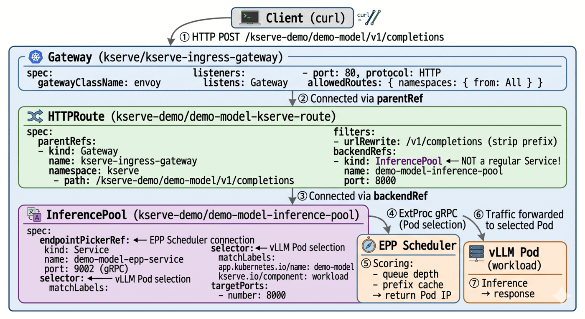
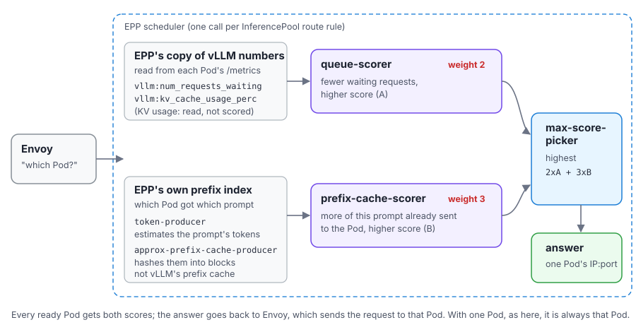

<!-- tut-translation source=README.md sha=6056c9a9667c -->
# Gateway에서 vLLM까지 요청이 지나가는 경로

<!-- tut:header -->

<!-- tutorial.yaml에서 `./tut sync`로 생성됨 — 직접 수정하지 마세요. -->
> **상태:** ✅ 안정 · **검증된 KServe:** v0.18.0 · **환경:** [`kind-kserve/v1`](../../envs/kind-kserve/v1/) · **GPU:** 불필요
>
> 🌐 [English](README.md)

<!-- /tut -->

LLMInferenceService에 `curl`로 요청을 한 번 보내면 클러스터 안에서 어떤 일이 일어날까요?
이 튜토리얼에서는 작은 모델을 배포하고, Envoy Gateway에서 EPP 스케줄러를 거쳐 vLLM Pod에
도달하는 요청 하나를 추적합니다. 세 구성 요소에서 공통으로 쓰는 요청 ID를 사용합니다.

> **핵심 질문** — 요청은 어떤 경로로 특정 Pod에 도달하며, 그 Pod는 왜 선택됐을까요?

이 튜토리얼에서 살펴볼 내용입니다.

- 요청 하나가 Envoy Gateway, HTTPRoute, InferencePool, EPP 스케줄러, vLLM Pod를
  거치는 경로와 각 구간에서 다음 목적지를 결정하는 객체를 살펴봅니다.
- Envoy가 ExtProc로 EPP에 Pod 선택을 요청하는 방법과 InferencePool로 연결되는
  경로 규칙마다 EPP를 한 번씩 호출하는 이유를 알아봅니다.
- `x-request-id`로 Envoy 로그, EPP 로그, 응답에서 같은 요청을 찾습니다.
- EPP가 Pod를 고를 때 쓰는 점수 산정 플러그인과 각 플러그인의 가중치, 참조하는 지표를 살펴봅니다.

## 요청 흐름 한눈에 보기

<a href="images/request_flow_1.png" target="_blank"></a>

그림의 네임스페이스는 `kserve-demo`이며, 이 튜토리얼에서는 `$NS`를 사용합니다.
그림을 클릭하면 원래 크기로 볼 수 있습니다.

요청을 전달할 때 각 구성 요소는 다음과 같이 동작합니다.

- **HTTPRoute**의 `backendRef`는 일반 Service 대신 **InferencePool**을 가리킵니다.
- **InferencePool**은 `endpointPickerRef`로 EPP 스케줄러를 지정하고 `selector`로
  vLLM Pod를 선택해 둘을 연결합니다.
- Envoy Gateway는 **ExtProc**(외부 처리) gRPC 서비스로 EPP를 호출한 뒤,
  EPP가 고른 Pod에 요청을 전달합니다.
- 요청이 vLLM에 도달하기 전에 HTTPRoute의 `urlRewrite` 필터가 URL 경로의 접두사를 제거합니다.

## 0단계. 환경 준비

KServe LLMInferenceService와 게이트웨이 스택가 포함된 Kind 클러스터를 준비하고,
이후 단계에서 사용할 네임스페이스를 만듭니다. 환경 구성은 위의 링크에서 확인할 수 있습니다.
이 단계는 다시 실행해도 됩니다.

<!-- tut:setup -->

```bash run
# Generated from tutorial.yaml by `./tut sync` — do not edit by hand.
export KSERVE_VERSION="${KSERVE_VERSION:-v0.18.0}"
export NS="${NS:-llmisvc-request-flow}"
export REPO_ROOT="$(git rev-parse --show-toplevel)"
source "$REPO_ROOT/tools/local-config.sh"   # your settings in .tut.env, if any
export TUT_LIB="$REPO_ROOT/lib"
# pinned CLI tools of the environment, for this shell only
export PATH="$REPO_ROOT/.tools/kind/v0.30.0:$REPO_ROOT/.tools/kubectl/v1.34.13:$REPO_ROOT/.tools/helm/v3.16.3:$REPO_ROOT/.tools/cloud-provider-kind/v0.12.0:$PATH"
# what this tutorial needs from the environment (env_options in tutorial.yaml)
TUT_ENV_TYPES=llmisvc TUT_ENV_MODE=standard TUT_ENV_KEDA=false "$REPO_ROOT/envs/kind-kserve/v1/setup.sh"
kubectl create namespace "$NS" --dry-run=client -o yaml | kubectl apply -f -
cd "$REPO_ROOT/tutorials/llmisvc-request-flow"
```

<!-- /tut -->

## 1단계. LLMInferenceService 배포

요청을 처리할 LLMInferenceService를 하나 배포합니다. 구조를 살펴보는 튜토리얼에서와
같이 vLLM으로 CPU에서 `facebook/opt-125m` 모델을 구동합니다.
LLMInferenceService 심화 과정을 따라왔다면 이미 실행 중이므로 이 단계를 건너뜁니다.

<!-- tut:use llmisvc-demo-model -->

<!-- Copied from llmisvc-anatomy (tut:define llmisvc-demo-model) by `./tut sync` — do not edit by hand. -->

```bash run
kubectl apply -f manifests/llmisvc-cpu.yaml -n "$NS"
```

<!-- /tut -->

<details>
<summary>manifests/llmisvc-cpu.yaml</summary>

<!-- tut:include manifests/llmisvc-cpu.yaml -->

```yaml
apiVersion: serving.kserve.io/v1alpha2
kind: LLMInferenceService
metadata:
  name: demo-model
spec:
  model:
    uri: "hf://facebook/opt-125m"
    name: facebook/opt-125m
  replicas: 1
  router:
    scheduler: {}
    route: {}
    gateway: {}
  template:
    containers:
      - name: main
        image: public.ecr.aws/q9t5s3a7/vllm-cpu-release-repo:v0.19.0
        securityContext:
          runAsNonRoot: true
          runAsUser: 1000
        env:
          - name: USER
            value: nonroot
          - name: VLLM_LOGGING_LEVEL
            value: DEBUG
          - name: VLLM_CPU_KVCACHE_SPACE
            value: "1"
          - name: VLLM_ADDITIONAL_ARGS
            value: "--block-size 16"
        resources:
          limits:
            cpu: "2"
            memory: 7Gi
          requests:
            cpu: 200m
            memory: 2Gi
        livenessProbe:
          initialDelaySeconds: 180
          periodSeconds: 30
          timeoutSeconds: 30
          failureThreshold: 8
        readinessProbe:
          initialDelaySeconds: 30
          periodSeconds: 10
          timeoutSeconds: 5
          failureThreshold: 3
```

<!-- /tut -->

</details>

이 튜토리얼에서는 `router` 아래의 빈 객체 세 개에 주목합니다.
`scheduler: {}`, `route: {}`, `gateway: {}`를 설정하면 KServe 컨트롤러가
EPP 스케줄러, HTTPRoute, InferencePool을 만들고 Gateway에 연결합니다.
Gateway나 경로를 직접 만들 필요는 없습니다.

> `route: {}`를 생략하면 HTTPRoute가 생성되지 않아 Gateway에서 모델에 접근할 수 없습니다.

LLMInferenceService가 `Ready` 상태가 될 때까지 기다립니다. 모델을 내려받고 CPU에서
vLLM을 시작하는 데 몇 분이 걸립니다.

```bash verify
kubectl wait --for=condition=Ready llminferenceservice/demo-model -n "$NS" --timeout=900s
```

## 2단계. 자동으로 생성된 라우팅 리소스 확인

```bash run
# Gateway (환경 설정에서 kserve 네임스페이스에 생성합니다)
kubectl get gateway -A

# LLMInferenceService용으로 생성된 HTTPRoute (InferencePool로 요청을 보냅니다)
kubectl get httproute -n "$NS" -o yaml

# InferencePool (EPP 스케줄러와 vLLM Pod를 연결합니다)
kubectl get inferencepool -n "$NS"
```

HTTPRoute에서 `backendRefs`의 종류가 `InferencePool`인지 확인하고 `URLRewrite` 필터를 찾습니다.
Gateway가 `Programmed` 상태가 되어야 주소가 생기고 이후 단계를 실행할 수 있습니다.

```bash verify
kubectl wait --for=condition=Programmed gateway --all -n kserve --timeout=120s
kubectl get httproute -n "$NS" -o jsonpath='{.items[*].spec.rules[*].backendRefs[*].kind}' | grep InferencePool
kubectl get httproute -n "$NS" -o jsonpath='{.items[*].spec.rules[*].filters[*].type}' | grep URLRewrite
test "$(kubectl get inferencepool -n "$NS" --no-headers | wc -l)" -ge 1
```

### Gateway 접속 주소

Kind에는 외부 로드 밸런서가 없으므로 워커 노드의 NodePort로 Gateway에 접속합니다.
공용 `llmisvc/v1` 모듈이 접속 주소를 `http://<worker node IP>:<node port>/<namespace>/demo-model`
형식으로 구성합니다.

```bash run
GATEWAY_URL=$("$TUT_LIB/llmisvc/v1/gateway-url.sh" "$NS" demo-model)
echo "$GATEWAY_URL"
```

<details>
<summary>lib/llmisvc/v1/gateway-url.sh</summary>

<!-- tut:include ../../lib/llmisvc/v1/gateway-url.sh -->

```bash skip
#!/usr/bin/env bash
# Usage: gateway-url.sh <namespace> <llmisvc-name>
# Prints the URL that reaches the LLMInferenceService through the Envoy Gateway.
# In Kind there is no external load balancer, so we use the worker node IP and
# the Gateway service NodePort.
set -euo pipefail
ns="${1:?namespace}"; name="${2:?llmisvc name}"
node_ip=$(docker inspect "${KIND_CLUSTER_NAME:-kind}-worker" \
  --format '{{range .NetworkSettings.Networks}}{{.IPAddress}}{{end}}')
node_port=$(kubectl get svc -n envoy-gateway-system \
  -l gateway.envoyproxy.io/owning-gateway-name \
  -o jsonpath='{.items[0].spec.ports[0].nodePort}')
echo "http://${node_ip}:${node_port}/${ns}/${name}"
```

<!-- /tut -->

</details>

## 3단계. 요청을 보내고 로그 확인

요청이 지나가는 과정을 보려면 터미널을 두 개 더 열어 로그를 실시간으로 확인합니다.
`Ctrl+C`를 누르면 로그 출력을 중지할 수 있습니다.

첫 번째 터미널에서는 Pod를 선택하는 EPP 스케줄러의 로그를 확인합니다.

```bash skip
kubectl logs -n "$NS" -l app.kubernetes.io/component=llminferenceservice-router-scheduler -c main -f --tail=0
```

두 번째 터미널에서는 추론을 수행하는 vLLM Pod의 로그를 확인합니다.

```bash skip
kubectl logs -n "$NS" -l app.kubernetes.io/component=llminferenceservice-workload -f --tail=0 --max-log-requests=5
```

그런 다음 Gateway에 텍스트 생성 요청을 보냅니다.

```bash run
curl -s "${GATEWAY_URL}/v1/completions" \
  -H "Content-Type: application/json" \
  -d '{
    "model": "facebook/opt-125m",
    "prompt": "Kubernetes is",
    "max_tokens": 30
  }' | python3 -m json.tool
```

LLMInferenceService가 `Ready` 상태가 된 뒤에도 경로가 동작하기까지 잠시 걸릴 수 있습니다.
아래 명령은 생성된 텍스트가 담긴 응답이 돌아올 때까지 다시 시도합니다.

```bash verify retry=10 delay=15
"$TUT_LIB/llmisvc/v1/completion.sh" "$GATEWAY_URL" facebook/opt-125m "Kubernetes is"
```

> `facebook/opt-125m`은 이 튜토리얼을 CPU에서 실행할 수 있도록 고른 소형 기본 모델입니다.
> 입력 텍스트에 이어서 문장을 생성하며, 결과가 어색할 때가 많습니다.
> 여기서 확인할 대상은 응답 내용보다 요청이 지나가는 경로입니다.

## 4단계. x-request-id로 요청 하나 추적

Envoy는 모든 요청에 `x-request-id`를 부여해 EPP와 vLLM에 전달합니다.
vLLM은 이 값을 응답의 `id`에 사용합니다(`cmpl-<x-request-id>`).
따라서 응답 본문의 ID로 각 로그에서 같은 요청을 찾을 수 있습니다.

### 1. 요청을 보내고 요청 ID 추출

```bash run
RESPONSE=$(curl -s "${GATEWAY_URL}/v1/completions" \
  -H "Content-Type: application/json" \
  -d '{
    "model": "facebook/opt-125m",
    "prompt": "Kubernetes is",
    "max_tokens": 20
  }')

echo "$RESPONSE" | python3 -m json.tool

# 응답 ID는 cmpl-<x-request-id> 형식이므로 접두사를 제거합니다
REQUEST_ID=$(echo "$RESPONSE" | python3 -c 'import json, sys; print(json.load(sys.stdin)["id"])' | sed 's/^cmpl-//')
echo "Request ID: $REQUEST_ID"
```

```bash verify
test -n "$REQUEST_ID"
```

### 2. Envoy Gateway에서 요청 찾기

Envoy는 요청이 끝나고 몇 초 뒤에 요청당 한 줄씩 JSON 액세스 로그를 남깁니다.
따라서 로그가 나타날 때까지 조회를 다시 시도합니다.

```bash verify retry=6 delay=5
kubectl logs -n envoy-gateway-system \
  -l gateway.envoyproxy.io/owning-gateway-name -c envoy --tail=50 \
  | grep "$REQUEST_ID" | python3 -m json.tool --json-lines
```

주요 필드는 다음과 같습니다.

| 필드 | 설명 |
|-------|-------------|
| `x-request-id` | 요청 추적 ID입니다. EPP 로그에서 같은 값을 찾습니다. |
| `upstream_host` | 요청을 전달받은 vLLM Pod의 IP 주소와 포트입니다. |
| `duration` | 요청을 받은 시점부터 응답이 끝날 때까지 걸린 총 시간입니다. 단위는 밀리초입니다. |
| `response_code` | 최종 HTTP 상태 코드입니다. 200은 성공을 뜻합니다. |

### 3. EPP 스케줄러에서 요청 찾기

스케줄러는 OpenTelemetry 스팬도 로그에 출력하므로 요청 하나에 수백 줄이 생깁니다.
최근 수백 줄로 범위를 제한하는 대신 최근 몇 분 동안의 로그를 검색합니다.
`kubectl logs`를 `-l`과 함께 쓰면 기본적으로 마지막 10줄만 가져오므로 `--tail=-1`을 지정합니다.

```bash verify retry=6 delay=5
kubectl logs -n "$NS" \
  -l app.kubernetes.io/component=llminferenceservice-router-scheduler \
  -c main --since=5m --tail=-1 \
  | grep "$REQUEST_ID"
```

EPP 로그의 각 줄은 다음 상황을 나타냅니다.

- `EPP received request`는 Envoy가 ExtProc gRPC로 EPP에 Pod 선택을 요청했다는 뜻입니다.
- `EPP sent request body response(s) to proxy`는 Pod 선택이 끝났다는 뜻입니다.
  이 줄에 `modelName`과 `targetModelName`이 표시됩니다.
- `EPP sent response body back to proxy`는 vLLM의 응답이 Envoy로 돌아갔다는 뜻입니다.

같은 요청 ID로 이 로그 세 줄이 여러 번 나타납니다. Envoy의 ExtProc 필터마다 한 묶음씩
기록되기 때문입니다. HTTPRoute에는 InferencePool로 요청을 보내는 규칙이 세 개
있습니다(`/v1/completions`, `/v1/chat/completions`, `/v1/responses`).
Envoy Gateway는 각 규칙에 해당하는 ExtProc 필터를 Gateway 리스너에 하나씩 추가합니다.
이 경로로 들어오는 요청마다 필터 세 개가 모두 실행되므로 EPP는 규칙당 한 번씩,
여기서는 총 세 번 호출됩니다. 세 번 모두 같은 Pod 하나를 반환합니다.
아래 명령은 규칙 수와 로그 묶음 수를 각각 셉니다.

```bash verify retry=6 delay=5
RULES=$(kubectl get httproute -n "$NS" -o json | python3 -c '
import json, sys
print(sum(1 for r in json.load(sys.stdin)["items"] for rule in r["spec"]["rules"]
          if any(b.get("kind") == "InferencePool" for b in rule.get("backendRefs", []))))')
SETS=$(kubectl logs -n "$NS" \
  -l app.kubernetes.io/component=llminferenceservice-router-scheduler \
  -c main --since=5m --tail=-1 \
  | grep "$REQUEST_ID" | grep -c "EPP received request")
echo "HTTPRoute rules to the InferencePool: $RULES; EPP sets for this request: $SETS"
test "$RULES" -gt 0 && test "$SETS" -eq "$RULES"
```

각 묶음 끝에는 `Request latency values are invalid for TPOT calculation`이라는
오류 수준의 로그도 남습니다. 요청 자체는 실패하지 않으며, EPP는 출력 토큰당 소요 시간인
TPOT 지표 하나만 기록하지 않습니다. 이 환경에서 쓰는 이미지인 llm-d-router v0.9.0의
EPP 소스에서 이유를 확인할 수 있습니다. 응답을 스트리밍하지 않으면 응답 전체가 메시지
하나로 도착합니다. 이때 EPP는 첫 토큰 시각(`handlers/response.go`)을 기록하기 직전에
응답 완료 시각(`handlers/server.go`)을 기록합니다. TPOT를 계산하려면 완료 시각이 첫 토큰
시각보다 늦어야 하므로(`metrics/metrics.go`의 `RecordRequestTPOT`), 시각 검사에 실패해
이 로그가 남습니다. 로그를 보면 `completeTime`이 `firstTokenTime`보다 몇 마이크로초 앞섭니다.

### 4. 요청을 처리한 vLLM Pod 확인

vLLM은 기본 설정에서 개별 요청을 로그에 남기지 않습니다. Envoy 로그의 `upstream_host`로
요청을 처리한 Pod를 찾습니다.

```bash run
# Envoy 액세스 로그에서 upstream_host를 읽어 vLLM Pod의 IP 주소를 찾습니다
TARGET_POD_IP=$(kubectl logs -n envoy-gateway-system \
  -l gateway.envoyproxy.io/owning-gateway-name -c envoy --tail=50 \
  | grep "$REQUEST_ID" \
  | python3 -c 'import json, sys; print(json.loads(sys.stdin.readline())["upstream_host"].split(":")[0])')

# 해당 IP 주소를 가진 Pod를 찾습니다
kubectl get pods -n "$NS" -o wide | grep "$TARGET_POD_IP"
```

이 IP 주소가 스케줄러 Pod와 구별되는 LLMInferenceService의 워크로드(vLLM) Pod 주소인지
확인합니다.

```bash verify
test "$(kubectl get pods -n "$NS" -l app.kubernetes.io/component=llminferenceservice-workload \
  -o jsonpath='{.items[0].status.podIP}')" = "$TARGET_POD_IP"
```

### 5. 추적 결과 요약

`x-request-id`로 추적한 요청 하나의 경로입니다.

```text
curl → Envoy Gateway → EPP scheduler (Pod selection) → vLLM Pod (inference)
       ↑ duration,       ↑ received →                   ↑ identified via
         upstream_host     sent body →                     upstream_host
                           sent response
```

## 5단계. 부하 분산 확인

요청 10개를 동시에 보내고 EPP가 어느 Pod로 보내는지 확인합니다.

```bash run
for i in $(seq 1 10); do
  curl -s "${GATEWAY_URL}/v1/completions" \
    -H "Content-Type: application/json" \
    -d "{
      \"model\": \"facebook/opt-125m\",
      \"prompt\": \"Request $i: Tell me about\",
      \"max_tokens\": 10
    }" &
done
wait
```

Envoy 로그에서 Pod별로 전달된 요청 수를 셉니다.

```bash run
kubectl logs -n envoy-gateway-system \
  -l gateway.envoyproxy.io/owning-gateway-name -c envoy --tail=50 \
  | grep -o '"upstream_host": *"[^"]*"' | sort | uniq -c | sort -rn
```

`replicas: 1`이면 선택할 수 있는 Pod가 하나뿐이므로 요청 10개가 모두 같은 Pod IP 주소로
전달됩니다. 복제본 수를 늘리면 요청이 여러 IP 주소로 분산됩니다.

```bash verify retry=6 delay=5
POD_IP=$(kubectl get pods -n "$NS" -l app.kubernetes.io/component=llminferenceservice-workload \
  -o jsonpath='{.items[0].status.podIP}')
kubectl logs -n envoy-gateway-system \
  -l gateway.envoyproxy.io/owning-gateway-name -c envoy --tail=50 \
  | python3 -c 'import json, sys
ip = sys.argv[1] + ":"
n = sum(1 for line in sys.stdin if line.startswith("{") and str(json.loads(line).get("upstream_host", "")).startswith(ip))
print(n, "requests forwarded to", sys.argv[1])
assert n >= 10' "$POD_IP"
```

## 6단계. 스케줄러가 Pod를 선택하는 방법

EPP 스케줄러는 점수 산정 플러그인으로 모든 Pod에 점수를 매긴 뒤, 가중치를 적용한 점수의
합이 가장 높은 Pod를 고릅니다.

<a href="images/epp-scoring.svg" target="_blank"></a>

두 플러그인은 서로 다른 데이터를 참조합니다. `queue-scorer`는 EPP가 보관하는 Pod별
`vllm:num_requests_waiting` 값을 사용합니다. `prefix-cache-scorer`는 vLLM의 접두사 캐시를
읽지 않습니다. 대신 어느 Pod에 어떤 프롬프트를 보냈는지 기록한 EPP 자체 인덱스를 사용합니다.
이 인덱스는 EPP가 자동으로 추가하는 보조 구성 요소 두 개
(`approx-prefix-cache-producer`, `token-producer`)가 만듭니다. EPP 로그에는
`auto-created default producer`라고 표시됩니다. 이 구성에서는 KV 캐시 사용률도 읽지만
점수 계산에는 쓰지 않습니다.

```bash verify
kubectl logs -n "$NS" -l app.kubernetes.io/component=llminferenceservice-router-scheduler -c main --tail=-1 \
  | grep 'auto-created default producer.*approx-prefix-cache-producer' | tail -n 1
```

### EPP 지표에서 점수 계산에 쓰는 값 조회

플러그인이 점수를 계산할 때 쓰는 값은 스케줄러의 지표 포트(9090)에서 조회할 수 있습니다.
이 주소에 접속하려면 Bearer 토큰이 필요합니다(`metrics-endpoint-auth: true`).
토큰의 소유자에게는 리소스가 아닌 URL `/metrics`에 대한 `get` 권한이 있어야 합니다.
이 권한만 가진 ServiceAccount를 만듭니다.

```bash run
kubectl apply -f manifests/metrics-reader.yaml -n "$NS"
kubectl create clusterrolebinding llmisvc-request-flow-metrics-reader \
  --clusterrole=llmisvc-request-flow-metrics-reader \
  --serviceaccount="$NS:metrics-reader" \
  --dry-run=client -o yaml | kubectl apply -f -
```

<details>
<summary>manifests/metrics-reader.yaml</summary>

<!-- tut:include manifests/metrics-reader.yaml -->

```yaml
# Identity used to read the EPP scheduler's /metrics endpoint.
# The endpoint checks the bearer token (TokenReview) and asks the API server
# whether its owner may "get" the non-resource URL /metrics.
apiVersion: v1
kind: ServiceAccount
metadata:
  name: metrics-reader
---
apiVersion: rbac.authorization.k8s.io/v1
kind: ClusterRole
metadata:
  name: llmisvc-request-flow-metrics-reader
rules:
  - nonResourceURLs: ["/metrics"]
    verbs: ["get"]
```

<!-- /tut -->

</details>

이 ServiceAccount로 임시 Pod를 실행합니다. Pod는 자신의 토큰을 보내 지표를 조회합니다.
이후 단계에서 다시 호출할 수 있도록 명령을 함수로 묶습니다.

```bash run
epp_metrics() {
  kubectl delete pod curl-metrics -n "$NS" --ignore-not-found
  kubectl run curl-metrics --rm -i --restart=Never -n "$NS" \
    --image=curlimages/curl:8.11.1 \
    --overrides="{
      \"spec\": {
        \"containers\": [{
          \"name\": \"curl\",
          \"image\": \"curlimages/curl:8.11.1\",
          \"command\": [\"sh\", \"-c\", \"sleep 2 && TOKEN=\$(cat /var/run/secrets/kubernetes.io/serviceaccount/token) && curl -s -H \\\"Authorization: Bearer \$TOKEN\\\" http://demo-model-epp-service.$NS.svc:9090/metrics | grep -E '^(epp_|inference_pool|inference_extension_prefix)'\"]
        }],
        \"serviceAccountName\": \"metrics-reader\"
      }
    }"
}
epp_metrics
```

주요 지표는 다음과 같습니다.

| 지표 | 점수 산정 플러그인 | 설명 |
|--------|--------|-------------|
| `inference_pool_average_kv_cache_utilization` | 해당 없음(이 구성에서는 점수 계산에 사용하지 않습니다) | Pod의 평균 KV 캐시 사용률입니다. |
| `inference_pool_average_queue_size` | queue-scorer | Pod의 평균 대기열 크기입니다. |
| `inference_pool_ready_pods` | — | 요청을 처리할 준비가 된 Pod 수입니다. |
| `inference_extension_prefix_indexer_hit_ratio` | prefix-cache-scorer | 접두사 캐시 적중률입니다(0.0~1.0). 비슷한 프롬프트를 반복해서 보내면 높아집니다. |
| `inference_extension_prefix_indexer_hit_bytes` | prefix-cache-scorer | 일치한 접두사의 길이입니다. 단위는 바이트입니다. |
| `inference_extension_prefix_indexer_size` | prefix-cache-scorer | 접두사 인덱서의 현재 크기입니다. |

InferencePool에서 요청을 처리할 준비가 된 Pod는 하나입니다.

```bash verify retry=5 delay=10
epp_metrics | awk '$1 ~ /^inference_pool_ready_pods/ && $NF >= 1 {ok = 1} END {exit !ok}'
```

**일부 값이 0인 이유는 무엇일까요?** 요청과 요청 사이에는 클러스터가 유휴 상태입니다.

- `kv_cache_utilization`은 0입니다. 요청이 끝나면 KV 캐시가 해제됩니다.
- `queue_size`는 0입니다. 대기 중인 요청이 없습니다.

앞 단계에서 보낸 요청이 이미 접두사 인덱서에 기록됐으므로 `prefix_indexer_size`는
0보다 큽니다.

### 같은 프롬프트 반복 전송

접두사 지표는 값이 누적되기만 하는 카운터와 히스토그램이므로 요청 전후의 값을 비교합니다.
지금까지 일치한 접두사의 바이트 수를 기록하고, 같은 긴 프롬프트를 다섯 번 보낸 뒤 지표를
다시 조회합니다.

```bash run
prefix_hit_bytes() {
  epp_metrics | awk '$1 == "inference_extension_prefix_indexer_hit_bytes_sum" {print $2}'
}
HIT_BYTES_BEFORE=$(prefix_hit_bytes)
echo "matched prefix bytes so far: $HIT_BYTES_BEFORE"
for i in $(seq 1 5); do
  curl -s "${GATEWAY_URL}/v1/completions" \
    -H "Content-Type: application/json" \
    -d '{"model":"facebook/opt-125m","prompt":"Write a detailed essay about the history of Kubernetes container orchestration platform and how it evolved from Google Borg system to become the industry standard for cloud native computing","max_tokens":10}' > /dev/null
done
epp_metrics
```

이제 다음 변화를 확인할 수 있습니다.

- `prefix_indexer_hit_bytes_sum`이 증가합니다. 반복해서 보낸 프롬프트가 인덱서에
  이미 있는 접두사와 일치했기 때문입니다.
- `prefix_indexer_hit_ratio`는 히스토그램입니다. 새 요청 대부분이 `le="1"` 버킷에
  집계되며, `_sum`과 `_count`가 거의 같은 양만큼 증가합니다. 적중률이 1.0에 가깝다는 뜻입니다.
- `prefix_indexer_size`는 거의 변하지 않습니다. 프롬프트 하나로 추가되는 항목은 몇 개뿐입니다.

일치한 접두사의 바이트 수가 늘어났는지 확인합니다.

```bash verify retry=5 delay=10
prefix_hit_bytes | awk -v before="$HIT_BYTES_BEFORE" '{now = $1} END {print "before", before, "now", now; exit !(now + 0 > before + 0)}'
```

부하가 계속되면 대기열 크기와 KV 캐시 사용률도 달라집니다.

## 정리

LLMInferenceService를 삭제하면 컨트롤러가 이 리소스를 위해 만든 Deployment, Service,
InferencePool, HTTPRoute가 모두 삭제됩니다. ClusterRole과 이를 연결한 바인딩은
클러스터 범위 리소스이므로 이름을 지정해 삭제합니다.

```bash cleanup
kubectl delete pod curl-metrics -n "$NS" --ignore-not-found
kubectl delete llminferenceservice demo-model -n "$NS" --ignore-not-found --wait=true
kubectl delete clusterrolebinding llmisvc-request-flow-metrics-reader --ignore-not-found
kubectl delete clusterrole llmisvc-request-flow-metrics-reader --ignore-not-found
kubectl delete namespace "$NS" --ignore-not-found
```

이 환경의 튜토리얼은 같은 Kind 클러스터를 공유합니다. 사용을 마치면 환경의
`teardown.sh`로 클러스터를 삭제합니다.

## 배운 내용

- 요청은 **7단계**를 거쳐 vLLM Pod에 도달합니다.
- **Envoy Gateway**는 L7 프록시 역할을 하고, **EPP 스케줄러**는 Pod를 고릅니다.
- EPP는 **ExtProc**(외부 처리) gRPC로 Envoy와 통신합니다.
- EPP는 대기열 점수(가중치 2)와 프롬프트 점수(가중치 3)의 가중합으로 Pod를 고릅니다.
  프롬프트 점수는 EPP 자체의 접두사 인덱스를 사용해 각 Pod에 이전에 보낸 프롬프트와
  현재 프롬프트가 얼마나 일치하는지에 따라 계산합니다.
- KServe가 Gateway 연결, HTTPRoute, InferencePool을 자동으로 구성하므로 직접 설정할 필요가 없습니다.
- `x-request-id` 하나로 Envoy 액세스 로그, EPP 로그, vLLM 응답을 연결해 추적할 수 있습니다.
