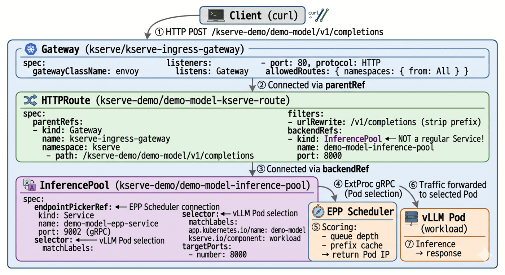
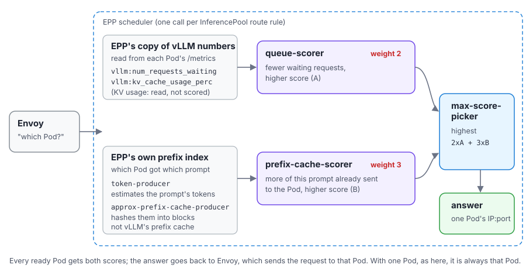

# Journey of a Request — From Gateway to vLLM

<!-- tut:header -->

<!-- Generated from tutorial.yaml by `./tut sync` — do not edit by hand. -->
> **Status:** 🚧 draft · **Tested with KServe:** v0.20.0 · **Environment:** [`kind-kserve/v1`](../../envs/kind-kserve/v1/) · **GPU:** not required
>
> 🌐 [한국어](README.ko.md)
>
> **Older KServe versions:** v0.18.0: [v0.18](revisions/v0.18/README.md)

<!-- /tut -->

What happens inside the cluster when you send a single `curl` to an
LLMInferenceService? This tutorial deploys a small model and follows one
request through Envoy Gateway and the EPP scheduler to the vLLM Pod, using the
request id that all three share.

> **Key question:** what path does my request take to reach a specific Pod, and
> why was that Pod chosen?

What you will learn:

- The path of one request: Envoy Gateway, HTTPRoute, InferencePool, EPP
  scheduler, vLLM Pod, and which object decides each hop.
- How Envoy asks the EPP for a Pod (ExtProc), and why the EPP is asked many
  times for one request: once per match of the InferencePool route rules.
- How to follow one request through the Envoy log, the EPP log and the answer
  with its `x-request-id`.
- How the EPP chooses a Pod: its scorers, their weights and the metrics they
  read.

## Request flow overview

<a href="images/request_flow_1.png" target="_blank"></a>

The picture uses the namespace `kserve-demo`; in this tutorial it is `$NS`.
Click it to open it at full size.

Key points:

- The **HTTPRoute**'s `backendRef` points to an **InferencePool**, not to a
  regular Service.
- The **InferencePool** is the hub: it names the EPP scheduler
  (`endpointPickerRef`) and selects the vLLM Pods (`selector`).
- Envoy Gateway calls the EPP as an **ExtProc** (External Processing) gRPC
  service, then forwards the request to the Pod the EPP picked.
- The URL path prefix is stripped by the HTTPRoute's `urlRewrite` filter before
  the request reaches vLLM.

## Step 0: Environment

This prepares a Kind cluster with KServe LLMInferenceService and its gateway
stack (see the environment link above) and creates the namespace used below. It
is safe to run again.

<!-- tut:setup -->

```bash run
# Generated from tutorial.yaml by `./tut sync` — do not edit by hand.
export KSERVE_VERSION="${KSERVE_VERSION:-v0.20.0}"
export NS="${NS:-llmisvc-request-flow}"
export REPO_ROOT="$(git rev-parse --show-toplevel)"
source "$REPO_ROOT/tools/local-config.sh"   # your settings in .tut.env, if any
export TUT_LIB="$REPO_ROOT/lib"
# pinned CLI tools of the environment, for this shell only
export PATH="$REPO_ROOT/.tools/kind/v0.30.0:$REPO_ROOT/.tools/kubectl/v1.34.13:$REPO_ROOT/.tools/helm/v3.16.3:$REPO_ROOT/.tools/cloud-provider-kind/v0.12.0:$PATH"
# what this tutorial needs from the environment (env_options in tutorial.yaml)
TUT_ENV_TYPES=llmisvc TUT_ENV_MODE=standard TUT_ENV_KEDA=false "$REPO_ROOT/envs/kind-kserve/v1/setup.sh"
kubectl create namespace "$NS" --dry-run=client -o yaml | kubectl apply -f -
cd "$REPO_ROOT/tutorials/llmisvc-request-flow"
```

<!-- /tut -->

## Step 1: Deploy the LLMInferenceService

The request needs somewhere to go. Apply one LLMInferenceService that serves
`facebook/opt-125m` with vLLM on CPU: the same one as in the anatomy tutorial.
If you follow the LLMInferenceService deep dive path, it is already running
and this step is skipped.

<!-- tut:use llmisvc-demo-model -->

<!-- Copied from llmisvc-anatomy (tut:define llmisvc-demo-model) by `./tut sync` — do not edit by hand. -->

```bash run
kubectl apply -f manifests/llmisvc-cpu.yaml -n "$NS"
```

<!-- /tut -->

<details>
<summary>manifests/llmisvc-cpu.yaml</summary>

<!-- tut:include manifests/llmisvc-cpu.yaml -->

```yaml
apiVersion: serving.kserve.io/v1alpha2
kind: LLMInferenceService
metadata:
  name: demo-model
spec:
  model:
    uri: "hf://facebook/opt-125m"
    name: facebook/opt-125m
  replicas: 1
  router:
    scheduler: {}
    route: {}
    gateway: {}
  template:
    containers:
      - name: main
        image: public.ecr.aws/q9t5s3a7/vllm-cpu-release-repo:v0.19.0
        securityContext:
          runAsNonRoot: true
          runAsUser: 1000
        env:
          - name: USER
            value: nonroot
          - name: VLLM_LOGGING_LEVEL
            value: DEBUG
          - name: VLLM_CPU_KVCACHE_SPACE
            value: "1"
          - name: VLLM_ADDITIONAL_ARGS
            value: "--block-size 16"
        resources:
          limits:
            cpu: "2"
            memory: 7Gi
          requests:
            cpu: 200m
            memory: 2Gi
        livenessProbe:
          initialDelaySeconds: 180
          periodSeconds: 30
          timeoutSeconds: 30
          failureThreshold: 8
        readinessProbe:
          initialDelaySeconds: 30
          periodSeconds: 10
          timeoutSeconds: 5
          failureThreshold: 3
```

<!-- /tut -->

</details>

The three empty objects under `router` are what this tutorial is about:
`scheduler: {}`, `route: {}` and `gateway: {}` make the KServe controller
create the EPP scheduler, the HTTPRoute and the InferencePool, and attach them
to the Gateway. You do not create a Gateway or a route yourself.

> Without `route: {}` no HTTPRoute is created and the Gateway cannot reach the
> model.

Wait until the service reports `Ready`. Downloading the model and starting vLLM
on CPU takes a few minutes.

```bash verify
kubectl wait --for=condition=Ready llminferenceservice/demo-model -n "$NS" --timeout=900s
```

## Step 2: Look at the generated routing resources

```bash run
# Gateway (created in the kserve namespace by the environment)
kubectl get gateway -A

# HTTPRoute generated for the LLMInferenceService (routes to the InferencePool)
kubectl get httproute -n "$NS" -o yaml

# InferencePool (connects the EPP scheduler and the vLLM Pods)
kubectl get inferencepool -n "$NS"
```

In the HTTPRoute, find `backendRefs` (kind `InferencePool`) and the
`URLRewrite` filter. The Gateway must be `Programmed`, otherwise it has no
address and nothing below works.

```bash verify
kubectl wait --for=condition=Programmed gateway --all -n kserve --timeout=120s
kubectl get httproute -n "$NS" -o jsonpath='{.items[*].spec.rules[*].backendRefs[*].kind}' | grep InferencePool
kubectl get httproute -n "$NS" -o jsonpath='{.items[*].spec.rules[*].filters[*].type}' | grep URLRewrite
test "$(kubectl get inferencepool -n "$NS" --no-headers | wc -l)" -ge 1
```

### The Gateway endpoint

In Kind there is no external load balancer, so the Gateway is reached through a
NodePort on the worker node. The shared `llmisvc/v1` module works out the URL:
`http://<worker node IP>:<node port>/<namespace>/demo-model`.

```bash run
GATEWAY_URL=$("$TUT_LIB/llmisvc/v1/gateway-url.sh" "$NS" demo-model)
echo "$GATEWAY_URL"
```

<details>
<summary>lib/llmisvc/v1/gateway-url.sh</summary>

<!-- tut:include ../../lib/llmisvc/v1/gateway-url.sh -->

```bash skip
#!/usr/bin/env bash
# Usage: gateway-url.sh <namespace> <llmisvc-name>
# Prints the URL that reaches the LLMInferenceService through the Envoy Gateway.
# In Kind there is no external load balancer, so we use the worker node IP and
# the Gateway service NodePort.
set -euo pipefail
ns="${1:?namespace}"; name="${2:?llmisvc name}"
node_ip=$(docker inspect "${KIND_CLUSTER_NAME:-kind}-worker" \
  --format '{{range .NetworkSettings.Networks}}{{.IPAddress}}{{end}}')
node_port=$(kubectl get svc -n envoy-gateway-system \
  -l gateway.envoyproxy.io/owning-gateway-name \
  -o jsonpath='{.items[0].spec.ports[0].nodePort}')
echo "http://${node_ip}:${node_port}/${ns}/${name}"
```

<!-- /tut -->

</details>

## Step 3: Send a request and watch the logs

To see the request pass by, open two more terminals and follow the logs there
(press `Ctrl+C` to stop).

Terminal 1, the EPP scheduler (Pod selection):

```bash skip
kubectl logs -n "$NS" -l app.kubernetes.io/component=llminferenceservice-router-scheduler -c main -f --tail=0
```

Terminal 2, the vLLM Pod (inference):

```bash skip
kubectl logs -n "$NS" -l app.kubernetes.io/component=llminferenceservice-workload -f --tail=0 --max-log-requests=5
```

Then send a completion request through the Gateway:

```bash run
curl -s "${GATEWAY_URL}/v1/completions" \
  -H "Content-Type: application/json" \
  -d '{
    "model": "facebook/opt-125m",
    "prompt": "Kubernetes is",
    "max_tokens": 30
  }' | python3 -m json.tool
```

The route can need a moment after the service turns `Ready`; this check retries
until a completion with text comes back.

```bash verify retry=10 delay=15
"$TUT_LIB/llmisvc/v1/completion.sh" "$GATEWAY_URL" facebook/opt-125m "Kubernetes is"
```

> `facebook/opt-125m` is a tiny base model chosen so the tutorial runs on a CPU.
> It continues the text, often oddly. What matters here is the path, not the
> answer.

## Step 4: Trace one request by its x-request-id

Envoy gives every request an `x-request-id`. It passes the id to the EPP and to
vLLM, and vLLM uses it for the `id` of its answer (`cmpl-<x-request-id>`). So
the id in the response body is the key to find the same request in every log.

### 1. Send a request and extract the request id

```bash run
RESPONSE=$(curl -s "${GATEWAY_URL}/v1/completions" \
  -H "Content-Type: application/json" \
  -d '{
    "model": "facebook/opt-125m",
    "prompt": "Kubernetes is",
    "max_tokens": 20
  }')

echo "$RESPONSE" | python3 -m json.tool

# the response id is cmpl-<x-request-id>: strip the prefix
REQUEST_ID=$(echo "$RESPONSE" | python3 -c 'import json, sys; print(json.load(sys.stdin)["id"])' | sed 's/^cmpl-//')
echo "Request ID: $REQUEST_ID"
```

```bash verify
test -n "$REQUEST_ID"
```

### 2. Find the request in Envoy Gateway

Envoy writes one JSON access-log line per request, a few seconds after the
request ends (hence the retries).

```bash verify retry=6 delay=5
kubectl logs -n envoy-gateway-system \
  -l gateway.envoyproxy.io/owning-gateway-name -c envoy --tail=50 \
  | grep "$REQUEST_ID" | python3 -m json.tool --json-lines
```

Key fields:

| Field | Description |
|-------|-------------|
| `x-request-id` | Request trace id. Search the EPP logs for the same value |
| `upstream_host` | IP:port of the vLLM Pod the request was forwarded to |
| `duration` | Total processing time in ms, from receiving the request to the end of the response |
| `response_code` | Final HTTP status. 200 means success |

### 3. Find the request in the EPP scheduler

The scheduler also prints its OpenTelemetry spans to the log, several hundred
lines per request, so search the last few minutes rather than the last few
hundred lines (`--tail=-1`: with `-l`, `kubectl logs` otherwise keeps only the
last 10 lines):

```bash verify retry=6 delay=5
kubectl logs -n "$NS" \
  -l app.kubernetes.io/component=llminferenceservice-router-scheduler \
  -c main --since=5m --tail=-1 \
  | grep "$REQUEST_ID"
```

What the EPP log lines mean:

- `EPP received request`: Envoy asked the EPP to pick a Pod (ExtProc gRPC)
- `EPP sent request body response(s) to proxy`: the Pod is picked; the line
  shows `modelName` and `targetModelName`
- `EPP sent response body back to proxy`: the vLLM answer went back to Envoy

The same request id shows up in several complete sets of these lines, one set
per ExtProc filter in Envoy. In Envoy's configuration every **match** of an HTTPRoute rule is a route of
its own, and the Gateway's listener has one ExtProc filter for each of those
routes that sends to the InferencePool.
List the rules and count their matches:

```bash run
kubectl get httproute -n "$NS" -o json | python3 -c '
import json, sys
for rule in json.load(sys.stdin)["items"][0]["spec"]["rules"]:
    name, matches = rule.get("name", "-"), len(rule.get("matches", []))
    kind = rule["backendRefs"][0].get("kind", "Service")
    print(f"{name:36} {matches:2} match(es) -> {kind}")'
```

```text
v1-completions-path                   1 match(es) -> InferencePool
v1-chat-completions-path              1 match(es) -> InferencePool
v1-responses-path                     1 match(es) -> InferencePool
v1-messages-path                      1 match(es) -> InferencePool
v1-model-routing                      8 match(es) -> InferencePool
v1-completions-publisher-path         1 match(es) -> InferencePool
v1-chat-completions-publisher-path    1 match(es) -> InferencePool
v1-responses-publisher-path           1 match(es) -> InferencePool
v1-messages-publisher-path            1 match(es) -> InferencePool
v1-publisher-path-catch-all           1 match(es) -> Service
v1-catch-all-path                     1 match(es) -> Service
v1-catch-all-model-routing            1 match(es) -> Service
```

Nine rules send to the InferencePool: four for the paths under
`/<namespace>/demo-model` (`/v1/completions`, `/v1/chat/completions`,
`/v1/responses`, `/v1/messages`), four for the same paths under
`/publishers/<namespace>/models/<model>`, and `v1-model-routing`, which
matches the bare `/v1/...` paths by the header `X-Gateway-Model-Name` and has
eight matches. That makes 4 + 4 + 8 = **16 matches, so 16 ExtProc filters**.
The filters of a listener form a chain that every request to the pool passes
through, whichever rule it matched, so the EPP is asked 16 times for one
request, with the same single Pod as the answer each time. The check counts
both:

```bash verify retry=6 delay=5
MATCHES=$(kubectl get httproute -n "$NS" -o json | python3 -c '
import json, sys
print(sum(len(rule.get("matches", [])) for r in json.load(sys.stdin)["items"] for rule in r["spec"]["rules"]
          if any(b.get("kind") == "InferencePool" for b in rule.get("backendRefs", []))))')
SETS=$(kubectl logs -n "$NS" \
  -l app.kubernetes.io/component=llminferenceservice-router-scheduler \
  -c main --since=5m --tail=-1 \
  | grep "$REQUEST_ID" | grep -c "EPP received request")
echo "Matches of the HTTPRoute rules to the InferencePool: $MATCHES; EPP sets for this request: $SETS"
test "$MATCHES" -gt 0 && test "$SETS" -eq "$MATCHES"
```

Each set also ends with an error-level line, `Request latency values are
invalid for TPOT calculation`. It does not mean the request failed; the EPP
only skips one metric, TPOT (time per output token). The reason is in the EPP's
source (llm-d-router v0.9.0, the image of this environment): when the answer is
not streamed it arrives in one message, and the EPP stamps the complete time
(`handlers/server.go`) just before the first-token time (`handlers/response.go`).
TPOT needs the complete time to be later (`metrics/metrics.go`,
`RecordRequestTPOT`), so the check fails and logs this line. You can see it in
the line itself: `completeTime` is a few microseconds before `firstTokenTime`.

### 4. Which vLLM Pod handled it

vLLM does not log single requests in its default configuration. Take the Pod
from `upstream_host` in the Envoy log instead:

```bash run
# upstream_host (IP of the vLLM Pod) from the Envoy access log
TARGET_POD_IP=$(kubectl logs -n envoy-gateway-system \
  -l gateway.envoyproxy.io/owning-gateway-name -c envoy --tail=50 \
  | grep "$REQUEST_ID" \
  | python3 -c 'import json, sys; print(json.loads(sys.stdin.readline())["upstream_host"].split(":")[0])')

# the Pod with that IP
kubectl get pods -n "$NS" -o wide | grep "$TARGET_POD_IP"
```

It must be the workload (vLLM) Pod of the LLMInferenceService, not the
scheduler:

```bash verify
test "$(kubectl get pods -n "$NS" -l app.kubernetes.io/component=llminferenceservice-workload \
  -o jsonpath='{.items[0].status.podIP}')" = "$TARGET_POD_IP"
```

### 5. Trace summary

The path of one request (`x-request-id`):

```text
curl → Envoy Gateway → EPP scheduler (Pod selection) → vLLM Pod (inference)
       ↑ duration,       ↑ received →                   ↑ identified via
         upstream_host     sent body →                     upstream_host
                           sent response
```

## Step 5: Observe load balancing

Send 10 requests at the same time and see where the EPP sends them.

```bash run
for i in $(seq 1 10); do
  curl -s "${GATEWAY_URL}/v1/completions" \
    -H "Content-Type: application/json" \
    -d "{
      \"model\": \"facebook/opt-125m\",
      \"prompt\": \"Request $i: Tell me about\",
      \"max_tokens\": 10
    }" &
done
wait
```

Count the requests per Pod in the Envoy log:

```bash run
kubectl logs -n envoy-gateway-system \
  -l gateway.envoyproxy.io/owning-gateway-name -c envoy --tail=50 \
  | grep -o '"upstream_host": *"[^"]*"' | sort | uniq -c | sort -rn
```

With `replicas: 1` there is only one Pod to pick, so all 10 requests went to
the same Pod IP. With more replicas the requests spread over several IPs.

```bash verify retry=6 delay=5
POD_IP=$(kubectl get pods -n "$NS" -l app.kubernetes.io/component=llminferenceservice-workload \
  -o jsonpath='{.items[0].status.podIP}')
kubectl logs -n envoy-gateway-system \
  -l gateway.envoyproxy.io/owning-gateway-name -c envoy --tail=50 \
  | python3 -c 'import json, sys
ip = sys.argv[1] + ":"
n = sum(1 for line in sys.stdin if line.startswith("{") and str(json.loads(line).get("upstream_host", "")).startswith(ip))
print(n, "requests forwarded to", sys.argv[1])
assert n >= 10' "$POD_IP"
```

## Step 6: How the scheduler chooses

The EPP scheduler scores every Pod with its scorer plugins and picks the Pod
with the highest weighted sum:

<a href="images/epp-scoring.svg" target="_blank"></a>

The four scorers read two different things. `queue-scorer` and
`kv-cache-utilization-scorer` use the EPP's copy of each Pod's vLLM numbers
(`vllm:num_requests_waiting`, `vllm:kv_cache_usage_perc`): fewer waiting
requests and a less full KV cache score higher. `prefix-cache-scorer` does not
read vLLM's prefix cache at all: it uses the EPP's own index of which Pod got
which prompt, built by two helpers the EPP adds on its own
(`approx-prefix-cache-producer`, `token-producer`; the EPP log says
"auto-created default producer"). `no-hit-lru-scorer` acts on prompts that no
Pod has seen: it prefers the Pod that got such a new prompt least recently, so
new prompts spread over the Pods instead of piling up on one.

```bash verify
kubectl logs -n "$NS" -l app.kubernetes.io/component=llminferenceservice-router-scheduler -c main --tail=-1 \
  | grep 'auto-created default producer.*approx-prefix-cache-producer' | tail -n 1
```

### Read the scoring inputs from the EPP metrics

The numbers the scorers work with are exported on the scheduler's metrics port
(9090). That endpoint requires a bearer token (`metrics-endpoint-auth: true`)
whose owner may `get` the non-resource URL `/metrics`. Create a ServiceAccount
with exactly that permission:

```bash run
kubectl apply -f manifests/metrics-reader.yaml -n "$NS"
kubectl create clusterrolebinding llmisvc-request-flow-metrics-reader \
  --clusterrole=llmisvc-request-flow-metrics-reader \
  --serviceaccount="$NS:metrics-reader" \
  --dry-run=client -o yaml | kubectl apply -f -
```

<details>
<summary>manifests/metrics-reader.yaml</summary>

<!-- tut:include manifests/metrics-reader.yaml -->

```yaml
# Identity used to read the EPP scheduler's /metrics endpoint.
# The endpoint checks the bearer token (TokenReview) and asks the API server
# whether its owner may "get" the non-resource URL /metrics.
apiVersion: v1
kind: ServiceAccount
metadata:
  name: metrics-reader
---
apiVersion: rbac.authorization.k8s.io/v1
kind: ClusterRole
metadata:
  name: llmisvc-request-flow-metrics-reader
rules:
  - nonResourceURLs: ["/metrics"]
    verbs: ["get"]
```

<!-- /tut -->

</details>

Now query the metrics from a short-lived Pod that runs as that ServiceAccount
and sends its own token. The command is wrapped in a function because the next
steps call it again.

```bash run
epp_metrics() {
  kubectl delete pod curl-metrics -n "$NS" --ignore-not-found
  kubectl run curl-metrics --rm -i --restart=Never -n "$NS" \
    --image=curlimages/curl:8.11.1 \
    --overrides="{
      \"spec\": {
        \"containers\": [{
          \"name\": \"curl\",
          \"image\": \"curlimages/curl:8.11.1\",
          \"command\": [\"sh\", \"-c\", \"sleep 2 && TOKEN=\$(cat /var/run/secrets/kubernetes.io/serviceaccount/token) && curl -s -H \\\"Authorization: Bearer \$TOKEN\\\" http://demo-model-epp-service.$NS.svc:9090/metrics | grep -E '^(epp_|inference_pool|inference_extension_prefix)'\"]
        }],
        \"serviceAccountName\": \"metrics-reader\"
      }
    }"
}
epp_metrics
```

Key metrics:

| Metric | Scorer | Description |
|--------|--------|-------------|
| `inference_pool_average_kv_cache_utilization` | kv-cache-utilization-scorer | Average KV-cache utilization of the Pods |
| `inference_pool_average_queue_size` | queue-scorer | Average queue size of the Pods |
| `inference_pool_ready_pods` | — | Pods ready to serve |
| `inference_extension_prefix_indexer_hit_ratio` | prefix-cache-scorer | Prefix-cache match ratio (0.0 to 1.0); grows when similar prompts repeat |
| `inference_extension_prefix_indexer_hit_bytes` | prefix-cache-scorer | Length of the matched prefix in bytes |
| `inference_extension_prefix_indexer_size` | prefix-cache-scorer | Current size of the prefix indexer |

The pool has one ready Pod:

```bash verify retry=5 delay=10
epp_metrics | awk '$1 ~ /^inference_pool_ready_pods/ && $NF >= 1 {ok = 1} END {exit !ok}'
```

**Why are some values 0?** Between requests the cluster is idle:

- `kv_cache_utilization` is 0: the KV cache is released when a request ends
- `queue_size` is 0: no request is waiting

`prefix_indexer_size` is not 0: the requests of the earlier steps are already
in the prefix indexer.

### Repeat one prompt

The prefix metrics are counters and histograms that only grow, so compare them
before and after. Note the matched prefix bytes so far, send the same long
prompt five times, then read the metrics again:

```bash run
prefix_hit_bytes() {
  epp_metrics | awk '$1 == "inference_extension_prefix_indexer_hit_bytes_sum" {print $2}'
}
HIT_BYTES_BEFORE=$(prefix_hit_bytes)
echo "matched prefix bytes so far: $HIT_BYTES_BEFORE"
for i in $(seq 1 5); do
  curl -s "${GATEWAY_URL}/v1/completions" \
    -H "Content-Type: application/json" \
    -d '{"model":"facebook/opt-125m","prompt":"Write a detailed essay about the history of Kubernetes container orchestration platform and how it evolved from Google Borg system to become the industry standard for cloud native computing","max_tokens":10}' > /dev/null
done
epp_metrics
```

You should now see:

- `prefix_indexer_hit_bytes_sum` has grown: the repeated prompt matched
  prefixes that were already in the indexer
- `prefix_indexer_hit_ratio` is a histogram; most new requests land in the
  `le="1"` bucket, so `_sum` grows by about as much as `_count` (a hit ratio
  close to 1.0)
- `prefix_indexer_size` barely moves: one prompt adds only a few entries

The matched prefix bytes grew:

```bash verify retry=5 delay=10
prefix_hit_bytes | awk -v before="$HIT_BYTES_BEFORE" '{now = $1} END {print "before", before, "now", now; exit !(now + 0 > before + 0)}'
```

Under sustained load the queue size and the KV-cache utilization change as
well.

## Cleanup

Deleting the LLMInferenceService removes everything the controller created for
it (Deployments, Services, InferencePool, HTTPRoute). The ClusterRole and its
binding are cluster-wide, so they are deleted by name.

```bash cleanup
kubectl delete pod curl-metrics -n "$NS" --ignore-not-found
kubectl delete llminferenceservice demo-model -n "$NS" --ignore-not-found --wait=true
kubectl delete clusterrolebinding llmisvc-request-flow-metrics-reader --ignore-not-found
kubectl delete clusterrole llmisvc-request-flow-metrics-reader --ignore-not-found
kubectl delete namespace "$NS" --ignore-not-found
```

The Kind cluster itself is shared by the tutorials in this environment; remove
it with the environment's `teardown.sh` when you are done.

## What we learned

- A request passes **7 stages** on its way to a vLLM Pod
- **Envoy Gateway** is the L7 proxy; the **EPP scheduler** picks the Pod
- The EPP talks to Envoy over **ExtProc** (External Processing) gRPC
- Pods are picked by a weighted sum: the waiting queue (weight 2) and how much
  of the prompt the EPP has already sent to each Pod, from its own prefix index
  (weight 3)
- Gateway wiring, HTTPRoute and InferencePool are generated by KServe; nothing
  is set up by hand
- One `x-request-id` links the Envoy access log, the EPP log and the vLLM answer
