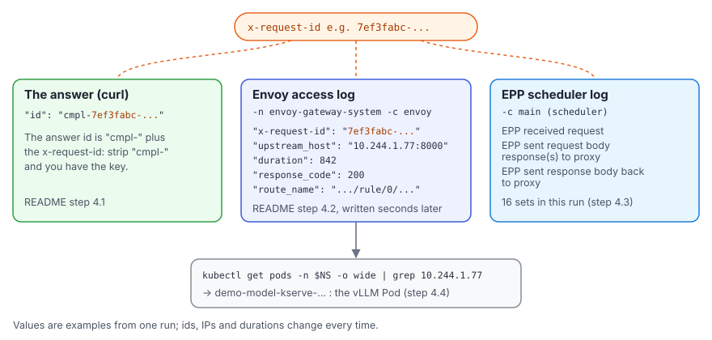

<!-- tut-explainer source=README.md sha=fb1bbc13b4b7 by=codex reviewed=yes -->
# 요청의 흐름 - Gateway에서 vLLM까지

## 그림으로 보는 요청 흐름

`curl`로 요청을 한 번 보내면 Envoy 프록시, EPP 스케줄러, vLLM을 차례로 거칩니다.
튜토리얼에서는 응답, Envoy 접근 로그, EPP 로그에서 같은 요청을 찾습니다.
세 곳을 연결하는 값은 **x-request-id**입니다. 마지막에는 스케줄러가 Pod를 고를 때
사용하는 지표를 살펴봅니다.

## 배울 내용

- Gateway에서 vLLM Pod까지 요청을 전달하는 리소스가 무엇인지, 그리고 KServe가 빈 필드
  세 개만으로 이 리소스를 모두 만들었다는 점을 확인합니다(2~6단계).
- 하나의 `x-request-id`로 응답, Envoy 접근 로그, EPP 로그에서 같은 요청을 찾습니다(9~14단계).
- 어느 Pod가 요청을 처리했는지 확인하고, 복제본이 하나일 때 부하 분산이 어떻게 동작하는지 살펴봅니다(15~17단계).
- EPP가 실제로 어떤 구성으로 동작하는지 살펴보고, 같은 프롬프트를 반복해서 보내기 전후의 지표를 비교합니다(18~22단계).

## 요청 경로 구성

### 빈 필드 세 개로 라우팅 경로 만들기

매니페스트에는 `router: {scheduler: {}, route: {}, gateway: {}}`가 있습니다.
llmisvc 컨트롤러(`llmisvc-controller-manager`)는 이 설정을 바탕으로 EPP 스케줄러,
HTTPRoute, InferencePool을 만들고 HTTPRoute를 공용 Gateway
`kserve/kserve-ingress-gateway`에 연결했습니다(5단계에서는 Gateway가 `Programmed` 상태가 될 때까지 기다립니다).

이 환경에서 Gateway는 두 프로그램으로 동작합니다. 두 프로그램 모두
`envoy-gateway-system`에 있으며, 역할은 다음과 같습니다.

- `envoy-gateway`는 제어 평면입니다. Gateway API 리소스를 Envoy 설정으로 변환합니다.
- **Envoy 프록시** Pod(`envoy-kserve-kserve-ingress-gateway-...`)는 데이터 평면입니다.
  요청이 실제로 이 프로그램을 거칩니다.

이 환경에는 컨트롤러가 하나 더 관여합니다. InferencePool 상태를 보면
`envoy-ai-gateway-system`에서 실행되는 `ai-gateway-controller`가 InferencePool을
수락했습니다. 이 컨트롤러는 환경에 설치된 Envoy AI Gateway의 구성 요소입니다.
HTTPRoute 자체는 Envoy Gateway의 컨트롤러가 수락합니다. 이 실행에서는 Envoy 정책
리소스가 없었고, AI Gateway 컨트롤러가 요청 경로에 어떤 동작을 추가하는지는 확인할 수
없었습니다. 확인된 것은 이 컨트롤러가 InferencePool 상태를 관리한다는 점뿐입니다.

### NodePort 31084로 접속하기

Envoy Service의 유형은 LoadBalancer입니다(예를 들어 `172.18.0.5`의 80번 포트).
튜토리얼의 보조 스크립트 `gateway-url.sh`는 워커 노드 IP와 Service의 NodePort를
사용합니다. 이 실행에서 사용한 주소는 `http://172.18.0.3:31084/<namespace>/demo-model`입니다(6단계).
NodePort 뒤에서는 Service가 80번 포트로 들어온 트래픽을 Envoy Pod의 10080번 포트로
전달합니다. 접근 로그의 `downstream_local_address`에는 Envoy Pod의 IP와 포트가
`10.244.1.10:10080`으로 기록됩니다.

### 규칙 네 개가 각각 경로를 다시 씁니다

4단계에서 확인하는 HTTPRoute에는 규칙이 네 개 있습니다.

| `/<namespace>/demo-model` 아래의 경로 | 변환된 경로 | 백엔드 |
|---|---|---|
| `/v1/completions` | `/v1/completions` | InferencePool |
| `/v1/chat/completions` | `/v1/chat/completions` | InferencePool |
| `/v1/responses` | `/v1/responses` | InferencePool |
| 그 밖의 모든 경로 | `/` + 나머지 경로 | Service `demo-model-kserve-workload-svc`의 8000번 포트 |

vLLM은 자체 경로만 인식하므로 각 규칙은 `URLRewrite`로 `/<namespace>/demo-model`
접두사를 제거합니다. 처음 세 규칙만 EPP를 거칩니다. 마지막 규칙은 vLLM Service로
바로 전달합니다. 튜토리얼에서는 마지막 규칙과 일치하는 요청을 보내지 않아 이 규칙의
용도는 확인할 수 없었습니다. 규칙의 두 시간 제한은 모두 `0s`입니다. Gateway API에서는
시간 제한이 없다는 뜻이므로 응답 생성이 오래 걸려도 Gateway가 중간에 끊지 않습니다.

텍스트 생성 요청은 0번 규칙과 일치했습니다. 접근 로그에는
`route_name: httproute/<namespace>/demo-model-kserve-route/rule/0/...`으로 기록됐습니다.

### ExtProc로 EPP에 Pod 선택 요청하기

InferencePool은 `endpointPickerRef`로 EPP를 지정합니다(Service `demo-model-epp-service`,
9002번 포트, `failureMode: FailOpen`). vLLM Pod는 레이블로 선택하며 포트는 8000번입니다.
0번 규칙과 일치하는 요청이 들어오면 Envoy가 **ExtProc**로 EPP를 호출합니다.
ExtProc는 외부 처리(External Processing)용 gRPC API입니다. Envoy는 요청을 전달하기 전에
이 API로 외부 프로그램에 요청을 넘깁니다. EPP가 Pod 하나를 골라 응답하면 Envoy가
그 Pod로 요청을 보냅니다.

### ID 하나로 세 곳에서 요청 찾기

- **응답.** `id`는 `cmpl-` 뒤에 x-request-id를 붙인 값입니다(9단계에서는
  `cmpl-fb75d8dc-...`). 접두사를 떼면 요청을 찾는 데 쓸 값을 얻습니다.
- **Envoy 접근 로그**(11단계, 요청당 JSON 한 줄)에는 `x-request-id`, `upstream_host`(요청을
  받은 Pod의 주소 `10.244.1.16:8000`), `duration`(토큰 20개 생성에 926ms),
  `response_code` 값 200, `route_name`이 기록됩니다.
- **EPP 로그**(12단계)에는 `EPP received request`, `EPP sent request body
  response(s) to proxy`(`modelName`과 `targetModelName` 포함), `EPP sent
  response body back to proxy`가 기록됩니다. 12단계에서 추적한 요청의 경우 EPP는
  약 1ms 사이에 이 세 줄을 모두 기록하는 일을 세 번 반복했습니다. 매번 오류 수준의
  `Request latency values are invalid for TPOT
  calculation` 로그도 한 줄씩 남겼습니다. 요청 자체는 성공했습니다.

`upstream_host`에서 Pod IP를 확인하고, 13단계에서 `kubectl get pods -o wide`로 해당 IP의
Pod 이름을 찾습니다. 14단계에서는 이 Pod가 스케줄러가 아닌 워크로드 Pod임을 확인합니다.

### Pod가 하나일 때의 부하 분산

15단계에서 동시에 보낸 요청 10개는 모두 `10.244.1.16`으로 갔습니다. `replicas: 1`이므로
EPP가 선택할 수 있는 Pod는 하나뿐입니다. 16단계에서 센 로그 줄 수에는 두 가지 요인이 영향을 줍니다.

- Envoy는 요청이 끝나고 몇 초 뒤에 접근 로그를 남깁니다. 요청을 한꺼번에 보낸 직후
  16단계에서는 해당 Pod의 로그가 3줄만 잡혔습니다. 잠시 뒤 다시 확인하니 방금 보낸
  요청 10개와 앞서 보낸 요청을 합쳐 13줄이었습니다.
- Gateway는 여러 튜토리얼이 공유합니다. 최근 로그 50줄 중 한 줄은 다른 튜토리얼의
  요청이었습니다(`route_name`은 `llmisvc-anatomy`에 해당했고, 로그에 나온 Pod IP는 더 이상 존재하지 않았습니다).

### 스케줄러가 Pod를 고르는 방식

EPP는 시작할 때 실제로 적용된 설정을 로그에 남깁니다. 설정에 지정된 플러그인에 더해
다음 기본 구성도 추가합니다.

- **스케줄링**에는 `default` 프로필 하나(`single-profile-handler`)를 사용합니다.
  이 프로필에는 `queue-scorer`(가중치 2), `prefix-cache-scorer`(가중치 3),
  `max-score-picker`가 있습니다.
- **요청 파싱**에는 `openai-parser`, `anthropic-parser`, `vllmhttp-parser`가 모두
  기본으로 추가됩니다. 여기서 보낸 요청은 OpenAI 형식입니다. EPP 플러그인 지표를 보면
  요청과 응답에 모두 `openai-parser`만 동작했습니다(이번 실행이 아니라
  llmisvc-monitoring 실행에서 확인했습니다).
- **Pod 정보**는 `metrics-data-source`와 `core-metrics-extractor`로 수집합니다.
  EPP가 Pod마다 대기열 크기를 관리한다는 점은 EPP가 제공하는
  `inference_pool_per_pod_queue_size` 지표에서 확인할 수 있습니다(이 실행의 Pod는
  `demo-model-kserve-...-rank-0`입니다).
- **접두사 점수 산정용 데이터**는 `approx-prefix-cache-producer`와 `token-producer`가
  관리합니다. EPP가 둘 다 자동으로 만들며, 로그에는 `auto-created default producer`(자동으로 생성한 기본
  producer)라고 표시됩니다. 두 플러그인은 어느 Pod가 어떤 프롬프트를 받았는지 EPP 자체 인덱스에
  기록합니다. 접두사 점수를 매길 때는 이 인덱스를 읽으며 vLLM의 접두사 캐시는
  참조하지 않습니다(이번 실행이 아니라 2026-11-25 llmisvc-monitoring
  실행의 EPP 로그에서 확인했습니다. README에서 이 로그 줄을 확인합니다).
- **흐름 제어**용 플러그인 `fcfs-ordering-policy`, `global-strict-fairness-policy`,
  `static-usage-limit-policy`, `utilization-detector`의 인스턴스가 만들어집니다.
  로그에는 `Experimental Flow Control layer is disabled, using legacy admission control`
  (실험적 흐름 제어 계층이 꺼져 있어 기존 요청 수락 제어를 쓴다는 뜻)이라는 메시지도 남습니다.

`kv-cache-utilization-scorer`는 없습니다. KV 캐시 지표는 제공되지만 이 구성에서
점수를 매길 때 사용하지 않습니다.

### 지표 읽기

9090번 포트에서 지표를 읽으려면 `/metrics` URL에 `get` 권한이 있는 주체의 베어러
토큰이 필요합니다. 18단계에서는 이 권한만 가진 ServiceAccount를 만듭니다.
19단계에서는 이 ServiceAccount로 잠깐 실행하는 curl Pod에서 해당 엔드포인트를 조회합니다.

조회한 값은 다음과 같습니다.

| | 7~17단계 이후 | 긴 프롬프트 하나를 5번 보낸 뒤 |
|---|---|---|
| `inference_pool_ready_pods` | 1 | 1 |
| `inference_pool_average_queue_size` | 0 | 0 |
| `inference_pool_average_kv_cache_utilization` | 0 | 0.0016 |
| `inference_pool_average_running_requests` | 0 | 1 |
| `prefix_indexer_hit_bytes` 평가 횟수 / 합계 | 39 / 7168 | 54 / 10752 |
| `prefix_indexer_hit_ratio` 평가 횟수 / 합계 | 39 / 28 | 54 / 42 |
| `prefix_indexer_size` | 11 | 12 |

각 값은 이렇게 해석합니다.

- 요청 하나당 평가 횟수가 3씩 늘었습니다. 19단계 전에 요청을 13개 보내 평가 횟수는
  39회였습니다. 이후 요청 5개를 더 보내자 15회가 늘었습니다. 이 실행에서 접두사 인덱서는
  요청당 평가를 3회 집계했습니다. 12단계에서 요청당 같은 로그 묶음이 세 번 나온 것과
  횟수가 같습니다.
- 새로 집계된 평가 15회 중 1회는 인덱스에서 일치하는 항목을 찾지 못했고(`le="0"` 버킷이
  11회에서 12회로 증가), 14회는 완전히 일치했습니다(적중률 합계가 14 증가). 새 프롬프트를
  맨 처음 평가했을 때만 인덱스에서 일치하는 항목을 찾지 못했습니다.
- 인덱서에는 항목이 하나 추가됐고, 일치한 접두사 데이터는 3584바이트 늘었습니다.
- 요청 5개의 응답을 모두 받은 직후에도 InferencePool의 평균 지표가 모두 0으로 돌아오지는
  않았습니다. 처리 중인 요청이 1개로 표시됐고 KV 캐시 사용률도 조금 남아 있었습니다.

## 단계별로 살펴보기

| README 단계 | 클러스터에서 일어나는 일 | 확인할 내용 |
|---|---|---|
| 1~3단계 환경 준비, 배포, 대기 | 기존 환경을 재사용합니다. 적용 전에는 네임스페이스가 비어 있고 배포 후 몇 분이 지나면 Ready 상태가 됩니다. | 적용 전 `kubectl get all -n $NS` |
| 4~5단계 라우팅 | 규칙 네 개가 있는 HTTPRoute와 InferencePool을 확인합니다. Gateway는 `Programmed` 상태가 됩니다. | `backendRefs`의 리소스 종류는 InferencePool 3개, Service 1개입니다. |
| 6단계 Gateway URL | 노드 IP와 Envoy Service의 NodePort를 사용합니다. | `http://<node IP>:31084/<ns>/demo-model` |
| 7~8단계 첫 요청 | 텍스트 생성 요청이 Gateway, HTTPRoute, EPP를 거쳐 vLLM에 도착합니다. | `finish_reason: length` |
| 9~10단계 요청 ID | 응답의 `id`에서 `cmpl-`을 뗍니다. | `Request ID: ...` |
| 11단계 Envoy 로그 | 해당 요청 ID의 JSON 로그가 한 줄 나옵니다. | `upstream_host`, `duration`, `route_name` |
| 12단계 EPP 로그 | 요청 수신, 요청 본문 처리 결과 전송, 응답 본문 전송 로그가 세 묶음 나옵니다. | `modelName`, `targetModelName` |
| 13~14단계 Pod 확인 | `upstream_host`의 IP로 Pod 이름을 찾습니다. | 찾은 Pod가 스케줄러가 아닌 워크로드 Pod인지 확인합니다. |
| 15~17단계 요청 10개 동시 전송 | 모든 요청이 Pod 하나로 갑니다. | 잠시 뒤 검증 단계에서 다시 센 값을 봅니다. |
| 18~20단계 지표 조회 | ServiceAccount와 ClusterRole을 만들고 curl Pod에서 해당 ServiceAccount의 토큰을 사용합니다. | `inference_pool_ready_pods 1` |
| 21~22단계 프롬프트 반복 | 일치한 접두사의 바이트 수가 늘어납니다. | `before 7168 now 10752` |
| 정리 | LLMInferenceService, ClusterRole 및 ClusterRoleBinding, 네임스페이스를 삭제합니다. | |

## README에 없던 관찰 결과

- 이 실행에서 Envoy는 전달한 요청마다 로그를 한 줄씩 남겼습니다. EPP는 추적한 요청에
  대해 로그를 세 묶음 남겼고, 접두사 인덱서의 카운터는 전체 요청 18개에서 각각 3씩
  늘었습니다. README는 ExtProc가 헤더, 본문, 트레일러를 별도 메시지로 처리하므로
  로그가 여러 줄 나온다고 설명했습니다. 실제 실행에서는 한 묶음 전체가 반복됐습니다.
  원인은 HTTPRoute에 InferencePool을 가리키는 규칙이 세 개 있기 때문입니다.
  튜토리얼을 실행한 뒤 2026-11-24에 확인한 Envoy 설정을 보면 Gateway의 리스너에
  해당 규칙마다 ExtProc 필터가 하나씩 있으며, 이 경로에서는 세 필터가 모두 동작합니다.
  README에는 이제 이 설명이 들어 있고 로그 묶음 수와 규칙 수가 같은지 확인합니다.
- README의 지표 표에는 KV 캐시 지표에 대응하는 플러그인으로 `kv-cache-utilization-scorer`가
  나옵니다. 이 실행에서 EPP에 실제로 적용된 설정에는 이 플러그인이 없습니다.
- 이 환경에서 InferencePool을 수락하는 컨트롤러는 Envoy AI Gateway의
  `ai-gateway-controller`입니다. README는 Envoy Gateway만 언급합니다.
- 추적한 비스트리밍 텍스트 생성 요청은 성공했지만 EPP는 로그 묶음마다
  `Request latency values are invalid for TPOT calculation`을 오류 수준으로 기록했습니다.
- README 5단계(단계별 실행의 16단계)에서 처음 센 값은 접근 로그가 늦게 기록돼 실제보다
  적을 수 있습니다. Gateway가 공용이라 다른 튜토리얼의 요청이 섞일 수도 있습니다.
  믿을 수 있는 값은 그 뒤 검증 단계에서 다시 센 값입니다.

## 이해도 확인

1. <code>GET /&lt;namespace&gt;/demo-model/v1/models</code>를 보냅니다. 이 요청의 x-request-id를 EPP 로그에서 찾을 수 있습니까?

찾을 수 없습니다. 이 경로는 HTTPRoute의 마지막 규칙에만 해당합니다. 이 규칙의 백엔드는
InferencePool이 아닌 워크로드 Service입니다. Envoy는 EPP에 묻지 않고 요청을 전달합니다.
요청은 Envoy 접근 로그에 남습니다.

2. 어느 Pod가 요청을 처리했는지 어떤 로그에서 확인할 수 있습니까?

Envoy 접근 로그에서 확인할 수 있습니다. `upstream_host`는 요청을 전달한 대상의 IP와
포트입니다. `kubectl get pods -o wide`로 해당 IP의 Pod 이름을 찾습니다.

3. 방금 요청을 10개 보냈는데 16단계에서는 해당 Pod에 요청이 3개만 기록됩니다. 부하 분산에 문제가 있습니까?

문제가 없습니다. Envoy는 요청이 끝나고 몇 초 뒤에 접근 로그를 기록합니다. 처음에는
너무 일찍 셌기 때문에 3개만 나왔습니다. 잠시 뒤 검증 단계에서는 10개를 모두 확인할 수 있습니다.

4. 같은 프롬프트를 5번 보냅니다. 인덱서의 크기는 거의 그대로인데 일치한 접두사의 바이트 수는 왜 늘어납니까?

첫 평가가 끝나면 프롬프트가 이미 인덱서에 들어 있습니다. 이후 평가에서는 같은
프롬프트를 인덱스에서 찾아 적중으로 집계하므로 새로 추가되는 내용은 거의 없습니다.

5. 이 구성에서 KV 캐시가 가득 찼을 때 이를 점수에 반영하는 플러그인은 무엇입니까?

그런 플러그인은 없습니다. `default` 프로필에서 점수를 매기는 플러그인은
`queue-scorer`와 `prefix-cache-scorer`뿐입니다. KV 캐시 지표는 제공되지만
점수 산정에는 쓰이지 않습니다.

Based on a run of llmisvc-request-flow with KServe v0.18.0 on 2026-11-21.
