<!-- tut-explainer source=README.md sha=0 by=claude reviewed=no -->
# 요청의 여정 - Gateway에서 vLLM까지: 동작 원리

## 한 장으로 보기

여러분은 `curl`을 한 번 보냅니다. 이 요청은 Envoy 프록시, EPP 스케줄러, vLLM을 지납니다.
이 튜토리얼은 그 요청 하나를 세 곳에서 찾습니다. 응답, Envoy access log, EPP 로그입니다. 셋을
잇는 실마리는 값 하나, **x-request-id**입니다.
마지막에는 스케줄러가 Pod를 고를 때 쓰는 숫자를 봅니다.

## 배울 내용

- Gateway에서 vLLM Pod까지 요청을 나르는 객체들, 그리고 KServe가 빈 필드 세 개만 보고 이
  모두를 만들었다는 것 (step 2-6)
- `x-request-id` 하나로 응답, Envoy access log, EPP 로그에서 같은 요청을 찾는 법 (step 9-14)
- 어느 Pod가 요청을 처리했는지 알아내는 법, replica가 하나일 때 "부하 분산"이 어떻게 보이는지
  (step 15-17)
- EPP가 실제로 무엇을 실행하는지, 그리고 같은 프롬프트를 반복하기 전후에 메트릭이 무엇을
  말하는지 (step 18-22)

## 구성 요소

### 빈 필드 세 개, 경로 전체

매니페스트에는 `router: {scheduler: {}, route: {}, gateway: {}}`가 있습니다. KServe 컨트롤러는
이것을 보고 EPP 스케줄러, HTTPRoute, InferencePool을 만들고, 라우트를 공용 Gateway
`kserve/kserve-ingress-gateway`에 붙였습니다(step 5가 `Programmed`가 될 때까지 기다립니다).

Gateway 자체는 Pod 하나가 아니라 환경이 설치한 프로그램 두 개이며, 둘 다
`envoy-gateway-system`에 있습니다.

- `envoy-gateway`: 컨트롤 플레인. Gateway API 객체를 Envoy 설정으로 바꿉니다.
- **Envoy 프록시** Pod(`envoy-kserve-kserve-ingress-gateway-...`): 데이터 플레인. 요청이
  실제로 지나가는 프로그램입니다.

이 환경에서는 컨트롤러가 하나 더 관여합니다. InferencePool의 status를 보면
`envoy-ai-gateway-system`에서 도는 `ai-gateway-controller`(환경이 설치한 Envoy AI Gateway)가
이것을 받아들였습니다. HTTPRoute 자체는 Envoy Gateway의 컨트롤러가 받아들입니다. AI Gateway 컨트롤러가 요청
경로에 정확히 무엇을 더하는지는 이번 실행에서 보이지 않았습니다(Envoy policy 객체가 없음).
확인된 것은 InferencePool의 status를 그것이 관리한다는 점뿐입니다.

### 들어오는 길: NodePort 31084

Envoy Service는 LoadBalancer 타입입니다(예: `172.18.0.5`, 포트 80). 하지만 튜토리얼의 헬퍼
`gateway-url.sh`는 대신 worker 노드 IP와 Service의 NodePort를 씁니다. 이번 실행에서는
`http://172.18.0.3:31084/<namespace>/demo-model`였습니다(step 6). NodePort 뒤에서 Service는
포트 80을 Envoy Pod의 10080으로 보냅니다. access log의 `downstream_local_address`가 정확히
그 값입니다(`10.244.1.10:10080`, Envoy Pod의 IP).

### 라우트: 규칙 네 개, 각각 rewrite

HTTPRoute(step 4)에는 규칙이 네 개 있습니다.

| `/<namespace>/demo-model` 아래 경로 | 바뀌는 경로 | 백엔드 |
|---|---|---|
| `/v1/completions` | `/v1/completions` | InferencePool |
| `/v1/chat/completions` | `/v1/chat/completions` | InferencePool |
| `/v1/responses` | `/v1/responses` | InferencePool |
| 그 밖의 경로 | `/` + 나머지 | Service `demo-model-kserve-workload-svc`, 포트 8000 |

모든 규칙이 `/<namespace>/demo-model` 접두사를 떼어 냅니다(`URLRewrite`). vLLM은 자기 경로만
알기 때문입니다. EPP를 거치는 것은 앞의 세 규칙뿐이고, 마지막 규칙은 vLLM Service로 바로
갑니다. 튜토리얼의 어떤 요청도 그 규칙을 쓰지 않았으므로, 그것이 무엇을 위한 규칙인지는 이번
실행으로는 알 수 없습니다. 규칙들은 두 timeout을 모두 `0s`로 두는데, Gateway API에서 이는 timeout이 없다는
뜻입니다. 생성이 오래 걸려도 Gateway가 끊지 않습니다.

여러분의 completion은 rule 0에 걸렸습니다. access log에
`route_name: httproute/<namespace>/demo-model-kserve-route/rule/0/...`이 남습니다.

### 고르는 쪽: EPP로 가는 ExtProc

InferencePool은 EPP를 가리키고(`endpointPickerRef`: Service `demo-model-epp-service`, 포트
9002, `failureMode: FailOpen`), 라벨로 vLLM Pod를 고릅니다(포트 8000). rule 0에 걸린 요청에
대해 Envoy는 **ExtProc**(External Processing: Envoy가 요청을 전달하기 전에 바깥 프로그램에
넘기는 gRPC API)으로 EPP를 부릅니다. EPP가 Pod 하나로 답하면 Envoy는 요청을 그리로
보냅니다.

### id 하나, 로그 세 곳

- **응답.** `id`는 `cmpl-` 뒤에 x-request-id가 붙은 값입니다(step 9의 `cmpl-fb75d8dc-...`).
  접두사를 떼면 열쇠가 됩니다.
- **Envoy access log**(요청마다 JSON 한 줄, step 11): `x-request-id`, `upstream_host`(요청이 간
  Pod, `10.244.1.16:8000`), `duration`(20토큰에 926 ms), `response_code` 200, `route_name`.
- **EPP 로그**(step 12): `EPP received request`, `EPP sent request body response(s) to proxy`
  (`modelName`, `targetModelName` 포함), `EPP sent response body back to proxy`. step 12에서 추적한
  요청에 대해 EPP는 이 줄들을 약 1밀리초 안에 완전한 세트로 세 번 썼고, 세트마다 error 레벨 줄
  `Request latency values are invalid for TPOT calculation`이 하나씩 붙었습니다. 요청 자체는
  성공했습니다.

`upstream_host`가 Pod IP를 주고, `kubectl get pods -o wide`가 그것을 Pod 이름으로 바꿉니다
(step 13). step 14는 그 Pod가 스케줄러가 아니라 workload Pod인지 확인합니다.

### Pod 하나로 하는 부하 분산

동시에 보낸 요청 열 개(step 15)는 모두 `10.244.1.16`으로 갔습니다. `replicas: 1`이면 EPP의
후보는 하나뿐입니다. step 16의 집계를 흐리게 만드는 것이 두 가지 있습니다.

- Envoy는 요청이 끝나고 몇 초 뒤에 access log를 씁니다. 몰아 보낸 직후 step 16은 그 Pod에 대해
  3줄만 셌고, 잠시 뒤의 verify는 13줄(열 개 + 앞선 요청)을 찾았습니다.
- Gateway는 공용입니다. 마지막 50줄 중 하나는 다른 튜토리얼의 요청이었습니다(`llmisvc-anatomy`의
  `route_name`, 지금은 없는 Pod IP).

### 스케줄러가 고르는 법

EPP는 시작할 때 실제로 적용된 설정(effective configuration)을 로그에 남깁니다. 설정된
플러그인 외에 시스템 기본값이 붙습니다.

- **스케줄링**: 프로파일 하나, `default`(`single-profile-handler`). `queue-scorer`(가중치 2),
  `prefix-cache-scorer`(가중치 3), `max-score-picker`.
- **요청 파싱**: `openai-parser`, `anthropic-parser`, `vllmhttp-parser`.
- **Pod에 대한 데이터**: `metrics-data-source`와 `core-metrics-extractor`. 내보내는 메트릭
  `inference_pool_per_pod_queue_size`를 보면 EPP는 Pod별 큐 크기를 갖고 있습니다(여기서는
  `demo-model-kserve-...-rank-0`).
- **flow control**: 플러그인 `fcfs-ordering-policy`, `global-strict-fairness-policy`,
  `static-usage-limit-policy`, `utilization-detector`가 생성되지만, 로그에는 "Experimental Flow
  Control layer is disabled, using legacy admission control"도 찍힙니다.

`kv-cache-utilization-scorer`는 없습니다. KV-cache 메트릭은 내보내지만, 이 설정에서 그것으로
점수를 매기는 플러그인은 없습니다.

### 메트릭 읽기

메트릭 포트 9090은 소유자가 URL `/metrics`를 `get`할 수 있는 bearer token을 요구합니다. 그래서
step 18은 그 권한만 가진 ServiceAccount를 만들고, step 19는 그 계정으로 도는 짧은 curl Pod에서
엔드포인트를 읽습니다.

숫자가 보여 준 것:

| | step 7-17 이후 | 긴 프롬프트 하나를 5번 반복한 뒤 |
|---|---|---|
| `inference_pool_ready_pods` | 1 | 1 |
| `inference_pool_average_queue_size` | 0 | 0 |
| `inference_pool_average_kv_cache_utilization` | 0 | 0.0016 |
| `inference_pool_average_running_requests` | 0 | 1 |
| `prefix_indexer_hit_bytes` count / sum | 39 / 7168 | 54 / 10752 |
| `prefix_indexer_hit_ratio` count / sum | 39 / 28 | 54 / 42 |
| `prefix_indexer_size` | 11 | 12 |

이렇게 읽으면 됩니다.

- count는 요청 하나에 3씩 움직입니다. step 19 전까지 요청 13개를 보냈고 count는 39였습니다.
  요청 5개를 더 보내자 15가 늘었습니다. 이번 실행에서 prefix indexer는 요청마다 평가를 세 번
  셌고, step 12의 로그 세 세트와 같은 모습입니다.
- 새로 생긴 15번의 평가 중 한 번은 miss였고(`le="0"` bucket이 11에서 12로), 14번은 완전한
  hit였습니다(ratio sum이 14 증가). 새 프롬프트를 처음 볼 때만 indexer에서 아무것도 찾지
  못했습니다.
- indexer는 항목이 하나 늘었고, 매칭된 바이트는 3584 늘었습니다.
- 반복 직후 pool 평균값이 모두 0은 아니었습니다(running request 1, 작은 KV-cache 사용률).
  다섯 요청은 이미 응답을 받은 뒤였는데도 그렇습니다.

## 단계별로 보기

| README step | 클러스터에서 일어나는 일 | 볼 것 |
|---|---|---|
| 1-3 setup, 배포, 대기 | 환경 재사용, apply 전 네임스페이스는 비어 있음, 몇 분 뒤 Ready | apply 전 `kubectl get all -n $NS` |
| 4-5 라우팅 | 규칙 네 개짜리 HTTPRoute, InferencePool, Gateway `Programmed` | `backendRefs` kind: InferencePool x3, Service x1 |
| 6 gateway URL | 노드 IP + Envoy Service의 NodePort | `http://<node IP>:31084/<ns>/demo-model` |
| 7-8 첫 요청 | Gateway, 라우트, EPP, vLLM을 거친 completion | `finish_reason: length` |
| 9-10 request id | 응답 `id`에서 `cmpl-`을 뗀 값 | `Request ID: ...` |
| 11 Envoy 로그 | 그 id의 JSON 한 줄 | `upstream_host`, `duration`, `route_name` |
| 12 EPP 로그 | received / sent body / sent response 세 세트 | `modelName`, `targetModelName` |
| 13-14 Pod | `upstream_host`의 IP -> Pod 이름 | 스케줄러가 아닌 workload Pod |
| 15-17 열 개 동시 | 모두 한 Pod로 | 첫 집계가 아니라 verify |
| 18-20 메트릭 | ServiceAccount + ClusterRole, 토큰을 쓰는 curl Pod | `inference_pool_ready_pods 1` |
| 21-22 프롬프트 반복 | hit bytes 증가 | `before 7168 now 10752` |
| cleanup | LLMInferenceService, ClusterRole(Binding), 네임스페이스 삭제 | |

## README에 없는 관찰

- 이번 실행에서 EPP는 추적한 요청에 대해 로그를 완전한 세트로 세 번 썼고, 요청 18개 모두에서
  prefix indexer 카운터가 요청마다 3씩 늘었습니다. Envoy는 요청마다 전달 한 줄만 남겼습니다.
  README는 여러 줄이 찍히는 이유를 ExtProc이 header, body, trailer를 따로 보내기 때문이라고
  설명하지만, 실행에서는 완전한 세트가 반복되었습니다. 라우트에 InferencePool을 가리키는 규칙이
  세 개 있다는 점과 관련 있을 수 있지만, 이번 실행에서 Envoy 설정은 보지 않았으므로 원인은 열려
  있고, 이 환경의 Envoy Gateway / AI Gateway 버전에 따라 다를 수도 있습니다.
- README의 메트릭 표는 KV-cache 메트릭에 `kv-cache-utilization-scorer`를 짝지어 두었습니다.
  이번 실행의 EPP effective configuration에는 그 scorer가 없습니다.
- 이 환경에서 InferencePool은 Envoy AI Gateway의 `ai-gateway-controller`가 받아들입니다.
  README는 Envoy Gateway만 언급합니다.
- 추적한 (non-streaming) completion에 대해 EPP는 세트마다 error 레벨 줄
  `Request latency values are invalid for TPOT calculation`을 남겼지만, 요청은 성공했습니다.
- README Step 5(walk step 16)의 첫 집계는 모자랄 수 있고(access log가 늦게 써짐), 다른
  튜토리얼의 요청이 섞일 수 있습니다(Gateway가 공용). 믿을 만한 숫자는 그 뒤의 verify입니다.

## 스스로 확인하기

1. <code>GET /&lt;namespace&gt;/demo-model/v1/models</code>를 보내면 EPP 로그에서 그 x-request-id를 찾을 수 있을까요?

아니요. 그 경로는 HTTPRoute의 마지막 규칙에만 걸리고, 그 백엔드는 InferencePool이 아니라
workload Service입니다. Envoy는 EPP에 묻지 않고 전달합니다. Envoy access log에는 남습니다.

2. 어느 Pod가 요청을 처리했는지 알려 주는 로그는?

Envoy access log입니다. `upstream_host`가 요청을 전달한 IP와 포트입니다.
`kubectl get pods -o wide`로 IP를 Pod 이름으로 바꿉니다.

3. 방금 10개를 보냈는데 step 16은 그 Pod에 3개만 보여 줍니다. 부하 분산이 고장 났을까요?

아니요. Envoy는 요청이 끝나고 몇 초 뒤에 access log를 씁니다. 집계가 너무 일렀습니다. 잠시
뒤의 verify는 모두 봅니다.

4. 같은 프롬프트를 다섯 번 반복하면 왜 매칭된 prefix 바이트는 늘고 indexer 크기는 거의 그대로일까요?

첫 평가 뒤에는 그 프롬프트가 이미 indexer에 있으므로, 이후 평가는 새로 추가할 것이 거의 없이
매칭(hit)만 됩니다.

5. 이 설정에서 KV cache가 가득 차면 반응하는 scorer는?

없습니다. `default` 프로파일에는 `queue-scorer`와 `prefix-cache-scorer`만 있습니다. KV-cache
메트릭은 내보내지만 점수에는 쓰이지 않습니다.

KServe v0.18.0으로 2026-11-21에 llmisvc-request-flow를 실행한 결과를 바탕으로 작성했습니다.
