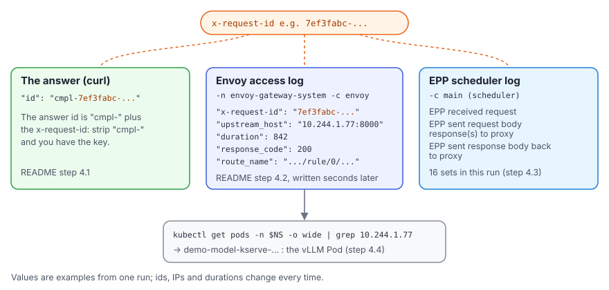

<!-- tut-explainer source=README.md sha=fb1bbc13b4b7 by=claude reviewed=yes -->
# Journey of a Request - From Gateway to vLLM: how it works

## In one picture

You send one `curl`. On its way it passes the Envoy proxy, the EPP scheduler
and vLLM. The tutorial finds that one request in three places: the answer, the
Envoy access log and the EPP log. The thread that ties them together is a
single value: the **x-request-id**. At the end you look at the
numbers the scheduler uses to choose a Pod.

## What you will learn

- Which objects carry a request from the Gateway to a vLLM Pod, and that
  KServe made all of them from three empty fields (steps 2-6).
- How one `x-request-id` lets you find the same request in the answer, the
  Envoy access log and the EPP log (steps 9-14).
- How to tell which Pod served a request, and what "load balancing" looks like
  with one replica (steps 15-17).
- What the EPP actually runs, and what its metrics say before and after you
  repeat a prompt (steps 18-22).

## The pieces

### Three empty fields, a whole route

The manifest has `router: {scheduler: {}, route: {}, gateway: {}}`. From these
the llmisvc controller (`llmisvc-controller-manager`) made the EPP scheduler, the HTTPRoute and the
InferencePool, and hung the route on the shared Gateway
`kserve/kserve-ingress-gateway` (step 5 waits until it is `Programmed`).

The Gateway itself is not one Pod but two programs from the environment, both in
`envoy-gateway-system`:

- `envoy-gateway`: the control plane. It turns Gateway API objects into Envoy
  configuration.
- the **Envoy proxy** Pod (`envoy-kserve-kserve-ingress-gateway-...`): the data
  plane, the program your request actually passes through.

One more controller is involved in this environment: the InferencePool's
status says it was accepted by `ai-gateway-controller`, which runs in
`envoy-ai-gateway-system` (Envoy AI Gateway, installed by the environment). The
HTTPRoute itself is accepted by Envoy Gateway's controller. What exactly the AI
Gateway controller adds to the request path was not visible in this run (no
Envoy policy objects exist); the run only shows that it owns the
InferencePool's status.

### Getting in: NodePort 31084

The Envoy Service is of type LoadBalancer (e.g. `172.18.0.5`, port 80), but the
tutorial's helper `gateway-url.sh` uses the worker node IP and the Service's
NodePort instead: `http://172.18.0.3:31084/<namespace>/demo-model` in this run
(step 6). Behind the NodePort, the Service sends port 80 to port 10080 of the
Envoy Pod; the access log shows exactly that as `downstream_local_address`
(`10.244.1.10:10080`, the Envoy Pod's IP).

### The route: four rules, one rewrite each

The HTTPRoute (step 4) has four rules:

| Path under `/<namespace>/demo-model` | Rewritten to | Backend |
|---|---|---|
| `/v1/completions` | `/v1/completions` | InferencePool |
| `/v1/chat/completions` | `/v1/chat/completions` | InferencePool |
| `/v1/responses` | `/v1/responses` | InferencePool |
| anything else | `/` + the rest | Service `demo-model-kserve-workload-svc`, port 8000 |

Each rule strips the `/<namespace>/demo-model` prefix (`URLRewrite`), because
vLLM only knows its own paths. Only the first three rules go through the EPP;
the last one goes straight to the vLLM Service. No request of the tutorial
used that rule, so this run does not show what it is meant for. The rules also set both
timeouts to `0s`, which in Gateway API means no timeout: a slow generation is
not cut off by the Gateway.

Your completion matched rule 0: the access log says
`route_name: httproute/<namespace>/demo-model-kserve-route/rule/0/...`.

### The picker: ExtProc to the EPP

The InferencePool names the EPP (`endpointPickerRef`: Service
`demo-model-epp-service`, port 9002, `failureMode: FailOpen`) and selects the
vLLM Pods by label (port 8000). For a request on rule 0, Envoy calls the EPP
over **ExtProc** (External Processing, a gRPC API where Envoy hands a request
to an outside program before forwarding it). The EPP answers with one Pod, and
Envoy sends the request there.

### One id, three logs

- **The answer.** Its `id` is `cmpl-` followed by the x-request-id
  (`cmpl-fb75d8dc-...` in step 9). Strip the prefix and you have the key.
- **Envoy access log** (one JSON line per request, step 11): `x-request-id`,
  `upstream_host` (the Pod the request went to, `10.244.1.16:8000`),
  `duration` (926 ms for 20 tokens), `response_code` 200, `route_name`.
- **EPP log** (step 12): `EPP received request`, `EPP sent request body
  response(s) to proxy` (with `modelName` and `targetModelName`), `EPP sent
  response body back to proxy`. For the request traced in step 12 the EPP wrote
  three complete sets of these lines within about a millisecond, and with each
  set an error-level line `Request latency values are invalid for TPOT
  calculation`. The request itself succeeded.

`upstream_host` gives the Pod IP; `kubectl get pods -o wide` turns it into the
Pod name (step 13), and step 14 checks that it is the workload Pod, not the
scheduler.

### Load balancing with one Pod

Ten requests at once (step 15) all went to `10.244.1.16`: with `replicas: 1`
the EPP has one candidate. Two things make the count in step 16 noisy:

- Envoy writes access-log lines a few seconds after a request ends. Right
  after the burst, step 16 counted only 3 lines for the Pod; the verify a
  moment later found 13 (the ten plus earlier requests).
- The Gateway is shared. Among the last 50 lines was one request of another
  tutorial (`route_name` of `llmisvc-anatomy`, a Pod IP that no longer exists).

### How the scheduler chooses

The EPP logs its effective configuration at start. Besides the configured
plugins it adds system defaults:

- **scheduling**: one profile, `default` (`single-profile-handler`), with
  `queue-scorer` (weight 2), `prefix-cache-scorer` (weight 3) and
  `max-score-picker`.
- **request parsing**: `openai-parser`, `anthropic-parser`, `vllmhttp-parser`,
  all three added by default. The requests here are OpenAI-style, and the EPP's
  plugin metrics show only `openai-parser` at work, for requests and for
  answers (seen in the llmisvc-monitoring runs, not in this walk).
- **data about Pods**: `metrics-data-source` with `core-metrics-extractor`.
  The exported metric `inference_pool_per_pod_queue_size` shows that the EPP
  keeps a queue size per Pod (here `demo-model-kserve-...-rank-0`).
- **data for the prefix scorer**: `approx-prefix-cache-producer` and
  `token-producer`, which the EPP creates on its own ("auto-created default
  producer" in its log). They keep the EPP's own index of which Pod got which
  prompt; the prefix scorer reads that index, not vLLM's prefix cache. (Seen in
  the EPP log of the llmisvc-monitoring walk on 2026-11-25, not in this walk;
  the README checks the log line.)
- **flow control**: the plugins `fcfs-ordering-policy`,
  `global-strict-fairness-policy`, `static-usage-limit-policy` and
  `utilization-detector` are instantiated, but the log also says "Experimental
  Flow Control layer is disabled, using legacy admission control".

There is no `kv-cache-utilization-scorer`. The KV-cache metric is exported, but
nothing scores with it in this configuration.

### Reading the metrics

The metrics port 9090 needs a bearer token whose owner may `get` the URL
`/metrics`, so step 18 creates a ServiceAccount with only that permission, and
step 19 reads the endpoint from a short-lived curl Pod that runs as it.

What the numbers showed:

| | after steps 7-17 | after 5 repeats of one long prompt |
|---|---|---|
| `inference_pool_ready_pods` | 1 | 1 |
| `inference_pool_average_queue_size` | 0 | 0 |
| `inference_pool_average_kv_cache_utilization` | 0 | 0.0016 |
| `inference_pool_average_running_requests` | 0 | 1 |
| `prefix_indexer_hit_bytes` count / sum | 39 / 7168 | 54 / 10752 |
| `prefix_indexer_hit_ratio` count / sum | 39 / 28 | 54 / 42 |
| `prefix_indexer_size` | 11 | 12 |

Read them like this:

- The counts move by 3 per request: 13 requests had been sent before step 19,
  and the count was 39; five more requests added 15. In this run the prefix
  indexer counted three evaluations per request, like the three sets of log
  lines in step 12.
- Of the 15 new evaluations, one was a miss (the `le="0"` bucket went from 11
  to 12) and 14 were full hits (the ratio sum grew by 14): only the very first
  look at the new prompt found nothing in the indexer.
- The indexer grew by one entry, while the matched bytes grew by 3584.
- Right after the repeats the pool averages were not all zero (one running
  request, a small KV-cache utilization), even though the five requests had
  returned.

## Step by step

| README step | What happens in the cluster | What to look at |
|---|---|---|
| 1-3 setup, deploy, wait | the environment is reused; the namespace is empty before the apply; Ready after a few minutes | `kubectl get all -n $NS` before the apply |
| 4-5 routing | HTTPRoute with four rules, InferencePool, Gateway `Programmed` | `backendRefs` kinds: InferencePool x3, Service x1 |
| 6 gateway URL | node IP + NodePort of the Envoy Service | `http://<node IP>:31084/<ns>/demo-model` |
| 7-8 first requests | completions through Gateway, route, EPP, vLLM | `finish_reason: length` |
| 9-10 request id | `id` of the answer minus `cmpl-` | `Request ID: ...` |
| 11 Envoy log | one JSON line for the id | `upstream_host`, `duration`, `route_name` |
| 12 EPP log | three sets of received / sent body / sent response | `modelName`, `targetModelName` |
| 13-14 the Pod | IP from `upstream_host` -> Pod name | the workload Pod, not the scheduler |
| 15-17 ten at once | all to one Pod | the verify, not the first count |
| 18-20 metrics | ServiceAccount + ClusterRole, curl Pod with its token | `inference_pool_ready_pods 1` |
| 21-22 repeat a prompt | hit bytes grow | `before 7168 now 10752` |
| cleanup | LLMInferenceService, ClusterRole(Binding), namespace deleted | |

## What we saw that the README does not say

- In this run the EPP wrote three complete sets of log lines for the traced
  request, and its prefix-indexer counters grew by 3 per request for all 18
  requests, while Envoy logged one forwarded request each. The README explains
  several lines with ExtProc's separate header, body and trailer messages; the
  run shows complete repeated sets instead. The route has three rules that
  point at the InferencePool, and that is the cause: Envoy's configuration (read
  on 2026-11-24, after this walk) has one ExtProc filter per such rule on the
  Gateway's listener, all three active for these paths. The README now says so
  and checks that the number of sets equals the number of rules.
- The README's metric table lists `kv-cache-utilization-scorer` for the
  KV-cache metric. That scorer is not in the EPP's effective configuration in
  this run.
- In this environment the InferencePool is accepted by Envoy AI Gateway's
  `ai-gateway-controller`; the README mentions only Envoy Gateway.
- For the traced (non-streaming) completion the EPP logged an error-level line
  `Request latency values are invalid for TPOT calculation` with each set,
  although the request succeeded.
- The first count of README Step 5 (walk step 16) can be short (the access log lags) and can include
  other tutorials' requests (the Gateway is shared); the verify after it is
  the reliable number.

## Check yourself

1. You send <code>GET /&lt;namespace&gt;/demo-model/v1/models</code>. Do you find its x-request-id in the EPP log?

No. That path matches only the last HTTPRoute rule, whose backend is the
workload Service, not the InferencePool. Envoy forwards it without asking the
EPP. It still appears in the Envoy access log.

2. Which log tells you which Pod served a request?

The Envoy access log: `upstream_host` is the IP and port the request was
forwarded to. `kubectl get pods -o wide` turns the IP into a Pod name.

3. Step 16 shows 3 requests for the Pod although you just sent 10. Is load balancing broken?

No. Envoy writes the access log a few seconds after a request ends; the count
ran too early. The verify a moment later sees all of them.

4. You repeat one prompt five times. Why do the matched prefix bytes grow while the indexer size barely moves?

The prompt is already in the indexer after its first evaluation, so later
evaluations match it (hits) without adding much that is new.

5. Which scorer would react to a full KV cache in this configuration?

None. Only `queue-scorer` and `prefix-cache-scorer` are in the `default`
profile; the KV-cache metric is exported but not used for scoring.

Based on a run of llmisvc-request-flow with KServe v0.18.0 on 2026-11-21.
